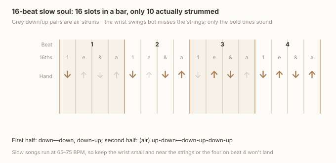
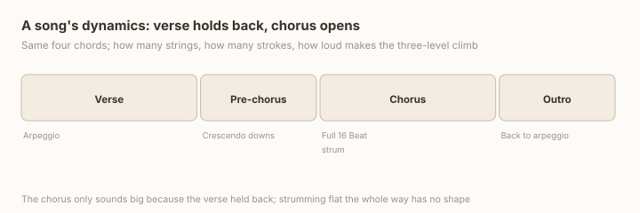
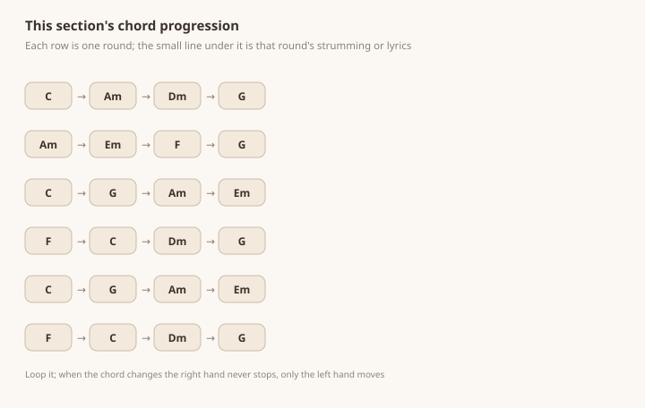

# Chapter 10: The Slow Soul Groove and Layering the Emotion

Having finished Part Two, you now have folk rock, the three-beat waltz and the chunk, which is enough for most light folk songs. But when you want to play and sing a modern Mandarin ballad — Hebe Tien's 〈小幸運〉 ("A Little Happiness"), Eric Chou's 〈以後別做朋友〉 ("Let's Not Be Friends Anymore"), or a big emotional single from A-Lin or G.E.M. — you find that the plain 8 Beat folk strum sounds "too rushed, too cheerful" and cannot hold up the fine tension of a slow ballad.

That is when you need the core ballad strum of modern Mandarin pop: **the 16 Beat slow soul groove**. This chapter takes apart the 16th-note grid and shows you how to design a song's four-stage arc — set-up, development, turn, resolution — through the arrangement.

---

## 10.1 Taking apart the 16 Beat slow soul grid

Why does a slow ballad need **16 Beat (16th notes)**? Because slow songs are slow (about BPM = 65–75), and if a beat is cut into only two halves (eighth notes) the gaps between notes feel too wide, not dense enough. Cut every beat into **four 16th notes (counted `1 e & a`)** and the right wrist moves twice as fast, so that even at a slow tempo you strum a silky, fine push with real groove to it.

### The 16 Beat slow soul pattern, slot by slot
In 4/4 a bar holds 4 × 4 = 16 sixteenth-note slots. Here is the most classic slow soul strum, broken down. All you have to memorise is which slots actually sound; the pattern has 10 strokes in all.

### The two-step way in (no need to memorise 16th notes)
Don't panic at 16 boxes. Cut the bar in half and practise **"the first half (beats 1 and 2)"** and **"the second half (beats 3 and 4)"**.

1. **First half (beats 1–2)**: the move is simple — **"down —— down, down-up"** (a long downstroke on beat 1, a downstroke on beat 2, then the last half of beat 2, the two 16th notes `&` and `a`, as a quick "down-up").
2. **Second half (beats 3–4)**: the move is **"(ghost) up-down —— down-up-down-up"** (the wrist swings down through empty air on the downbeat of beat 3, then straight into "up-down", then the four-note "down-up-down-up" run of beat 4 to finish).

> **The feel that matters**: in the slow soul strum the right wrist's swing has to be **smaller than in folk rock, and closer to the strings**. The beat is now a 16th note, so if you swing wide, the "down-up-down-up" of beat 4 will not finish in time. Keep the movement small and close to the strings, and sweep through lightly.

---

## 10.2 A whole song's arrangement layers: verse, pre-chorus and chorus

The same song: why does a professional resident singer make the audience's hair stand on end, while a beginner sounds like a plain running account? The difference is **the dynamic arrangement**. A standard Mandarin pop song has three core sections, and you should set a different accompaniment density for each one:

| Section | English term | What it does emotionally | The recommended ukulele setting | Volume and force |
| :--- | :--- | :--- | :--- | :--- |
| **First verse** | Verse 1 | Opens the story, sets the picture, draws the listener close | **All-downstroke long notes** (one strum on beat 1 and let it ring) or **the ballad arpeggio (`4-3-2-3-1-3-2-3`)** | Soft (about 40% volume), so the voice stays clear and close to the listener |
| **Pre-chorus** | Pre-Chorus | The climb where the feeling starts to build and gets ready to take off | **A steady downstroke on every beat (`↓ ↓ ↓ ↓`)**, or a gentle eighth-note strum | Crescendo (from 50% pushing up to 75%), building expectation |
| **Chorus** | Chorus | Where the emotion breaks open; the highest point of the hook | **The 16 Beat slow soul strum** (or the folk-rock strum), wide open | Full (85%–100% volume), all four strings ringing out |
| **Outro** | Outro | The feeling lingers and slowly settles | Back to **the arpeggio**, and the last `C` chord ends on a **slow thumb roll** down through the strings | Fading (40% → 10%), letting the last note vanish into the air |

---

## 10.3 Putting it to work: a whole ballad's emotional arrangement

### Song one: Hebe Tien's 〈小幸運〉 ("A Little Happiness"), the full C major layered version

* **Tempo and metre**: 4/4, about BPM = 76.
* **The secret of it**: the original is in F major. Transposed to **C major**, the verse, pre-chorus and chorus chords are clear and easy to finger, which makes this the ideal model for practising "three-stage arrangement switching" and the 16 Beat slow soul strum.

| Chord progression | Rhythm / pattern |
| :--- | :--- |
| `C` → `Am` → `Dm` → `G` | — |
| `Am` → `Em` → `F` → `G` | — |
| `C` → `G` → `Am` → `Em` | — |
| `F` → `C` → `Dm` → `G` | — |

### Song two: Eric Chou's 〈以後別做朋友〉 ("Let's Not Be Friends Anymore"), a deep-feeling C major slow soul version

* **Tempo and metre**: 4/4, about BPM = 68 (a typical slow ballad for the KTV room).
* **The secret of it**: this song is slower, which is exactly the stage on which the 16 Beat slow soul strum shows what it can do. Take the verse on a slow thumb roll, and the moment the chorus arrives, where the title line is answered by a matching phrase, switch straight into the 16 Beat slow soul strum; the tenderness comes through at full strength.

| Chord progression | Rhythm / pattern |
| :--- | :--- |
| `C` → `G` → `Am` → `Em` | — |
| `F` → `C` → `Dm` → `G` | — |

---

### Chapter checklist

* [ ] I understand how the 16 Beat slow soul strum divides the beat, and my right wrist moves in a small arc close to the strings, without fluster.
* [ ] I can move naturally through the three-stage change inside a song: verse arpeggio → pre-chorus crescendo downstrokes → chorus slow soul strum.
* [ ] I can play and sing the chorus of 〈小幸運〉 ("A Little Happiness") or 〈以後別做朋友〉 ("Let's Not Be Friends Anymore") with the slow soul strum.
