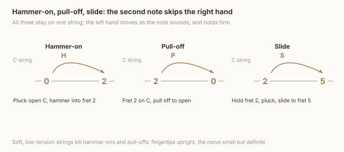
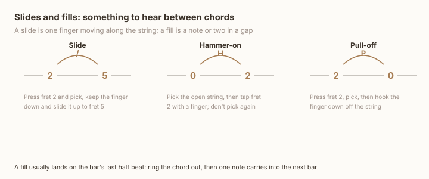
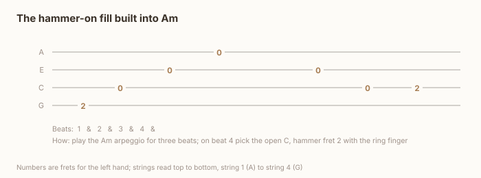
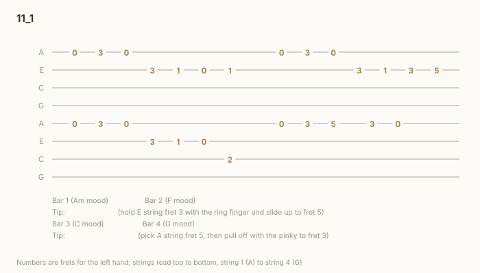

# Chapter 11: Left-Hand Ornaments — Hammer-Ons, Pull-Offs and Slides

Once you can fret chords smoothly and strum a rhythm that sounds good, you start to wonder: "Why is it that when some players online play the same `C` or `Am` chord, a few bright, playful melody notes seem to jump out in the middle—and it sounds so professional?"

That is the magic of the left hand's legato techniques: the **hammer-on**, the **pull-off** and the **slide**. None of them needs an extra pluck from the right hand. Everything comes from a left-hand finger striking, flicking or sliding on the fretboard, which makes the notes run into one another. In pop accompaniment this is called a **fill-in (an ornament built inside the chord)**. Learn these three moves and your accompaniment stops sounding plain and starts to sound alive.

---

## 11.1 Hammer-on and pull-off: training the stroke

In four-line tab (TAB), a legato move is written as a **slur**—a curved line joining two numbers—with a letter on it.

### 1. Hammer-on (written `H`)

* **What the move is**: pluck a lower note first (the open string `0`, say). While the string is still ringing, a left-hand finger comes down on a higher fret of the same string (fret 2, say) **like a small hammer**—straight down, fast and firm. The note at fret 2 then sounds on its own, with no second pluck from the right hand.
* **What makes it work**:
  1. **Fast, and the fingertip vertical**: come down as decisively as a typewriter key. Never lay the finger down slowly, because that simply kills the vibration that was already there.
  2. **Strike just inside the fret wire**: land 2 mm on the inside of the metal wire, and the note comes out clean and loud.
  3. **Stay pressed after the strike**: the moment the finger lands it has to hold its pressure, so the new note keeps ringing.

### 2. Pull-off (written `P`)

* **What the move is**: the hammer-on in reverse. Fret the higher note (fret 2, say) and pluck it. The fretting finger then does not lift straight up; it **hooks slightly toward the floor, the way a pluck does, and only then lets go**, so the lower note on the same string (open `0`, or fret 1 under the index finger) rings out clearly.
* **What makes it work**: lift the finger straight up and the second note is barely there. It needs **a little downward friction, dragging the string as it goes**, to set the string vibrating again.

---

## 11.2 The slide, and designing a fill-in inside the chord

### 3. Slide (written `S`, or `/` and `\`)

* **What the move is**: fret a note and pluck it, then **keep the finger's pressure on the string without letting up** and slide it quickly along the fretboard to the target fret (fret 2 to fret 4, written `2S4` or `2/4`).
* **What makes it work**: keep the downward pressure on the fingertip the whole way (ease it halfway and the sound dies), **look at the destination fret before you move**, and brake to a stop the instant you arrive.

| Ornament | Written as | Which way the pitch moves | The feel to aim for | Where pop accompaniment uses it |
| :--- | :--- | :--- | :--- | :--- |
| **Hammer-on** | `H` | Low → high | A small hammer, striking fast and vertically just inside the fret wire | A bright upward decoration over `Am`, `C` and `F` chords |
| **Pull-off** | `P` | High → low | The fingertip hooks lightly toward the floor, then releases | A smooth descending fill-in melody |
| **Slide** | `S` or `/` | Low → high, or high → low | The fingertip hugging the string as it travels, braking exactly on the target fret | Copies the tender glide a singer makes between notes; often lands at the end of a phrase |

---

## 11.3 Ornaments in the intro and the interlude of real pop songs

The most useful ornament in pop accompaniment is this: **while you are holding a chord shape, use a finger you have spare to play a hammer-on or a pull-off.** Below are two all-purpose ornament modules. Drop either one straight into any long held note in a ballad.

### Module 1: the classic `0H2` fill-in over `Am` and `F`
When a song sits on `Am` or `F` for a whole bar while the singer finishes a line and takes a breath, this is the fill-in to play. It adds a lot of texture, and it turns up all the time in Jay Chou, WeiBird and folk singer-songwriter material:

### Module 2: a classic pop intro—the single-note intro of Jay Chou's 〈晴天〉 ("Sunny Day"), arranged in C major for practice
So that you can hear what hammer-ons, pull-offs and slides do to a melody, here is the famous intro of 〈晴天〉 ("Sunny Day") as a single-note study in C major. In Chapter 15 we play it again in the original key, G major:

---

### Chapter checklist

* [ ] **No second pluck.** With only a left-hand finger striking (hammer-on) or flicking (pull-off), I get a clear, loud note; the right hand never plucks again.
* [ ] **A slide that holds.** During a slide my finger keeps its pressure all the way, and it brakes exactly on the target fret.
* [ ] **The `0H2` fill-in.** I can add the `0H2` ornament to an arpeggio accompaniment on `Am`.
