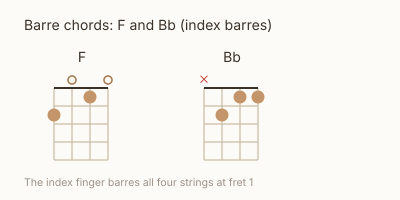
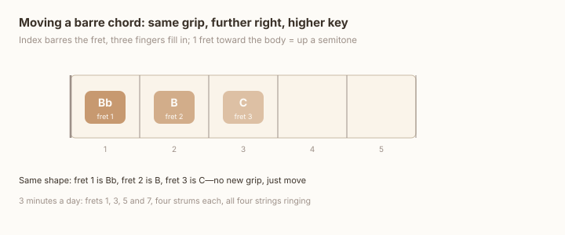

# Chapter 12: Taking On the Beginner's Boss Fight — Barre Chords

Every string instrument has a dividing line that terrifies beginners, and on the ukulele it is the **barre chord** (also called the full barre).

You have played your way happily through the first eleven chapters, and now you want to try Sodagreen's 〈小情歌〉 ("Little Love Song"), Jay Chou's 〈告白氣球〉 ("Love Confession") or Mayday's 〈突然好想你〉 ("Suddenly I Miss You"). Then a **`Bb`** or a **`Bm`** jumps out of the chart. You lay your index finger across all the strings the way the diagram shows, squeeze until the web of your hand goes numb, and what comes out is a dull "thud, thud, thud". Don't be discouraged. It is not that your fingers are weak; you are using **the wrong angle of force**. This chapter uses the physics of the hand to tame the thing once and for all.

---

## 12.1 The mechanics of a barre: a lever that saves effort, and pressing with the side of the index finger

A barre works by using the left index finger (finger `1`) **like a capo built into your hand**, pressing across several strings at fret 1 or fret 2 at the same time, while the middle and ring fingers fret the other notes.

Why does a beginner's barre refuse to ring, and hurt so much? Because the instinct is to press with the soft pad at the centre of the index finger, and to fight it by pinching thumb and index finger together as hard as possible. Switch to these four rules of force instead:

1. **Press with the bony side of the index finger, not the soft pad!**
   Hold out your left index finger and feel the edge on the thumb side (the outer edge). The skin there is thinnest, and right underneath is hard bone. To barre, don't lay the flat of the finger against the fretboard; **roll it about 15–20 degrees toward the headstock** and press with that hard bony edge. Half the force seals all four strings tight.

2. **Sit right against the inside of the fret wire**:
   This rule is life or death on a barre. The index finger has to sit snug against the inside edge of the metal wire below the target fret (about 1–2 mm from it). Never plant it in the middle of the space.

3. **Borrow leverage from the right forearm, tucked inward!**
   This is the strangest of the effort-saving tricks. While the left index finger presses the neck, **the right forearm, which is holding the body, presses very slightly toward your own chest**. By the lever principle, the body comes toward your chest and the neck is pushed forward into your left index finger, which adds reaction force from behind. The web of the hand carries noticeably less.

4. **The index finger only has to press the strings that need to sound**:
   On a `Bm`, for example, the ring finger already holds the 4th string at fret 4. So when the index finger barres fret 2, it really only has to **press strings 1, 2 and 3**. Even if it never fully seals the 4th string, the chord is still in tune.

---

*Figure: a barre chord—the whole index finger lies across all four strings, and the other fingers make the rest of the shape.*

## 12.2 Four advanced shapes you have to learn: `Bb`, `Bm`, `Cm` (barred) and `F#m` (three fingers)

These four are the barred (and half-barred) chords that turn up most often in Chinese-language pop. In the diagrams, the thick black line across several strings (`●═══●`) means **the index finger (finger `1`) barres every marked string at that fret at once**.

### The four shapes in detail, with a string-by-string check

| Chord | Type of barre | Exact left-hand fingering | Keys it usually appears in | String-by-string check |
| :--- | :--- | :--- | :--- | :--- |
| **Bb** | Half barre (partial) | Index (`1`) barres **strings 1 and 2 at fret 1**; middle (`2`) on string 3, fret 2; ring (`3`) on string 4, fret 3 | F major (the 4 chord); a borrowed chord in C major | Check whether string 2 (the E string) is really sealed by the pad of the index finger, or whether the middle fingertip is touching it and choking it |
| **Bm** | Full barre | Index (`1`) barres **fret 2, strings 1–4**; ring (`3`) on **string 4, fret 4** (the middle finger can stack on top of the index to add pressure!) | G major (the 3 chord), D major (the 6 chord) | **The shortcut worth knowing**: the middle finger (`2`) has nothing else to do, so **lay it on the back of the index finger** to add pressure—the "won't seal" problem goes away at once! |
| **Cm** | Half barre (partial) | Index (`1`) barres **strings 1, 2 and 3 at fret 3**; string 4 stays open `O` | The borrowed minor `iv`: in G major you borrow the `iv` chord `Cm` (G's own `iv` would be `C`); the borrowed `iv` that matches in C major is `Fm` | Keep the tip of the index finger off the open 4th string, so that the open 4th string (G in high-G tuning) rings out clear |
| **F#m** | No barre (advanced three-finger shape) | Index (`1`) on string 3, fret 1; middle (`2`) on string 2, fret 2; ring (`3`) on string 4, fret 2; string 1 open `O` | The common minor chord in A major and D major | It differs from `Dm` (`2210`) only in which string the index and middle fingers take: in `Dm` the index is on string 2 and the middle on string 3; in `F#m` the index is on string 3 and the middle on string 2. In both, string 1 stays open |

---

## 12.3 Moving a barre shape, and the three-minute daily drill

Once a barre works, the biggest payoff is that **the shape is movable**. Learn `Bm` at fret 2, keep the hand exactly as it is, and shift the whole hand one fret toward the body (index at fret 3, ring at fret 5): it becomes `Cm` on its own. Shift two more frets (index at fret 5, ring at fret 7) and it becomes `Dm`.

### The three-minute daily barre menu

Never press hard for more than five minutes at a stretch, or the tendons get inflamed. Spend three minutes before you practise each day on press-and-release intervals:

1. **One-finger barre test (1 minute)**: with only the side of the index finger, barre all four strings at fret 2. Pluck the four strings in turn with the thumb, from the top string down. Once all four ring, let the left hand go completely for three seconds. Repeat ten times.
2. **The most-used changes, on a loop (2 minutes)**: with a metronome at BPM = 55, practise the barre changes that come up most in pop:
   * Set A (the classic F major progression): `| F | Bb | C7 | F |` (practise dropping the index finger from a single note on string 2, fret 1 straight into the `Bb` barre across strings 1 and 2!)
   * Set B (the classic G major progression): `| G | Bm | C | D |` (in Chapter 15 we use this progression straight away on Jay Chou's 〈晴天〉 ("Sunny Day"))

---

### Chapter checklist

* [ ] **The angle.** Barring, I press with the bony side of the index finger, snug against the inside of the fret wire, and I borrow force from the right forearm tucked slightly inward.
* [ ] **Two clean barres.** `Bb` and `Bm` ring out with no buzz (I know to stack the middle finger on the back of the index for extra pressure).
* [ ] **The changes.** I can move smoothly between `F` → `Bb` and `G` → `Bm`.

