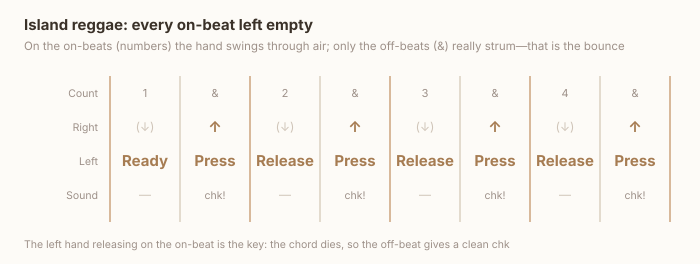
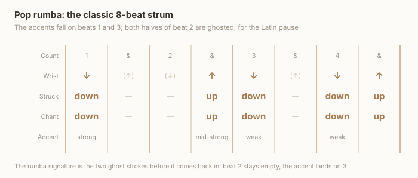
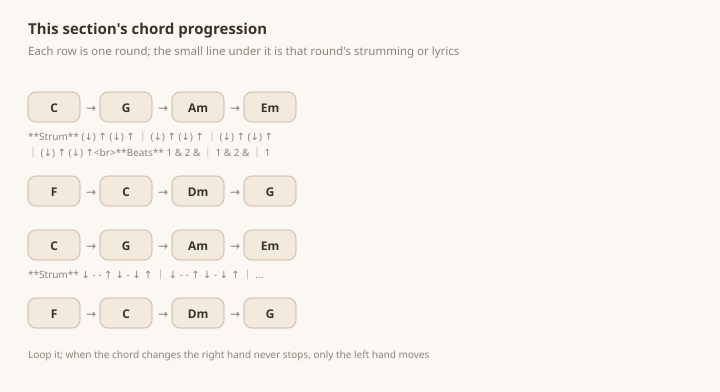

# Chapter 13: Island Reggae and Rumba Grooves

Don't forget that the ukulele was born on the sunny beaches of Hawaii. When you carry it to the shore, to a campsite or to a summer-night barbecue, nothing lights up the island-holiday mood faster than **reggae** and **rumba**.

Both names sound exotic, but in Chinese-language pop they are everywhere. From Chang Chen-yue's 〈愛我別走〉 ("Love Me, Don't Go") and MC HotDog and Chang Chen-yue's 〈嗨嗨人生〉 ("Party Life"), to Jay Chou's 〈迷迭香〉 ("Rosemary") and Karen Mok's 〈愛〉 ("Love"), these songs lean heavily on off-beat syncopation and Latin groove. This chapter opens up both patterns—the kind that get you swaying before you notice.

---

## 13.1 Reggae: off-beat accents and a left hand that lets go (staccato)

In ordinary pop and rock the accents sit on the beat (`1, 2, 3, 4`), which is what makes it feel planted. Reggae, which comes from Jamaica, puts all its energy and every accent on the back half of the beat—every `&` in `1 & 2 & 3 & 4 &`. This "on-beats empty, off-beats jumping" groove makes a lazy, slightly tipsy sway, as if you were standing on sand.

*Figure: in reggae the on-beats are muted (X) and only the off-beats are strummed; the quieter the on-beats, the more the off-beats bounce.*

### The three essentials of a reggae strum

1. **Do not strum the on-beats at all (`1, 2, 3, 4`)**: counting `1, 2, 3, 4` in your head, the right hand swings down through empty air (or taps the strings lightly with the edge of the palm for a low percussive thud).
2. **A short upstroke (or downstroke) off the beat (`&`)**: on every `&`, hit the chord decisively.
3. **The soul of it—the left hand releases at once (staccato)**: a reggae chord must never smear. **Within 0.1 seconds** of strumming the chord on the `&`, the fretting fingers ease their pressure (they stay lightly on the strings; they don't leave the fretboard), so the sound is cut dead and becomes a short, dry "chk!—chk!—chk!—chk!"

*(A tip: when you are starting out on reggae, favour chords in which every string is fretted—`Bb`, `Bm` and the like. On those, simply easing the left hand mutes all four strings at once. Chords with open strings, such as `G` and `D`, need the palm to stop them; on a `C` chord, the spare index and middle fingers have to lie lightly across the open strings to mute them!)*

---

## 13.2 Rumba: training the Latin syncopation

If reggae is a lazy walk along the beach, then rumba, which comes from Cuba, is a passionate couple's dance. In 4/4 the rumba moves on **clave-style syncopated accents** (long-and-short groupings of 3-2 or 2-3). It sounds Latin, and it suits mid-tempo romantic ballads very well.

### Feeling the rumba: count it out loud

Look at the structure of the first two beats. After the downstroke on `1` you wait a full **1.5 beats** (`1&` and `2` both pass in silence), and only on `2&` does an accent come back, hooking upward. With a metronome at BPM = 75, say this count out loud:
**"boom (`1`) — chk (`2&`) — boom (`3`) — chk-chk (`4 &`)"**
This pattern is for Chinese-language pop with a tipsy jazz colour and a Latin feel (Bossa Nova has its own pattern, so don't simply apply the rumba strum to it)—some Karen Mok, Tanya Chua and Jay Chou songs, for instance. The result is far bigger than the effort involved.

| Groove | Where the accents fall | What the two hands do together | What it sounds and feels like, and where to use it |
| :--- | :--- | :--- | :--- |
| **Reggae** | Every accent on the back half of the beat (`1& 2& 3& 4&`) | After the off-beat strum, **the left hand releases at once** to make a short staccato | Sunny beach, campfire, tipsy swaying, summer parties |
| **Rumba** | Strong syncopated accents pushing on `1`, `2&` and `3` | The right wrist keeps swinging like a pendulum, passes precisely over `1&` and `2`, and accents the upstroke on `2&` | A romantic couple's dance, Latin colour, late-night city ballads |

---

## 13.3 Putting it to work: the song every island campfire sings

### The song: Chang Chen-yue's 〈愛我別走〉 ("Love Me, Don't Go"), a C major reggae-swing arrangement

* **Tempo and metre**: 4/4, about BPM = 82.
* **The secret of it**: this is the most-sung song in university guitar clubs, campsites and beach parties in Taiwan! The original is in F major (once you have F major from the next chapter, you can play it in the original key). Here we use the friendliest key, **C major**, to try the classic plan—**a reggae off-beat sway in the verse, then rumba or folk rock letting go in the chorus**!

| Chord progression | Rhythm / pattern |
| :--- | :--- |
| `C` → `G` → `Am` → `Em` | **Strum** (↓) ↑ (↓) ↑ ｜ (↓) ↑ (↓) ↑ ｜ (↓) ↑ (↓) ↑ ｜ (↓) ↑ (↓) ↑ **Count** 1 & 2 & ｜ 1 & 2 & ｜ 1 & 2 & ｜ 1 & 2 & (four off-beat groups per bar) |
| `F` → `C` → `Dm` → `G` | — |
| `C` → `G` → `Am` → `Em` | **Strum** ↓ - - ↑ ↓ - ↓ ↑ ｜ ↓ - - ↑ ↓ - ↓ ↑ ｜ ... |
| `F` → `C` → `Dm` → `G` | — |

---

### Chapter checklist

* [ ] **The back half of the beat.** I can land every `&` steadily and produce reggae's "on-beats empty, off-beats jumping" sway.
* [ ] **A clean staccato.** After an off-beat strum I can cut the sound dead and clean by easing the left-hand fingers.
* [ ] **The rumba push.** I have the rumba's syncopated accents—down, then up, down, then down-up—and I can play and sing 〈愛我別走〉 ("Love Me, Don't Go").
