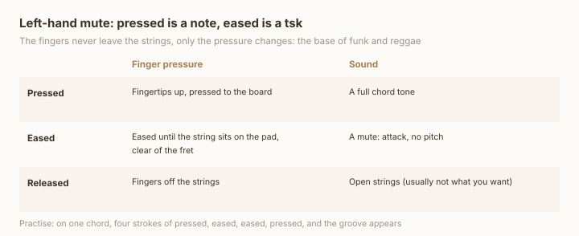
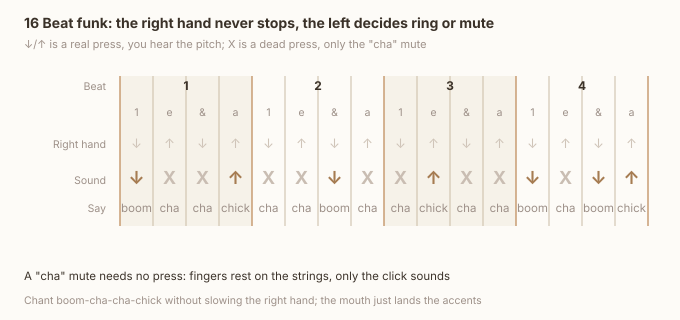
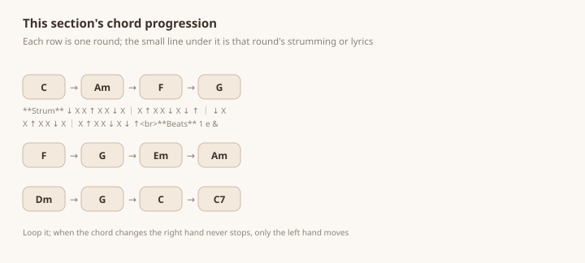

# Chapter 14: Funk — 16th-Note Strumming and Left-Hand Muting

Have you heard Crowd Lu's 〈早安，晨之美！〉 ("Good Morning, Beautiful Morning!"), WeiBird's 〈女孩〉 ("Girl"), or a light Bruno Mars dance track, and found yourself thinking: how can the right hand strum as densely as a machine gun, and how can a rhythm be so strong that every cell in your body wants to dance?

That is **funk strumming**, the most energetic style in pop. The point of funk is not a complicated progression (plenty of funk songs run on one or two chords for the whole track). It is the tight coordination of **a wrist swinging 16th notes at speed** with **the left hand's light-touch mute**. This chapter pushes your right wrist's mobility and your left hand's rhythmic control up to another level.

---

## 14.1 The left-hand mute (the `X` note)

Before the funk strum, you have to learn a mute that is nothing like Chapter 9's right-hand chunk: **the left-hand mute**, usually written `X` or `M` in the tab.

* **The right-hand chunk** covers the strings with the edge of the right palm. It is a bigger movement, and it suits the heavy beats, 2 and 4.
* **The left-hand mute** keeps the right hand swinging up and down at speed with no break at all, and relies purely on **the left-hand fingers** switching between pressing and easing. That switch decides which strokes sound a chord and which turn into a percussion-like muted "shhk, shhk".

### The left-hand mute in three steps

1. **Pressed properly (real sound)**: the left-hand fingers press the frets vertically and firmly, and the right hand's strum gives a clear chord.
2. **Ease off in an instant (mute sound, `X`)**: the fingers **do not leave the strings**; the downward pressure is simply let go all at once (the spare ring and little fingers can also lie lightly flat across all four strings), so the fingers rest on the string surface like a wet cloth.
3. **Strum the gear teeth at speed**: the right index finger now swings hard up and down through all four strings, and you hear the dry scrape of the `X` note—"tsk, tsk"!

> **Avoiding stray harmonics**: when you ease off, **try to touch the strings with two or more fingers at once** (index, middle and ring, say), and keep away from directly over frets 5, 7 and 12. If a single finger touches fret 5, 7 or 12 and you strum, you will set off a clear **natural harmonic** without meaning to (you learn these in Chapter 22), and the pure percussive feel that funk needs is gone.

---

## 14.2 Fast alternating 16th-note strumming and a party groove

The engine of funk strumming is the right wrist swinging 16th notes down and up without a break: `1 e & a 2 e & a 3 e & a 4 e & a`, four strokes per beat—down, up, down, up.

Start with a metronome (BPM = 60; slow it right down to practise), lay all four left-hand fingers lightly across the fretboard so that everything is muted, and strum sixteen even strokes: **down-up-down-up, down-up-down-up, down-up-down-up, down-up-down-up**. Once the sound is as even and steady as a train running on its rails, start adding the left hand's pressed notes.

### Three stages of funk practice

1. **Stage one (one beat at a time)**: practise beat 1 alone first, **`↓ X X ↑`** (accented downstroke → muted upstroke → muted downstroke → accented upstroke). Press down for the downstroke on `1`, ease the left hand at once for the two muted strokes `X X`, then press again in an instant on the last `a` and bring the upstroke out! Repeat those four strokes until the fingers switch as precisely as a switch.
2. **Stage two (add the chunk on beat 2)**: in pop funk, the on-beats `2` and `4` can take a harder accent (combine them with the right-hand chunk from Chapter 9 if you like), which brings the groove closer to a real drum kit's kick-and-snare counterpoint.
3. **Stage three (speed up to the record)**: once the movement is fully coordinated, walk the metronome from BPM = 60 up to **BPM = 95–115**, and you get the party rush of funk for yourself.

| The two mutes compared | Right-hand chunk | Left-hand mute |
| :--- | :--- | :--- |
| **What does the muting** | The outer edge of the right palm (the little-finger side, near the wrist) | The pads of several left-hand fingers, touching the strings |
| **Tempo it suits** | Mid and mid-fast (mostly eighth notes) | **Fast alternating 16th-note strumming** |
| **What it sounds like** | One thick, dry hit—"tsk!" | A fine, unbroken machine-gun "tsk-tsk-tsk" |
| **Where it fits best** | Folk rock, country, light pop | Funk, disco, upbeat light rock |

---

## 14.3 Putting it to work: morning energy and a party track

### Song one: Crowd Lu's 〈早安，晨之美！〉 ("Good Morning, Beautiful Morning!"), a C major funk workout

* **Tempo and metre**: 4/4, about BPM = 116 (when you practise, start at BPM = 75 without fail!).
* **The secret of it**: this song might as well have been written for ukulele funk, and the whole country can sing it. The chords are very simple (mostly `C`, `Am`, `F`, `G`), but the dense 16th-note muted strumming turns the small everyday act of eating breakfast into a full-blooded rock party!

| Chord progression | Rhythm / pattern |
| :--- | :--- |
| `C` → `Am` → `F` → `G` | **Strum** ↓ X X ↑ X X ↓ X ｜ X ↑ X X ↓ X ↓ ↑ ｜ ↓ X X ↑ X X ↓ X ｜ X ↑ X X ↓ X ↓ ↑ **Count** 1 e & a 2 e & a ｜ 3 e & a 4 e & a ｜ 1 e & a 2 e & a ｜ 3 e & a 4 e & a |

### Song two: WeiBird's 〈女孩〉 ("Girl"), a romantic retro-funk take in C major

* **Tempo and metre**: 4/4, about BPM = 112 (to practise, slow it down to BPM = 75 first).
* **The secret of it**: 〈女孩〉 ("Girl") blends 1980s retro disco with a modern funk groove. The verse is full of jumpy left-hand staccato and muted strumming (`Am` → `Dm` → `G` → `C`), and the chorus, where the title word opens the line and a longer phrase follows it, releases all the strumming energy at once.

| Chord progression | Rhythm / pattern |
| :--- | :--- |
| `F` → `G` → `Em` → `Am` | — |
| `Dm` → `G` → `C` → `C7` | — |

---

### Chapter checklist

* [ ] **A clean `X`.** I can touch the strings with several left-hand fingers at once to mute them, and I do not set off a stray harmonic over frets 5, 7 and 12.
* [ ] **A loose wrist.** My right wrist keeps a small, relaxed, continuous 16th-note swing (down-up-down-up) without stiffening.
* [ ] **Into a song.** At a slow BPM = 75 I can use the funk strum to play and sing the chorus of 〈早安，晨之美！〉 ("Good Morning, Beautiful Morning!") or 〈女孩〉 ("Girl").
