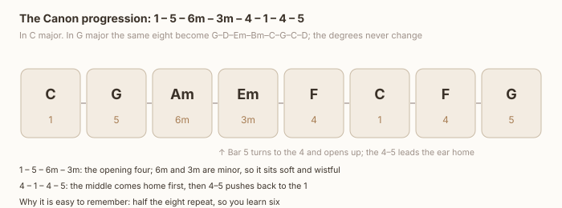
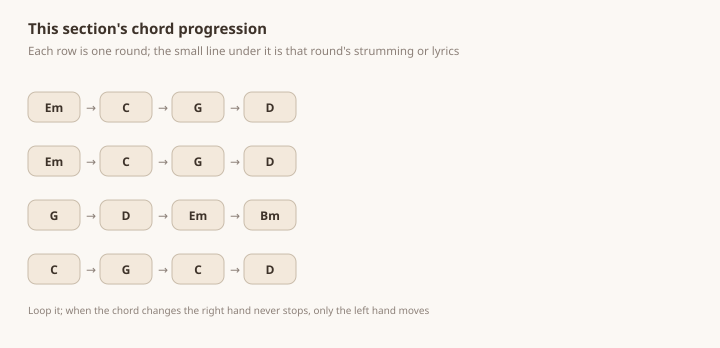
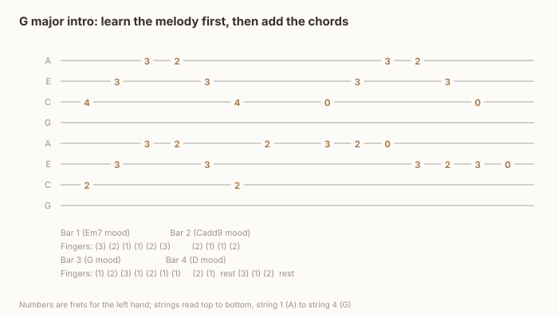

# Chapter 15: The G Major Chord Family and Classic Pop Progressions

You have come to the end of Part 3, and you are now a pop accompanist with a full set of techniques. But you may have noticed one small limit: "every song we have played so far is in **C major**."

What happens, then, when you meet a classic that was **G major** to begin with (Jay Chou's 〈晴天〉 ("Sunny Day"), for instance), or when a friend singing finds C major too high or too low and you need to move the song to G major to play it? From Part 4 on, we open up your sense of key properly. This chapter starts by introducing the second most-used key in Chinese-language pop—**the G major chord family**—and then uncovers the strongest chord code in the history of pop music: **the Canon progression**!

---

## 15.1 The diatonic chords of G major at a glance (`G`, `Am`, `Bm`, `C`, `D`, `Em`)

In music theory, every major key has its own **seven basic members, called the diatonic chords**. In scale order they are numbered with the Roman numerals **`I` (degree 1), `ii` (2), `iii` (3), `IV` (4), `V` (5), `vi` (6), `vii°` (7)**, where a capital means a major triad and a lower-case `m` means a minor triad.

Set the **C major** you know best beside this section's subject, **G major**, and something surprising appears: **of G major's six common chords, four (`G`, `Am`, `C`, `Em`) you can already play!** You only need to learn one new chord, **`D`** (plus the `Bm` from Chapter 12), and the whole G major world opens up at once.

| Degree | 1 (`I`) | 2 (`ii`) | 3 (`iii`) | 4 (`IV`) | 5 (`V`) | 6 (`vi`) |
| :--- | :--- | :--- | :--- | :--- | :--- | :--- |
| **Chord quality** | Major triad (the tonic) | Minor triad | Minor triad | Major triad | Major triad (the dominant) | Minor triad (the relative minor) |
| **C major member** | **C** | **Dm** | **Em** | **F** | **G** (or G7) | **Am** |
| **G major member** | **G** | **Am** | **Bm** (revision) | **C** | **D** (**new!**) | **Em** |

### The new chord: two ways to finger `D`

* **The standard three-finger shape**: index (`1`) on string 4, fret 2; middle (`2`) on string 3, fret 2; ring (`3`) on string 2, fret 2; string 1 stays open `O`. The three fingers have to queue up tightly inside the same fret 2. Turn the wrist slightly toward the body and the three fingers slide in side by side, on a slant.
* **The half-barre shortcut**: if three fingers crammed into fret 2 feels too tight and keeps catching string 1, use the first joint of the index finger (`1`) to barre strings 4, 3 and 2 at fret 2, and let the fingertip tilt slightly upward so the bottom string, string 1 (the A string), stays free and rings out clear! This one is extremely useful when you are changing chords fast.

---

## 15.2 The formula that never fails in Chinese-language pop: the Canon progression (`1-5-6-3-4-1-4-5`)

Once you have the diatonic chords of G major, you can use **degrees** to see through the underlying logic of pop music. In C major or in G major, these are the two golden formulas pop songs use most:

1. **The all-purpose four-chord pop loop (the `1 - 6 - 4 - 5` progression)**:
   * In C major: `C` → `Am` → `F` → `G`
   * In G major: **`G` → `Em` → `C` → `D`**! (No barre chords needed at all—very easy to finger!)

2. **The Canon progression (the `1 - 5 - 6 - 3 - 4 - 1 - 4 - 5` progression)**:
   * It comes from Pachelbel's 〈D 大調卡農〉 ("Canon in D") in the Baroque period. Because the harmony flows so smoothly and beautifully, it became Chinese-language pop's hundred-year tearjerker formula (〈晴天〉 ("Sunny Day"), 〈小幸運〉 ("A Little Happiness"), 〈不是因為天氣晴朗才愛你〉 ("Not Because the Weather Is Fine"), 〈那些年〉 ("Those Years")).
   * In G major: **`G` → `D` → `Em` → `Bm` → `C` → `G` → `C` → `D`**!

---

## 15.3 Putting it to work: Jay Chou's 〈晴天〉 ("Sunny Day"), complete in the original key of G major

This song is on a lot of people's list of goals for learning an instrument! The original is in **G major**. The intro's single-note melody is famous enough that the whole room sings along from its first four notes, and with the tender Canon progression under the chorus, it sits on the ukulele very naturally.

### The song: Jay Chou's 〈晴天〉 ("Sunny Day"), sung in the original G major, with the intro as a single-note line

* **Tempo and metre**: 4/4, about BPM = 68 (a tender mid-tempo ballad rock).

#### Part one: the classic intro as a single-note line (TAB)
Start by plucking the melody with the right thumb. Once it is solid, on beat 1 of each bar you can also rake the thumb down gently through that bar's chord, and it will sound as full as a duet!

#### Part two: the chord progression for the verse and the chorus

* **Verse arrangement**: use the ballad arpeggio pattern from Chapter 7 (`4-3-2-3-1-3-2-3`), at a steady, tender tempo.
* **Chorus arrangement**: when the chorus arrives, switch to the **16 Beat slow soul strum** from Chapter 10 (or a full folk-rock strum), and let all the regret and heat of being young out in one go!

| Chord progression | Rhythm / pattern |
| :--- | :--- |
| `Em` → `C` → `G` → `D` | — |
| `Em` → `C` → `G` → `D` | — |
| `G` → `D` → `Em` → `Bm` | — |
| `C` → `G` → `C` → `D` | — |

---

### Chapter checklist

* [ ] **A clean `D`.** I can finger `D` smoothly (three fingers or the half barre), and string 1 still rings clear instead of dead.
* [ ] **The six chords.** I remember G major's six common diatonic chords: `G`, `Am`, `Bm`, `C`, `D`, `Em`.
* [ ] **The song.** I can play the single-note intro melody of 〈晴天〉 ("Sunny Day"), then carry on into the G major verse and chorus and sing along at the same time.
