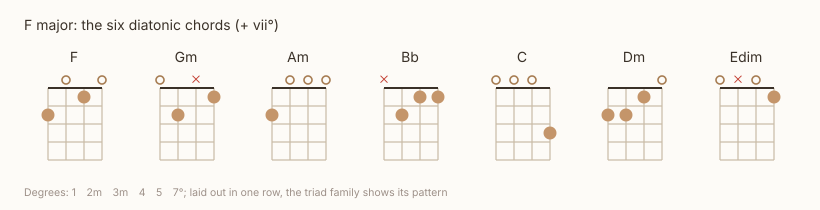
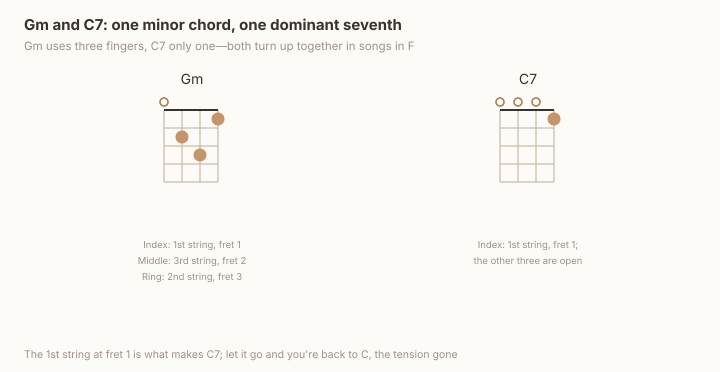
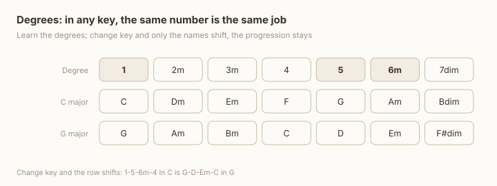
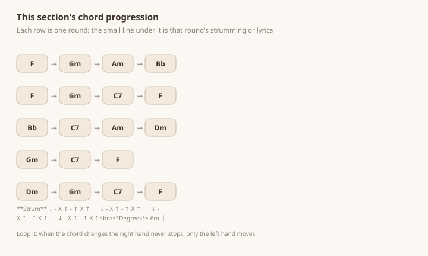

# Chapter 16: The F Major Chord Family and Deriving Diatonic Chords in Three Minutes

In the guitar and ukulele world there are three "people's golden keys"—**C major**, **G major** and **F major**. These three keys get the most open-string resonance in the ukulele's open position, they sound the sweetest, and they are the first choice for almost every pop song when it is arranged for the instrument.

Last chapter we conquered G major. This chapter we fill in the last piece of the puzzle—**the F major chord family**! What matters more, we teach you a **numeral-degree method** you can learn in three minutes, so that from now on you never memorise a chord progression again. Glance at the numbers in a chart (`1 2 3 4 5 6 7`) and you can work out the matching chord in any key in seconds.

---

## 16.1 The F major diatonic chords at a glance (F, Gm, Am, Bb, C7, Dm)

Once again we use the "learn by comparison" method to look at F major's six core diatonic chords. You will find that four of them (`F`, `Am`, `C` / `C7`, `Dm`) are already familiar from earlier chapters, and `Bb` came in Chapter 12, so the only new face you have to meet is **`Gm` (the degree 2 chord)**!

| Degree | 1 (I) | 2 (ii) | 3 (iii) | 4 (IV) | 5 (V) | 6 (vi) |
| :--- | :--- | :--- | :--- | :--- | :--- | :--- |
| **Chords in C major** | **C** | **Dm** | **Em** | **F** | **G** (or G7) | **Am** |
| **Chords in G major** | **G** | **Am** | **Bm** | **C** | **D** (or D7) | **Em** |
| **Chords in F major** | **F** | **Gm** (**new!**) | **Am** | **Bb** | **C** (or C7) | **Dm** |

*Figure: F major diatonic chords: F, Gm, Am, Bb, C, Dm, Edim—laid out in one row, the pattern of the triad family shows itself.*

### New chord guide: fingering charts for `Gm` and `C7`

* **The `Gm` secret**: the index finger (1) on the 1st string, 1st fret, the middle finger (2) on the 3rd string, 2nd fret, the ring finger (3) on the 2nd string, 3rd fret, and the 4th string open, `O`. **Look at its shape: it looks exactly like the G major chord, except that the finger which was on the 1st string, 2nd fret has moved back one fret, to the 1st fret!** (In theory, flatten the third of a major triad by a semitone and you get a minor triad, which is why `G` moved back one fret becomes `Gm`!)
* **The `C7` secret**: the easiest seventh chord in ukulele history! Press **the index finger (1) on the 1st string, 1st fret** and leave the other three strings open. It gives F major a very strong resolving pull back to the tonic `F`.

---

## 16.2 Plain-language theory: the numeral degrees (1–7) and instant key changes

Why is it that when the singer calls out at a KTV or on the street—"we're taking this one a semitone down, in F!"—a professional player can play it straight away without rewriting the chart? Because what professional players keep in their heads is not letters but **the number system**!

Remember these two plain-language formulas and you can work out the diatonic chords of any major key yourself:

1. **The major scale's "whole whole half, whole whole whole half" interval formula**:
   * Between two neighbouring letters, apart from **`E-F` (Mi-Fa)** and **`B-C` (Si-Do)**, which are a semitone apart (1 fret), every neighbouring pair of letters is a whole tone apart (2 frets).
   * Any major scale, `1 - 2 - 3 - 4 - 5 - 6 - 7 - 1`, has to obey the distance formula strictly: **whole tone, whole tone, semitone, whole tone, whole tone, whole tone, semitone**.
   * Take **F major** as the worked example. Start on `F` (1); a whole tone up is `G` (2); another whole tone up is `A` (3); the next step, `3` to `4`, has to be a **semitone**—and a semitone above `A` is not `B` (`A` to `B` is a whole tone), it is **`Bb` (4)**! That is why the degree 4 chord in F major is always `Bb` and never `B`.

2. **The fixed formula for chord quality (`1, 4, 5` are major; `2, 3, 6` are minor)**:
   * In any major key, **degrees 1, 4 and 5 are always major triads** (bright and sunny), and **degrees 2, 3 and 6 are always minor triads** (melancholy, with an `m` after the letter)!
   * Test it on the F major scale, `F` (1) - `G` (2) - `A` (3) - `Bb` (4) - `C` (5) - `D` (6) - `E` (7):
     * `1, 4, 5` stay uppercase → **`F`**, **`Bb`**, **`C`**
     * `2, 3, 6` take an `m` → **`Gm`**, **`Am`**, **`Dm`**
     * And there are your six diatonic chords for F major.

---

## 16.3 Putting it to work: hits that are originally in F major

F major sits in a very comfortable register. Plenty of classic songs by Mandarin-language female singers and by tenors are originally in F major, so played on the ukulele in F major they need no transposition at all—you can play straight along with the original CD.

### Track one: Sodagreen's 〈小情歌〉 ("Little Love Song") (played in F major; original in D major)

* **Rhythm**: 4/4, about 70–80 BPM.
* **The secret**: the original is in **D major**. We teach it in F major here because the F family is the easiest to finger on the ukulele. To play along with the record, take the same set of chords as C shapes and clamp a **capo on fret 2** (C + 2 = D). The verse has a delicate, poetic piano texture, best interpreted with the ukulele's lyrical fingerpicked arpeggios; the chorus, whose opening lyric line is a long one, switches to a full folk-rock or slow-soul strum.

| Chord progression | Rhythm / pattern |
| :--- | :--- |
| `F` → `Gm` → `Am` → `Bb` | — |
| `F` → `Gm` → `C7` → `F` | — |
| `Bb` → `C7` → `Am` → `Dm` | — |
| `Gm` → `C7` → `F` | — |

### Track two: Tanya Chua's 〈紅色高跟鞋〉 ("Red High Heels") (an upbeat city version in F major)

* **Rhythm**: 4/4, medium-fast.
* **The secret**: the original is in F major, and verse and chorus are carried almost the whole way by a crisp four-bar loop, **`Dm` → `Gm` → `C7` → `F`** (in degrees the **`6m - 2m - 5 - 1` loop**, a favourite of pop jazz and upbeat urban styles). Add the knife-edge chunk strum from Chapter 9 (`down, chunk, down-up, chunk`) and you have the confidence and the playfulness of the city at once.

| Chord progression | Rhythm / pattern |
| :--- | :--- |
| `Dm` → `Gm` → `C7` → `F` | **Strum** ↓ - X ↑ - ↑ X ↑ ｜ ↓ - X ↑ - ↑ X ↑ ｜ ↓ - X ↑ - ↑ X ↑ ｜ ↓ - X ↑ - ↑ X ↑ **Degrees** 6m ｜ 2m ｜ 5(7) ｜ 1 |

---

### Chapter checklist

* [ ] I can finger the `Gm` and `C7` chords, and I remember F major's six common diatonic chords: `F`, `Gm`, `Am`, `Bb`, `C7`, `Dm`.
* [ ] I understand the degree rule that `1, 4, 5` are major chords and `2, 3, 6` are minor chords, and I can work out the diatonic chords of D major or A major myself.
* [ ] I can sing and play 〈小情歌〉 in F major (the original is D major; to play with the record, use C shapes with a capo on fret 2) or 〈紅色高跟鞋〉.
