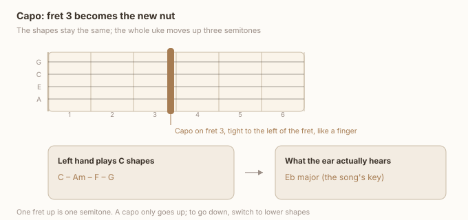
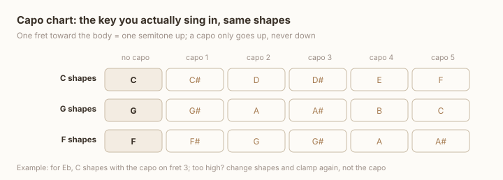
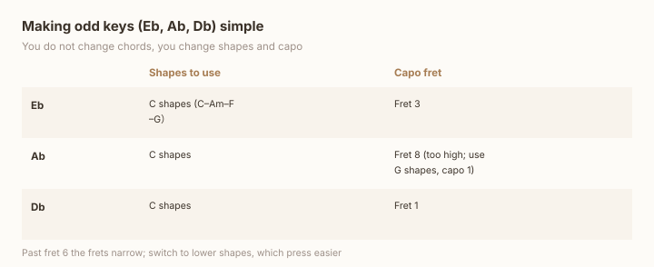

# Chapter 17: Capo Transposition in Practice — What If It's Too High or Too Low to Sing?

In real sing-and-play work you are certain to run into these two crushing situations:

1. **Situation A (the range doesn't fit)**: the version of 〈小幸運〉 ("A Little Happiness") you find online is the common "C major shapes + capo 5" one (the original is in F major), but you are a man with a low voice, and on the chorus's high notes you crack into outer space. Or you are a woman who wants to sing Eason Chan or Eric Chou, and in the original key the low notes sound like something stuck in your throat—no sound comes out at all.
2. **Situation B (an unfamiliar, hellish key)**: you badly want to play a new song, you open a chord chart online, and it says **`Eb`**, **`Cm`**, **`Ab`**, **`Bb`** (E-flat major)! The whole song is one barre chord after another, your fingers cramp, and it still comes out muffled.

Don't worry. To a pop player these two pain points need nothing more than one small gadget, and they are gone in three seconds: the **capo**. This chapter teaches you the KTV-level transposition trick, so that from now on you can sing in whatever key you like—and always with the simple chords you know best.

---

## 17.1 Clamping a ukulele capo correctly, and keeping the tuning

The capo is easy to understand: **it is a very solid "mechanical index finger" that barres a fret for you**, shortening the ukulele's effective string length and so raising the pitch of every open string.

### Three golden rules for clamping (avoid going out of tune, avoid damaging the instrument)

1. **Always use a capo made for the ukulele**: an acoustic-guitar capo's spring is tensioned for thick steel strings. Force it onto the ukulele's slender neck and soft nylon strings and it will not only press dents into the neck, it will also over-stretch the strings, so that everything is a semitone sharp the moment it is clamped on.
2. **Clamp against the headstock side of the fret wire**: exactly as with left-hand fingering, the capo's rubber pad has to sit snug against the fret wire on the headstock side of the target fret (to clamp fret 2, press it against the headstock side of the 2nd fret wire). That way there is no fret buzz, and the strings don't get pulled sideways out of tune.
3. **Check the tuning quickly after clamping**: every time you move the capo, make a habit of climbing quickly from the 4th string up to the 1st and listening, to confirm that all four strings ring clear and bright and none has been pulled out of tune.

---

## 17.2 A KTV-level transposition table (raising and lowering the key for duets)

In music, **every fret you move toward the body (one fret higher with the capo) raises the pitch you actually hear by one semitone**; two frets is two semitones (one whole tone).

### One: a man singing a woman's song, or a woman singing a man's—which fret?

Broadly speaking, the comfortable ranges of adult men and women differ by about **an octave (12 semitones)**. When you cover a singer of the other sex there are two usual approaches: ① **lower the song by 4–5 semitones**, moving it into the middle of your own range; ② **sing it an octave down**, and use the capo to lift the accompaniment back to the original key.

* The arithmetic of the second approach: singing an octave down means the voice is 12 semitones lower, while **the accompaniment is played from the original chart with no capo**—the voice sits an octave below the accompaniment, which already sounds normal. Only when "even the accompaniment in the original key feels too high" do you use approach ① (switch to shapes 4–5 semitones lower). Don't mix the two together.

### Two: the universal transposition table

Suppose the shapes you know best are the **C major shapes (`C, Dm, Em, F, G, Am`)** or the **G major shapes (`G, Am, Bm, C, D, Em`)**. Clamp the capo on the matching fret and your shapes don't change at all, while what comes out is a brand-new key.

| Capo position | Semitones raised | Actual key with C major shapes | Actual key with G major shapes | Actual key with F major shapes |
| :--- | :--- | :--- | :--- | :--- |
| **No capo (fret 0)** | original pitch | **C major** | **G major** | **F major** |
| **Capo on fret 1** | +1 semitone | **Db (C#) major** | **Ab (G#) major** | **Gb (F#) major** |
| **Capo on fret 2** | +2 semitones (1 whole tone) | **D major** (as most published versions have it) | **A major** (as most published versions have it) | **G major** |
| **Capo on fret 3** | +3 semitones | **Eb (D#) major** (the original key of so many love songs!) | **Bb (A#) major** | **Ab (G#) major** |
| **Capo on fret 4** | +4 semitones (2 whole tones) | **E major** | **B major** (as most published versions have it) | **A major** |
| **Capo on fret 5** | +5 semitones | **F major** | **C major** | **Bb (A#) major** |

---

## 17.3 Turning an awkward key (Eb / Ab / Db) into an easy one in one second

Now let's take a "hell-level barre-chord chart" off the internet and turn it into a heavenly easy one.

### The transposition steps (a three-step formula)

Say you find a song online that you love, the original is in **Eb major (E-flat major)**, and the chart is full of:

`| Eb | Cm | Ab | Bb |`

1. **Step one: work out the degrees of the original**
   * `Eb` is the tonic chord (degree 1), `Cm` is the relative minor (a degree 6 minor chord), `Ab` is the subdominant (degree 4), `Bb` is the dominant (degree 5).
   * Underneath it is just our most familiar **all-purpose four chords, `1 - 6m - 4 - 5`**!

2. **Step two: look up the capo fret in the table**
   * We want to sound **Eb major** using the simplest **C major shapes (`C - Am - F - G`)**.
   * Look along the "C major shapes" column of the table above for the target key, **Eb major**—the matching capo position is **fret 3**!

3. **Step three: clamp capo 3 and sing the original key straight off the simplified chart!**
   * Clamp the capo firmly on **fret 3** and treat fret 3 as your new nut. Play **`C` → `Am` → `F` → `G`** as usual, and the magic happens: what your ear hears is one hundred percent the pitch of the original CD, while the left hand has an easy time of it!

> **One more thing**: if you find that the same chord, in C major shapes, gets too high at frets 6 or 7 (the frets grow narrow and hard to press), you can switch to **G major shapes** and look for a lower-position alternative. To play **Bb major**, for example, C shapes need fret 10 (far too high!), but switch to **G major shapes (`G - Em - C - D`)** and **capo on fret 3** gives you Bb major without trouble. This is exactly why learning both the C and the G shapes matters.

---

### Chapter checklist

* [ ] I know how to clamp a ukulele capo correctly (snug against the headstock side of the fret wire), without pulling the strings sideways out of tune.
* [ ] I understand the logic that one fret higher, toward the body, raises the actual pitch by a semitone.
* [ ] I can use "degree conversion plus the capo table" to turn a song in Eb major or A major, full of barre chords, into easy C or G shapes.

