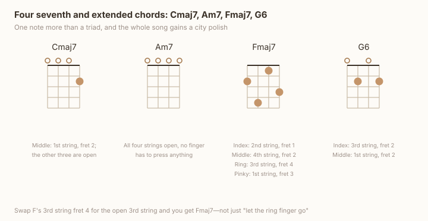
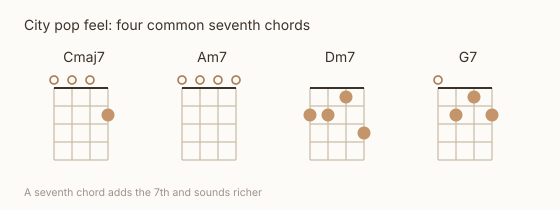
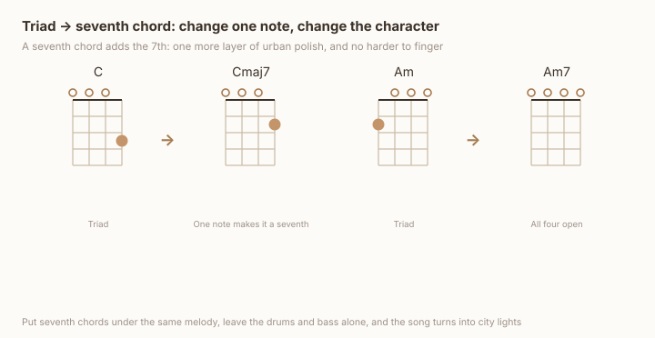
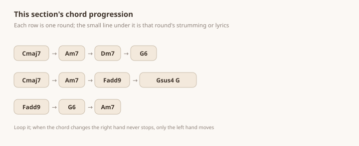

# Chapter 18: The Secret of City Pop and the Indie Feel — Seventh Chords and Extended Chords

Have you noticed that the indie bands and urban singer-songwriters everyone plays now—Sunset Rollercoaster (落日飛車), 9m88, WeiBird (韋禮安), Accusefive (告五人), Deca Joins—always sound like "a tipsy urban night", "clear Japanese-style freshness", or "the lazy, arty feel of a café afternoon"?

The secret is not how hard they strum. It is that they have upgraded the traditional **triads** (`C`, `Am`, `F`, `G`) into dreamy **seventh chords** and **extended chords**! Best of all: on the ukulele these chords that sound so expensive often need **one finger fewer** than the plain chord. This chapter opens up that chord aesthetic for you.

---

## 18.1 One finger fewer and a more refined sound: Maj7, m7, 6, sus4, add9 explained

In theory a traditional triad stacks three notes—the root (1), the third (3) and the fifth (5)—and sounds stable and direct. Add a seventh (7), a sixth (6) or a ninth (9, which is the 2 an octave higher) on top, and the chord gains a subtle colour and tension; it becomes rich and three-dimensional at once.

Look at the most surprising "subtraction magic" chord chart in ukulele history:

*(Note: the third chord in the chart, the standard practical **`Fmaj7`** fingering, is the middle finger on the 4th string, 2nd fret, the index on the 2nd string, 1st fret, the ring finger on the 3rd string, 4th fret, and the little finger on the 1st string, 3rd fret. If you want the minimalist indie version, you can also use **`Fadd9`**—only the 2nd string, 1st fret pressed, the other three strings open!—and the sound is clear and dreamy beyond belief.)*

*Figure: Cmaj7, Am7, Dm7 and G7 need only one finger more than the triad, but add a "mature" colour.*

### The six indie colour chords: character and fingering at a glance

| Chord | Full name | Exact left-hand fingering | What it sounds like | When to upgrade from the plain chord |
| :--- | :--- | :--- | :--- | :--- |
| **Cmaj7** | C major seventh | Middle finger (2) on the 1st string, 2nd fret, everything else open (one fret back from `C`!) | Dreamy, transparent, Japanese-clear, a slightly sweet romance | Replaces `C` (especially good at the start and the end of a song) |
| **Am7** | A minor seventh | **All four strings open, `O`!** (even the middle finger comes off, unlike `Am`!) | Lazy, urban night, the soul of R&B and City Pop | Replaces `Am`, so the chord change takes no time at all |
| **Fadd9** | F add nine | **Only the index finger (1) on the 2nd string, 1st fret**, the other three strings open (one finger fewer than `F`!) | Ethereal, clear as spring water, strongly indie-folk | Replaces `F`, particularly good in fingerpicked arpeggios |
| **G6** | G major sixth | Index (1) on the 3rd string, 2nd fret, middle (2) on the 1st string, 2nd fret (the ring finger comes off, unlike `G`!) | Retro, jazz café, an easy resolution that never turns heavy | Replaces `G` or `G7` |
| **Gsus4** | G suspended fourth | Move the finger that `G` has on the 1st string (A), 2nd fret, to the **3rd fret** (`Gsus4`'s four strings are G–D–G–C) | Suspended, expectant, full of breath (usually back to `G`, to set the melody moving) | Put it on the first two beats of a `G` bar: `Gsus4` → `G` |
| **Cadd9** | C add nine | Index on the 3rd string, 2nd fret, ring finger on the 1st string, 3rd fret, the other two strings open (G–D–E–C) | Open, a sunny breeze, the sound modern pop bands love most | Replaces `C`; strummed, the resonance is especially rich and full |

---

## 18.2 Upgrading the traditional triads: urban romantic progressions side by side

Now let's run a striking musical experiment. Pick up your ukulele, strum the traditional `C - Am - F - G` once, then strum the upgraded indie version, **`Cmaj7 - Am7 - Fadd9 - G6`**, straight away, and feel the atmosphere in the air change:

| Chord progression | Rhythm / pattern |
| :--- | :--- |
| `C` → `Am` → `F` → `G` → `Cmaj7` → `Am7` → `Fadd9` → `G6` | — |

### An advanced arranging trick: the breathing magic of `sus4`

At the end of a section in a ballad—say a `G` chord held for a whole bar—don't just strum four beats of `G` and leave it there. Try putting **`Gsus4`** on the first two beats (the 1st string moved to fret 3), then move the finger back to fret 2 for **`G`** on the last two beats. You will hear a graceful inner voice (1st string, `C` → `B`, in solfège `Do` → `Si`) start to sing inside the chord by itself. This is the secret weapon professional arrangers reach for most.

---

## 18.3 Putting it to work: urban indie-style songs

### Track one: WeiBird's 〈慢慢等〉 ("Waiting Slowly") (C major, indie colour version)

* **Rhythm**: 4/4, medium-slow.
* **The secret**: WeiBird's early folk songs are full of transparent, clear extended-chord colour. Replace the verse's plain chords with `Cmaj7`, `Am7`, `Dm7` (the `Dm` shape with the little finger added on the 1st string, 3rd fret) and `G6`, and the whole song's finesse goes up a level straight away.

| Chord progression | Rhythm / pattern |
| :--- | :--- |
| `Cmaj7` → `Am7` → `Dm7` → `G6` | — |
| `Cmaj7` → `Am7` → `Fadd9` → `Gsus4   G` | — |

### Track two: Accusefive's 〈帶我去找夜生活〉 ("Take Me to Find the Nightlife") (a tipsy city version in C major)

* **Rhythm**: 4/4, medium-fast (slow it right down when you practise).
* **The secret**: this party love song, soaked in retro disco and City Pop, transposes to **C major** on the ukulele and runs **`Fmaj7` (or `Fadd9`) → `G6` → `Em7` (press only the 3rd string, 2nd fret and the 1st string, 2nd fret—that is `G6`!) → `Am7`**, with the light 16 Beat strum or rumba groove from Chapter 14. One person in a living room can build the neon night of a whole city.

| Chord progression | Rhythm / pattern |
| :--- | :--- |
| `Fadd9` → `G6` → `Am7` | — |

---

### Chapter checklist

* [ ] I can finger the colour chords `Cmaj7`, `Am7`, `Fadd9`, `G6`, `Gsus4` and `Cadd9`.
* [ ] I can hear the difference in emotional colour between a plain triad and a seventh or add-nine chord, and I know when to swap them in for ballads and indie styles.
* [ ] I have learned to use `Gsus4` → `G` at the end of a section to set an inner voice moving.
