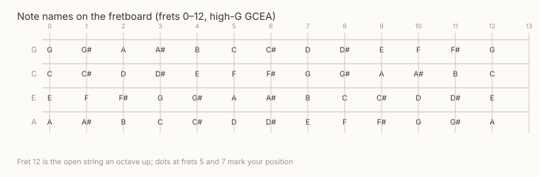
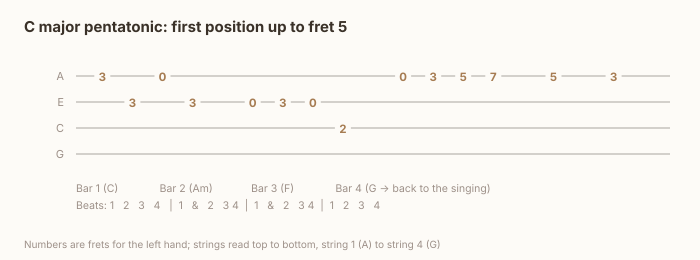
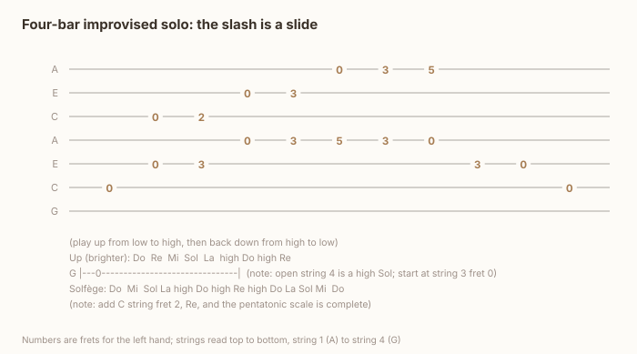

# Chapter 19: Scales Across the Whole Fretboard, and Designing a Simple Solo Interlude

For the first eighteen chapters we have worked almost entirely between the ukulele fretboard's fret 0 (the open strings) and fret 4 (open position). But as you look at the frets running up to the 12th, the 15th, aren't you curious: what notes are in those frets up there? And how does a professional player write a good single-note solo fill between the verse and the chorus?

This chapter unfolds the note-name map of the whole ukulele fretboard, and teaches you a tool for improvising that you can use even if you know no complicated theory at all: the **C major pentatonic scale**!

---

## 19.1 The note-name map of the ukulele fretboard, frets 1 to 12

To remember the note names of every fret, whatever you do don't memorise them one by one. Use the semitone rule from Chapter 2 (every neighbouring pair of letters is 2 frets apart, except `E-F` and `B-C`, which are 1 fret apart), together with the **white dot markers along the side of the fretboard (frets 5, 7, 10 and 12)** as landmarks, and you can work out the note name of any fret in seconds.

| String ＼ Fret | 0 | 1 | 2 | 3 | 4 | 5 | 6 | 7 | 8 | 9 | 10 | 11 | 12 |
| :--- | :-- | :-- | :-- | :-- | :-- | :-- | :-- | :-- | :-- | :-- | :-- | :-- | :-- |
| 1st string A | A | · | B | C | · | D | · | E | F | · | G | · | A |
| 2nd string E | E | F | · | G | · | A | · | B | C | · | D | · | E |
| 3rd string C | C | · | D | · | E | F | · | G | · | A | · | B | C |
| 4th string G | G | · | A | · | B | C | · | D | · | E | F | · | G |

*(The "·" means that fret is a sharp or a flat: the 1st string, 1st fret, for instance, is A♯/B♭. Fret 12 has the same name as the open string, an octave higher.)*

*Figure: note names from fret 0 to 12: fret 12 is the octave of the open string, and frets 5 and 7 work as position markers.*

### The three golden landmarks (the shortcuts worth memorising)

You don't have to memorise all 48 cells. Learn these three landmarks first:

1. **Fret 12 (the double dot)**: exactly halfway along the string. The pitch is **a full octave above the open string**, and the note names are identical to the open strings (from the top string down, still `G - C - E - A`).
2. **Fret 5 (the first dot)**: from the top string down, the notes are **`C - F - A - D`**. Look closely—that is exactly the familiar combination of the core F major triad plus the note D.
3. **La-Si-Do-Re-Mi-Fa-Sol-La on the 1st string**: the 1st string is the one you use most for melody, so learn where its notes sit without fail:
   * `fret 0 = La (A)` → `fret 2 = Si (B)` → `fret 3 = Do (C)` → `fret 5 = Re (D)` → `fret 7 = Mi (E)` → `fret 8 = Fa (F)` → `fret 10 = Sol (G)` → `fret 12 = high La (A)`!

---

## 19.2 C major pentatonic positions, and how to write an improvised fill

When you want to write your own four bars of single-note solo in a song's interlude, the beginner's greatest fear is "accidentally hitting a note that clashes". That is when the most magical scale in music history comes to the rescue: the **major pentatonic scale**!

### Why the pentatonic scale "never sounds bad, however you play it"

In the traditional seven-note scale (`Do Re Mi Fa Sol La Si`), the two notes that most easily fight the accompaniment and turn harsh are **the 4th note, `Fa` (F)**, and **the 7th note, `Si` (B)**. The pentatonic scale cleverly removes both landmines, leaving only the five most harmonious, most pleasing notes: **`Do` (C)**, **`Re` (D)**, **`Mi` (E)**, **`Sol` (G)** and **`La` (A)**!

### Three steps to your first pop-song interlude solo

Next time you play a song in C major at a gathering (〈小薇〉 "Xiao Wei", or 〈稻香〉 "Rice Field" and 〈寶貝〉 "Baby" transposed into C), when the first chorus ends and the interlude begins (`| C | Am | F | G |`, four bars in all), try improvising a single-note melody with these three ideas:

1. **Mix long and short notes (leave room to breathe)**: don't pack every beat with notes! Use a lot of "two-beat long notes" together with "two half-beat short notes", imitating the way a singer phrases and takes a breath.
2. **Land the ends of phrases on a chord tone**: at the end of each bar, and at the end of bar 4, let the melody come to rest on **`Do`** (the C string open, or the A string, 3rd fret) or **`Sol`** (the E string, 3rd fret). It will sound steady and finished at once.
3. **Add the slides and hammer-ons from Chapter 11**: slide from the E string, 3rd fret, up to the 5th, or do `0H2` on the C string, and it has the flavour of a professional guitarist's solo immediately.

---

### Chapter checklist

* [ ] I can use the dot markers at frets 5, 7, 10 and 12 to find the note name of any fret on the 1st and 2nd strings quickly.
* [ ] I can play the C major pentatonic (`Do Re Mi Sol La`) up and down in open position smoothly.
* [ ] I have tried writing a simple, good-sounding single-note interlude melody of my own over a four-bar `C - Am - F - G` loop.
