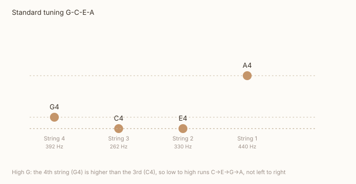
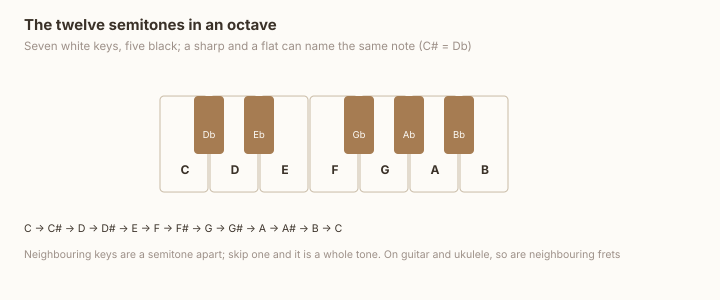
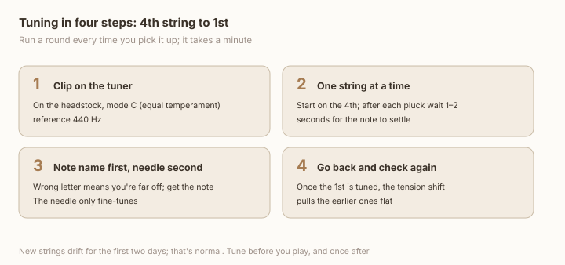

# Chapter 2: The Secret of the Four Strings, and Accurate Tuning in 30 Seconds

Many self-taught players bring a ukulele home, eagerly press the chord shapes from an online chart, and the strum comes out in some strange key that sounds nothing like a pop song. Most of the time the problem is not your fingers. It is that **the instrument is not in tune at all.**

New strings stretch a great deal, and temperature and humidity move them further, so a ukulele drifting out of tune before each session is ordinary physics. The first thing a professional does at every practice session is spend 30 seconds tuning. This chapter uncovers the unusual way the four strings are arranged by pitch, and shows you how to tune quickly and safely.

---

## 2.1 The four strings, their numbers, and standard tuning (G-C-E-A)

Hold the ukulele against your chest first: headstock to the left, body to the right, the fretboard facing away from you. Looking down at it, the four strings are numbered and named like this:

* **4th string (the top one, closest to your chin)**: note name **G** (solfège Sol)

* **3rd string (second from the top)**: note name **C** (solfège Do)

* **2nd string (third from the top)**: note name **E** (solfège Mi)

* **1st string (the bottom one, closest to the floor)**: note name **A** (solfège La)

Easy to remember: **from the top down, 4th string to 1st, it is G - C - E - A.**

*Figure: standard tuning G-C-E-A. In high G, the 4th string (G4) is a fifth, seven semitones, above the 3rd string (C4), so the four strings do not run lower to the left.*

### Why is the 4th string so thin? The secret of high G

On an acoustic guitar the six strings run in a tidy order from top to bottom: thicker and lower, then thinner and higher. Look closely at a ukulele and you find something surprising: **the 4th string at the top (G) is thinner than the 3rd string below it (C).**

That is exactly where the ukulele's characteristic sound comes from: **re-entrant tuning, usually called high G.**

| String (top to bottom) | Note name (scientific pitch notation) | Solfège (numbered notation, C major) | Standard frequency (A4 = 440 Hz) | Where it sits relative to the others |
| :--- | :--- | :--- | :--- | :--- |
| **4th string (top)** | **G4** | `5` (Sol) | **392.0 Hz** | **The high G! A fifth above the 3rd string, which gives the instrument its crisp, springy feel** |
| **3rd string** | **C4** | `1` (Do) | **261.6 Hz** | **The lowest-pitched string on the instrument (middle C on a piano)** |
| **2nd string** | **E4** | `3` (Mi) | **329.6 Hz** | A major third above middle C |
| **1st string (bottom)** | **A4** | `6` (La) | **440.0 Hz** | **The highest-pitched string on the instrument (the international pitch reference)** |

Because the 4th string (G4) is higher than the 3rd (C4), when the right hand sweeps down across the four strings the first note you hear is not a heavy bass but a clear, glassy high Sol, which then settles into a steady Do - Mi - La. That bright-then-warm acoustic arrangement gives the ukulele its own sunny, soothing air, as if a sea breeze were passing through. (Note: advanced fingerstyle players sometimes replace the 4th string with a wound `G3` an octave lower, called low G. Chapter 24 covers that in detail.)

---

## 2.2 Note names and accidentals: the code on the tuner screen

Before you switch the tuner on, spend one minute on the seven basic note names and the chromatic scale.

Western music names pitch with seven letters, in a repeating ladder from low to high:
C (Do) → D (Re) → E (Mi) → F (Fa) → G (Sol) → A (La) → B (Si) → C (the Do an octave up)

Between these seven notes sit five more semitones, like the black keys of a piano. Two symbols name them:

* **Sharp `#`**: raises the note by a semitone. `C#`, for example, is a semitone above C.

* **Flat `b`**: lowers the note by a semitone. `Bb`, for example, is a semitone below B.

> **The one thing to memorise**: among the seven notes, **`E` to `F`** and **`B` to `C`** are already a semitone apart, with no black key between them (`E♯` sounds the same as `F`, and `B♯` the same as `C`, so a piano has no separate key for either; both spellings still turn up in key signatures). Every other pair of neighbouring letters has a semitone between them.

Why does the order matter when you tune? Pluck the 3rd string, whose target is **C**. If the tuner reads **`B`**, then `B` sits to the left of `C` on the ladder above, so the string is **too low** and you need to tighten it. If the screen reads **`C#`** or **`D`**, the string is **too high** and you need to loosen it.

---

## 2.3 Tuning in four steps, and the safety rules that save your strings

Clip the tuner onto the very top of the headstock, screen toward you, and hold the power button to switch it on.

### Step one: check the tuner's mode

Many general-purpose tuners have a mode for each instrument. Press the power or function button briefly to switch the mode shown in a corner of the screen to **`C` (Chromatic, which names all twelve semitones)** or **`U` (Ukulele)**.

* Beginners should use **`C` (chromatic)**: it shows all twelve note names, so you can tell clearly whether the string is high or low, without being limited to particular string numbers.

### Step two: start on the 4th string (G) and pluck one string at a time

Pluck the 4th string gently with the right thumb — one string at a time, with the left hand resting lightly on the other three so their ringing doesn't confuse the tuner — and watch the screen:

| What the screen shows | What it means | What you do (facing the headstock) |
| :--- | :--- | :--- |
| **The letter hasn't reached the target** (target G, screen shows `F#`) | Far too low; the string is slack | **Tighten** the matching peg slowly until the letter jumps to G |
| **The letter is right (G), the needle sits left (amber or red)** | A little low | Tighten the peg slightly, so the needle moves toward the centre |
| **The letter is right (G), the needle dead centre (bright green)** | **In tune** | Stop turning and go to the next string |
| **The letter is right (G), the needle sits right (amber or red)** | A little high | Loosen a touch so the needle drops just left of centre, then come back **up from below** to the centre |
| **The letter has gone past the target** (target G, screen shows `G#` or `A`) | **Too high; the string is over-tightened** | **Loosen the peg at once**, drop below the target note, then come back up |

### Step three: work through C - E - A, then check all four again

Tune the 3rd string (C), the 2nd (E) and the 1st (A) the same way.

**One thing to watch**: as you bring the four slack strings up to tension one by one, the neck is pulled a hair forward, and that drops the pitch of the 4th and 3rd strings — the two you tuned first — very slightly. So **after all four are done, run a quick second pass from the 4th string to the 1st** and make sure every string shows green.

### Three safety rules that stop you breaking a string

1. **Pluck as you turn; never turn blind.** Bring the string to life and see the screen move before you turn a peg slowly. If the screen shows nothing after a pluck — the room is too noisy, or the battery is flat — do not keep tightening. The string will go past its limit and snap.

2. **Make sure you have the right peg.** On the 4th string, follow the line of the string to see which peg it winds onto. The classic beginner's mistake is to pluck the 4th string while turning the 3rd string's peg; the pitch on screen doesn't move, you keep tightening, and the 3rd string breaks.

3. **Always come up to the note from below.** If the string is high, loosen it until it sits just under green, then tighten back up to green. That keeps the gear teeth meshed tight, and the string holds its tuning when you play.

---

### Chapter checklist

* [ ] Without the book, I can say the standard note names of the ukulele from top to bottom, 4th string to 1st: `G - C - E - A`.
* [ ] I understand that the 4th string is the high G (G4), higher in pitch than the 3rd string (C4).
* [ ] Without anyone's help, I can get all four strings to a green light with the tuner inside a minute.

