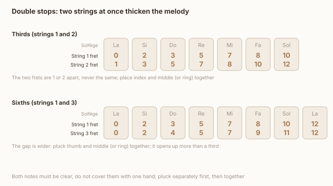
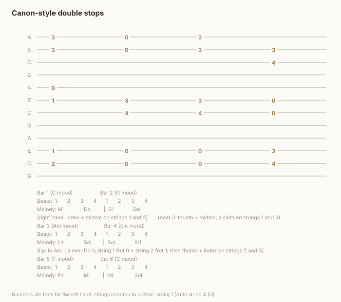

# Chapter 20: Double Stops and Beautifying the Melody

Here we enter part five: the world of fingerstyle playing.

Last chapter we learned to play a single-note melody. But you may have noticed that a single line, clear as it is, sounds a little thin on the ukulele—like one person singing alone. If we let two fingers of the right hand **sound two strings at the same time**, one string singing the melody and the other singing a harmony, the whole line becomes thick and full at once, as pleasing as a duet between two voices.

This chapter teaches the two most common and most pleasing harmonic distances in pop arranging: **double stops in thirds** and **double stops in sixths**.

---

## 20.1 Fingerings for third and sixth double stops

In music, the distance in pitch between two notes sounded together is called an **interval**. Of all the intervals, the sweetest, most harmonious and most full of pop-love-song feeling are **the third** (`Do` with `Mi`) and **the sixth** (`Mi` with the high `Do`).

### One: the right hand's plucking gesture for double stops

To play a double stop, the right thumb (`T`) and the index (`1`) or middle (`2`) finger pinch lightly toward the palm together (as if lifting a pearl with two fingertips). **Make sure both strings sound in the same millisecond**, at an even volume—do not let them come out one after the other as an arpeggio.

### Two: the C major double-stop scale chart (the most practical: thirds on the 1st and 2nd strings)

Look at the double-stop scale below. Every note of it sits on the brightest pair, the **1st string (melody on top)** and the **2nd string (harmony underneath)**. Remember the rule "the 2nd string is 1–2 frets above the 1st", and you can move the whole pattern anywhere on the fretboard.

*(The rule: for a major third the 2nd string is 1 fret above the 1st, for a minor third it is 2 frets; when you change key, the whole set shifts together.)*

### Three: fingering for sixth double stops (1st and 3rd strings sounded together)

Sixths span a wider range and sound full of classical romance and film-score grandeur. The right hand plucks the 3rd string with **the thumb** and the 1st with **the middle (or ring) finger**:

---

## 20.2 Practice: a Canon-style double-stop passage

Now we put the thirds and sixths we have just learned into a Canon-style progression, and try the three-dimensional effect of one person playing a duet!

---

### Chapter checklist

* [ ] When I pluck a double stop, my two fingers touch the strings at exactly the same moment, so both notes sound together with a balanced volume.
* [ ] I remember the shifting rule for thirds between the 1st and 2nd strings: the 2nd string is 1–2 frets above the 1st.
* [ ] I can play the Canon-style double-stop passage smoothly.
