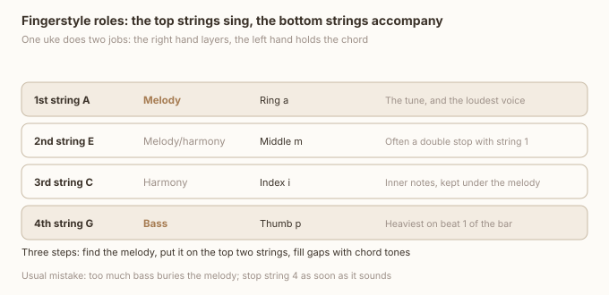
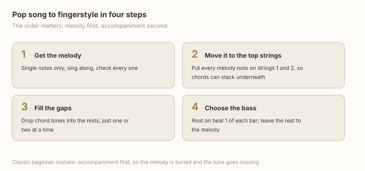
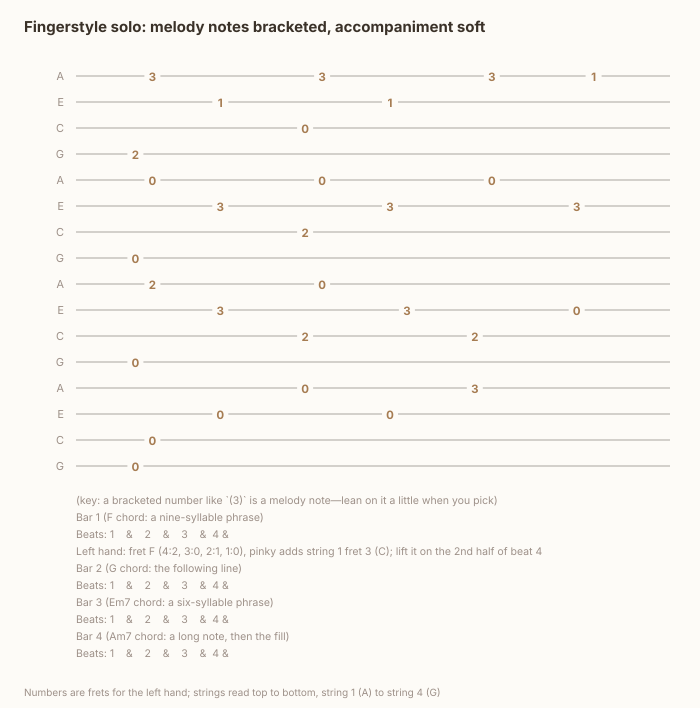

# Chapter 21: Fingerstyle, Step One — Playing the Melody and the Accompaniment at Once

Some evenings you don't want to sing at all. You want to make a cup of tea, sit in the quiet, and play a hit song on the ukulele by yourself, so that anyone listening recognises it within a bar. That is the evening you fall for **fingerstyle**.

What is fingerstyle? Put simply, **one player is a small band**. The high fingers of the right hand — index, middle, ring — pick the singer's melody out on the thinner strings, while the right thumb (`T`) takes the bass on the 4th string and the other fingers fill in the inner parts wherever there is a gap. This chapter takes apart the underlying logic of a fingerstyle arrangement, and finishes your first pop solo.

---

## 21.1 The core idea: a high melody line plus a low harmony part

Many beginners go numb at the sight of a fingerstyle tab crowded with numbers. In fact any fingerstyle piece breaks down into two simple layers:

1. **The lead layer (the melody line)**: always **the highest note among the notes sounding at that moment** (usually on the **1st and 2nd strings**). It's the soprano in a choir. When the right-hand ring finger (`3`) or middle finger (`2`) sounds a melody note, it gives slightly more weight than the accompaniment notes, so the melody floats up out of the accompaniment and sits clearly on top.
2. **The supporting layer (the chord accompaniment)**: the notes below the melody (usually on the **4th, 3rd and 2nd strings**). Their job is to fill in harmony in the gaps the melody leaves. Play them as light as a breeze; they must never take over and cover the melody.

---

## 21.2 Four steps for turning a pop song into a fingerstyle solo

Once you have these four steps, you can eventually arrange any pop song you like as a ukulele solo yourself:

| Arranging step | What you actually do | The principle, and what to watch |
| :--- | :--- | :--- |
| **Step 1: Find the single-note melody** | On the 1st and 2nd strings (the high register), work out the song's melody as single notes and mark the beats | Check that every note lands on the right beat, and learn the melody on its own first. |
| **Step 2: Fit the chord shapes underneath** | Match the chord the bar already had (`C`, `Am`, `F`, `G` and so on), and let the fingers already holding the melody note form that chord shape | Wherever you can, use a chord shape that overlaps the melody note's position, to cut down how far the left hand has to travel. |
| **Step 3: Let them sound together on beat 1 of each bar** | On beat 1 of the bar, as the melody note lands, the thumb sweeps the chord's root at the same moment (or rolls the thumb down through the strings in one sweep) | That instant of chord and melody sounding together is the fullest, most moving moment in a fingerstyle piece. |
| **Step 4: Fill the long notes with broken-chord notes** | When the melody holds a note for 2 or 4 beats, use the fingers the right hand has free to pick `3-2-3` fills into the gap | Keep the fills quiet — clearly softer than the melody, so they read as background. |

---

## 21.3 A complete fingerstyle piece: Jay Chou's 〈告白氣球〉 ("Love Confession Balloon"), a beginner's solo arrangement

This modern classic is sweet to the point of overload, and its chorus melody is shapely and repeats a lot, which makes it a good candidate for your first fingerstyle solo. We've arranged it in the friendliest key, **C major**, and marked the melody notes you have to bring out with brackets, **`( )`**.

### The golden rules for practising this piece

1. **Practise the bracketed notes on the top two strings on their own**: pick just the bracketed numbers (`3 - 3 - 3 - 1 | 0 - 0 - 0 - 3 | 2 - 0 - 3 - 0`) with the right hand, and check that your ear already recognises the opening phrase of the chorus.
2. **Then slide the accompaniment gently in underneath**: once the notes in between are added, picture your ring finger as the singer holding the microphone, and the thumb and index as the band standing at the back of the stage. The singer always stays the clearest, most solid sound.

---

### Chapter checklist

- [ ] **The dynamic layers.** You understand the balance in fingerstyle: bring out the highest note as the melody, keep the accompaniment notes in the middle soft.
- [ ] **Two fingers, one instant.** When you sound the 1st and 4th strings together (beat 1 of bar 1, for example), both fingers land exactly in sync.
- [ ] **The chorus solo.** You can play the four-bar fingerstyle passage from the chorus of 〈告白氣球〉 ("Love Confession Balloon") smoothly.
