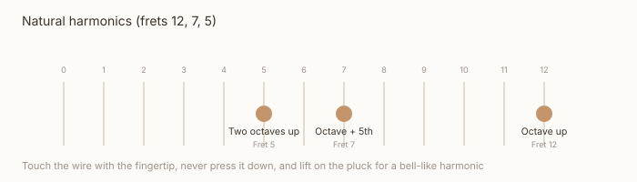
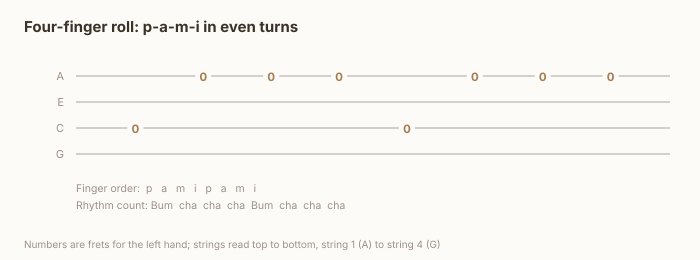
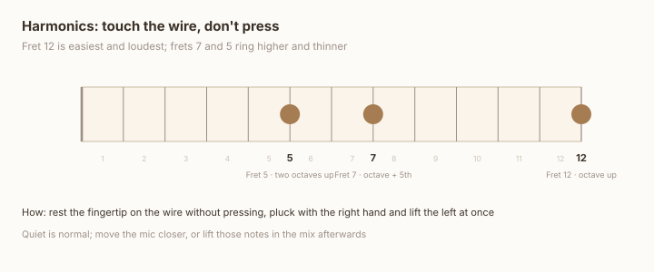

# Chapter 22: Flashy Techniques — Tremolo and Natural Harmonics

Once you start playing fingerstyle solos, you notice quickly that the ukulele — small body, low-tension nylon strings — has a much shorter **sustain** than a piano or an electric guitar. Two or three seconds after you pluck, the note has faded away.

So how do fingerstyle players make a ukulele hold a long romantic note the way a violin does, or end a song with something as clear and unreal as a crystal music box? The answer is this chapter's two showpieces: **tremolo** and **natural harmonics**.

---

## 22.1 Four-finger tremolo (a-m-i-p): training a long, unbroken note

Tremolo comes from the classical guitar; a mandolin gets a similar effect with a tremolo pick. The principle is that the fingers of the right hand **repeat one string extremely fast and extremely evenly**, so the ear is fooled into hearing a single note that never stops sounding. It is made for the long climax note of a slow romantic ballad.

*Figure: fret 12 gives an octave up, fret 7 an octave and a fifth, fret 5 two octaves up; touch lightly right over the fret wire and never press down.*

### The classic ukulele four-finger order: `p - a - m - i` (thumb → ring → middle → index)

* **`p` (thumb)**: sounds the low accompaniment string first. In standard high G the lowest note is the 3rd string, C; with low G tuning the 4th string, `G3`, is the lowest.
* **`a` (ring)** → **`m` (middle)** → **`i` (index)**: then the ring, middle and index fingers hook upward through the same high melody string (the 1st, say) three times in quick succession.

### Three rules for making the tremolo even

1. **Build finger independence slowly (never chase speed at the start!)**: the ring finger (`a`) is the least agile of the four, and beginners usually end up with a limp-horse hoofbeat instead of an even roll. Set the metronome to **`BPM = 50`**, one note per beat, and insist that the four strokes `p`, `a`, `m`, `i` match in volume and in spacing exactly — as regular as a machine gun.
2. **Keep the movement tiny**: the finger only has to hook through a space `3–5 mm` above the string, then relax back into place at once. Never lift the fingers high.
3. **Hold a chord with the left hand and tremolo through the harmony**: hold `C` → `Am` → `F` → `G7`, pluck the 3rd string (or the 4th) with `p`, and tremolo the 1st string with `a-m-i`. You will hear something like a mandolin orchestra in a Hawaiian sea breeze.

---

## 22.2 Natural harmonics at frets 12, 7 and 5

**Natural harmonics** — written `Harm.` on a chart, or with a diamond beside the number (`<12>`, `◇12`) — are the ukulele's most attractive acoustic trick. They give a pure overtone above the note you would normally get: an octave up at fret 12, an octave and a fifth at fret 7, two octaves at fret 5. The timbre is clean and transparent, like a music box or a crystal wind chime, and it is most often used for the last chord of a song.

### The physics, and the four-step method

When a string vibrates, it doesn't only swing as a whole. At **1/2** of its length (fret 12), **1/3** (fret 7) and **1/4** (fret 5) there are **nodes** — points that stand still. Touch the string lightly directly over one of these nodes and you filter out the heavy fundamental, leaving only the clear, pure upper overtones.

1. **Find the spot directly over the fret wire (this is nothing like normal fretting!)**:
    * Normally you press inside the wooden space behind the wire. To play a natural harmonic the left-hand finger has to sit **exactly over the centre of the 12th fret wire** (or the 7th, or the 5th).

2. **Touch it like a dragonfly landing; never press the string down to the fretboard**:
    * The pad of the left index (or ring) finger only has to rest on the surface of the string — just enough to feel the string against the skin. The string must not sink at all, and must never reach the wood.

3. **Pluck nearer the bridge with the right hand (a brighter tone)**:
    * Pluck with the right thumb (or index) closer to the bridge than usual, and pluck decisively, with a touch more force than normal.

4. **The critical milliseconds: release the left hand the moment the string sounds**:
    * **`0.05` seconds** after the right hand plucks, the left-hand finger leaves the string straight up. Hold on and the finger absorbs the vibration within a moment. Let go at once and that crystal bell rings on in the air for several seconds.

| Where the harmonic sits | Fraction of the string length | The pitch you actually get (1st string A, for example) | How hard it is, and what to do |
| :--- | :--- | :--- | :--- |
| **Directly over the 12th fret wire** | 1/2 of the string | **one octave** above the open string (`A5`) | **Easiest to get, and loudest.** Start at fret 12. Rolled across all four strings, one after another, it makes a dreamlike arpeggio. |
| **Directly over the 7th fret wire** | 1/3 of the string | **an octave and a fifth** above the open string (`E6`) | Extremely clear and airy. Plucking a little nearer the bridge makes it speak more easily. |
| **Directly over the 5th fret wire** | 1/4 of the string | **two octaves** above the open string (`A6`) | Very high. It needs the most precise placement right over the wire, and a firmer pluck. |

### The ending move: a C major harmonic close

Next time you finish any song in C major — 〈寶貝〉 ("Baby"), say, or 〈小幸運〉 ("A Little Happiness") played in C — don't end the last bar on a plain `C` chord. Try closing like this:

1. Hold the `C` chord and roll slowly down through the strings (2 beats).
2. On beats 3 and 4, move the left hand quickly so it sits over the 12th fret wire, touching all four strings lightly. Sweep the right thumb gently down through the 4th → 3rd → 2nd → 1st strings and **release the left hand at the same moment**.
3. Four transparent, music-box harmonics (`G - C - E - A`, high) spread out slowly in the air, and every listener in the room gasps.

---

### Chapter checklist

- [ ] **An even tremolo.** You can play `p - a - m - i` evenly at a slow tempo (`BPM = 50`), with the ring and middle fingers matching in volume and in spacing.
- [ ] **The harmonic touch.** You know a natural harmonic has to be touched lightly **right over the 12th / 7th / 5th fret wire**, and that the left hand has to leave the string the instant it sounds.
- [ ] **The crystal ending.** You can produce a clear natural harmonic on all four strings at fret 12, and use it to end a song.

