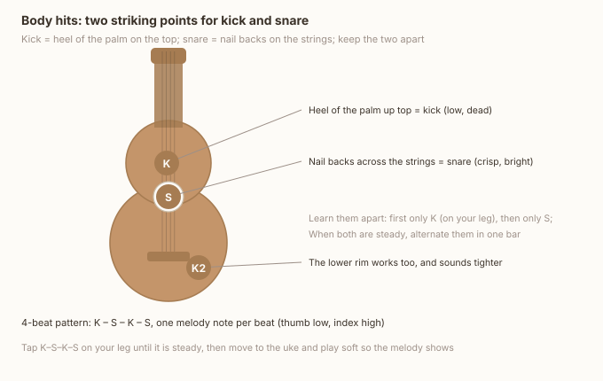
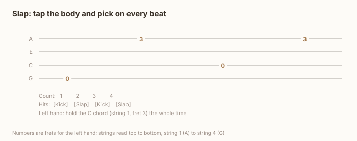

# Chapter 23: Getting Started with Percussive Fingerstyle

Have you seen videos of the modern fingerstyle guitarists and ukulele players — Sungha Jung, Jake Shimabukuro, the players doing it on the street? One person, one instrument, and somehow a melody comes out of the strings while the other hand drums a kit rhythm on the body. The whole instrument turns into a three-piece band.

That style is **percussive fingerstyle**. This chapter opens up the acoustics of the striking points on the body, and teaches you the basic coordination of playing and drumming at once: **kick plus snare**.

---

## 23.1 Where to hit the top: kick and snare

To fake the layers of a drum kit on a small ukulele, you use different parts of the right hand on two areas of the body that resonate in completely different ways:

### 1. Faking the kick drum — the heel of the palm on the top

* **Which part of the hand**: the thick fleshy pad at the base of the right palm, below the wrist (the hypothenar pad).
* **Best spot on the top**: the centre of the top between the soundhole and the bridge, where the low frequencies are fullest.
* **Why it works**: a light, springy tap with the palm pad sets the air inside the body moving at low frequencies, and out comes a deep, solid boom. One thing to remember: the wrist has to bounce straight back up, the way your hand does when you dribble a basketball. Never leave it pressed against the top, or you smother the wood's resonance.

### 2. Faking the snare — a nail, a knuckle, or the strings at the end of the fretboard

On the ukulele there are two usual ways to play the snare accents, on beats 2 and 4, and both look good:

1. **The slap (marked `X` or `⊗` on a chart)**: the side of the right thumb, or the back of the index and middle fingers, whips down like a cracking whip onto the strings at the end of the fretboard, so the strings strike the fret wire around frets 12–14 and give a bright metallic smack.
2. **The nail tap**: the back of the right middle or ring fingernail taps the edge of the top below the soundhole for a dry click.

| Drum it imitates | Usual marking | Which part of the right hand | Best spot on the ukulele | How to get the sound, and what to watch |
| :--- | :--- | :--- | :--- | :--- |
| **Kick** | `K` or `●` (the low part of the tab) | The palm pad at the base of the right hand | The centre of the top, between soundhole and bridge | Relaxed wrist, tap and bounce straight off; let the body produce the deep boom |
| **Snare / slap** | `S` or `⊗` | The side of the right thumb / the back of the middle fingernail | Over the strings at frets 12–14, at the end of the fretboard | Strike firmly so the strings hit the fret wire for a bright smack, which also cuts off the ringing from the beat before |

---

## 23.2 Playing melody and percussion together

What makes percussive fingerstyle both fascinating and difficult is this: **the right hand has to do two things in the same instant — hit the kick with the palm (or slap the snare), and pluck a melody note with a finger.**

### Two coordination drills (no chart needed, just start)

#### Drill 1: kick plus thumb (`K + T`)

1. Hold the easiest `C` chord with the left hand (3rd fret of the 1st string).
2. Set the right hand above the soundhole. At the exact moment the palm pad comes down on the top above the soundhole, the right thumb sweeps down through the 4th string (or the 3rd).
3. You hear the low boom and the bright chord note arrive together.

#### Drill 2: slap plus index (`S + 1`)

This one is the heart of the style, and it is called **slap and flick**:

1. As the side of the thumb slaps down across the 4th and 3rd strings for the snare, the curled right index (or middle) finger flicks upward through the 1st or 2nd string and pulls the melody note out with it.
2. Loop it: with the metronome at `BPM = 65`, repeat this four-beat groove.
    * **Beat 1**: palm pad plays the kick, thumb plucks the 4th string (`boom + string`)
    * **Beat 2**: thumb slaps the snare, index plucks the 1st string (`slap + melody`)
    * **Beat 3**: palm pad plays the kick, thumb plucks the 3rd string (`boom + string`)
    * **Beat 4**: thumb slaps the snare, index plucks the 1st string (`slap + melody`)

*(Once you have this four-beat pattern, swap the left hand through `C` → `Am` → `F` → `G7` and you can accompany yourself, playing and singing 〈寶貝〉 ("Baby") or 〈稻香〉 ("Rice Field") with nothing but percussive fingerstyle. It sounds live.)*

---

### Chapter checklist

- [ ] **The kick.** When you hit the top with the palm pad for the kick, the wrist bounces straight off, and the low end comes out full rather than dead.
- [ ] **The snare.** You can get a clean slap out of the strings without hitting the top hard enough to damage it.
- [ ] **The four-beat loop.** You can play the basic pattern — kick and a plucked string on beat 1, snare and a melody note on beat 2 — all the way round.
