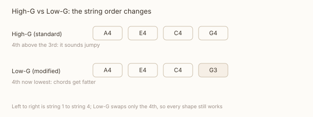
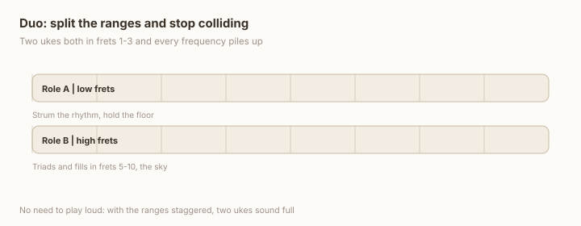

# Chapter 24: Fitting a Low G String, and Playing Duets

After a while on the ukulele you start coming across solo videos with a deeper, rounder tone that almost sounds like a classical guitar, and the title usually says **"Low G Ver."** Many adult players eventually think about a second ukulele strung in low G, or about a duet when friends come round — one high G and one low G.

This chapter goes through the acoustic difference between high G and low G, and what changing over involves. Then it gives you the way to split the parts, so that two ukuleles in a duet don't fight each other and the whole thing gains a dimension.

---

## 24.1 High G and low G compared: timbre, range, and what each is good for

In Chapter 2 we said that the 4th string of a standard ukulele is the high G (`G4`, `392.0 Hz`), higher than the 3rd string (`C4`). Fitting a low G means taking that thin 4th string off and putting on a dedicated **low 4th string** (`G3`, `196.0 Hz` — a full octave lower). It usually has fine metal wire wound around the outside (a **wound string**) to add mass and low resonance.

With a low G on, the four strings run from the 4th down to the 1st in order of pitch, low to high (`G3 - C4 - E4 - A4`). That layout is called **linear tuning**, and it extends the useful range downward by a perfect fourth — five semitones, the short stretch of low notes from `G3` up to `B3`.

| What you're comparing | Standard high G (`G4 - C4 - E4 - A4`) | Low G (`G3 - C4 - E4 - A4`) |
| :--- | :--- | :--- |
| **Pitch and look of the 4th string** | High G (`G4`), a clear fluorocarbon or nylon monofilament | **G an octave lower (`G3`)**, thicker, usually with silver or gold wire wound round it |
| **Character of the whole instrument** | Bright, springy, sunny, full of Hawaiian island air | **Warm, dark and round**, close to the fine texture of a miniature classical guitar |
| **Where it fits best** | Light folk strumming, reggae, chucking, small bright Japanese-style pieces | **Ballads with a low male voice, modern fingerstyle solos, classical arrangements** |
| **Do the chord shapes still work?** | **Completely.** Low G only turns the existing high G into a low G; none of the chord diagrams or strumming in this book needs changing. | **Completely.** But in some fingerstyle pieces written for high G, a melody note that sat on the 4th string will now sound an octave down. |
| **What to watch when you change over** | The factory standard; nothing to adjust. | On some inexpensive instruments the 4th-string slot in the nut is narrow, and a thicker low G may need the slot opened up a little with fine sandpaper. |

> **If you're thinking about a second instrument**: the ideal pair is a **23-inch concert kept in standard high G** (for strumming and singing bright songs) and a **26-inch tenor fitted with low G** (for ballads and fingerstyle solos).

---

*Figure: low G means changing only the 4th string. In high G the 4th string is higher than the 3rd; in low G it becomes the lowest note. The fingering doesn't change.*

## 24.2 Splitting the parts in a duet: rhythm down low, triads up high

Two friends, two ukuleles, one pop song. The mistake beginners make is to sit side by side holding the same open chords low on the neck and strumming the same folk-rock pattern. It's loud, all the frequencies pile into the same place, and the moment one of you pushes the beat slightly it sounds like a traffic accident.

To get the three-dimensional layering of an orchestra out of two ukuleles, divide the registers strictly: **one player takes the floor, the other takes the sky.**

### Player A: the rhythm player (the floor — full harmony and groove down low)

* **What they use**: the **open chords at frets 1–3** from earlier in this book (`C, Am, F, G`), played as a steady folk-rock strum, a chuck, or a slow-soul groove, holding the rhythmic frame of the whole song.

### Player B: harmony and melody up high (the sky — triads and fills)

* **What they use**: nothing at frets 1–3. Instead, **triads between frets 5 and 10**, picked cleanly, played as double stops, or used as short off-beat chucks — a conversation of high against low with player A.

A triad up the neck is not a new chord. It is the same set of notes, repeated an octave higher. One rule covers it: **move a whole shape N frets toward the body and every note goes up N semitones.** Every note in the four shapes below has been checked against its note name:

| Chord | Low position (4th, 3rd, 2nd strings; `G` uses 3, 2, 1) | The notes | High position (3rd, 2nd, 1st strings) | The notes |
| :--- | :--- | :--- | :--- | :--- |
| `C` | 4th string fret 0, 3rd string fret 0, 2nd string fret 0 | G–C–E | 3rd string fret 7, 2nd string fret 8, 1st string fret 7 | G–C–E |
| `Am` | 4th string fret 2, 3rd string fret 0, 2nd string fret 0 | A–C–E | 3rd string fret 9, 2nd string fret 8, 1st string fret 7 | A–C–E |
| `F` | 4th string fret 2, 3rd string fret 0, 2nd string fret 1 | A–C–F | 3rd string fret 5, 2nd string fret 5, 1st string fret 3 | F–A–C |
| `G` | 3rd string fret 2, 2nd string fret 3, 1st string fret 2 | D–G–B | 3rd string fret 7, 2nd string fret 7, 1st string fret 5 | G–B–D |

Three things to remember:

1. **Play only the three strings you are holding.** The high shapes all sit on the 3rd, 2nd and 1st strings. Don't play the 4th; rest the heel of the right hand on it to stop it.
2. **The same notes, an octave apart.** Low `C` is G–C–E, and high `C` is G–C–E. So when player A strums `C`, player B's high `C` from the table is guaranteed to fit.
3. **Check it yourself once.** Take the `G` shape on the 3rd, 2nd and 1st strings (frets 2·3·2) and move the whole thing 5 frets toward the body: it becomes frets 7·8·7, which is exactly the high `C` in the table. N frets up, N semitones up. That holds anywhere on the neck, and it still works when you change key.

> **Why move up the neck at all?** With both instruments at frets 1–3 all the frequencies crowd into one place, and the more you strum the muddier it gets. Move one player to frets 5–10 and the registers separate: one floor, one sky.

### Three ways two players can interact

1. **Call and response in the verse.** Player A fingerpicks the accompaniment and player B doesn't strum at all, using the **pentatonic scale** from Chapter 19 to answer the ends of phrases with two single notes.
2. **High against low in the chorus.** Player A strums folk-rock down low; player B plays short reggae upstrokes on the off-beats (an `&` placed as a fill) up at frets 5–10. The registers never overlap, and it sounds like an acoustic and an electric guitar playing together.
3. **A harmonic to close.** In the last bar, player A rolls slowly through a `C` chord low on the neck while player B sounds a clear natural harmonic at fret 12, and the song comes to a full stop.

---

### Chapter checklist

- [ ] **The two tunings.** You know the difference in timbre and in repertoire between high G (clear and bright) and low G (warm and dark, the 4th string an octave down).
- [ ] **Triads up the neck.** You know a high triad is the same notes an octave up, and you can work the shape out yourself with "N frets up, N semitones up" (for example, `G`'s 3·2·1 shape moved up 5 frets is `C`).
- [ ] **A real duet.** You can play a pop song with another ukulele player, one low and one high, with the parts kept apart.

