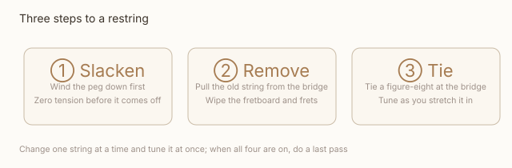
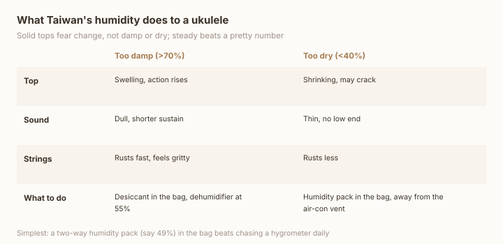
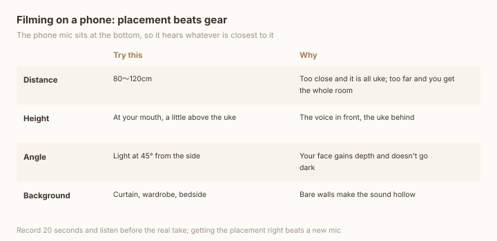

# Chapter 25: Restringing and Care, and Recording Yourself on a Phone for Social Media

Twenty-four chapters on, you are no longer the beginner who knew nothing about the instrument. You can read a chart, transpose, keep a groove going, play fingerstyle, and even play with a friend.

In this last chapter we cover how to keep the instrument you love in good shape — changing the strings yourself, and keeping the damp out — and how to use the phone in your pocket to record a clean-sounding, good-looking short video of you playing and singing (a Reel or a Short), and hand the comfort of the music on to the people around you.

---

## 25.1 Choosing string material, and every step of a restring

Strings are consumables. Sweat from your fingers eats into them and they rub against the frets, so every **3 to 6 months** (2 to 3 months if you practise daily) they start to go: the intonation drifts and the octaves stop matching, the tone turns dull and closed, and you can see dents in the surface. That is the point to put a new set on.

*Figure: three steps to a restring — loosen, take off, then wind a figure-eight and keep tuning while you pull the string tight. One string at a time.*

### 1. A guide to the main string materials

| Material | English name | Brands to look at | Feel, tension and appearance | Tone, and what it suits |
| :--- | :--- | :--- | :--- | :--- |
| **Fluorocarbon** | Fluorocarbon | Worth, D'Addario Fluorocarbon, Aquila Super Nylgut | Thinner gauge, clear and bright to look at, medium tension on the crisp side | **Very articulate, long sustain, plenty of brightness.** The first choice for modern pop accompaniment and fingerstyle solos. |
| **Super Nylgut** | Nylgut (Super Nylgut is Aquila's improved version) | Aquila, the Italian firm | Milky white, slightly smooth and springy, medium tension | **Warm and sweet, full and round.** The most traditional Hawaiian ukulele character, and the first choice for unamplified accompaniment. |
| **Traditional nylon** | Clear / black nylon | GHS, Martin | Clear or black, the softest under the fingers | Gentle and mellow, good for beginners whose fingertips still hurt, and for quiet pieces. |

### 2. Changing the strings yourself in four steps (one at a time, so the order can never go wrong)

**The golden rule: take one off, put one on.** Never cut all four old strings at once. Take off a single string and fit its replacement immediately, and the bridge and the nut keep an even load — and you can't possibly get the thick and thin strings in the wrong places.

1. **Tie the knot at the bridge (a figure-eight)**:
    * Thread the new string through the small hole in the bridge and leave about `5 cm` of tail.
    * Pass the tail under the main string, then take it around itself once, the way you tie a figure-eight — a loop crossed over to make an 8, with the last turn **lying over the lower edge of the bridge**. Pull the main string tight and check that the knot is jammed hard against the edge of the bridge and can't slip off.

2. **Leave the right amount of slack**:
    * Pull the string straight through the hole in its tuning post, and once it is through, **hook a finger under it at fret 12 and lift it about `3–4 cm`**. That slack is exactly what lets the string wind **2.5 to 3 neat turns** around the post. Too few turns and it slips out of tune; too many and they crowd into each other.

3. **Wind downwards in neat turns around the post**:
    * As you turn the peg to take up the string, press it lightly with your other hand so every new turn sits **neatly below the one before**, spiralling downward. Then cut the extra tail with side cutters, leaving about `0.5 cm`.

4. **Stretch the new string**:
    * Nylon and fluorocarbon strings stretch a great deal in their first two days, and go out of tune every five minutes of playing. Once the string is on and tuned, hook a finger under it above the soundhole and **pull it gently upward about `1–2 cm`**, a few times from side to side, then tune it again. Repeat **3 or 4 times** and the settling period is much shorter.

---

## 25.2 Looking after it in Taiwan's humid climate

A ukulele — especially a solid-top or all-solid instrument — is a living thing made of wood, and it is very sensitive to humidity. Relative humidity in Taiwan runs at 75%–85% most of the year. Without care the top takes on moisture and swells, which raises the action until the instrument is hard to play; and if it sits for months in the draught from a dehumidifier, the wood dries and cracks instead.

* **The range to aim for**: **`50%–55%` relative humidity**, `20°C–26°C` room temperature.
* **Three rules for looking after it at home**:
    1. **Keep an instrument humidity pack in the bag or case.** A two-way humidity control pack (Boveda 49%, or a desiccant made for instruments) is the least fuss and the safest thing you can do.
    2. **In the rainy season, keep the instrument out of the dehumidifier's draught.** Set the room unit to `55%`, and stand the ukulele in a corner of the room or put it away in a padded bag.
    3. **Wipe the fretboard and strings after every session.** Keep a microfibre cloth, and spend ten seconds clearing the sweat and oil off the strings and the fretboard; it noticeably lengthens the life of the strings.

---

## 25.3 Shooting a good Reel or Short on a phone: placement and sound

When you have a song down, use the phone to record how far you have come and put it on Instagram Reels, YouTube Shorts or TikTok. You don't need expensive studio gear. Get these three settings right and the video comes out far better than the equipment would suggest.

### 1. Microphone distance and angle (no more tiny voice and booming strums)

The phone's built-in microphone sits at the bottom, beside the charging port. Most people put the phone right in front of the soundhole and close in, and end up with a recording that is nothing but booming low end from the strumming, with the voice completely buried.

* **The triangle to aim for**: stand the phone about `80–100 cm` from your body, a little above chest height (roughly level with your collarbone), with the bottom microphone pointing at **the space between your mouth and fret 12 of the neck** — never straight into the soundhole. The balance between voice and ukulele then comes out even and natural.

### 2. Light and framing (for a warm, quiet look at home)

* **Light from 45 degrees to the side.** Sit by a window or a warm floor lamp and let the light fall across your face and the grain of the top from 45 degrees in front and to one side. It brings out the warmth of solid wood, and it flatters the shape of the face.
* **Frame on the diagonal.** In a vertical 9:16 video, let the neck run up toward the top left of the frame and put your upper body and both hands in the centre. That gives the shot the most energy.

### 3. Turn on the phone's better audio settings

* On an iPhone, keep **Settings → Camera → Record Stereo Sound** switched on (or record through the free *Dolby On* app, which filters out the air conditioning and the room's background noise without loss, and the ukulele's articulation comes up a level at once).

---

## Chapter checklist

- [ ] **String materials.** You can describe the difference in tone between fluorocarbon and nylon, and you know to change one string at a time and tune as you go.
- [ ] **The bridge knot.** You know the tail has to go round in a figure-eight with the last turn over the lower edge of the bridge, so the string can't slip off.
- [ ] **Back in tune.** After a restring you can bring it back to standard tuning (`G-C-E-A`) and check that nothing buzzes against a fret or rattles.
- [ ] **A 30-second recording.** You have recorded yourself playing and singing on the phone, and you know to put the microphone between the body and your mouth.
- [ ] **Rights before uploading.** You know to check the rights on the music and the footage before posting, so you aren't using someone else's copyright material.

---

## Closing: let music be the place you can always go

My friend, congratulations on finishing all 25 chapters of *Ukulele: Pop Accompaniment and Solo Playing*.

Think back to the first day you picked up this small four-string instrument. You may have hesitated over which way to turn the tuner, and lined up a single `G7` one finger at a time. Now you can read a chord progression, use a capo to change key at will, strum a folk-rock groove and a chuck, and even play harmonics that ring like a crystal bell, or a fingerstyle solo.

Remember that learning music never graduates, because it is not an exam — it's a companion through the happiness and the sadness of a life. However busy work gets, however tired you are, as long as this ukulele is standing in a corner of the room, you can pick it up at any moment and sound the first `C` chord. The door of the music stays open for you.

May every melody you play sound like the truest, happiest version of you.
