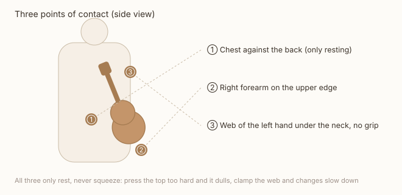
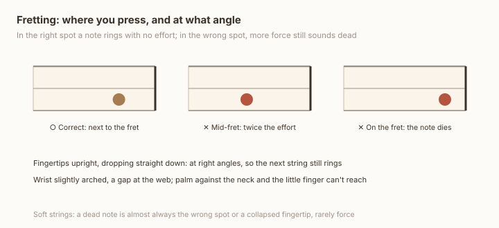
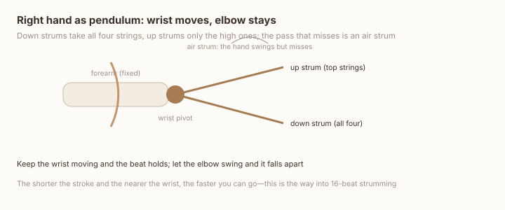
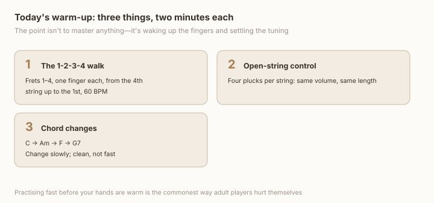

# Chapter 3: Holding the Ukulele Without Aching, and How Each Hand Works

With the instrument in tune, most people want to press a chord and strum straight away. Before that, give yourself 10 minutes to build the right ergonomic posture.

Why do those 10 minutes matter? The two reasons adults most often give up — **an aching left hand at the web of the thumb and at the wrist**, and **the body sliding down as if it were about to fall** — usually come from how they held the instrument on day one and how they applied force. Once the wrong muscle memory forms, correcting it later takes far longer, because it has to be practised deliberately. This chapter shows the most relaxed, most natural hold, and the basics of each hand.

---

## 3.1 How an adult holds it at home: three points of contact, steady without a strap

A ukulele is small and light, with no big body to rest securely on your thigh the way an acoustic guitar has, so beginners unconsciously use the left hand to hold the neck up and stop the instrument sliding. The consequence: with the left hand taken hostage to support the instrument, the fingers can no longer move freely to change chords.

The correct hold builds **three points of support — the chest, the right forearm, and the web of the left hand** — and leaves the left hand completely free:

1. **Against the chest (first support)**: sit on the front edge of a chair or sofa with your back naturally straight, and lay the back of the ukulele flat against your right chest (or just above the navel). The headstock points naturally forward-left, tilted up about **15 to 30 degrees** from the floor. Never let the headstock droop toward the floor; that twists the left wrist badly.

2. **The forearm (second support)**: let the right arm hang naturally, then use the **inside of the right forearm, about 5 ~ 10 cm below the elbow**, to hold the lower-right curve of the body lightly, pressing the instrument steadily toward your chest.

3. **The web of the thumb (the third, helping point)**: by now you will find that with the left hand entirely let go, the ukulele still sits firmly between your right arm and your chest. Now raise the left hand lightly and let the neck fall naturally between the pad of the left thumb and the base of the index finger.

---

*Figure: all three points only rest — chest, right forearm, web of the left hand. Grip hard at any one of them and the tone dulls and the chord changes slow down.*

## 3.2 The golden rules of left-hand fretting: a full note, no fret buzz

When a left-hand finger presses a string at a fret and you pluck it, if what comes out is not a clean note but a dull thud, or a metallic rattle (players call it **fret buzz**), check these four details straight away:

### 1. A fingertip vertical to the fretboard, leaving a half-round tunnel

The **first joint of a left-hand finger — the one nearest the nail — must stay bent**, and the very tip of the pad presses straight down on the string. Never let the joint collapse and lay the pad flat on the string. A flat finger puts the flesh under the pad against the neighbouring string below, and that string stops sounding.

### 2. The golden spot: right against the inside edge of the fret wire

This is the most important rule for saving effort. Take fret 3, the wooden space enclosed by the 2nd and 3rd fret wires.

* **Wrong**: pressing in the middle of the space, or near the top of it, by the 2nd wire. The string never meets the 3rd wire firmly; it takes twice the force, and it very easily produces a rattling buzz.

* **Right**: press **about 2 ~ 3 mm inside the lower wire, the 3rd one** (but not directly on top of the wire, or the note goes dull). From there it takes half the force to seat the string against the fret wire, and the note comes out at its clearest and fullest.

### 3. Where the thumb goes, and the gap at the web

The left thumb rests naturally on the centre line of the back of the neck, roughly behind the index and middle fingers, as the fulcrum you press against. Leave a gap between the palm and the underside of the neck big enough to hold a small egg (**keep the web open**). Never wrap the whole hand round the neck as if gripping a baseball bat; that limits how far the fingers can stretch.

### 4. Keep the left-hand nails cut short

With long nails the fingertip cannot stand vertically on the fretboard and you are forced to lay the pad flat instead. To learn the ukulele without fighting the instrument, cut the nails of all five left-hand fingers level with the tips.

| Symptom in the left hand | Likely cause | The fix, right now |
| :--- | :--- | :--- |
| **A metallic rattle when you pluck (fret buzz)** | 1. The finger is too far from the fret wire. 2. Not enough pressure on the string. | Move the finger 2 ~ 3 mm toward the inside of the lower wire, and press straight down with the fingertip. |
| **The open string next to it goes dead** | 1. A finger joint has collapsed and the pad is touching the neighbouring string. 2. The web is pressed against the neck, flattening the shape of the hand. | Drop the palm slightly (keep the web open), stand the fingertip joints up, and check that every finger forms an arch. |
| **The web and the wrist ache within five minutes** | 1. The left hand is carrying the weight of the instrument. 2. The thumb is squeezing the neck too hard. | Take the weight again with the right forearm; relax the left hand and use only the smallest force that still makes the note ring. |
| **The fingers won't spread and can't reach a distant fret** | The headstock is drooping toward the floor, or the thumb has climbed above the neck. | Raise the headstock about 20 degrees, and bring the thumb down to the very centre of the back of the neck. |

---

## 3.3 The right hand's basic motion: the wrist pendulum for plucking and strumming

The right hand on a ukulele usually needs no pick. The pads of the fingers and the nails alone give a tone that is warm and fine, crisp and lively, all at once.

### 1. Plucking single notes with the thumb

For single-note melodies and for tuning, the right thumb does most of the work:

* Rest the right index, middle and ring fingers lightly on the top of the body, below the soundhole, as a steady anchor.

* Use the pad on the left edge of the thumb, near the tip, and sweep down through the string. After the pluck the thumb comes to rest against the next string. Players call this a **rest stroke**, and it gives the fullest, steadiest tone.

### 2. Strumming with the index finger

Strumming is the central action of pop singing and playing. Many beginners swing the whole right arm up and down like a machine; the sound comes out stiff and loud, and the fingers keep catching on the strings.

Hold on to this image: **you have just washed your hands, there is no towel, and you are shaking the water off your fingertips.**

* **The wrist drives, not the elbow**: keep the forearm steady against the body, let the wrist go completely loose, and swing it up and down like a pendulum.

* **Down strum (marked ↓)**: the wrist swings naturally down and the **back of the right index finger (the nail side)** slides through the 4th, 3rd, 2nd and 1st strings. Touch them lightly, the way a feather skims water; don't push the finger deep into the gap between the strings.

* **Up strum (marked ↑)**: the wrist carries back up and the **pad of the right index finger** hooks from the 1st string up through the 2nd, 3rd and 4th.

* **Where to strum**: above the soundhole, where the fretboard ends (around fret 12 ~ 14). The string tension there is middling, the strum feels smoothest, and the tone is warmest and most even.

---

## 3.4 Today's warm-up: the spider walk and steady open strings

Before the next chapter, where we read music, spend five minutes on each of these two basics and wake up the connection between your hands and your brain:

### Exercise A: the left-hand "1-2-3-4" spider walk (teaching the fingertip to stand up)

1. Press fret 1 of the **1st string** with the tip of the left index finger (finger 1) standing up, and pluck the 1st string with the right thumb. Check that the note is clean, with no rattle.

2. Keep the index down. Press **fret 2 of the 1st string** with the middle finger (finger 2) and pluck the 1st string.

3. Keep both down. Press **fret 3 of the 1st string** with the ring finger (finger 3) and pluck the 1st string.

4. Keep all three down. Press **fret 4 of the 1st string** with the little finger (finger 4) and pluck the 1st string.

5. When that is done, repeat the whole thing on the 2nd, 3rd and 4th strings in turn. Once a day, and the fingers loosen up faster than you would expect.

### Exercise B: the right-hand open-string pendulum (teaching the wrist to stay loose)

1. The left hand presses nothing at all; all four strings stay open.

2. Count four steady beats in your head: `1 - 2 - 3 - 4`.

3. On every beat, strum down once with the nail of the right index finger (↓). In the middle of each beat — on the "&" — the wrist must swing back up to the ready position, set up for the next down strum.

4. Once that is comfortable, hook up with the pad of the index on each "&" as well (↑), so the motion becomes a continuous, even down, up, down, up.

---

### Chapter checklist

* [ ] With my left hand completely let go, the ukulele still sits between my right forearm and my chest without sliding down.
* [ ] When I fret, the fingertip stays bent and vertical, and sits just inside the fret wire.
* [ ] When I strum, the wrist drives the motion, rather than the whole arm swinging stiffly up and down.

