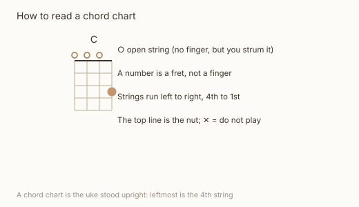
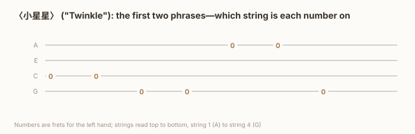
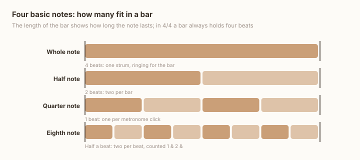
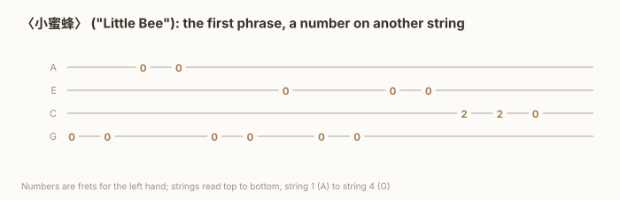

# Chapter 4: Reading Pop Guitar and Ukulele Chord Charts, and Counting Time

Well done — by this chapter your hands are ready. Before you play your first pop song, there is one last piece of the puzzle: **reading the kind of music written for playing and singing.**

The good news: learning pop songs needs **no staff notation at all**. Guitar and ukulele players today look a song up online and play it from two intuitive things — the **chord diagram** and the **TAB** — plus the letters printed above the lyric. The system is as simple as a metro map, and five minutes is enough to have it.

---

## 4.1 Reading a chord diagram in five minutes

Search for any Mandopop song's ukulele chart and you will find letters above the lyric — `C`, `Am`, `F`, `G7`. Those letters name the **chord**. The little grid that tells you where the fingers go is the chord diagram.

*Figure: a chord diagram is the ukulele standing upright, facing you. The leftmost line is the 4th string; `○` above means open, `✕` means don't play, and the number in a dot is the finger number (the row a dot sits in is the fret).*

### 1. The change of viewpoint: stand the ukulele up facing you

The first step to reading a chord diagram is getting the picture and the instrument to line up. Imagine standing the ukulele **upright, headstock up, body down, the fretboard facing your eyes.** That is the viewpoint every chord diagram uses:

### 2. The five symbols on a chord diagram

1. **The four vertical lines**: left to right they are the **4th string (G), 3rd (C), 2nd (E) and 1st (A)**. The leftmost is the 4th string (G), nearest your chin; the rightmost is the 1st string (A), nearest the floor. Note that with high G tuning the 4th string is not the thickest — the 3rd (C) is.

2. **The horizontal lines and the spaces between them**: the thick line at the top is the nut, and counting down you get fret 1, fret 2, fret 3, fret 4. If a chord higher up the neck doesn't start at fret 1, the left of the diagram gives the starting fret — `3fr`, for example, means it starts at fret 3.

3. **The black dots and their numbers (left-hand fingering)**: a dot marks the fret a finger presses. Inside or below the dot there is usually a number, `1` to `4`, for the four fingers of the left hand:
   * **`1`**: index finger
   * **`2`**: middle finger
   * **`3`**: ring finger
   * **`4`**: little finger
   (The left thumb supports the neck from behind and takes no number; if it ever has to fret a string it is marked `T`.)

4. **`O` above the diagram (open string)**: the left hand presses nothing on that string, but a right-hand strum **must include it**, so that it sounds too.

5. **`X` above the diagram (muted, don't play)**: that string should not sound in this chord. It is rare on the ukulele; most chords sound all four strings.

---

## 4.2 Getting to know TAB: the ally for intros and fingering

When a song has a good single-note intro, or you want to practise a right-hand arpeggio pattern, you use **tablature, TAB for short**.

Where a chord diagram shows the ukulele standing up, TAB shows it **lying across the page**, the way you see the fretboard when you look down at it — except that up and down are reversed from what you see. Watch out for that.

### Three rules for reading TAB

1. **Top is the 1st string, bottom is the 4th string**: the top horizontal line is the **1st string (A)** and the bottom one is the **4th string (G)**. That is the reverse of what you see looking down at the instrument, so don't try to memorise it by instinct — just remember "top is the 1st string". Also, with high G tuning the thickness of the strings does not run thin at the top to thick at the bottom: the 3rd (C) is both the thickest and the lowest, and the 4th (G) is thin.

2. **A number on a line means which fret**, not which finger:
   * **`0`**: no finger at all — the open string.
   * **`3`**: the left hand presses that string at fret 3.
   * **`7`**: the left hand presses that string at fret 7.

3. **Read from left to right**: numbers in a row across the page are played one note after another, a single-note melody. Numbers **stacked vertically, one above another**, mean those strings are **plucked or strummed together** as a chord.

| What you compare | Chord diagram | TAB |
| :--- | :--- | :--- |
| **Direction** | Headstock up, standing upright | Headstock left, lying across the page |
| **Where the 1st string (thinnest) is** | The **right**most vertical line | The **top** horizontal line |
| **Where the 4th string (G) is** | The **left**most vertical line | The **bottom** horizontal line |
| **What the numbers mean** | **Left-hand finger numbers** (1 index, 2 middle, 3 ring, 4 little) | **Fret numbers** (0 open, 1 first fret, 2 second fret …) |
| **What it is mainly for** | Chord accompaniment, and looking up a chord shape quickly | Single-note intros, right-hand arpeggios, fingerstyle solos |

---

## 4.3 Beats and rhythm: the 4/4 that pop songs live in

Now that you know where to press, the next question is when to strum and how many times. What makes pop music nod along is a steady **beat**.

Almost every Mandopop song is in **`4/4`**, which means **a quarter note to the beat, four beats to the bar**. Think of the second hand of a clock: each bar counts evenly `1 - 2 - 3 - 4`, and when the four beats are done the next bar starts, over and over.

### The three note values and strum arrows you have to learn

Pop charts print arrows above the chords — `↓` for a down strum, `↑` for an up strum — and different note values combine them into an endless variety of rhythms:

| Note | Length (in `4/4`) | How you count it out loud | The strum it usually maps to | How it feels |
| :--- | :--- | :--- | :--- | :--- |
| **Whole note** | All **4 beats** | `1 - 2 - 3 - 4` | One down strum (↓) on beat 1, letting the sound ring for the full 4 beats | Broad and still; good for the start or the end of a song |
| **Half note** | **2 beats** | `1 - 2` / `3 - 4` | Down strum (↓) on beat 1, another down strum (↓) on beat 3 | Steady and gentle; good for laying out a ballad verse |
| **Quarter note** | **1 beat** | `1` / `2` / `3` / `4` | One even down strum per beat: `↓ ↓ ↓ ↓` | Solid, with a sense of walking; the best rhythm for a beginner building a feel for the beat |
| **Eighth note** | **Half a beat (0.5)** | `1 & 2 & 3 & 4 &` | Down strum on the numbers, up strum on the `&`s: ↓ ↑ ↓ ↑ ↓ ↑ ↓ ↑ | Light and flowing; the foundation of every pop strumming pattern |

### Why you have to use a metronome

When you are new to an instrument, most of your attention goes to the left hand's chord changes. Hit a chord that is hard to press and the right hand stops of its own accord to wait for the left, so the whole song comes out in fits and starts, speeding up and slowing down.

Download any free metronome app, or simply search for "metronome" in a browser, and set the tempo to **`BPM = 65 ~ 70`**. BPM means beats per minute.

* **The golden rule of practice**: **better slow as a snail than a broken beat.** Even if a chord change is half a beat late and not properly pressed, the right hand keeps strumming in time with the metronome's click, click, click, click. It never stops for the left hand.

---

## 4.4 Putting it together: 〈小蜜蜂〉 ("Little Bee"), single notes and strumming

To test whether chord diagrams, TAB and `4/4` have landed, pick up the ukulele and play this melody everyone knows.

### Task one: play the single notes from TAB (right thumb, one or two beats per note)

*(Hint: G4, A4 and E4 are all open strings — the 4th, 1st and 2nd. Only the last D presses the 3rd string at fret 2 with the middle finger; the C is the open 3rd string.)*

### Task two: hold a steady down strum from the chord diagram (four bars of C, all down strums)

Fret the **C major chord** from the start of this chapter — left ring finger on the 1st string at fret 3 — and strum down evenly with the metronome counting `1 - 2 - 3 - 4`, for four bars, sixteen strums in all. Feel all four strings ring together, and hear the harmony they make.

---

### Chapter checklist

* [ ] I can tell a chord diagram (upright, numbers are finger numbers) from TAB (lying across the page, numbers are frets).
* [ ] I know that in `4/4` a whole note lasts 4 beats and an eighth note lasts half a beat (counted `1 &`).
* [ ] I can follow a metronome at `BPM = 70` and strum quarter notes steadily with the index finger, without rushing or dragging.
