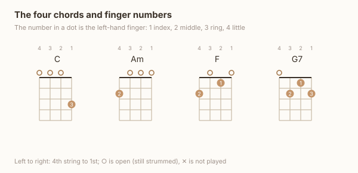
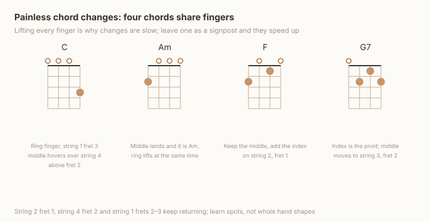
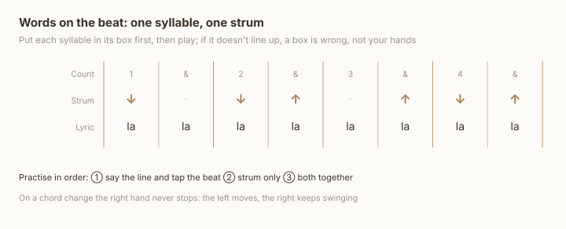
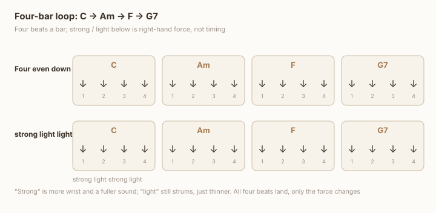
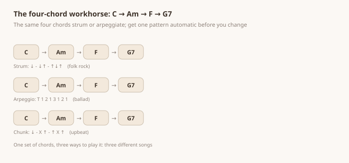
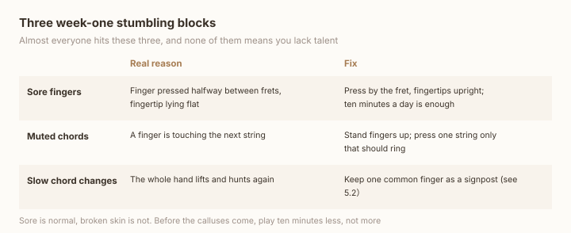

# Chapter 5: The Four Chords Behind Mandopop (C - Am - F - G7)

From this chapter on, you are properly inside the world of Mandopop, playing and singing at once.

Have you ever wondered why so many pop songs sound so easy on the ear, why one listen to the chorus is enough to hum along? The secret is the **chord progression**. Pop history has a golden combination known as the **50s progression**, and in Mandarin pop as "the four chords that do everything": **`C` → `Am` → `F` → `G7`**, which in theory is the **1 - 6 - 4 - 5** progression.

On the ukulele these four are not only easy to press but link end to end into a loop that never stops, and with them alone you can play and sing any number of Mandarin pop classics. This chapter goes through their fingerings one at a time, hands you the trick of changing chords without pain, and takes you through your first pop hit.

## 5.1 The four core chords of C major

Work through the chord diagrams below, one chord at a time. Each time you have a chord fretted, pluck **slowly** from the 4th string to the 1st with the right thumb, and check that every string rings clear, with no other finger's pad deadening it.

*Figure: the fingerings for `C`, `Am`, `F` and `G7`. Left to right is the 4th string to the 1st; the number in each dot is the left-hand finger.*

### Each chord: the exact fingering, and the mood it carries

| Chord | Full name | Exact left-hand position | Mood | What beginners get wrong |
| ----- | ----- | ----- | ----- | ----- |
| **C** | C major triad | Ring finger (3) on the 1st string, fret 3; the other three strings open | Bright, sunny, stable — the security of coming home | Why not the index finger? Because with the **ring finger** on it, the hand barely has to move when you go on to `F` or `G7` |
| **Am** | A minor triad | Middle finger (2) on the 4th string, fret 2; the other three strings open | Gentle, a little tart, with a thread of youthful sadness | The middle fingertip must stand up, or the pad droops onto the 3rd string (C) and deadens it |
| **F** | F major triad | From `Am`, add the index finger (1) on the 2nd string, fret 1 | Open and warm, full of hope and of a story | With the index on the 2nd string, keep the back of it off the open 1st string (A), and keep the middle finger standing tall |
| **G7** | G dominant seventh | Index (1) on the 2nd string, fret 1; middle (2) on the 3rd string, fret 2; ring (3) on the 1st string, fret 2 | Tense, full of suspense, aching to get back to `C` | The three fingers form an equilateral triangle; turn the wrist slightly toward the headstock and all three drop into their frets easily |

## 5.2 Three secrets of painless chord changes: the shared finger and the pivot

The mistake beginners make with the `C` → `Am` → `F` → `G7` loop is this: **on every change they lift every left-hand finger off the fretboard and find each position again from scratch.** That is slow, and it makes the hand panic.

Use the economy of movement a professional relies on, so the fingers change step the way a ballet dancer does:

1. **`C` → `Am` (pass the baton)**: while you fret `C` with the ring finger, the **middle finger (2) is already hanging directly over the 4th string, fret 2.** To change, drop the middle finger straight down and lift the ring finger at the same moment.

2. **`Am` → `F` (keep the shared finger; nothing moves)**: this is the most satisfying step in the loop. The middle finger on the 4th string, fret 2, **does not lift at all**. Press the index finger straight down on the 2nd string, fret 1, and the chord has become `F`.

3. **`F` → `G7` (keep the index as the pivot)**: compare the two diagrams and you will see that both have the **index finger (1) on the 2nd string, fret 1.** So going from `F` to `G7`, **hold the index down as the pivot**, move the middle finger down one string from the 4th to the 3rd string, fret 2, and drop the ring finger onto the 1st string, fret 2. The triangle is standing in a second.

4. **`G7` → `C` (the ring finger slides)**: coming back from `G7` to `C`, release the index and middle fingers and let the **ring finger (3)**, already on the 1st string at fret 2, **slide one fret to the right along the string, to fret 3.** You are back where you started, without a detour.

## 5.3 The first step of playing and singing together: matching the words to the strum

Plenty of people play fine on their own and sing fine on their own, and the moment they try both at once the brain crashes. Either the mouth follows the right hand and every syllable lands like a chant, or the singing starts and the right hand forgets to strum.

There is one method for this: **make the right hand automatic first, then hang the words on the chord's beat.**

Follow these three steps, in order:

* **Step one: the loop, instrumental only**
  Set the metronome to `BPM = 65` and go through `| C | Am | F | G7 |`, one bar (4 beats) each, one even down strum per beat (`↓ ↓ ↓ ↓`). Ten times round, until the left hand changes chords without your eyes on it at all.

* **Step two: find the syllable the chord change sits on**
  Pop charts print each chord symbol **directly above the syllable it belongs to**. You don't have to track which syllable every beat falls on. Remember one thing: **when you reach the syllable with a chord symbol over it, the left hand has finished the change and the right hand is landing beat 1.**

* **Step three: hum it first (la la la), then add the words**
  On the first pass, don't try to memorise the lyric. Hum the melody on "la" or "mmm" and listen for the moment the chord landing on beat 1 meets the melody's own accent. Once that runs smoothly, put the full words on top.

## 5.4 The real thing: two songs built on the loop

With `| C | Am | F | G7 |` under your fingers — or with the final `G7` swapped for the `G` you will meet later — you can already play two of the most representative songs in Mandarin pop. Here is how each one is built, and where its chords fall against the words. Play along with the original recording as you work through them:

### Song one: 〈寶貝〉 ("Baby") by Deserts Chang (a warm folk version in C major)

* **Feel**: `4/4`, about `BPM = 70 ~ 80`. Start at `BPM = 60` when you practise, and only move up once it is steady.

* **The secret**: for most of this much-loved warm ballad, one four-bar progression simply keeps repeating.

* **The basic accompaniment**: one chord to a bar. To begin with, use a down strum on every beat (`↓ ↓ ↓ ↓`) and let the voice carry the song.

*Figure: a four-bar loop — one chord to a bar, four beats, all down strums.*

**Where the verse chords fall**

- Line 1, opening (a four-syllable phrase; the title word is the third syllable): the title word lands on beat 1 of `C`.
- Line 1, closing phrase (six syllables): its second syllable enters on beat 1 of `Am`.
- Line 2, middle phrase (seven syllables): its second syllable enters on beat 1 of `F`.
- Line 2, closing phrase (four syllables): its last syllable enters on beat 1 of `G7`, and then the loop turns back to `C`.

> **A practice note**: this song usually starts singing on the second half of the previous loop's last beat — a pickup. The first two syllables come before the beat, and the real accent on beat 1 falls on the title word. Listen to the original twice and find that accent; the moment you have it, the whole thing sounds native.

### Song two: 〈擁抱〉 ("Embrace") by Mayday (a heartfelt ballad version in C major)

* **Feel**: `4/4`, about `BPM = 72` — a relaxed tempo that suits beginners well.

* **The secret**: the original key sits high for most voices. Moved here to the friendlier **C major**, both verse and chorus take the `C - Am - F - G7` progression (in some phrases you can also swap `Am` for the `Em` you will meet in chapter 7, which comes closer to the colour of the original).

* **One step harder**: if four down strums to the bar already feel too easy, add **accented beats**. Strum beats 1 and 3 a little louder and let beats 2 and 4 pass lightly, and you have the breathing of a band's power ballad.

*Figure: the same loop with a strong, light, light, light touch, and the breathing of a power ballad comes out.*

**Where the verse and chorus chords fall**

- Verse line 1 (seven syllables): its fourth syllable lines up with beat 1 of `C`.
- Verse line 1, second half (seven syllables): its sixth syllable lines up with beat 1 of `Am`.
- Verse line 2 (seven syllables): its sixth syllable lines up with beat 1 of `F`.
- Verse line 2, second half (eight syllables): its sixth syllable lines up with beat 1 of `G7`.
- The peak line of the chorus (seven syllables, the second one accented): the same `C → Am → F → G7`, and the feeling rises on its own.

## 5.5 First-week questions beginners ask

* **Q1: I'm always late with the change, and I have to stop for a second before the chord is down. What do I do?**
  **A**: That means your brain is still working out where the fingers go. Slow the metronome to `BPM = 50` and **prepare early**: right after the down strum on beat 4, release the left hand and start moving. Use the second half of beat 4 as your travel time, and the next bar's beat 1 lands on time.

* **Q2: Why does one string always come out dead in my `G7`?**
  **A**: Nine times out of ten the pad of the **ring finger (1st string, fret 2) or the middle finger (3rd string, fret 2)** is touching the 2nd string in between, or the index finger (2nd string, fret 1) is drooping onto the 1st string. Push the left wrist slightly forward, so the palm turns a little more downward, and the three fingertips stand more vertically on the fretboard.

### Chapter checklist

* \[ \] Without the chord diagrams, I can put down all four chords — `C`, `Am`, `F`, `G7` — and every note rings clear with no buzz.

* \[ \] Going from `Am` to `F` I keep the middle finger down; going from `F` to `G7` I keep the index as the pivot.

* \[ \] At `BPM = 65`, strumming down on every beat, I can play and sing at least one verse and chorus of 〈寶貝〉 ("Baby") or 〈擁抱〉 ("Embrace").

