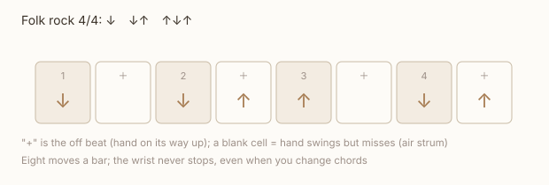
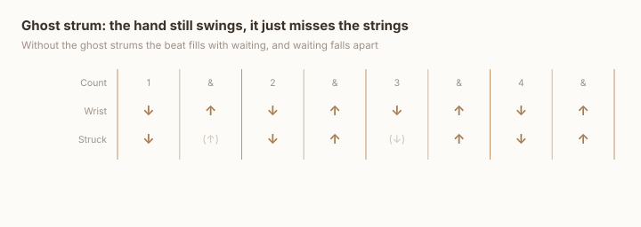
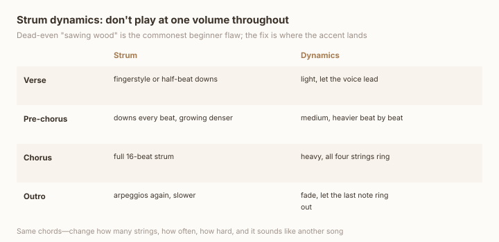
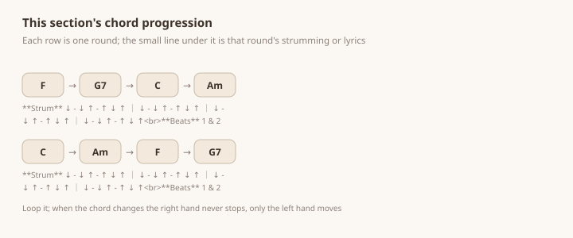

# Chapter 6: The Signature Rhythm of Pop: Folk Rock

In the last chapter we used "four downstrokes to a beat" to play and sing our first pop song ever. But you will have noticed something: an all-downstroke strum is steady, yet it is missing some of the bounce and the flowing breath that pop music has.

To take your accompaniment from "beginner exercise" to "street-performer level" in one step, the secret weapon is the rhythm Mandarin pop uses more than any other — the **folk-rock strum (Folk Rock)**, known in the trade as **"down, down-up, up-down-up"**. Learn this one rhythm pattern, and you can strum a large part of Chinese-language pop with the flavour of the original record.

---

## 6.1 Taking apart the rhythm code of "down, down-up, up-down-up"

Folk rock is built on eighth notes in 4/4 (`1 & 2 & 3 & 4 &`), so a bar has eight half-beat slots. We don't sound all eight, though: by **deliberately leaving two of them empty** we create a springy, syncopated groove.

*Figure: the eight moves of folk rock: ↓　↓↑　↑↓↑, the blank cells are ghost strums where the hand keeps moving but doesn't touch the strings.*

### Why does this pattern sound so good?
Look at the relationship between the back half of beat 2 (`2 &`) and the downbeat of beat 3 (`3`). After the upstroke on `2 &`, we don't strum on the downbeat of beat 3: the accent of the upstroke sits on a weak beat (`2 &`) and carries across the downbeat of beat 3. That is **syncopation**, and then on `3 &` the hand suddenly flicks upward for one bright, crisp note. That "unexpected accent on the off-beat" is the core code that makes pop music set your head nodding.

---

## 6.2 The soul of the groove: the ghost-strum (air-strum) drill

Many beginners learning "down, down-up, up-down-up" turn into stiff robots: the wrist finishes stroke 1 down at the bottom, waits half a beat, then strums stroke 2. That way the beat falls apart very easily, and the wrist locks up.

The only secret professional players have for keeping absolutely steady time is the **constant pendulum motion**: counting time by **ghost strumming (air strumming)**.

* **Rule one**: whether or not the chart says to make a sound, your right wrist must obey the physical law that **the numbers (1, 2, 3, 4) always swing down, and the `&` always swings up**.
* **Rule two**: when you reach the bracketed `(↑)` (the back half of beat 1) and `(↓)` (the downbeat of beat 3), the wrist still swings up or down as usual. Only **the fingertip lifts about 1 cm off the strings and passes through empty air (a ghost strum)**.
* **Self-check**: if you ever find, after beat 3, that you are "doing a downstroke on the `&`", your pendulum has turned the wrong way.

| Where in the bar | What the right hand does | Does it touch the strings and sound? | What to listen for, and how hard |
| :--- | :--- | :--- | :--- |
| **`1`** | Swings down | **Yes (downstroke ↓)** | **The steadiest beat of the bar**; all four strings ring out full |
| **`&`** | Swings up | **No (up through the air ↑)** | Carries the right hand back up, ready for the downstroke on beat 2 |
| **`2`** | Swings down | **Yes (downstroke ↓)** | Meets the song's snare-drum accent; a slightly crisper, firmer stroke |
| **`&`** | Swings up | **Yes (upstroke ↑)** | The index fingernail hooks lightly across strings 1 and 2 (string 3 at most); no need to haul the nail through every string |
| **`3`** | Swings down | **No (down through the air ↓)** | **The crucial ghost strum!** The wrist swings down through empty air and lets the previous beat's ring carry over |
| **`&`** | Swings up | **Yes (upstroke ↑)** | The syncopation highlight: a bright upward flick |
| **`4`** | Swings down | **Yes (downstroke ↓)** | A steady handover into the last half-beat |
| **`&`** | Swings up | **Yes (upstroke ↑)** | A light flick upward while the left hand gets ready for the next bar's chord |

---

## 6.3 Controlling the dynamics of the strum: no more "sawing wood"

Once you can swing through "down, down-up, up-down-up" smoothly, the next step is **dynamics**. If all six sounding strokes come out at the same volume, the whole thing sounds as noisy as sawing wood.

Try adding these two small adjustments to your practice:

1. **On upstrokes, brush only "the bottom 2–3 strings"**: on a downstroke the pad of the index finger sweeps naturally across all four strings, giving a full tone. On an upstroke (`2&`, `3&`, `4&`) the index fingernail hooks lightly across **strings 1 and 2 (string 3 at most)**. That produces the three-dimensional feel of "thick low end, bright high end", and the wrist move gets smaller and faster.
2. **Accent the rhythm of beats 2 and 4**: in a pop-rock drum part the kick drum falls on beats `1` and `3` and the snare on `2` and `4`. On the downstroke of beat 2 (`2`) and beat 4 (`4`), let the wrist's swing be a touch more decisive, and the whole song's groove comes to life at once.

---

## 6.4 Putting it to work: the folk-rock classics

Now take the `C - Am - F - G7` progression from the last chapter and put the new folk-rock strum on it. Set the metronome to **BPM = 65** first and loop the plain strum for 5 minutes, until the right hand is fully automatic. Then sing along with the two Mandarin pop hits below.

### Song one: Accusefive's 〈披星戴月的想你〉 ("Thinking of You Under the Stars"), a C major emotional build

* **Tempo and metre**: 4/4; the original runs at about BPM = 76, a mid-tempo ballad pace that is ideal for learning the folk-rock strum.
* **The secret of it**: the chord progression of this new-generation national love song is extremely regular. The chorus and the late-song climax use the classic **`F` → `G7` → `Em` → `Am`** (for now you can stand `C` in for `Em`; once you learn `Em` in the next chapter, the original progression is yours) and **`F` → `G7` → `C`** loop. The folk-rock strum carries the surging emotional tension of the chorus.

| Chord progression | Rhythm / pattern |
| :--- | :--- |
| `F` → `G7` → `C` → `Am` | **Strum** ↓ - ↓ ↑ - ↑ ↓ ↑ ｜ ↓ - ↓ ↑ - ↑ ↓ ↑ ｜ ↓ - ↓ ↑ - ↑ ↓ ↑ ｜ ↓ - ↓ ↑ - ↑ ↓ ↑ **Count** 1 & 2 & 3 & 4 & ｜ 1 & 2 & 3 & 4 & ｜ 1 & 2 & 3 & 4 & ｜ 1 & 2 & 3 & 4 & |

### Song two: Huang Pin-yuan's 〈小薇〉 ("Xiao Wei"), a light C major classic

* **Tempo and metre**: 4/4, about BPM = 108 (slow it to BPM = 80 for practice).
* **The secret of it**: 〈小薇〉 ("Xiao Wei") is recognised across Mandarin pop as the number-one song for "learning to coordinate a folk-rock strum with singing out loud". The melodic rhythm is very square: almost every syllable lands on a beat or a half-beat, there is very little tricky syncopation pushing ahead of the beat, and the progression sits on `C`, `Am`, `F` and `G7`.

| Chord progression | Rhythm / pattern |
| :--- | :--- |
| `C` → `Am` → `F` → `G7` | **Strum** ↓ - ↓ ↑ - ↑ ↓ ↑ ｜ ↓ - ↓ ↑ - ↑ ↓ ↑ ｜ ↓ - ↓ ↑ - ↑ ↓ ↑ ｜ ↓ - ↓ ↑ - ↑ ↓ ↑ **Count** 1 & 2 & 3 & 4 & ｜ 1 & 2 & 3 & 4 & ｜ 1 & 2 & 3 & 4 & ｜ 1 & 2 & 3 & 4 & |

---

### Chapter checklist

* [ ] Strumming "down, down-up, up-down-up", my right wrist keeps a steady up-and-down pendulum, with no pause on the ghost-strum slots.
* [ ] I can watch TV or hold a simple conversation while keeping the folk-rock strum going for a full minute without losing the beat, which means the right hand is in muscle memory.
* [ ] I can play and sing the chorus of 〈小薇〉 ("Xiao Wei") or 〈披星戴月的想你〉 ("Thinking of You Under the Stars") with the folk-rock strum.
