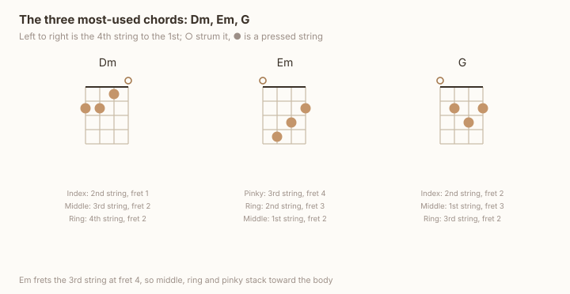
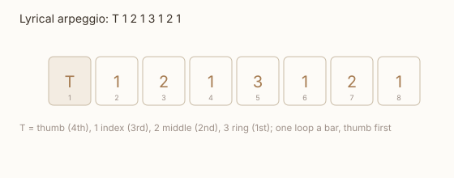
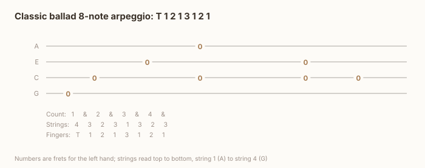
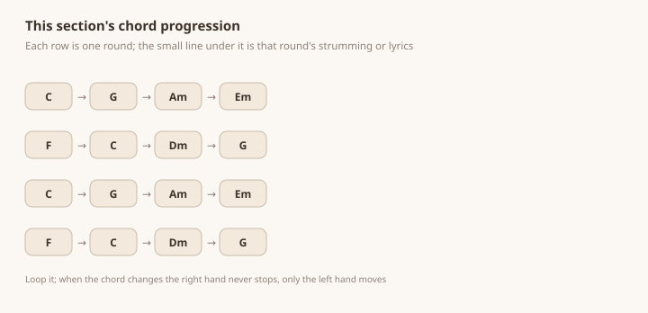

# Chapter 7: Adding Minor Chords and the Ballad Arpeggio (T1213121)

If a ballad accompanies itself with strums from beginning to end, it is like someone speaking in a loud voice the whole time: warm-hearted, but missing the fineness and tenderness of a whisper at midnight.

In Chinese-language pop arranging, the standard formula for the great majority of ballads is this: **the verse takes a right-hand arpeggio that flows like water; the chorus switches to a surging strum**. In this chapter we first complete the last three core chords of the C major family (`Dm`, `Em`, `G`), then learn the ukulele's most romantic right-hand picking pattern — **the ballad arpeggio (`4-3-2-3-1-3-2-3`)**.

---

## 7.1 Extending the C major family: `Dm`, `Em`, `G`

Add `C`, `Am`, `F` and `G7` from Chapter 5, and once you have these three as well you hold the full set of **the most-used diatonic chords in C major**. (The remaining seventh-degree chord, `Bdim`, rarely turns up in pop songs; when it does, play `G` in its place.) That means you can now read and finger every chord in most pop charts transposed to C major.

### Breaking down the new shapes, and the shortcuts between them

| Chord | Exact left-hand fingering | The colour of the sound | The effort-saving shape and the change shortcut |
| :--- | :--- | :--- | :--- |
| **Dm** | Index (`1`) on string 2, fret 1; middle (`2`) on string 4, fret 2; ring (`3`) on string 3, fret 2 | Deep, melancholy, a sorrow with dramatic tension | **Reshape it straight from `F`!** Fret `F` first (index and middle), then just **tuck the ring finger (`3`) into string 3, fret 2, directly below the middle finger** — and you are there. |
| **Em** | Index (`1`) on string 1, fret 2; middle (`2`) on string 2, fret 3; ring (`3`) on string 3, fret 4 | Fine, cool, the bookish kind of sadness | The three fingers line up diagonally like someone **walking up a staircase** (frets 2, 3 and 4). In practice put the index down first, then the middle and the ring in order; turning the wrist slightly toward the body helps them land |
| **G** | Index (`1`) on string 3, fret 2; middle (`2`) on string 1, fret 2; ring (`3`) on string 2, fret 3 | Bright, open, and more formal than `G7` (the modern pop first choice that replaced `G7`) | The three fingers form an **upside-down triangle** (the reverse of `G7`). Keep the ring fingertip upright on string 2, fret 3, so it doesn't touch string 1 |

---

## 7.2 The right hand's four fingers, and the classic ballad arpeggio (`4-3-2-3-1-3-2-3`)

Once you move to fingerpicking, the right hand no longer swings the index finger up and down. The thumb, index, middle and ring fingers each take their own job, plucking each string gently the way a harp is played.

*Figure: T1213121 — the thumb lands first, then index and middle alternate; when the same pattern moves to another chord, the thumb still takes string 4.*

### 1. The right hand's golden division of labour: one finger to a string
In classical guitar teaching the right-hand fingers are marked with Spanish abbreviations (`p` thumb, `i` index, `m` middle, `a` ring). Chinese-language pop charts usually shorten them to **`T` (Thumb), `1` (index), `2` (middle), `3` (ring)**.

| Right-hand finger | Pop-chart label | The string it owns | Plucking direction and where it touches |
| :--- | :--- | :--- | :--- |
| **Thumb** | **`T`** (or `p`) | **String 4 (G)** (now and then string 3 as well) | **Plucks downward**, with the fleshy side edge of the thumb |
| **Index finger** | **`1`** (or `i`) | **String 3 (C)** | **Hooks upward**; the tip stays slightly bent and hooks lightly toward the palm |
| **Middle finger** | **`2`** (or `m`) | **String 2 (E)** | **Hooks upward** |
| **Ring finger** | **`3`** (or `a`) | **String 1 (A)** | **Hooks upward** |

> **Keeping the right hand steady**: let the right wrist hang naturally just above the soundhole, the wrist slightly raised as if you were holding a ping-pong ball in the palm. The little finger can rest lightly on the top below the soundhole as a support (or stay free, if that is your habit), and the four fingers rest lightly on their four strings, ready. When you pluck, **only the finger joints move and the wrist stays still** — don't pull the whole hand upward like pulling a radish out of the ground.

### 2. Mandarin pop's number-one ballad pattern: `T - 1 - 2 - 1 - 3 - 1 - 2 - 1` (string numbers `4-3-2-3-1-3-2-3`)
This arpeggio is made of eight even eighth notes that fill one 4/4 bar, and it is the standard accompaniment of countless ballad verses:

**The count to say to yourself**: say the string numbers **"4 - 3 - 2 - 3 - 1 - 3 - 2 - 3"** in your head. Let the `4` on beat 1 (the thumb) and the `1` on beat 3 (the ring finger) be a little fuller, and pass the `3` between them (the index finger) lightly. Then it sounds as lovely and flowing as a piano accompaniment.

---

## 7.3 Putting it to work: arpeggio verse, strummed chorus

This song is a modern ballad standard that gets requested constantly at guitar clubs, campsites and weddings. Its progression is highly regular, which makes it perfect for practising a complete arrangement: a tender arpeggio in the verse, then a folk-rock strum breaking out in the chorus.

### The song: Bestards' 〈不是因為天氣晴朗才愛你〉 ("Not Because the Weather Was Clear"), a C major arrangement

* **Tempo and metre**: 4/4, about BPM = 76.
* **The core progression**: **`C` → `G` → `Am` → `Em` → `F` → `C` → `F` → `G`**. This is the famous "Canon progression", and we take its pull apart in Chapter 15.

| Chord progression | Rhythm / pattern |
| :--- | :--- |
| `C` → `G` → `Am` → `Em` | — |
| `F` → `C` → `Dm` → `G` | — |
| `C` → `G` → `Am` → `Em` | — |
| `F` → `C` → `Dm` → `G` | — |

### The move that makes the switch from arpeggio to strum seamless
Going from the verse's last bar (the `G` arpeggio) into the chorus's first bar (a `C` strum), many beginners lose half a beat because the right hand still has to rearrange itself. Watch this: **on the last beat of that `G` bar, once strings 2 and 3 have been plucked, the four right-hand fingers gather into a loose fist with the index finger slightly extended, which is the ready position for strumming**. The arm lifts naturally, and the chorus's beat 1 lands on time and with force.

---

### Chapter checklist

* [ ] I can finger all three chords `Dm`, `Em` and `G`, and I remember the `F` → `Dm` shortcut that only needs the ring finger added.
* [ ] Each of my four right-hand fingers owns its string, and I can pluck `4-3-2-3-1-3-2-3` steadily without looking down at my right hand.
* [ ] I can play through the "arpeggio verse → strummed chorus" change in 〈不是因為天氣晴朗才愛你〉 ("Not Because the Weather Was Clear").
