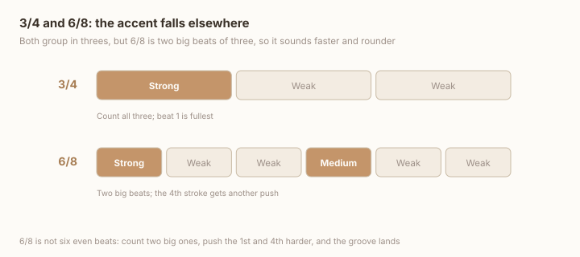
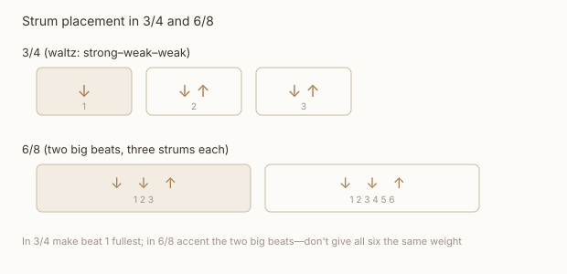
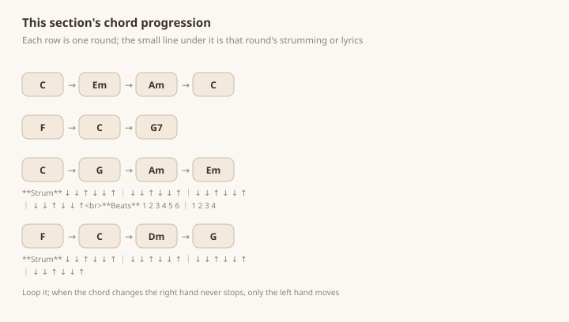

# Chapter 8: Ballad Rock in Triple Time: 3/4 and 6/8

Every rhythm we have practised so far has been in even beats (4/4). But pop music also holds a rhythm type full of retro romance, swaying as elegantly as a waltz: **the three-beat feel, meaning 3/4 and 6/8 time. (6/8 is compound duple time: two big beats to the bar, three strokes in each.)**

Three-beat time (3/4, 6/8) is in fact rare in Mandarin pop, and mostly turns up in arrangements. 〈月亮代表我的心〉 ("The Moon Represents My Heart"), 〈浪子回頭〉 ("The Wanderer's Return") and 〈告白氣球〉 ("Love Confession") are all originally in 4/4, and this chapter rearranges them into three-beat time as exercises. The point is to learn the "strong–weak–weak" centre of gravity, not to claim the originals are in three. Once you have the "strong–weak–weak" waltz weight, your repertoire gains a whole new expression of deep, tender romance at once.

---

## 8.1 Where the accents fall in 3/4 and 6/8

Many beginners are thrown when they see `3/4` or `6/8` in the top left corner of a chart. In the actual practice of modern pop singing and playing, the two have a very similar "three-beat sway"; only **the pace of the weight and the way the beat is subdivided** differ a little:

| Time signature | What the theory says (beats per bar) | How you count it out loud | The accent structure | What it sounds like, and the styles it suits |
| :--- | :--- | :--- | :--- | :--- |
| **3/4 (three-quarter time)** | A quarter note to a beat, **3 beats to the bar** | **`1 - 2 - 3`** (or subdivided as `1 & 2 & 3 &`) | **Strong – weak – weak** (`1` heavy, `2` light, `3` light) | The classic waltz: elegant, round, old-fashioned ballad folk (here 〈月亮代表我的心〉 ("The Moon Represents My Heart") is used as a 3/4 arrangement demonstration) |
| **6/8 (six-eighth time)** | Six eighth notes to the bar, heard as **2 big beats** of three eighth notes each | **`1 - 2 - 3 - 4 - 5 - 6`** (two groups of three) | **Strong – weak – weak – medium-strong – weak – weak** (`1` heaviest, `4` medium-strong) | Ballad rock, a deep and weathered feeling, a rise and fall like ocean swell (classic 6/8: 〈Hallelujah〉; 〈浪子回頭〉 ("The Wanderer's Return") is originally 4/4 and is rearranged here as an exercise) |

---

## 8.2 Three-beat fingerings: the strummed version and the arpeggio version

We have one practical accompaniment template for each of 3/4 and 6/8, one for strumming and one for arpeggios:

*Figure: in 3/4 the 1st beat is fullest; 6/8 is "two big beats", three strokes each, so don't strum all six at the same weight.*

### 1. The 3/4 waltz template (for classic ballads)

* **Strummed version ("down, down-up, down-up")**: a full downstroke on beat 1 (imitating the kick drum's "boom"), then light down-up strokes on beats 2 and 3 (imitating "cha-cha"), for the classic "boom–cha-cha" waltz groove.
* **Arpeggio version (`4 - 3 - 2 - 1 - 2 - 3`)**: six even eighth notes fill the three beats (`1 & 2 & 3 &`), climbing like a wave and then falling gently back.

| 3/4 strummed | 3/4 arpeggio (TAB) |
| :--- | :--- |
| Count:  1    2  &   3  & | Count:  1   &   2   &   3   & |
| Strum:  ↓    ↓  ↑   ↓  ↑ | A (string 1) ｜-----------0-----------｜ |
| Say:  boom    cha  cha  cha  cha | E (string 2) ｜-------0-------0-------｜ |
| Force:  heavy   light  light  light  light | C (string 3) ｜---0---------------0---｜ |
| — | G (string 4) ｜0----------------------｜ |
| — | String:  4   3   2   1   2   3 |
| — | Finger:  T   1   2   3   2   1 |

### 2. The 6/8 ballad-rock template (demonstration: a 〈浪子回頭〉 arrangement)
In 6/8 a bar holds six eighth notes. The most important thing is to give **beat 1 (`1`) and beat 4 (`4`)** a clear accent and to pass `2, 3` and `5, 6` lightly:

| 6/8 strummed (the ballad-rock strum) | 6/8 classic arpeggio (TAB) |
| :--- | :--- |
| Count:  1   2   3   4   5   6 | Count:  1   2   3   4   5   6 |
| Strum:  ↓   ↓   ↑   ↓   ↓   ↑ | A (string 1) ｜-----------0-----------｜ |
| Force:  heavy   light   light  medium-heavy   light   light | E (string 2) ｜-------0-------0-------｜ |
| — | C (string 3) ｜---0---------------0---｜ |
| — | G (string 4) ｜0----------------------｜ |
| — | String:  4   3   2   1   2   3 |
| — | Force:  heavy   light   light  medium-heavy   light   light |

---

## 8.3 Putting it to work: two three-beat classics

### Song one: 〈月亮代表我的心〉 ("The Moon Represents My Heart"), a C major 3/4 arrangement

* **Tempo and metre**: 3/4, about BPM = 75 (unhurried and elegant).
* **Arrangement suggestion**: use the **3/4 arpeggio (`4-3-2-1-2-3`)** in the verse, and switch to the **3/4 waltz strum (`↓ ↓↑ ↓↑`)** on the chorus, whose opening line is a six-syllable phrase.

| Chord progression | Rhythm / pattern |
| :--- | :--- |
| `C` → `Em` → `Am` → `C` | — |
| `F` → `C` → `G7` | — |

### Song two: 〈浪子回頭〉 ("The Wanderer's Return"), an original 4/4 song rearranged into 6/8

* **Tempo and metre**: 6/8. The original is in D major; transposed to **C major**, the whole song needs only six basic chords: `C`, `G`, `Am`, `Em`, `F`, `Dm`.
* **Arrangement suggestion**: use the **6/8 arpeggio** (accenting the 1st and 4th notes) for the intro and the first verse. When the chorus arrives, on its long opening line where one phrase is repeated three times, switch to the **6/8 ballad-rock strum (`↓ ↓ ↑ ↓ ↓ ↑`)**, strumming hard on beats `1` and `4` for a grown man's heartfelt shout.

| Chord progression | Rhythm / pattern |
| :--- | :--- |
| `C` → `G` → `Am` → `Em` | **Strum** ↓ ↓ ↑ ↓ ↓ ↑ ｜ ↓ ↓ ↑ ↓ ↓ ↑ ｜ ↓ ↓ ↑ ↓ ↓ ↑ ｜ ↓ ↓ ↑ ↓ ↓ ↑ **Count** 1 2 3 4 5 6 ｜ 1 2 3 4 5 6 ｜ 1 2 3 4 5 6 ｜ 1 2 3 4 5 6 |
| `F` → `C` → `Dm` → `G` | **Strum** ↓ ↓ ↑ ↓ ↓ ↑ ｜ ↓ ↓ ↑ ↓ ↓ ↑ ｜ ↓ ↓ ↑ ↓ ↓ ↑ ｜ ↓ ↓ ↑ ↓ ↓ ↑ |

---

### Chapter checklist

* [ ] I have the "heavy–light–light" centre of gravity of three-beat time clearly, and I don't drift into four beats without noticing.
* [ ] I have the 3/4 waltz strum (`↓ ↓↑ ↓↑`) and the 6/8 arpeggio (`4-3-2-1-2-3`) down.
* [ ] I can play the arranged 6/8 chorus of 〈浪子回頭〉 ("The Wanderer's Return").
