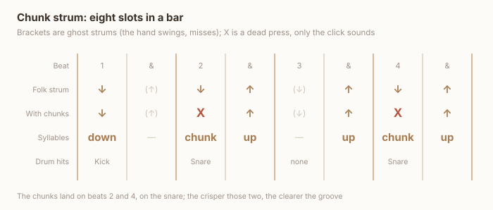
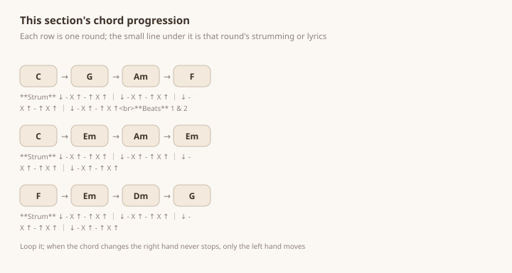

# Chapter 9: The Chunk — Giving Your Playing a Drum's Groove

Why is it that some people, playing an upbeat song on nothing but a small ukulele, sound as if a whole drum kit were standing behind them — full of rhythm, making you want to tap along?

The answer is the ukulele's most distinctive percussion technique: **the chunk (chunking, also called the right-hand muted strum)**. The chunk makes a crisp, clean "chunk" the instant you strum, copying the hit of a drum kit's snare drum on beats 2 and 4. Learn the chunk and your upbeat pop accompaniment takes a step up in quality at once.

---

## 9.1 How the chunk makes its sound, and the right-hand thenar-pad move

"Chunking" does not mean slapping the strings dead so that nothing sounds. It means **"at the very same moment the index fingernail strums the strings, the fleshy edge of the right palm presses against all four strings and cuts the vibration off"**. Because the sound survives only 0.05 seconds before it is stopped, what you hear is not a chord's pitch but a crisp percussive "chunk!".

### The move in four steps (start with the left hand touching the four strings to mute them)

1. **The ready position**: the right hand takes its natural strumming shape, with the wrist turned slightly inward (the palm facing the top a little, rather than sitting flat and parallel to it).
2. **The pad lands first (the crucial millisecond)**: as the wrist swings down to strum, **the thick pad below the right thumb (the thenar eminence, the side edge of the palm)** touches the four strings above the soundhole first, lightly.
3. **The index finger follows straight after**: at the same instant the pad meets the strings, the right index fingernail sweeps down through all four. The strings are already held by the pad and cannot vibrate freely, so the nail scraping over them gives a crisp, ringing "chunk".
4. **Lift at once, ready for the upstroke**: once the chunk is done, don't leave the edge of the palm stuck to the strings. Bounce it off as if you had had a shock, ready for the upstroke that comes next.

| Why a chunk goes wrong | What it sounds like | The fix |
| :--- | :--- | :--- |
| **The pad arrives too late (the chord sounds before it is covered)** | It becomes "chord—chunk": half the chord rings before it is cut | Adjust the wrist angle so the thenar pad on the thumb side **arrives about 0.01 seconds ahead of the index finger** |
| **The palm slaps the top of the body too hard** | A dull "boom, boom" of wood being hit, like knocking on a table | A chunk is a short, sharp hit made of "pad on the strings plus nail against muted strings", not a hard slap on the wooden top. Keep the force light and concentrated |
| **Only strings 1 and 2 get cut, and the others keep ringing** | The chunk isn't clean, and a hum of leftover chord buzzes away underneath | Make sure the edge of the palm covers **all four strings**, from string 4 to string 1 |

---

## 9.2 The golden pairing: the chunk and the folk-rock strum (`down, chunk, up, up, chunk, up`)

In 4/4 pop music the snare accent always lands on **beat 2** and **beat 4**. So we replace **the downbeat of beat 2** and **the downbeat of beat 4** in the folk-rock strum from Chapter 6 (`down - down-up - up-down-up`) with chunks, written **`X`** or **`chunk`**. The most classic rhythm pattern in ukulele history is born: **the chunked rock strum**.

*Figure: the chunk falls on the downbeats of beats 2 and 4 (X), and every other slot is strummed up or down as usual.*

### The whole move as a chant
Hold the easiest chord, `C`, and don't rush to change chords. With a metronome at BPM = 65, chant and strum over and over: **"down —— chunk-up —— up-chunk-up"**.

* **`1` (down)**: a full, bright C chord.
* **`2 &` (chunk-up)**: a decisive "chunk!" on beat 2, then the index fingertip hooks a light upstroke straight after.
* **`3 &` (ghost up)**: on beat 3 the wrist swings down through empty air, and on `3 &` it hooks up for a crisp note.
* **`4 &` (chunk-up)**: another "chunk!" on beat 4, then `4 &` hooks up for the last note and takes you back to beat 1 of the next bar.

---

## 9.3 Putting it to work: a chunk to fire up the countryside and the groove of youth

The chunk suits Mandarin pop that is light, bright and folksy, with the feel of a summer countryside. Add "down, chunk, up, up, chunk, up" to the two songs below and they are suddenly full of the original's soul and groove.

### Song one: Jay Chou's 〈稻香〉 ("Rice Field"), a C major chunk classic

* **Tempo and metre**: 4/4, about BPM = 90 (slow it to BPM = 70 for practice).
* **The secret of it**: 〈稻香〉 ("Rice Field") is originally in A major. Transposed to **C major**, almost the whole song — intro, verse and chorus — is built on the same four-bar progression **`C` → `G` → `Am` → `F`** (now and then resolving to `G`), looping without end. With the "down, chunk, up, up, chunk, up" rhythm on top, it sounds like the clean acoustic guitar and drum groove of the record.

| Chord progression | Rhythm / pattern |
| :--- | :--- |
| `C` → `G` → `Am` → `F` | **Strum** ↓ - X ↑ - ↑ X ↑ ｜ ↓ - X ↑ - ↑ X ↑ ｜ ↓ - X ↑ - ↑ X ↑ ｜ ↓ - X ↑ - ↑ X ↑ **Count** 1 & 2 & 3 & 4 & ｜ 1 & 2 & 3 & 4 & ｜ 1 & 2 & 3 & 4 & ｜ 1 & 2 & 3 & 4 & **Say** down chunk up up chunk up ｜ down chunk up up chunk up ｜ down chunk up up chunk up ｜ down chunk up up chunk up |

### Song two: Crowd Lu's 〈魚仔〉 ("Little Fish"), a fresh C major chunk take

* **Tempo and metre**: 4/4, about BPM = 82.
* **The secret of it**: 〈魚仔〉 ("Little Fish") is a warm, folksy piece of writing. Use the arpeggio from Chapter 7 to set the scene through the first half of the verse. Then, when the middle section and the chorus arrive, where the opening line is answered by a four-syllable phrase sung twice, move to a gentle version of the chunked strum. No need to chunk hard: light and brief is enough. That is what gives you the shimmer of light on water when a breeze crosses the pond.

| Chord progression | Rhythm / pattern |
| :--- | :--- |
| `C` → `Em` → `Am` → `Em` | **Strum** ↓ - X ↑ - ↑ X ↑ ｜ ↓ - X ↑ - ↑ X ↑ ｜ ↓ - X ↑ - ↑ X ↑ ｜ ↓ - X ↑ - ↑ X ↑ |
| `F` → `Em` → `Dm` → `G` | **Strum** ↓ - X ↑ - ↑ X ↑ ｜ ↓ - X ↑ - ↑ X ↑ ｜ ↓ - X ↑ - ↑ X ↑ ｜ ↓ - X ↑ - ↑ X ↑ |

---

### Chapter checklist

* [ ] I can produce a crisp, clean chunk, with no leftover hum of chord and no hard slap on the top of the body.
* [ ] I can play "down, chunk, up, up, chunk, up (`↓ - X ↑ - ↑ X ↑`)" smoothly and change chords steadily.
* [ ] I can play and sing the chorus of 〈稻香〉 ("Rice Field") or 〈魚仔〉 ("Little Fish") with the chunk rhythm.
