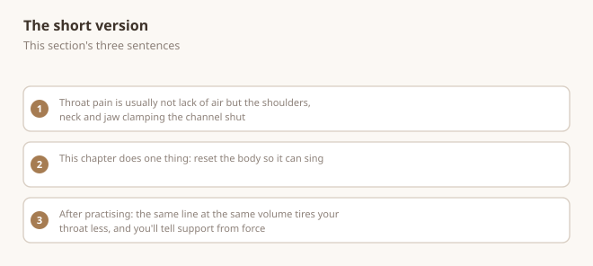
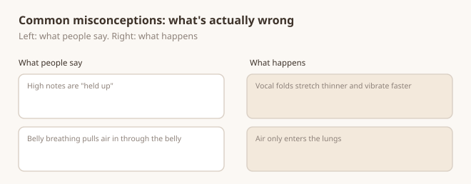
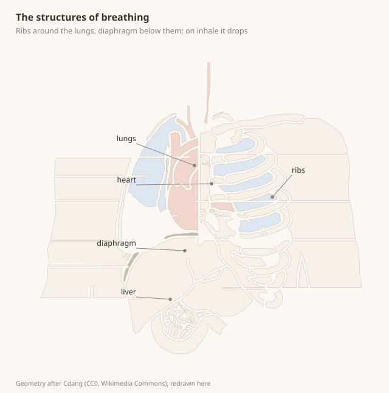
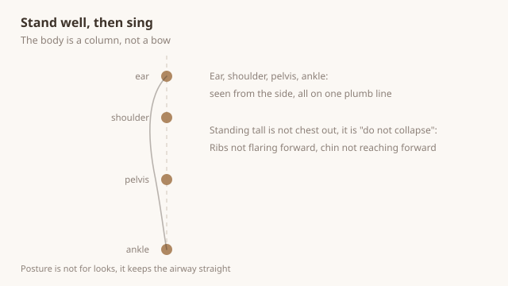
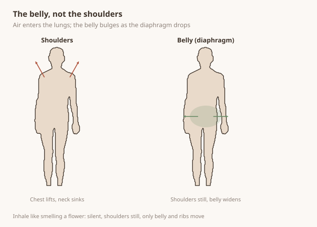
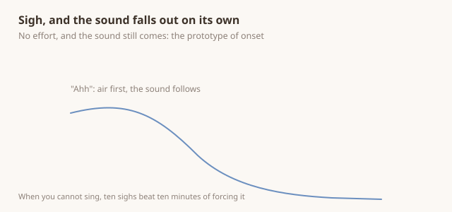
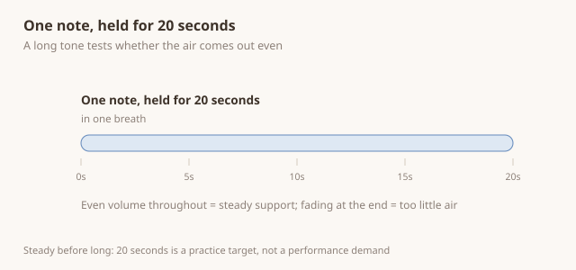
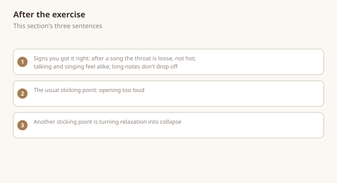

# Chapter 1: The Nature of Singing: Let Music Become Everyday Breathing

## The short version

When your throat hurts from singing, it is usually not that you are short of air. Your shoulders, neck and jaw are all working at once and have pressed the channel shut. There is plenty of air; it is blocked halfway along.

This chapter does one thing: put the body back into a state where it can make sound. The diaphragm draws the air in, the throat is not squeezed, and the voice sits on a steady airflow.

After the exercise you will find that the same sentence at the same volume leaves your throat less tired. You will also tell the difference between breath support and force for the first time. Never mind volume, never mind high notes. First take away the effort that should not be there.

## Common misconceptions

Many people think a high note has to be held up from below, so the moment the chorus arrives they shrug, lift the chin and stretch the neck. In fact a note goes higher because the vocal folds are stretched longer and thinner and vibrate faster. The work is done by two very small muscle groups in the larynx. The big muscles of the shoulder and neck cannot help; from the outside they only flatten the channel. And the louder and higher you sing, the more readily the neck and shoulder muscles join in. That is the body compensating, not helping you (Pettersen et al., 2005). The harder you prop it up, the tighter the sound.

Another misconception is that belly breathing means pulling air in with your stomach. Air only goes into the lungs. On the inhale the diaphragm contracts and drops, the rib cage expands, and only then is air drawn in. The lower belly bulges because the abdominal cavity is being pushed down by the diaphragm. The bulge is a result, not an action. You don't need to "breathe into your stomach"; you only need to let the lower belly soften instead of bracing against it. The opposite is just as true: push the belly out hard on the inhale and all you make is abdominal pressure. No more air goes in.

## How it works

The diaphragm is a dome-shaped muscle below the lungs. When it contracts it flattens and moves down, the rib cage gets bigger, the pressure inside drops, and air flows in through the nose. Your lower belly goes out at that moment not because you pushed it out, but because the space inside was given up. The lower belly and the pelvic floor relax and make room on the inhale; only on the exhale do they gradually join in (Emerich Gordon & Reed, 2020).

When you speak, the exhale is automatic. When you sing we want the exhale slower and steadier, so the lower belly draws in gently and resists the diaphragm springing back too fast. That continuous, adjustable pressure is what people call breath support. Note that support is not a single action: studies measuring the trunk strategies singers use to project sound found that different people reach the same result in different ways (Thorpe et al., 2001). So don't memorise one posture. Find the version where the airflow stays steady.

Now the sound itself. The airflow passes the vocal folds as they come together and sets them vibrating. The raw sound the folds make is very small; the cavities and tubes of the body amplify it, and that is what you hear. So volume comes mainly from steady airflow and resonance, not from effort in the throat. Pitch works the same way: higher means the folds are stretched longer and thinner and vibrate faster; lower means they are thicker and shorter and vibrate more slowly. Force from the outside only gets in the way.

## An analogy

**A hose with a foot on it.** The pressure is steady, the hose is not bent, and the water runs freely. Stand on the hose in the middle and no amount of extra pressure downstream will help. When the shoulders, jaw and root of the tongue tighten, that pinch is the foot on the hose. Move the foot first, then talk about how to supply the air.

**A candle two metres away.** To blow out a candle two metres away you don't blast at it. You turn the air into one long, thin stream. The exhale in singing is that stream. It is not about who pushes harder; it is about who delivers more steadily.

**A backpack you keep lifting.** The pack already hangs on your shoulders. If your hands keep pulling the straps upward, your shoulders ache within five minutes. Zeroing the shoulders is not pressing them down; it is letting go of the straps.

Where all three analogies break is the same point: a body is not a passive hose. Muscles compensate on their own, so the harder you push, the more the body calls in something else to take over. The point of practice is not more control. It is letting go of the effort you don't need.

## Try it now

### Exercise 1: Zero the shoulders

1. Feet shoulder-width apart, knees slightly bent, not locked.
2. Breathe in and lift both shoulders up towards your ears. Hold for three seconds.
3. Breathe out and let the shoulders drop, as if a backpack slid off onto the floor.
4. Repeat five times.

What you should feel: the moment you let go, both sides of the neck release. If you get it wrong: if the shoulders are still half lifted after you let go, you only released half of it. Shake out your hands for ten seconds, start again, and make the exhale longer.

### Exercise 2: Find the diaphragm lying down

1. Lie flat, knees bent, one hand on the chest and one hand just above the navel.
2. Breathe in through the nose for four seconds. The hand on the belly is pushed up; the hand on the chest barely moves.
3. Lips slightly apart, breathe out slowly for six seconds, as if blowing out a candle.
4. Five rounds.

What you should feel: the lower belly swells on the inhale and settles slowly on the exhale. The shoulders don't move at all. If you get it wrong: if the hand on the chest moves first and the shoulders rise with it, you are still chest breathing. Don't breathe harder; make the breath smaller and slower and let the lower belly swell by itself. Remember, the belly does not pull the air in. The diaphragm goes down.

### Exercise 3: The sigh

1. Breathe in, mouth slightly open.
2. Make a "haa—", the way you do when you finally sit down and let everything go.
3. Volume about the same as talking. Not loud.
4. Hold it for five seconds, repeat five times.

What you should feel: no squeezing in the throat, and a little breathiness in the sound is normal. If you get it wrong: if it cracks as it starts or the throat itches, the air is too strong or the chin has lifted. Halve the volume. Aim for loose first, loud later.

### Exercise 4: Stretch the sigh out

1. Same "haa—". Try to hold it for eight seconds.
2. Keep the volume even from start to finish, no swelling or fading.
3. If you run out of air, stop and breathe again. Don't force it.
4. Three times.

What you should feel: the lower belly draws in slowly and the airflow is like a thin thread. If you get it wrong: the last two seconds getting smaller or shaking usually means the support in the lower belly has let go. Don't clamp with the throat. Next time, let the lower belly draw in more slowly and more steadily.

## After the exercise

Signs you got it right: after a song your throat is loose, not hot; talking and singing feel about the same in the throat; the last second of a long note doesn't suddenly drop away.

The usual sticking point is starting too loud. Too loud sends the body straight back into force mode. Practising quietly on purpose is so you can hear whether the airflow is steady.

Another is turning relaxation into collapse. Relaxed means no extra effort, not no support. The lower body needs to be stable and the upper body needs to stay free to move. The two do not conflict.

Next chapter goes looking for tension in the neck, shoulders and jaw one piece at a time. Those are the two most common compensations when you sing high notes.

## Further reading

- **Pettersen, V., Bjørkøy, K., & Torp, H. (2005).** Neck and shoulder muscle activity and thorax movement in singing and speaking tasks with variation in vocal loudness and pitch. *Journal of Voice.* As volume and pitch rise, neck and shoulder muscle activity changes with them; this is the direct measurement behind compensation. PMID 16301107.
- **Thorpe, C. W., Cala, S. J., & Chapman, J. (2001).** Patterns of breath support in projection of the singing voice. *Journal of Voice.* Measuring the trunk movement of singers as they project: support is not one fixed action, and different singers reach the same result with different strategies. PMID 12269638.
- **Emerich Gordon, K., & Reed, O. (2020).** The Role of the Pelvic Floor in Respiration: A Multidisciplinary Literature Review. *Journal of Voice.* The role of the lower belly and pelvic floor in breathing, which is roughly where the "dantian" sits anatomically. PMID 30447797.
