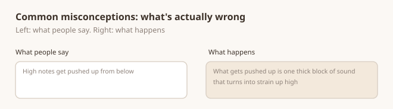
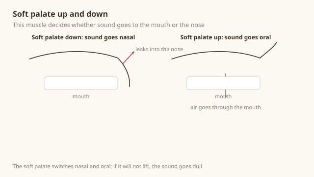
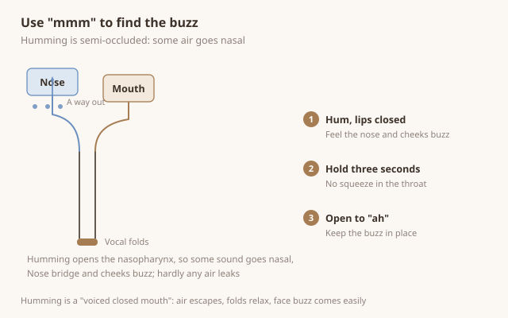
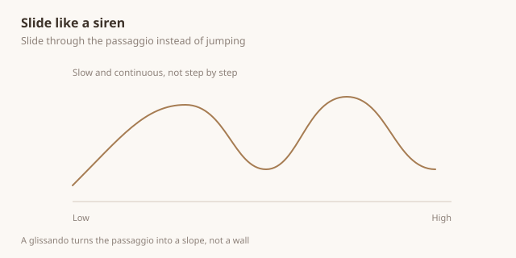
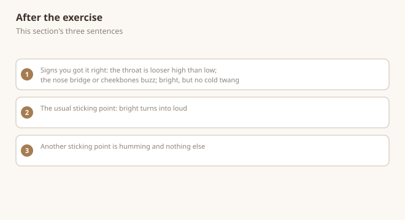

# Chapter 10: Lighting Up the Sound: A First Feel for Nasal and Head Resonance (Simple Ways to Make the Voice Brighter and Clearer)

## The short version

When the high notes won't come, it is often not that the note is too high. You are dragging the whole weight of the chest up with it.

The higher the note, the smaller the space that suits it. You move the vibration from the chest up to the bridge of the nose and the cheekbones, and you make the throat looser rather than stronger.

This chapter does two things: find the vibration at the bridge of the nose and tell it apart from a head-cold twang, then use a glide to confirm that the path from chest to face is open.

## Common misconceptions

Many people resist the phrase "nasal resonance" because it makes them think of the flat sound of a blocked nose. The two are very different. A cold blocks the nasal passages, the sound cannot get into the nose, nasal resonance is missing, and the result sounds dull and flat. Nasal resonance is sound coming out of the mouth as usual, with the soft palate slightly open so that part of the airflow and vibration reaches the nasal cavity and adds a little colour.

The other misconception is that high notes are pushed up from below. What gets pushed up is usually a thick lump of sound, and up high it turns into a tug. The easier way is to change space: let go of the weight in the chest and let the vibration move up.

## How it works

First, clear up a claim that is easy to get wrong: the skull is not a speaker cabinet. It does contain small air spaces such as the sinuses, but their contribution to amplifying sound is very limited. Endoscopic observation shows that what classical singing calls "head voice" corresponds to a change in vocal tract shape, not to sound actually travelling into the skull (Aura et al., 2022).

So where does brightness come from? Partly from the high-frequency components of the nasal cavity and the vocal tract, and partly from a cluster of high-frequency energy that forms when the channel above the larynx narrows. Modelling the shape of the epilaryngeal tube makes that cluster more concentrated, and this has been simulated (Vampola et al., 2024). Brightness is a result of channel shape, not of force.

Space size relates to frequency: a larger space suits low frequencies, a smaller one suits high frequencies. As the pitch rises, placing the vibration higher up lets the high-frequency components out more easily, and the sound becomes brighter and more focused.

But this is not about moving the sound somewhere. The resonance chambers are passive. What you change is the shape of the tract and the mouth: where the soft palate sits, how relaxed the throat is, the shape of the vowel. Get the shape right and the high frequencies increase on their own. When the volume has to rise, these adjustments do change with it (Vurma, 2022).

Why more relaxed? The higher the note, the thinner the vocal folds are stretched, and what they need is steadier, finer airflow rather than more force. Clamping from the outside only makes them harder to set vibrating.

How does the pitch get higher? Two small muscle groups in the larynx adjust the vocal folds. One thickens and shortens them, which lowers the pitch; the other lengthens and thins them, which raises it. They coordinate on their own. Force from the outside only interferes with that.

## An analogy

**Walking out of a hall into a small room.** The same person at the same volume sounds diffuse in an empty hall, and focused and clear in a small room. You didn't get louder; the space changed.

**A rubber band.** Stretch the same band long and tight and it snaps at a higher pitch; let it go slack and short and the pitch drops. Right at full stretch it is also at its most fragile: one pluck and it breaks. That is why you don't use force on high notes.

**Walking a tightrope.** A tightrope walker's hands are open and the body is loose; the stiffer you go, the faster you fall. High notes are the same: the closer you get to the limit, the more you need balance, not force.

## Try it now

### Exercise 1: The puppy whimper

1. Stand tall, head directly above the shoulders.
2. Wrinkle the nose slightly, as if you had smelled something sour.
3. Lips closed, make an "mmm—" on a rather high pitch, like a puppy feeling sorry for itself.
4. Touch the bridge of your nose lightly with a finger and feel the fine vibration.

What you should feel: an itch or a tingle at the bridge of the nose, and no tightness in the throat. If you get it wrong: if the vibration ends up in the throat and the nose feels nothing, raise the pitch a little and reduce the airflow. If it turns throaty, hum a very light middle note first, find the bridge of the nose, then go higher.

### Exercise 2: Open "mmm" into "ah"

1. Hum an "mmm—" first and check that the bridge of the nose is buzzing.
2. Without breaking the air, slowly open the mouth into "aah—".
3. As it opens, the vibration has to stay at the bridge of the nose and in front of the cheekbones.
4. Do it five times.

What you should feel: the sound brightens and focuses, as if it were shooting forward. If you get it wrong: if the vibration drops back into the throat the moment you open your mouth, the jaw went forward along with it. Keep the jaw still; open only the lips and the mouth.

### Exercise 3: The owl's "hoo"

1. Relax the jaw and round the lips into a small circle.
2. Make a very light, slightly breathy "oo—" in falsetto.
3. Rest a palm on the jaw and the side of the throat; there should be almost no extra squeezing.
4. Do it three times.

What you should feel: a light, floating sound, with almost no squeeze under the palm. If you get it wrong: if it turns loud and thick as soon as it starts, chest voice has come along. Take the volume right down and aim for light first.

### Exercise 4: Siren glide

1. Start from a low note on a lip trill: "brrr—".
2. Without breaking the air, slide the pitch slowly upward.
3. Feel the vibration leave the chest and move up into the face.
4. Don't linger at the top. Slide back down smoothly. Five times.

What you should feel: the lips keep buzzing, the pitch keeps moving, and the throat gets looser as you go. If you get it wrong: if the glide sticks or breaks halfway, the jaw is working, or you are carrying the weight of the chest up with you. Lower the top note, narrow the range, and aim for no break first.

### Exercise 5: Check it on one line

1. Pick a line that tightens when you sing it high.
2. Run the melody on a lip trill first.
3. Then hum it on "mmm" and confirm that the vibration up high is in your face.
4. Finally put the words back, keeping the throat loose.

What you should feel: the high note no longer feels like pulling something. If you get it wrong: if it tightens again once the words are back, the diction is bringing the jaw out. Lighten the consonants. Get the placement first, clear words second.

## After the exercise

Signs you got it right: the throat is looser on high notes than on low ones; there is vibration at the bridge of the nose or the cheekbones; the sound is brighter without turning into a head-cold twang.

The usual sticking point is that brightness becomes loudness. Brightness is not volume; it is a proportion of frequencies. You can be very quiet and still bright. Chasing loudness usually drops the placement back into the throat.

Another is staying on humming alone. Humming is a tool for finding placement. It has to end up in vowels and words before you know whether you can really use it.

Next chapter takes on the shift between modal voice and falsetto. That is the bridge between chest and head.

## Further reading

- **Aura, M., Geneid, A., & Bjørkøy, K. (2022).** A Nasoendoscopic Study of "Head Resonance" and "Imposto" in Classical Singing. *Journal of Voice.* Endoscopic observation shows that "head resonance" is a change in vocal tract shape, not sound being amplified inside the skull. PMID 32513553.
- **Vampola, T., Horáček, J., & Laukkanen, A. M. (2024).** Three-Dimensional Finite Element Modeling of the Singer's Formant Cluster Optimization by Epilaryngeal Tube Shaping. *Journal of Voice.* The shape of the epilaryngeal section decides whether high-frequency energy stays concentrated; brightness is a question of shape. PMID 39218756.
- **Vurma, A. (2022).** Amplitude Effects of Vocal Tract Resonance Adjustments When Singing Louder. *Journal of Voice.* When the volume changes, vocal tract resonance adjustments are measurable; brightness and volume are two different things. PMID 32624371.
