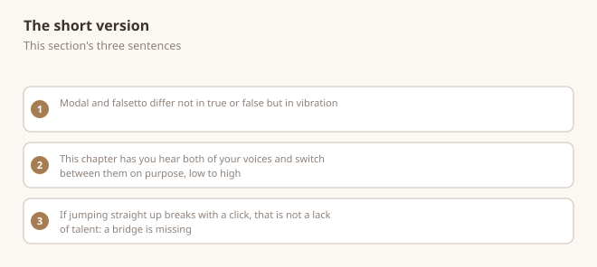
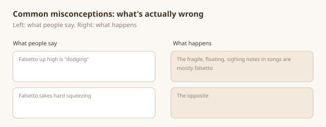
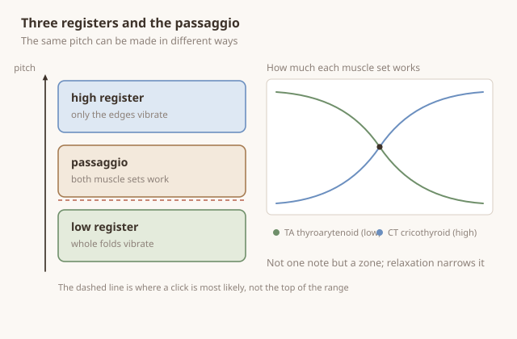
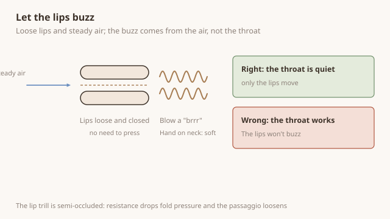
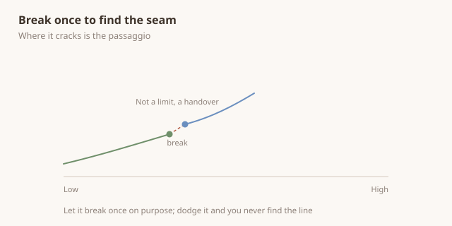
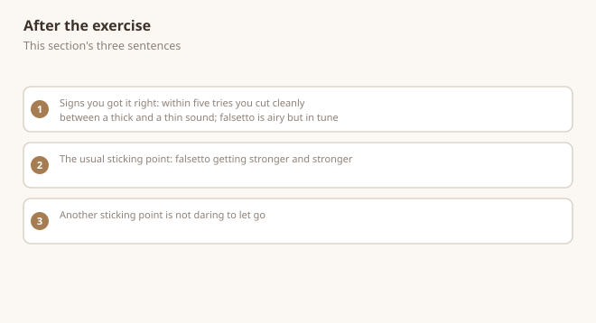
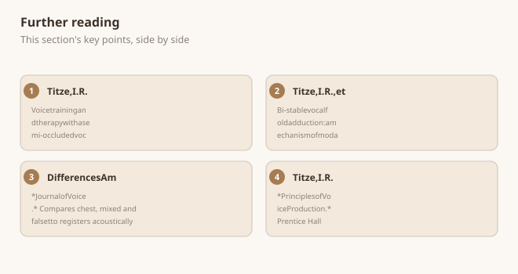

# Chapter 11: The Bridge Across the Range: Getting to Know Modal Voice and Falsetto (Telling the Two Apart by Ear, and a First Try at Producing Them)

## The short version

Modal voice and falsetto are not about "true" and "false". They differ in how the vocal folds vibrate. In modal voice the whole vocal fold vibrates together: thick, solid, strong. In falsetto only the edges vibrate: thin, light, leaky. Both are normal sounds, and neither is the more advanced one.

This chapter wants you to hear both of your own voices and switch between them on purpose. First you separate them; only after that is joining them worth talking about.

If jumping straight up makes your voice break with a click, that is not a lack of talent. There is a bridge missing in the middle. This chapter gives you two: the lip trill and humming.

## Common misconceptions

Many people treat falsetto on high notes as an escape, as if singing modal voice were the proof of ability. In fact the fragile, floating, sighing sounds in a song are mostly made in falsetto. Force a whole song out in modal voice and it sounds like someone shouting slogans.

Another misconception is that falsetto needs a hard squeeze to come out. The opposite. Falsetto depends on letting the effort out of the throat, letting the airflow run more freely, and letting the vocal folds touch only lightly. Squeeze and the folds clamp shut, the falsetto won't come, and your throat gets scraped.

Others confuse falsetto with breathiness. Breathiness is almost no vibration at all, just airflow. Falsetto has the edges of the vocal folds vibrating while air leaks past. Falsetto has a pitch. Breathiness does not.

## How it works

Modal voice — some people call it chest voice — is the whole vocal fold closing and vibrating together. The thicker the folds, the slower the vibration and the lower the note. This sound has a core and it has weight; ordinary speech, calling to someone across the road, laughing, all use it. When you talk you don't feel that you are singing, because modal voice is close to speech to begin with.

Falsetto is the vocal folds stretched long and thin, with only the edges coming together, a small gap left in the middle and air leaking through. Falsetto therefore always carries some breathiness, and it cannot be made loud. That is not a flaw; it is how it is built. The floating quality you hear is the leaking air.

The difference between the two on the vocal folds comes down to where they close: in modal voice the whole mucosa closes together, in falsetto only the edges touch. The vocal folds are not swapped for a different pair. The same pair is stretched and brought together in a different way (Titze et al., 2014).

Between them lies the passaggio. A beginner going straight from low to high often breaks here with a click. That is not the top of your range; it is the vibration mode failing to switch in time. The place where it breaks is the place to practise. What you are really training is not "never break" but "when it breaks, you know where you are".

## An analogy

**Changing gear.** On a bicycle facing a hill you shift into a lighter gear. The chain is not swapped for another chain; the gears mesh differently. Modal voice and falsetto work the same way: the same vocal folds, with a different balance of muscle effort (the thyroarytenoid shortens and thickens them, the cricothyroid lengthens and thins them). The pedals lurch for a moment when you shift, and that lurch is your click. Nobody says the bike is broken because a gear change lurched.

**A violin harmonic.** Press the same string down firmly and it gives a full note; touch a finger lightly at the midpoint and it gives a thin, bright high note. The string is the same; the vibrating length changed. Falsetto is the vocal folds' harmonic: not another pair of folds, but the same ones with only the edges vibrating.

**A clutch held halfway.** Many people cannot get into falsetto because they keep the accelerator down (the air) while the clutch (vocal fold closure) is still engaged. What you do is release the closure first, then add air. Do it the other way round and the sound jams between the two.

## Try it now

### Exercise 1: Find your modal voice first

1. Stand tall. Imagine a friend across the road and you want to get their attention. Shout "hey!" at your normal volume.
2. Put a hand on your chest and shout again. You should feel the chest buzzing and the sound carrying a core.
3. Three times. Don't press the throat to get loud.

If you get it wrong: if the neck thickens and the throat hurts as soon as you shout, you are using the throat instead of the air. Halve the volume and aim for relaxed first. Modal voice does not mean loud; it can be quiet and still solid.

### Exercise 2: Use a lip trill to feel what "no effort" is

The lip trill is the most important exercise in this section: it lets you move air while the vocal folds do no work. The air blows the lips into vibration, meets resistance in the mouth, and the vocal folds end up under less strain (Titze, 2006).

1. Close the lips loosely, as if about to blow out a candle, but don't pout.
2. With one steady breath, set the lips flapping: "brrr". No voice yet. Five times, three seconds each.
3. Keep it going and add a comfortable low-to-mid "oo", so the voice shakes along with the lips.
4. With the same trill, slide slowly from low to high and back. Don't stop in the middle, and don't add volume as you go.

What you should feel: the lips flapping and nothing at all in the throat. If the neck starts working, the air is too strong or the lips are too tight.
If you get it wrong: if the lips won't flap at all, they are usually too tense or the air too weak; practise only the unvoiced "brrr" first. If the trill breaks as you slide up, slow it down and let the lips lead you rather than driving the lips yourself.

### Exercise 3: Use humming to find where falsetto sits

Humming is another semi-occluded exercise. The difference is that a small part of the air now goes through the nasal cavity, so you feel the vibration in your face more easily than the squeeze in your throat.

1. Mouth closed, make a comfortable "mmm—" for three seconds.
2. Feel the bridge of the nose and the cheeks; there should be a faint vibration.
3. Keep that same feeling, open the mouth into "ah", same pitch. The placement must not drop into the throat.
4. Slide straight up from "mmm" into falsetto, then back down. Five times.

If you get it wrong: if the "mmm" sounds dull, like a cold, all the air is jammed into the nasal cavity; relax around the mouth and leave some air in the mouth. If the sound falls apart the moment you open into "ah", you were holding it up with your nose rather than with the airflow; go back and reduce the volume.

### Exercise 4: Break on purpose

1. Sing "ah" on a comfortable low note. That is modal voice.
2. Without stopping, jump straight up to the note where it breaks by itself and turns into falsetto.
3. Jump back down, then up again. Five round trips.
4. Notice the instant of the click: that is not failure, it is two sets of muscles handing over.

If you get it wrong: if the throat hurts on the way up, you are charging with the effort of modal voice. Bring the top note down and shorten the distance. If every jump stays in modal voice, you are not jumping high enough; go a little higher.

### Exercise 5: Take it into one line of a song

1. Pick a line with a clear rise and fall.
2. Sing the low part in modal voice and put the highest syllable in falsetto.
3. Sing it again with that switch earlier, then later, and feel the difference.
4. Record it and listen once to confirm the two sounds really are different.

If you get it wrong: if the whole line sounds like one voice, you did not switch; you forced the pitch up. Go back to exercise 3 or 4, separate the two extremes first, then put them into the song.

## After the exercise

Signs you got it right: within five tries you can cut cleanly between a thick sound and a thin one, and the throat does not hurt when you switch; the falsetto sounds breathy but the pitch is in tune; you can switch once inside a line on purpose and you know which syllable you switched on.

The usual sticking point is falsetto getting stronger and stronger. Add effort and the folds close tight; the falsetto turns into squeezed modal voice and sounds strained. Practising deliberately quietly is about giving edge vibration a chance to happen, not because quiet sounds nice.

Another is not daring to let go. Many people reach the passaggio and unconsciously slow down and dodge, so they never learn where the line is. Breaking on purpose a few times is far safer than pretending the passaggio isn't there. A crack on its own does not damage the vocal folds; forcing through does.

Next we take on the sections of a song: when to hold back and when to let go.

## Further reading

- **Titze, I. R. (2006).** Voice training and therapy with a semi-occluded vocal tract: rationale and scientific underpinnings. *Journal of Speech, Language, and Hearing Research, 49*(2), 448–459. This is the theoretical basis for semi-occluded exercises such as lip trills, humming and straw phonation: add resistance behind the mouth and the vocal folds can vibrate at lower pressure. PMID 16671856.
- **Titze, I. R., et al. (2014).** Bi-stable vocal fold adduction: a mechanism of modal–falsetto register shifts and mixed registration. *Journal of the Acoustical Society of America.* Modal voice and falsetto are two closure states of the same vocal folds, not two different pairs. PMID 25235006.
- **Differences Among Mixed, Chest, and Falsetto Registers: A Multiparametric Study (2023).** *Journal of Voice.* Chest voice, mixed voice and falsetto compared on acoustic and aerodynamic measures: they can be told apart in measurement, but the boundaries are continuous. PMID 33518476.
- **Titze, I. R. (1994).** *Principles of Voice Production.* Prentice Hall. The mechanics of vocal fold vibration and pitch (a textbook, no PMID).

