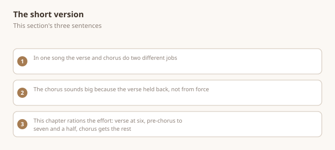
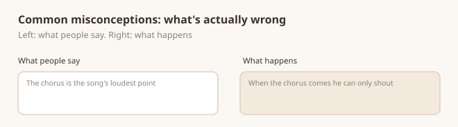
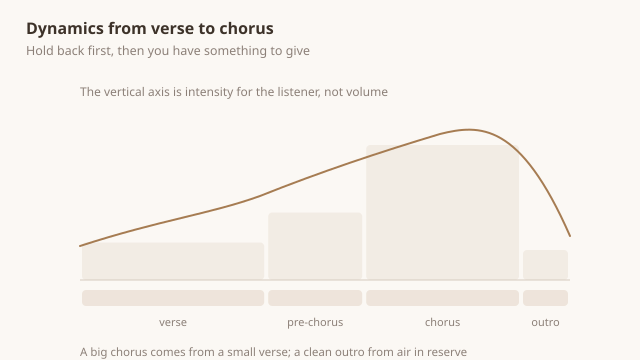
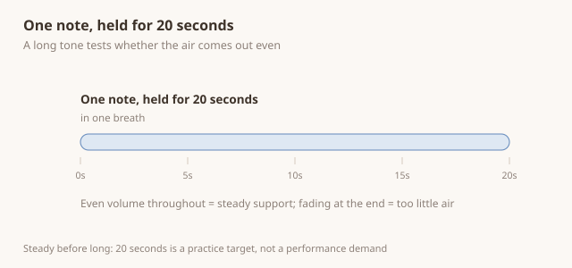
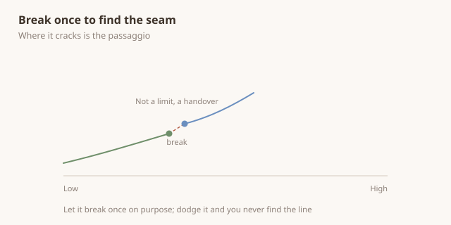
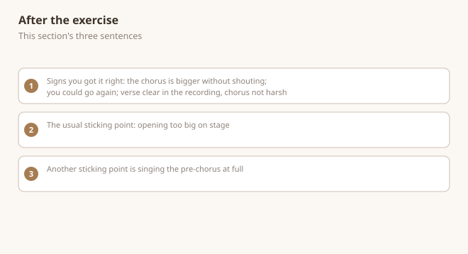

# Chapter 12: The Standard Shape of a Pop Song: How Verse and Chorus Differ in Level (The Basic Dynamics of a Verse and a Chorus)

## The short version

In the same song, the verse and the chorus do two different jobs. The verse delivers words to the listener's ear. The chorus carries the voice through the backing track and across the room.

The chorus sounds big not because you sing hard, but because the verse before it held back. The gap is what makes the chorus work.

This chapter allocates the effort: the verse at six out of ten, the pre-chorus pushed to seven and a half, so the chorus can use what is left. When you finish practising, you will have sung the whole song and still have something in reserve.

## Common misconceptions

Many people think the chorus is the loudest point of the song, so they open at eight out of ten from the first line. Then the chorus actually arrives and all they have left is shouting. The ear adapts to volume: hold the same level for a while and it stops sounding loud, so the only way to be bigger is more force, and the end of that road is a cracked note.

Others treat loud and forceful as the same thing. What actually makes a voice louder is airflow, subglottal pressure, and an adjustment to the shape of the vocal tract (Vurma, 2022). Effort in the throat only pinches the outlet: the sound turns harsh and flat, and it still doesn't carry.

A third misconception is that the verse can be sung carelessly because the chorus is the point. Listeners decide whether to keep listening in the first ten or twenty seconds. Muddle the verse and nobody stays long enough to hear how big the chorus is.

## How it works

The skeleton of a pop song is roughly verse, pre-chorus, chorus, then the whole round again, a bridge in the middle, and a final chorus to close. This order survives because it matches how people listen to a story: set it out, build it up, let it go.

The vocal difference is not in how much force, but in where three things sit. First, pitch: the verse stays near speaking pitch, the chorus moves up, and the cricothyroid lengthens and thins the vocal folds so the note can get there. Second, airflow and subglottal pressure: the chorus needs more air and higher pressure for the voice to get past the backing track. Third, vocal tract shape: when you sing louder, the space in the pharynx and mouth adjusts and lifts the mid-to-high frequency energy, and that is why the voice cuts through (Vurma, 2022).

There is also a practical observation: when volume and pitch rise together, muscle activity in the neck and shoulders tends to rise with them (Pettersen, 2005). In other words, the louder you get, the more likely you are to use the wrong place. So what the chorus really needs is loudness that doesn't come from the throat.

Breath support has no single standard posture either. Research comparing the torso movement of different singers as they project their voice found that they reach similar results by different strategies (Thorpe, 2001). So you don't have to copy what someone else's abdomen looks like on a chorus. What you copy is the result: steady airflow.

## An analogy

**The same cup of sweet tea.** Drink a fully sweetened cup first and this one at thirty percent tastes of nothing. Drink plain water first and thirty percent is sweet. That is how the ear handles volume and brightness: it compares what came before, not absolute values. The size of the chorus is propped up by the smallness of the verse.

**A tap and a pinched hose.** To make the jet reach further, do you open the tap wider or pinch the end of the hose? Pinch it and the jet gets thin, fast and sprays everywhere. That is adding volume with the throat: the sound turns harsh and still doesn't carry. Opening the valve is adding air: the jet gets thicker and steadier, and that is what a chorus should do. The difference is at the outlet, not in how hard your hand works.

**Pacing an 800-metre race.** Sprint off the line and you are done by 300 metres. The verse is the first 400, the pre-chorus is the bend, the chorus is the final straight. What you do is save something, not skimp: the verse still has to be clear and have feeling, you just don't spend the last of your breath on it.

## Try it now

### Exercise 1: Score the sections first, don't sing

1. Pick a ballad with clear verses and choruses, copy out the lyrics, and leave a blank line between sections.
2. Mark the verse 3, the pre-chorus 5, the chorus 8, out of ten. You are scoring how big it sounds, not how hard you push.
3. Speak the verse, at the volume of someone talking to a person sitting opposite.
4. For the chorus, speak to someone ten metres away. Louder, but not shouting.

What you should feel: a little support in the lower abdomen on the chorus, and nothing in the throat.
If you get it wrong: if the neck thickens and the voice goes hoarse on the chorus, you are adding volume with the throat. Halve the imagined distance and aim for clear words first.

### Exercise 2: One note, sliding in volume

1. Breathe in and sing "oo—" on a rather low note, quietly.
2. Without breaking the air, push the volume slowly to maximum over five seconds. The pitch must not climb with it.
3. Feel the bridge of your nose and check that at the loud end there is some vibration in the face, not just strain in the throat.
4. Then take five seconds to bring it back to minimum. Five times.

What you should feel: at the loud end it is the sides of your waist that ache, not the throat; at the quiet end the pitch has not dropped.
If you get it wrong: if the pitch drifts up as the volume rises, you are faking volume with pitch. Put a reference note on and sing against it.

### Exercise 3: Practise only the seam

1. Take only the last line of the pre-chorus and the first line of the chorus. Sing nothing else.
2. Speak it once and mark which syllable the breathing point comes after.
3. Sing those two lines: hold the pre-chorus at five, then jump the first syllable of the chorus straight to eight.
4. Repeat ten times, breathing in the same place every time.

What you should feel: the step into the chorus is a release, not a push.
If you get it wrong: if the chorus arrives at a different moment every time, you are guessing the beat. Count four beats with the backing track and pin the breathing point down. If your throat tickles going into the chorus, the air is being pushed from the neck; send it from the sides of the waist instead.

### Exercise 4: Sing the whole song once and record it

1. Make the verse deliberately half as loud as usual, keep the pre-chorus at its mark, and take the chorus to the biggest sound you can still control.
2. Sing the whole song. Don't stop in the middle to criticise yourself.
3. Record it and listen for three things only: are the verse words clear, is the chorus bigger than the verse, and does your throat feel hot afterwards.
4. If the chorus isn't big enough, go back and pull the verse in further. Don't make the chorus bigger first.

If you get it wrong: if the verse is so small the words smear, you held back too far. The floor for quiet is that every word is understood. If your throat is dry and you want water afterwards, the chorus used the wrong effort.

## After the exercise

Signs you got it right: the chorus is clearly bigger than the verse without shouting; you could sing the whole thing again afterwards; in the recording the verse is clear and the chorus is not harsh.

The usual sticking point is opening too big on stage. Adrenaline makes you louder than you were in practice, and the smallness of the verse disappears. Before you go on, speak one line of the verse to calibrate the volume.

Another is singing the pre-chorus at full. The pre-chorus is a staircase, not a lift. Hold it at five and the chorus has somewhere to stand.

Next chapter is about key. The original singer sounds relaxed on a song and you get stuck: the problem is often not technique but pitch.

## Further reading

- **Vurma, A. (2022).** Amplitude Effects of Vocal Tract Resonance Adjustments When Singing Louder. *Journal of Voice.* When you sing louder, the adjustment of vocal tract resonance is a measurable action, not just a feeling. PMID 32624371.
- **Pettersen, V., Bjørkøy, K., & Torp, H. (2005).** Neck and shoulder muscle activity and thorax movement in singing and speaking tasks with variation in vocal loudness and pitch. *Journal of Voice.* The louder and the higher you go, the more neck and shoulder muscle activity tends to rise. PMID 16301107.
- **Thorpe, C. W., Cala, S. J., & Chapman, J. (2001).** Patterns of breath support in projection of the singing voice. *Journal of Voice.* Breath support is not one action; different singers reach the same projection with different torso strategies. PMID 12269638.
