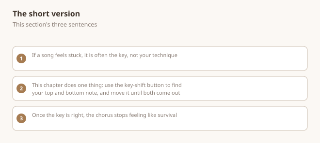
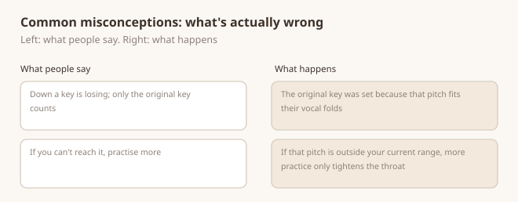
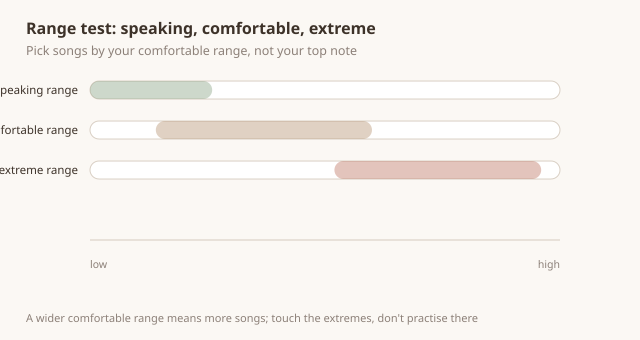
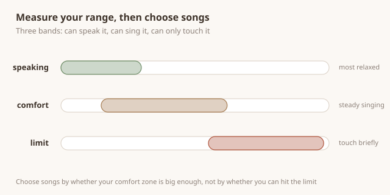
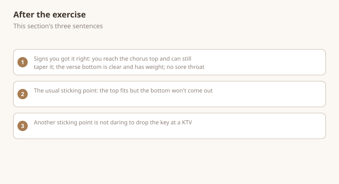

# Chapter 13: The Art of Choosing a Key: Finding the Range Where You Sing Best (A Simple Range Test for People With No Music Background)

## The short version

When a song feels stuck, it is often not a technique problem: the pitch of the song does not suit you. Everyone's vocal folds differ in length and thickness, and everyone's vocal tract differs in size, so the range each person can sing comfortably differs too.

This chapter does one thing: use the key-shift button on your phone to test a song's highest and lowest notes for you, and move it until you can sing both ends. No theory needed, and no perfect pitch.

Once the key is right, the most immediate change is that the chorus stops feeling like a fight for survival and the verse stops going hollow.

## Common misconceptions

Many people think dropping the key is admitting defeat, and that singing in the original key is what counts as being able to sing. The original singer set that key because that pitch suits their vocal folds. Forcing yourself into someone else's key is like running in someone else's shoes: finishing is luck, and not getting far is normal.

Another is that a note you can't reach will come after a few more tries. If that pitch is outside your current range, more attempts only tighten the throat. Range does widen over time, but not by forcing the same line over and over.

Others assume that raising the key must be harder. If your low notes are the weak part, raising the key makes the verse easier to sing, though the chorus has to be checked again. No direction of key change is better than the other; only whether the position is right.

## How it works

A song's range is the distance between its highest and lowest note. You also have a range you can currently sing comfortably: the middle is the zone where nothing costs much effort, and at each end there is a buffer where you can squeeze the note out but not hold it long.

Setting a key means shifting the song's whole range so that it lands inside your comfortable zone. When you shift, both ends move at once, so you have to test twice: first see whether the top note goes past your limit, then go back and see whether the bottom note falls out. Check only one end and you will get it wrong.

Range is best not left to feel. In the clinic, a voice range profile records how quietly and how loudly every pitch can be sung: a standardised, objective check (Berger, 2022). You can't measure that finely on a phone, but the principle holds. Being able to hit a note is not the same as being able to hold it steady.

One more thing that gets overlooked: singing in tune depends on hearing and on body sensation at the same time (Mürbe, 2002). In a KTV room or on headphones, change the balance between the backing track and your own voice and the evidence you judge pitch by changes with it. And if the external feedback is too loud, intonation actually gets worse (Bottalico, 2017). So when you test a key, set the monitoring so that you can hear yourself and hear the track. Don't bury your own voice for the sake of excitement.

## An analogy

**Someone else's shoes.** Half a size out and the same pair of shoes rubs. You wouldn't conclude your feet are wrong because you can't get into someone else's shoes. Keys are the same: the song is fine, your feet are fine, this pair doesn't fit.

**A height barrier.** When a truck can't get under the height barrier, it isn't that the truck is bad or the road is bad. The clearance doesn't suit that vehicle. Dropping the key is taking another route; you still get where you were going. Forcing through damages something, and that something is the vocal folds.

**A picture frame and a hook.** The song's range is the frame, a fixed size. Your range is the height of the hook on the wall. The same picture can hang higher or lower; what matters is that all of it is in your line of sight, not half of it up at the ceiling.

## Try it now

### Exercise 1: Go straight at the top note

1. Pick a song you have always found hard, and find its highest line, usually in the last chorus.
2. Play the backing track in the original key and sing only that line. Nothing before it.
3. Check three things: did the neck thicken, did the chin push forward, did the sound turn from singing into shouting.
4. Any one of the three means a red light.

What you should feel: when it passes, you can still hold the top note half a beat longer, and you don't feel that you are working.
If you get it wrong: repeating it after a red light tires the vocal folds, and everything you measure afterwards will be off. Drop the key the first time it's wrong. Don't keep fighting it.

### Exercise 2: Down one semitone at a time

1. Drop the backing track by one semitone and sing the same line.
2. If it is still tight, drop another semitone. One step at a time.
3. Stop at the step where you can reach it, the throat doesn't hurt, and you can still hold the note out.
4. Write that number down, for example "down two".

If you get it wrong: drop too far in one go and you won't know which step was the tightest, so next time you still guess. If it stays tight even after dropping a long way, the problem may not be the key but how you produce that line. Go back to the previous chapter.

### Exercise 3: Go back and check the bottom note

1. In the key you just found, go back to the first line of the first verse, usually the lowest point in the song.
2. Sing it at speaking volume. Don't press it down on purpose.
3. Check: are the words clear, is there vibration in the chest, is the voice buried by the low end of the backing track.
4. If the verse falls outside, go up one step and test again.

What you should feel: when it passes, the low note is spoken out loosely, not squeezed out.
If you get it wrong: if you push the chin down into the neck to reach the low note, the sound goes dull. That is pressing, not singing.

### Exercise 4: Write down your code

1. Write your key for this song next to it on your playlist, for example "down two".
2. Test three songs the same way and see whether the numbers are close.
3. If the three numbers all sit near each other, that is your comfortable zone for now.
4. Next time you pick a song, set it to that number first, then adjust by one step.

If you get it wrong: three songs differing a lot is normal, because each song spans a different range. The point is not getting the same number; it is testing both ends every time.

## After the exercise

Signs you got it right: you can reach the top note of the chorus and still taper it off; the lowest note of the verse is clear and has weight; your throat is not sore after the whole song.

The usual sticking point is the top note fitting while the bottom note won't come out. That means the song's span is wider than your current range. It is not your fault and not the song's fault; it just doesn't suit you yet. Leave it for now. Range widens gradually.

Another is being too shy to drop the key at a KTV. Singing is for other people to hear, not a competition. Two steps down, steady and with feeling, sounds far better than forcing the original key and cracking.

Next chapter is about distributing emotion: in the same song, where to hold back and where to let everything go.

## Further reading

- **Berger, T., Fuchs, M., & Dippold, S. (2022).** Standardization and Feasibility of Voice Range Profile Measurements in Epidemiological Studies. *Journal of Voice.* The voice range profile is a standardised objective measurement, not a feeling that "I can sing that". PMID 32402662.
- **Mürbe, D., Pabst, F., & Hofmann, G. (2002).** Significance of auditory and kinesthetic feedback to singers' pitch control. *Journal of Voice.* Singing in tune depends on hearing and body sensation at once; headphones or a change in the monitoring balance set the two against each other. PMID 12002886.
- **Bottalico, P., Graetzer, S., & Hunter, E. J. (2017).** Effect of Training and Level of External Auditory Feedback on the Singing Voice: Pitch Inaccuracy. *Journal of Voice.* Too much external feedback, and intonation actually gets worse. PMID 26948385.
