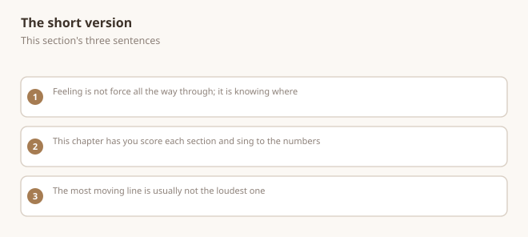
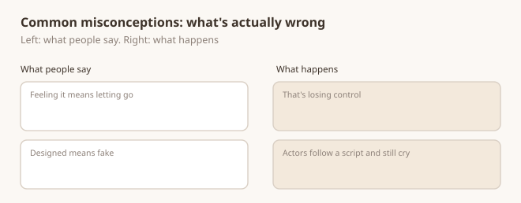
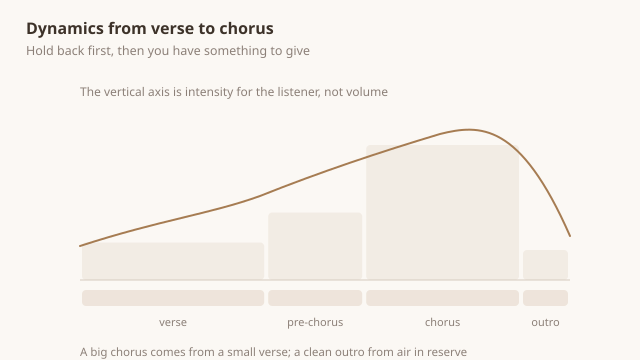
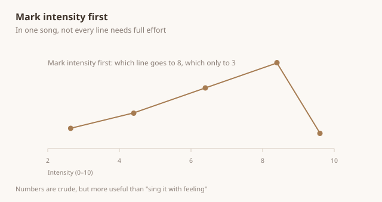
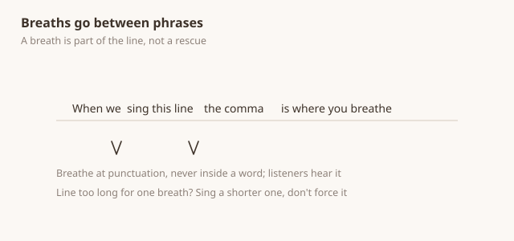
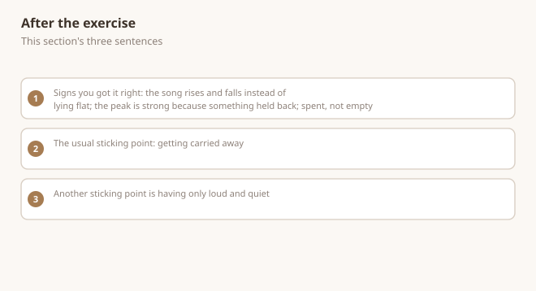

# Chapter 14: Drawing the Emotional Line: Making Singing as Natural as Telling a Story (Basic Emotional Scoring and How to Allocate It Across Sections)

## The short version

Singing with feeling is not being forceful from beginning to end. It is knowing where to hold back and where to let go. Keep one intensity for the whole song and the listener has had enough within ten minutes.

This chapter has you write numbers beside the lyrics, set an intensity for each section, then sing to those numbers. With that map in front of you, your mood of the moment stops dragging you around.

When you're done you'll find that the most moving line is usually not the loudest one.

## Common misconceptions

Many people think feeling means letting go completely: a furrowed brow and a cracked voice must mean commitment. That is really losing control. Once emotion takes over, the breath goes first, the throat clamps next, and the voice gives out soon after — on stage.

Another is that anything designed can't be sincere. An actor works from a script and still cries. Design is what makes it stable, and stable is what carries.

Others equate quiet with feeling nothing. Quiet is harder to sing than loud; it needs more breath support, not less. Many people go hollow when they pull back, and that is support collapsing, not emotion arriving.

## How it works

Intensity can be taken apart. It contains at least four things: volume, airflow, how bright or dark the timbre is (resonance placement), and how tight the diction is. The same "loud" can be shouted in a bright timbre or pushed in a thick, dark one, and it reads as two completely different emotions.

This is not mysticism; it can be measured. Compare belt with a neutral style of singing and the two differ in breathing pattern, sound pressure and formant strategy (Sundberg & Thalén, 2015). So when you decide that a section should push harder, you are changing a whole set of settings, not just turning the volume knob.

Teaching systems say the same thing plainly. Complete Vocal Technique divides the voice into four modes — neutral, curbing, overdrive and belting — each with its own volume and timbre, and there is research assessing how workable the classification is for teaching (McGlashan, 2023). Think of them as four gears. A single song changes gear anyway.

As for breath support, there is no single correct action. Research on how different singers project their voice found that they use different torso strategies and all reach projection (Thorpe, 2001). So an eight on the emotional map is not asking you to copy someone's abdomen. It is asking you to reach that result.

## An analogy

**Salt in a pot of soup.** Salty enough from the first bowl and salty enough in the last, and the pot is ruined. The smarter way is to keep it light at the start, leave the tongue some room, and add at the end. The emotional line is the salt: you don't bring every section to full, you save full for the section that needs it.

**The first climb of a rollercoaster.** The car creeps upward and you are bored, but that stretch is necessary: without it the drop later isn't a drop. If the first chorus is already at ten, the last chorus can only be ten, and the whole song becomes one flat high line.

**Breathing is punctuation.** Move the comma in a sentence and the meaning changes ("I don't want to, you go" against "I don't want you to go"). Same words, completely different breath. Breathing is not only topping up oxygen: it phrases the line for you, and it buys the listener time. A quick stolen breath sounds rushed; a slow one sounds reluctant.

## Try it now

### Exercise 1: Draw an emotional map

1. Copy out the lyrics, keep the section order, and leave wide gaps between the lines.
2. Mark the first verse 3 and the first chorus 7.
3. Mark the second verse 4, a little more than the first, and push the bridge from 6 to 8.
4. Mark the final chorus 9. Write the numbers to the right of the lyrics, in pencil.

If you get it wrong: if every section is marked eight or above, the map is useless. Go back and push the opening down to 3 so that later sections have somewhere to rise to. If you finish scoring and don't know what the difference between 3 and 7 is, speak it first, don't sing it.

### Exercise 2: Perform it once, speaking

1. Don't sing. Read the whole lyric out loud.
2. At the 3s, picture the listener sitting one step in front of you.
3. At the 8s, picture the listener across the street.
4. Every time the section changes, the body has to change too: stance, jaw angle, eyes.

What you should feel: at the 8s it is the lower abdomen that aches, not the throat, and the words are still clear.
If you get it wrong: if the voice breaks at the 8s, you jumped too far at once. Start at 5 and add a section at a time. If you feel ridiculous afterwards, that is normal. You are doing something you don't normally do.

### Exercise 3: Design three kinds of breath

1. Mark a "v" mid-sentence for a quick, silent stolen breath.
2. Mark an "h" in the verse for a sighing intake of air, so it sounds like holding something back.
3. Mark "V!" before the last chorus for an obvious, deep breath.
4. Read it once following the marks and listen for whether the same words now mean something different.

If you get it wrong: mark "V!" everywhere and the whole song sounds like panting. One big breath is enough; save it for the point that needs it.

### Exercise 4: Use an image instead of a memory

1. Pick the section you feel most.
2. While you sing, don't go back to your own painful memories. Picture something concrete instead: raindrops sliding slowly down a window.
3. Sing at the speed of that image, not at the concentration of the memory.
4. Record once and listen for whether the voice is steadier.

If you get it wrong: if thinking of something genuinely painful makes you choke up and stop singing, emotion has overridden control. The point of working from an image is to be carried along by it, not flooded by the memory.

### Exercise 5: Sing it through to the map

1. With the scores and breathing points in front of you, sing once with the backing track.
2. Before each section starts, look at its number, then open your mouth.
3. Afterwards, compare: which sections came out bigger than marked, which smaller.
4. Fix only the section that was furthest off. Leave the rest alone for now.

If you get it wrong: if every section came out bigger, that is nerves, not design. Shift the whole map down one. If you forget to look halfway through, put the backing track aside and practise with a finger on the lyrics.

## After the exercise

Signs you got it right: the song has rises and falls instead of being flat; the strongest point is strong because something before it held back; afterwards you feel emotionally spent but not physically empty.

The usual sticking point is getting more and more excited as you go. Once the chorus takes over, the scores go out the window and everything after it gets louder. While practising, keep your eyes on the numbers you wrote and let them work the brake.

Another is having only loud and quiet. A 3 can be a cold 3 or a warm 3; the difference is timbre and diction. The score is only the skeleton. Tone is the flesh.

Next chapter is upkeep. The voice is a consumable: you have to know how to look after it, not just how to use it.

## Further reading

- **Sundberg, J., & Thalén, M. (2015).** Respiratory and Acoustical Differences Between Belt and Neutral Style of Singing. *Journal of Voice.* Belt and neutral style differ in breathing, sound pressure and formant strategy; they are not one setting with the volume turned up. PMID 25819162.
- **McGlashan, J., Aaen, M., & White, A. (2023).** A mixed-method feasibility study of the use of the Complete Vocal Technique (CVT), a pedagogic method to improve the singing voice. *Pilot and Feasibility Studies.* The four CVT modes (neutral, curbing, overdrive, belting) and how workable they are for teaching. PMID 37226281.
- **Thorpe, C. W., Cala, S. J., & Chapman, J. (2001).** Patterns of breath support in projection of the singing voice. *Journal of Voice.* Breath support has no single correct posture; different singers reach the same projection with different torso strategies. PMID 12269638.
