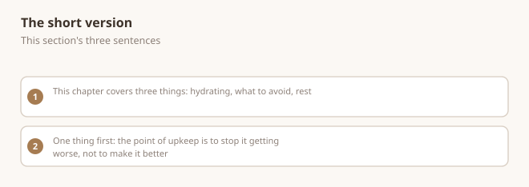
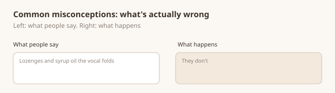
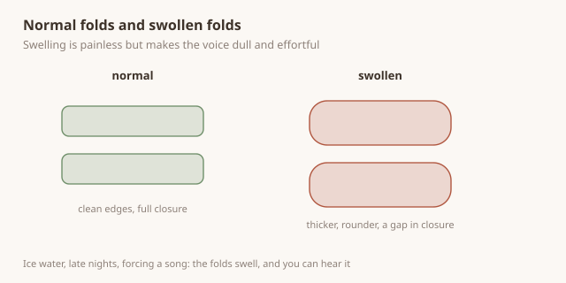
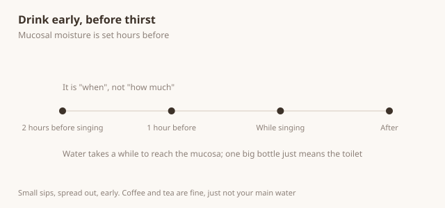
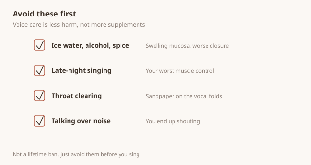
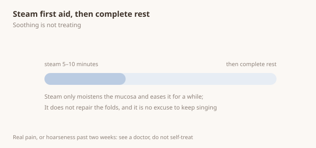
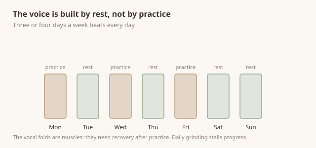
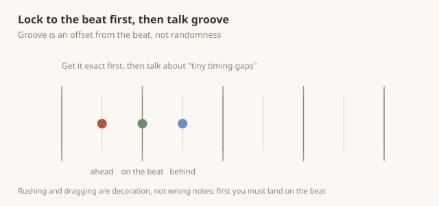
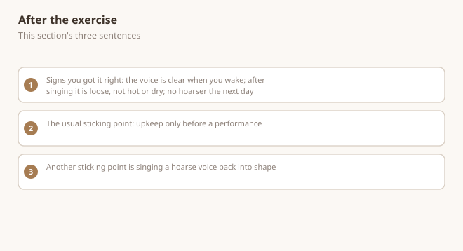

# Chapter 15: A Guide to Caring for the Voice: Daily Upkeep and Keeping a Comforting Sound (Hydration, Diet, and How to Rest the Throat)

## The short version

The vocal folds are a consumable. However good your technique, dryness, inflammation and overuse will still wear them out.

This chapter covers three things only: how to hydrate, what to stay away from, and how to rest when you are tired. Get these three right and they beat any home remedy.

One thing to be clear about first: the point of upkeep is to stop things getting worse, not to make them better. Getting better comes from practice and sleep, not from what you drink.

## Common misconceptions

Many people think throat lozenges or cough syrup lubricate the vocal folds directly. They don't. When you swallow, the epiglottis covers the trachea, and what you swallow goes down the oesophagus. The vocal folds sit at the top of the trachea; the two paths are separate. A lozenge can at most make the throat feel cool. What actually supplies the vocal folds with moisture is your blood.

A more dangerous misconception is that whispering protects a hoarse voice. Whispering is the vocal folds not closing fully, with a gap left in the middle and air leaking through it the whole time. On vocal folds that are already swollen, that is prolonged rubbing. The best thing for hoarseness is to talk less, not to keep talking in another voice.

Others have a habit of clearing the throat when a note won't come. Clearing the throat slams the two vocal folds into each other, with a more concentrated impact than a high note. When you want to clear it, swallow instead, or take a small sip of warm water.

## How it works

The surface of the vocal folds carries a thin layer of mucus that cushions the vibration. The quality of that layer depends on how hydrated your whole body is. But water does not arrive the moment you drink it: it has to be absorbed through the gut, enter the blood, and be secreted by the mucosa, and that takes time. So downing a big bottle five minutes before you go on only makes you need the bathroom.

Vibration itself produces heat. After a long stretch of talking or singing, the vocal folds get tired and slightly swollen, the voice starts to go rough, and the high notes get harder. That is normal, and rest reverses it. What causes chronic problems is pushing on once you are tired.

The effect of temperature is often exaggerated. Drinks that are too hot irritate the mucosa; cold drinks don't actually touch the vocal folds directly, though some people feel a tightening in the throat after them. Room temperature or lukewarm is the most neutral. If cold drinks don't bother you, there is no need to give them up.

Stomach acid is another enemy that gets overlooked. Eat too much, eat too much fat, lie down straight after eating, and acid can reflux into the pharynx and irritate the vocal folds directly. That is why many people wake up hoarse with their high notes gone.

As for warming up, it works, but only to the extent of steadying what you have; it does not widen your range. One study compared the effects of warm-up and cool-down in teachers (Masson et al., 2019), and another compared steam with semi-occluded exercises as two kinds of morning warm-up (Keltz & McHenry, 2022). Both are usable, but steam soothes; it does not treat.

## An analogy

**Polishing the outside of a shoe.** You work the polish into the upper and get a fine shine, and the inside is still damp. A lozenge is the polish: it touches the surface of the mouth and pharynx, not the layer on the vocal folds. To keep the inside dry you have to hydrate from within.

**Slamming two doors together.** Clearing the throat is like throwing a door shut: loud, and the hinges wear out fast. You think you cleared something; what actually happened is that two folds of mucosa hit each other. When you want to clear it, open the door gently instead: swallow, or drink water.

**A dry sponge.** Drop a dry sponge into water and it takes a while to soak it up; a sponge that is already damp needs one drop. The mucosa of the vocal folds is that sponge. Keep your water level up day to day and it stays damp. Flood it only once it has dried out and it is too late.

## Try it now

### Exercise 1: Hydrate ahead of time

1. Work out when your next practice session is.
2. Starting two hours before, drink two or three mouthfuls of room-temperature water every fifteen to twenty minutes.
3. Don't down a big glass at once. Small sips, at regular intervals.
4. Keep the same rhythm going during the session.

What you should feel: afterwards the throat is loose, not dry and not hot.
If you get it wrong: down a big bottle just before you go on and you will only need the bathroom; the vocal folds are still dry. If you drink nothing but coffee and tea all day, their diuretic effect loses water faster, so remember to put back the same amount in plain water.

### Exercise 2: Stay away from these first

1. Two hours before practising, avoid coffee, strong tea and alcohol.
2. Dairy doesn't necessarily produce more phlegm, but some people feel a coating on the throat afterwards and keep wanting to clear it. If that is you, avoid it before you practise.
3. Avoid fried food, chilli and anything very sweet; they tend to set off stomach acid.
4. If you do eat them, leave at least two hours before you practise, and don't lie down straight after the meal.

If you get it wrong: if you keep wanting to clear your throat halfway through, stop and drink water or swallow. Don't cough hard. Clearing the throat only makes it want clearing more; the loop is habit-forming.

### Exercise 3: Steam, not hot air

1. Pour a cup of hot water at about seventy degrees Celsius. Bring your face near it, keeping more than a hand's width away.
2. Breathe in slowly through the nose and mouth for five to ten minutes.
3. Stop when the throat feels moist. Don't breathe in until it burns.
4. Do it once whenever the voice goes rough or the high notes get hard.

If you get it wrong: water that is too hot, at too short a distance, scalds the mucosa, which is worse than the original problem. Don't drink iced water straight after. And if you need steam every morning before your voice will work, that is not a warm-up problem; go and see a doctor.

### Exercise 4: Schedule real rest

1. After forty-five minutes of continuous talking or singing, stop.
2. Give yourself fifteen minutes with no talking, no humming, no phone calls.
3. Schedule two or three of these quiet stretches a day.
4. Sleep at least seven hours. Most of the repair happens while you sleep.

If you get it wrong: if you spend the break scrolling and chatting quietly, that is not a break. What the vocal folds need is for you to stop. If you are already hoarse, stretch the rest to a whole day.

### Exercise 5: The cool-down is easier to skip than the warm-up

1. Before you finish, do two minutes of glides on a lip trill or humming, at half volume.
2. Then come back down to speaking pitch and read a couple of sentences.
3. Don't shout or take a phone call straight after the cool-down.
4. Have at least one day a week with no singing at all.

If you get it wrong: pack up and leave straight after practising and the vocal folds stay in a high-tension state, and they tend to go rough the next day. The cool-down doesn't need to be long. It needs to happen every time.

## After the exercise

Signs you got it right: your voice is clear when you wake up; after practising the throat is loose, not hot and not dry; the next day you are no hoarser than the day before.

The usual sticking point is looking after the voice only before a performance. The state of the vocal folds accumulates: stay up late the night before, drink, shout all evening in a noisy place, and there is only so much you can do on the day.

Another is trying to sing a hoarse voice back into shape. Hoarseness means the vocal folds are already inflamed, and practising now only makes it worse. Rest, hydrate, and wait for the voice to come back. In vocal hygiene advice for professional voice users, the things mentioned most often are these same basics (Behlau & Oliveira, 2009).

That is the end of the beginner stage. Next comes finer breath control: how to take one note from very small to very large, and bring it back.

## Further reading

- **Behlau, M., & Oliveira, G. (2009).** Vocal hygiene for the voice professional. *Current Opinion in Otolaryngology & Head and Neck Surgery.* Evidence-based advice on hydration, avoiding throat clearing, and voice rest. PMID 19342952.
- **Keltz, A., & McHenry, M. (2022).** Steam and/or Semi-occluded Vocal Tract Exercise as Morning Vocal Warm-up Strategy. *Journal of Voice.* Steam and semi-occluded exercises both work as a morning warm-up; steam soothes rather than treats. PMID 32988703.
- **Masson, M. L. V., Fabbron, E. M. G., & Loiola-Barreiro, C. M. (2019).** Vocal warm-up and cool-down in teachers: a quasi-experimental controlled study. *CoDAS.* What warm-up and cool-down do for people who use their voice for long stretches. PMID 31531555.
