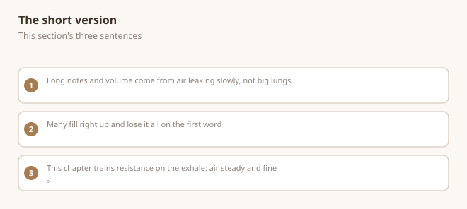
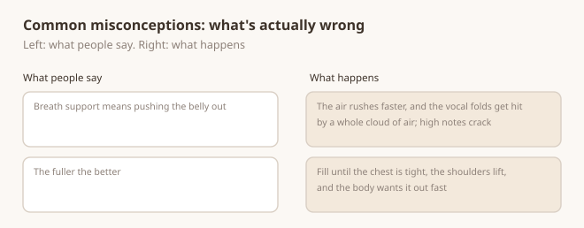
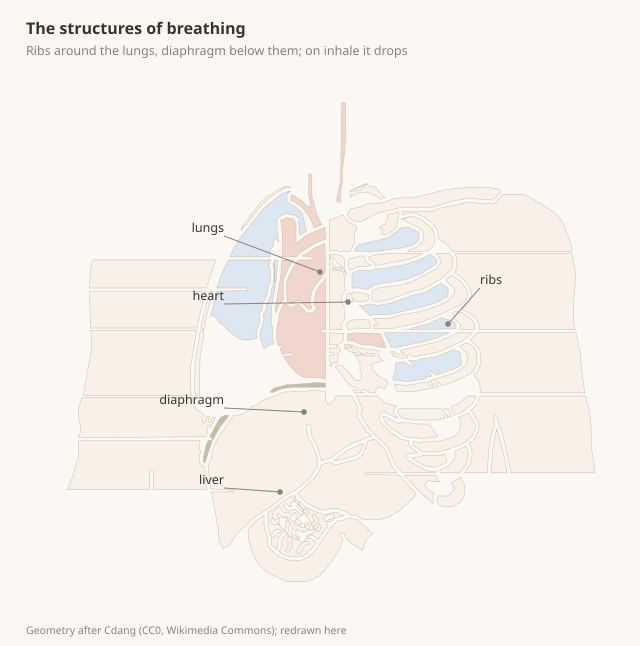
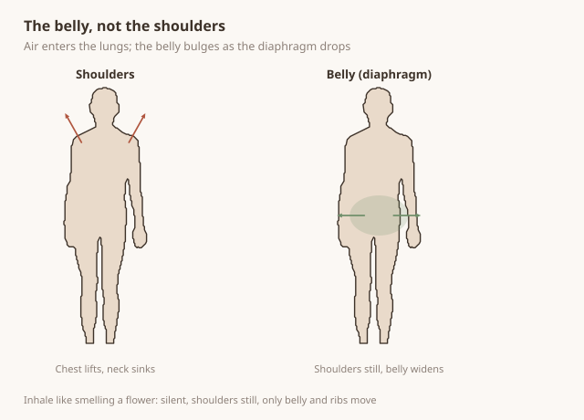
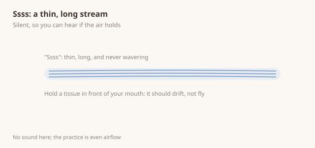
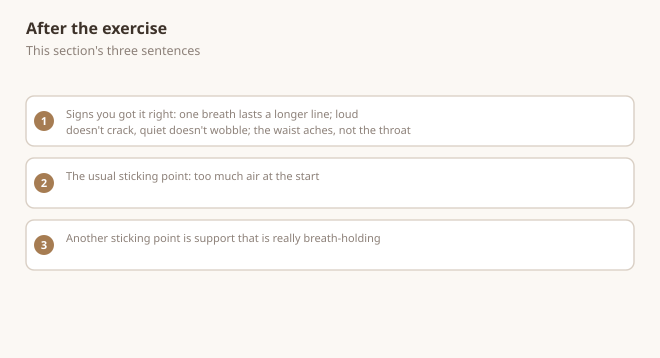

# Chapter 16: Deep Training for the Diaphragm: Building a Wide Dynamic Range of Breath

## The short version

Singing long notes and singing loud does not depend on a big lung capacity. It depends on the air leaking out slowly.

Many people fill up completely and lose all the air the moment they open their mouths. The problem is not that there isn't enough air. It is that you are not controlling how fast it goes back out.

This chapter trains resistance on the way out: airflow that is steady and fine, that stops when you want it to stop and grows when you want it to grow. Afterwards, the same breath will last through a longer line, and high notes won't thin out as quickly.

## Common misconceptions

Many people think breath support means pushing the belly out hard to squeeze the air out. That makes the air rush faster instead, a big lump of it hits the vocal folds, and the high note cracks. Breath support is not about how much you give; it is about how fast it leaves.

Another misconception is that the fuller the breath, the better. Fill until the chest is tight and the shoulders are up and the body wants to get rid of the air as fast as it can. A useful breath is a deep one with the upper body still loose.

Others think the belly has to stay pushed out. Pushing out is a result of breathing in, not the goal. What you maintain is the sense of expansion that comes with still wanting one more sip, not a belly blown up like a balloon.

## How it works

The diaphragm is an umbrella-shaped muscle sitting below the lungs. When you breathe in it contracts and drops, the chest cavity gets larger, and air is drawn in. The abdominal cavity is pressed downward and the belly therefore moves outward. Note the order: the diaphragm drops first, then the belly moves out. Trying to push the belly out in order to pull air in reverses it.

When you breathe out, the diaphragm relaxes and rises back into place, and the elastic recoil of the lungs and chest wall helps push the air out. This process is passive to begin with. That is exactly the problem: leave it entirely alone and the air rushes out, a long line runs out halfway, and airflow that strong works against the vocal folds vibrating.

So the advanced training is about not letting it go back so fast. The muscles of the abdomen and the sides of the waist keep a little tension, opposing the rising diaphragm, so the airflow becomes fine and even. Classical singing calls this opposition — keeping the inspiratory posture while breathing out — appoggio. It is not holding your breath: the air keeps coming out, just very slowly.

One more structure gets overlooked: the pelvic floor takes part in breathing too, and together with the deep abdominal muscles it gives the lower abdomen its stability (Emerich Gordon & Reed, 2020). What is loosely called "dantian" support — driving from the deep centre below the navel — corresponds anatomically to this deep tension, not to pulling the navel in hard.

Breath support has no single right answer either. Research on the torso movement of singers as they project their voice found different singers reaching similar results by different strategies (Thorpe, 2001). Some hold the sides of the waist out visibly; others work the lower abdomen harder. So what you are after is steady airflow, not someone else's posture.

One last warning: when the volume rises and the pitch goes up, muscle activity in the neck and shoulders tends to rise with them (Pettersen et al., 2005). That means the moment you think "more effort", the body starts compensating from the shoulders and the muscles outside the larynx. The point of training breath support is to stop that from happening.

## An analogy

**A balloon with the neck pinched.** Let go of a full balloon and the air sprays everywhere. Pinch the neck and leave a small opening and the air comes out fine and steady. Pinch too hard and nothing comes out at all, and the sound is gone; don't pinch at all and it is over in two seconds. Breath support is the strength in that hand, and it sits at the outlet, not inside the balloon.

**Squeezing a toothpaste tube.** The right way is to press slowly from the end, with even force, so the paste comes out in a neat line. The wrong way is to grab it in the middle: a big blob comes out first and after that there is nothing but air. A long sung line is the same: go easy at the start and there will still be something at the end.

**Holding a kite string.** The force pulling the kite up is the elastic recoil of the lungs; your hand is the tension in the abdomen. Let the string go completely and the kite wanders; pull too tight and it drops. What you want is a line that stays taut while always paying out, and that is exactly what opposition on the way out means.

## Try it now

### Exercise 1: Check the direction first

1. Stand tall, one hand on the chest, one on the lower abdomen.
2. Breathe in slowly through the nose. Feel the lower abdomen and the sides of the waist move outward while the chest stays as still as it can.
3. Breathe out and feel the lower abdomen come back slowly, without collapsing all at once.
4. Five times. The shoulders must not shrug.

What you should feel: on the way in, the hand is pushed away rather than shoved out by you.
If you get it wrong: if only the chest moves and the belly doesn't, that is shallow breathing. If you force the belly out and feel dizzy, you are breathing too fast. Slow down and breathe through the nose.

### Exercise 2: Resistance on a sibilant

1. Breathe in, hands on your waist with the fingers against the sides.
2. Teeth lightly closed, make a long "sss—", as if letting out a little air at a time.
3. As you breathe out, keep the sides of the waist slightly out, so the "sss" stays the same fineness from start to finish.
4. Aim for thirty seconds. If you can't last that long it doesn't matter; steady first, long second.

What you should feel: it is the sides of the waist and the lower abdomen that ache; the throat feels nothing.
If you get it wrong: if the "sss" starts thick and ends thin, you let out too much air at the start. If the belly collapses all at once, you dropped the support. If you go red in the face, the air isn't coming out at all: that is not support, that is holding your breath.

### Exercise 3: Short detached notes

1. Mouth slightly open, pant like you have just been running: "ha, ha, ha, ha", eight at a time.
2. Hand on the lower abdomen. Each "ha" should be a quick bounce of the belly.
3. Switch to a pitched "ah": short, detached, clean.
4. Once it is easy, speed up a little, but each one still needs that movement from the belly.

If you get it wrong: if the chest rises and falls and the shoulders move with it, you are panting with the upper body. If the notes are being cut off by the throat, they will sound jammed; stop the airflow instead of closing the throat.

### Exercise 4: Push and pull on one note

1. Pick a comfortable mid-to-high note.
2. Sing "oo" very quietly and hold it for three seconds.
3. Grow it slowly to the loudest sound you can control over five seconds, then take five seconds to bring it back to the smallest.
4. Three times. The pitch must not drop at the end.

What you should feel: at full volume the sound gets wider rather than harsher.
If you get it wrong: if it turns harsh and the throat tightens as you get louder, you are adding volume with the throat. What you add is air and resonance space, not effort in the throat. If it wobbles or goes out of tune as it fades, the support was released too early; keep the tension in the sides of the waist to the last of the breath.

## After the exercise

Signs you got it right: one breath lasts through a longer line than before; loud notes don't crack and quiet ones don't wobble; what aches afterwards is the sides of the waist and the lower abdomen, not the throat.

The usual sticking point is giving away too much air at the start. On a loud line many people empty themselves on the first beat and then watch it thin out. Hold a little back at the start and leave it for the end of the phrase.

Another is support that is really breath-holding. The belly is braced hard but no air is moving, and the sound goes dull and shaky. Support controls the flow rate; it does not shut the air off.

Next chapter takes the two ends of a note: how it starts and how it ends. However good the middle is, careless ends cost you a level of quality.

## Further reading

- **Thorpe, C. W., Cala, S. J., & Chapman, J. (2001).** Patterns of breath support in projection of the singing voice. *Journal of Voice.* Breath support is not one action; different singers reach the same projection with different torso strategies. PMID 12269638.
- **Emerich Gordon, K., & Reed, O. (2020).** The Role of the Pelvic Floor in Respiration: A Multidisciplinary Literature Review. *Journal of Voice.* The role of the pelvic floor and the deep abdominal muscles in breathing: the anatomical counterpart of what is called the "dantian". PMID 30447797.
- **Pettersen, V., Bjørkøy, K., & Torp, H. (2005).** Neck and shoulder muscle activity and thorax movement in singing and speaking tasks with variation in vocal loudness and pitch. *Journal of Voice.* The louder and the higher you go, the more neck and shoulder muscle activity tends to rise. PMID 16301107.
