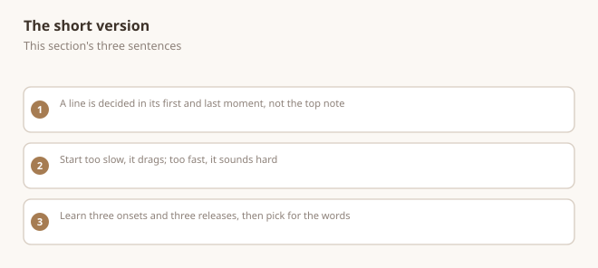
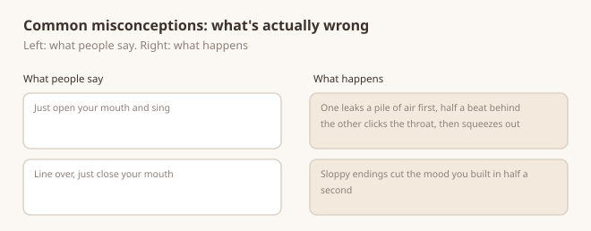
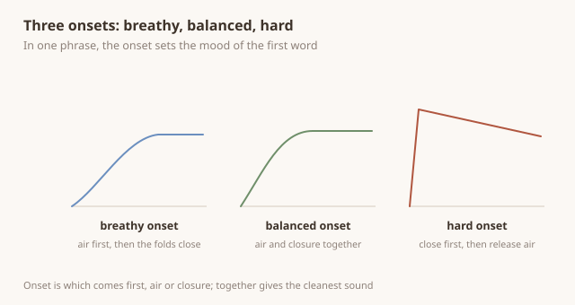
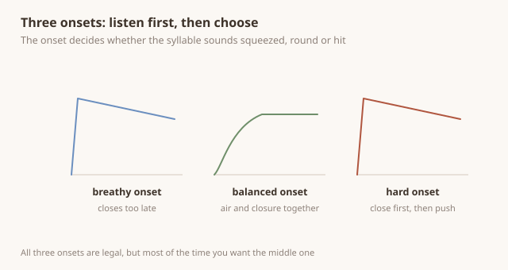
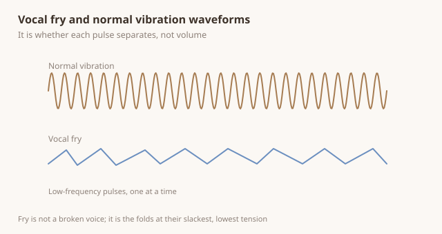
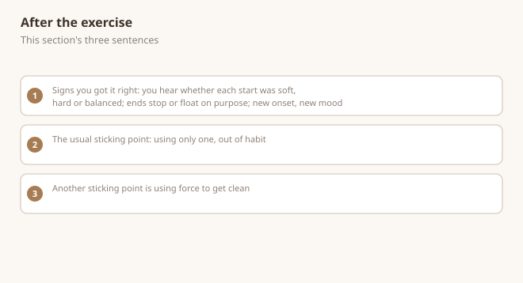

# Chapter 17: Fine Control of the Breath: Getting the Onset and the Release Exactly Right

## The short version

Whether a line sounds good is usually decided in the two moments at its start and its end, not at the highest note in the middle.

Start too slowly and it drags; too fast and it sounds hard. End too abruptly and the feeling snaps off right there.

This chapter wants you to tell three kinds of onset and three kinds of release apart, then pick one to suit the words. You don't have to get it right every time. You only have to know which one you are doing.

## Common misconceptions

Many people think singing is just opening the mouth and making a sound. The result is one of two things: a lot of air escapes before the sound arrives and it sounds half a beat late, or the throat clicks first and squeezes the sound out and it sounds hard. Neither is direct. In both, the timing is off.

Another is that finishing a line means closing the mouth. End carelessly and the feeling you built up snaps in the last half second. End well and the listener's feeling is left hanging in mid-air; end badly and it is as if someone pressed pause.

Others think a clean onset means force. Clean is about timing: when the air arrives, the vocal folds come together at that same moment. One extra unit of force and it becomes a hard onset. That is not clean, that is a collision.

## How it works

How a sound begins depends on the gap in timing between two things: when the airflow arrives, and when the vocal folds come together.

Air first, vocal folds closing a moment later: that is a soft onset. A stretch of pure breath comes first, and it sounds gentle, like a sigh. Vocal folds closing first and the air forcing them apart: that is a hard onset. A small burst at the start, crisp and aggressive. Both happening at once is a balanced onset: no leaking air, no burst, the least effort of the three.

A release reverses the order. Air stops first while the folds are still closed, and the sound is cut off. The folds loosen first while the air is still moving, and the sound dissolves gradually into breath: that is a fading release. At the release the airflow drops, so breath support has to be steadier rather than less, or the pitch sags and the sound wobbles.

Why is the hard onset especially damaging? Because the impact energy is concentrated in that instant. The tighter the folds come together and the harder the air forces them apart, the bigger the collision. That is also why semi-occluded exercises make onsets easier: add resistance behind the mouth and the vocal folds can vibrate at lower pressure (Titze, 2006).

Two more mechanisms are worth knowing. Vocal fry is vibration at low tension and low pressure, with the vocal folds closing very loosely (Elias et al., 2016), which is why it is often used to reset an onset that is too tight: start the vibration in the loosest state, then build up from there. And modal voice and falsetto are two closure states of the same vocal folds (Titze et al., 2014), so if a release runs down through the passaggio you will feel the closure jump. That is a handover between states, not a mistake.

None of the three onsets is the correct one. The hard onset is useful on a strong beat, but using it repeatedly keeps the vocal folds taking hits. The soft onset suits gentle passages, but it leaks a lot of air and the next line runs out. The balanced onset is the most neutral, and it is the everyday default.

## An analogy

**Pushing a door.** The door is the vocal folds, the push is the air. Push before the door opens and the door is knocked open and may bounce back: a hard onset. Push a door that was never properly closed and your push disperses through the gap: a soft onset. Hand on the door, door opening at the same moment: a balanced onset. All three open the door; they differ in the order.

**Filling a cup.** To fill a cup you set the cup down and then turn the tap on; you don't turn the tap on and then bring the cup over, or it splashes. A soft onset is turning the tap on first: the air has already been flowing for a moment when the cup (the vocal folds) arrives.

**Stopping at a red light.** A good driver brakes gradually and glides to a stop right at the line. A bad driver slams the brake at the line and the passengers lurch forward. A fading release is the good driver: the air eases off and the sound slides away to nothing. Shutting the mouth abruptly is the bad driver, and the feeling gets thrown forward.

## Try it now

### Exercise 1: Hear all three onsets

1. Breathe in, hold for a moment, then force out an "ah!" and listen to the burst at the start. Five times.
2. Breathe in, let out a "haa—" first, then melt the voice into it so it becomes "haa-ah". Five times.
3. Breathe in and go straight into "aah—", with no burst and no leaking air. Ten times.

What you should feel: the third is the least effortful, as if the sound were there the moment the air came, with no gap in between.
If you get it wrong: if all three sound the same, you are not really controlling the timing gap. Slow right down, practise air-first, closure-first and simultaneous separately, then speed up.

### Exercise 2: Practise only the balanced onset

1. Hand on the lower abdomen. Breathe in.
2. At the moment the sound starts, feel that the air and the vocal folds start together.
3. Check the start: a breathy "h" means the air was early, a click means the folds closed too early.
4. Adjust one direction at a time, ten repetitions. Stop when it's right; don't practise until you are tired.

If you get it wrong: if ten tries don't find it, you are usually paying attention to your throat. Put your attention on the moment the air leaves the belly instead, and the vocal folds will follow. If your throat gets tighter the more you practise, rest. The effort is going to the wrong place.

### Exercise 3: Loosen first, then start

1. Sigh, and let the vocal folds produce a low vocal fry, like a motorbike idling.
2. Hold the fry for two seconds and feel that the throat is doing nothing.
3. Without stopping, let the fry melt straight into an "ah", with the pitch rising only a little.
4. Five times, starting from the loosest state every time.

If you get it wrong: if the fry won't come, the air is too strong or the throat too tight. Reduce the air to a sigh. If the sound hardens and grows the moment it melts into "ah", the old habit is back; go back to doing only the fry.

### Exercise 4: A fading release

1. Start a middle "oo" on a balanced onset and hold it for three seconds.
2. As you get ready to finish, let the vocal folds loosen gradually so that breath starts mixing into the sound.
3. Keep the support in the sides of the waist; don't let the air dump out all at once.
4. Let the "oo" turn into breath and finally vanish. Five times.

If you get it wrong: if the pitch drops as the sound fades, the support was released along with the volume. Keep the support the same and only reduce the air. If it shakes badly, the air is being released too much and too fast; narrow the outlet a little.

### Exercise 5: Put it into one line of a song

1. Pick the first line of a ballad's chorus.
2. First time: start with a touch of sigh (soft onset), end fading into breath.
3. Second time: a clean start (balanced onset), a decisive stop at the end.
4. Third time: a small accent at the start (hard onset), a fading end.

If you get it wrong: if all three feel emotionally the same, the differences are too small. Exaggerate the features and practise, then pull them back once it is easy.

## After the exercise

Signs you got it right: you can hear whether each of your starts was soft, hard or balanced; the end of a line stops or floats exactly as you intend; the same line with a different onset and release sounds like a different mood.

The usual sticking point is habitually using only one. Some people start every line softly and the whole song sounds vague; others start every line hard and it sounds like an argument. Practise the balanced onset as your default, and switch when the song needs an expression.

Another is using force to get clean. Clean is alignment in time, not strength. Force only makes the onset hard and tires the vocal folds faster.

Next chapter takes the instant switch between loud and soft: how to drop from loud to very small in a moment without the pitch falling.

## Further reading

- **Titze, I. R., et al. (2014).** Bi-stable vocal fold adduction: a mechanism of modal–falsetto register shifts and mixed registration. *Journal of the Acoustical Society of America.* Modal voice and falsetto are two closure states of the same vocal folds; a release that passes through the passaggio shows a handover between them. PMID 25235006.
- **Elias, V. S., Cielo, C. A., & Jotz, G. P. (2016).** Effect of Vocal Fry on Voice and on Velopharyngeal Sphincter. *International Archives of Otorhinolaryngology.* Vocal fry is vibration at low tension and low pressure, often used to reset an onset that is too tight. PMID 27096021.
- **Titze, I. R. (2006).** Voice training and therapy with a semi-occluded vocal tract: rationale and scientific underpinnings. *Journal of Speech, Language, and Hearing Research, 49*(2), 448–459. With resistance added behind the mouth, the vocal folds can start vibrating at lower pressure, which makes the onset easier. PMID 16671856.
