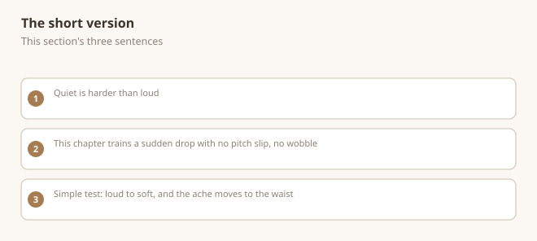
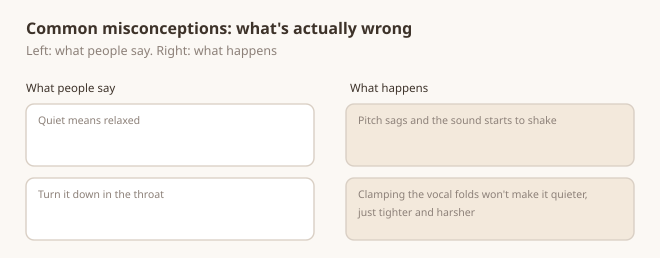
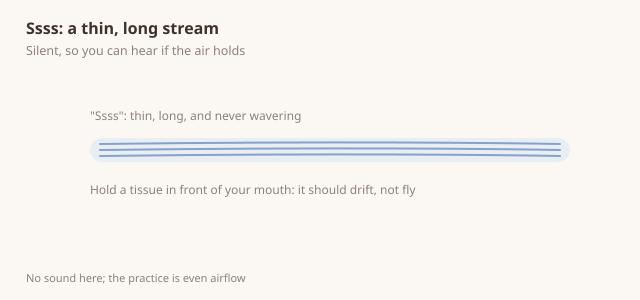
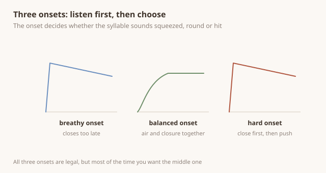
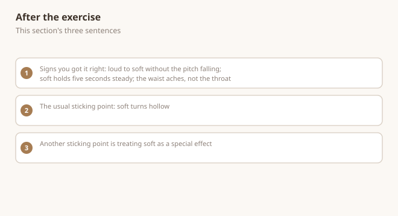

# Chapter 18: Advanced Dantian Support: Training the Core's Resistance Under Shifts of Volume

## The short version

Singing quietly is harder than singing loud. Loud, the air wants to go out anyway and you just go with it; quiet, the air in your lungs keeps trying to rush out and you have to hold it back the whole way.

This chapter trains one move: shrink in an instant without the pitch dropping and without the sound shaking. Get that, and you can sing those fragile near-whispers that come after a burst in a song.

The test when you're done is simple: going from loud down to soft, the ache moves from your throat to the sides of your waist.

## Common misconceptions

Many people think quiet means relaxed, so the moment the chorus ends they let all the strength go with it. The pitch goes too, and the sound starts to shake. Quiet does not take less strength; it takes finer strength.

Another misconception is using the throat to turn the volume down. Squeeze the vocal folds and the sound doesn't get smaller, it gets tight and harsh. What you want is less airflow, not a clamped outlet.

Others think quiet needs no support. It's the opposite: with less total airflow, a small error is a bigger share of it, so the control has to be finer. Ease off the support and the air is gone in a moment; the line can't reach its end.

## How it works

Volume is decided by several things at once: airflow, subglottal pressure, how firmly the vocal folds close, and the resonance adjustments of the vocal tract. To be loud you usually give more air and raise subglottal pressure. To be quiet you give less air and lower the pressure, but the closure must not loosen along with it, or the sound falls apart.

The trouble is that the lungs are an elastic balloon. The fuller they are, the harder they want to spring back. Singing loud, that spring helps you. Singing quiet, the air shouldn't be leaving that fast, and you have to hold it back the whole way. That is why quiet is more work, and why breathing in too full makes quiet harder.

So the control point for a soft note is not the throat, it is the abdomen and the sides of the waist. The diaphragm relaxes and rises, and the abdominal muscles hold it back so it rises slowly. The throat stays loose, letting a smaller airflow through. Closure stays roughly as it was; volume comes down by reducing airflow and pressure. If you want a deliberate touch of breathiness, loosen the closure a little more, and that is where a soft note gets its airy sound.

Be clear about what you are fighting: the speed of the airflow, not the airflow itself. Shut it off completely and there is no sound left. The line has to sit in the middle.

The loud end has its details too. As volume rises, the resonance adjustments of the vocal tract change with it, and that is a measurable action (Vurma, 2022). In other words, louder is not just more air; the whole setup moves together. And how support is executed differs from singer to singer: different singers reach the same projection with different torso strategies (Thorpe, 2001), and the pelvic floor and the deep abdominal muscles take part as well (Emerich Gordon & Reed, 2020). You don't have to copy someone else's belly. Just get the result: steady airflow, loose outlet.

## An analogy

**Coasting downhill.** Full lungs are the downhill at the start; the bike runs away on its own. What you do is hold the brake and let it roll slowly, instead of letting it run to the bottom and hit a wall. The brake is not the stop: clamp it all the way and the bike doesn't move, and neither does the sound.

**Pouring soy sauce.** Tip the bottle and half a bowl lands at once and you can't take it back. A cook holds the back of a knife against the mouth of the bottle and lets it come drop by drop. The sides of your waist are that knife blade: the soy sauce (the air) is still flowing, but you decide the rate. Let go and the whole bottle goes.

**Walking with a cup full of water.** The fuller the cup, the harder it is to carry, because the water sloshes. Your hand can't shake and you can't crush the cup. Crushing the cup is squeezing the throat: the cup deforms and the water spills anyway. Carrying water is about steadiness, not grip strength.

## Try it now

### Exercise 1: An instant change of volume on a sibilant

1. Breathe in, hands on your waist.
2. Make a continuous "sss—", loud for two beats.
3. On the third beat drop instantly to soft, but don't let the "sss" break.
4. One bar of "loud, loud, soft, soft". Ten times.

What you should feel: the two soft beats are when the sides of the waist ache more.
If you get it wrong: if the "sss" cuts out the moment it goes soft, you shut the air off. If the sides of the waist go slack right after the drop, you let the support go.

### Exercise 2: The dive-bomb soft note

1. Pick a comfortable mid-to-high note.
2. Sing "ah" with a firm sound and hold it for two seconds.
3. On the third second drop instantly to very small: throat loose, support doubled.
4. Let the soft "ah" float steadily for five seconds, no shake, no drift.

What you should feel: at the moment it shrinks, the sound seems to float up while the support sinks down.
If you get it wrong: if the pitch falls with it, you were thinking only "smaller" and forgot "same height". If the sound shakes, too much air is leaking; narrow the outlet a little more.

### Exercise 3: Start from very small

1. Don't shrink down from loud. Start from almost inaudible instead.
2. Start on a sigh and let the sound appear slowly.
3. Hold for three seconds, then let it go slowly.
4. Five times, checking the pitch is the same every time.

If you get it wrong: if the pitch is different each time, you are guessing. Give yourself a reference note on a keyboard or an app first. Soft notes go out of tune easily, because the airflow is small and the vibration is less stable, and you can't hear it well yourself.

### Exercise 4: Back into a song

1. Pick a stretch of lyric where one line is hard-driven and the next suddenly goes soft.
2. Sing the loud line, then at the breathing point take only a little air, not a full breath.
3. Set the core in an instant; don't let the air dump out all at once.
4. Sing the soft line with your attention on holding it up, not on making it smaller.

If you get it wrong: if the soft line sounds like giving up, you let the emotion go with it. Soft is not unfeeling; it is held inside. If you can't stop yourself taking a big gulp at the breathing point, there will be too much air and the soft line is harder to control.

### Exercise 5: Record both lines

1. Record the two lines from exercise 4.
2. Listen to the loud one first, then the soft one.
3. Check whether the soft line stayed at the same pitch.
4. If it didn't, don't practise the whole song yet. Go back to exercise 2.

If you get it wrong: judging by feel in the moment, you underestimate how far off the pitch is. A soft note going out of tune is only audible on the recording.

## After the exercise

Signs you got it right: going from loud to soft, the pitch doesn't drop; the soft note holds for five seconds without shaking; what aches afterwards is the sides of the waist, not the throat.

The usual sticking point is that soft turns into thin. Soft and thin are different: soft is less air with steady support; thin is no support and the sound falling apart. If it sounds thin, check the support first, don't add force.

Another is treating the soft note as an effect. Sing a whole song breathy and it has no shape, and it costs a lot of air. A soft note gets its power from contrast.

Next chapter deals with the vocal folds themselves: why some people crack on high notes and others move through smoothly. It starts with two sets of muscles.

## Further reading

- **Emerich Gordon, K., & Reed, O. (2020).** The Role of the Pelvic Floor in Respiration: A Multidisciplinary Literature Review. *Journal of Voice.* The pelvic floor and the deep abdominal muscles take part in the stability of breathing: the anatomical counterpart of what is called the "dantian". PMID 30447797.
- **Thorpe, C. W., Cala, S. J., & Chapman, J. (2001).** Patterns of breath support in projection of the singing voice. *Journal of Voice.* Support is not one action; different singers reach the same result with different torso strategies. PMID 12269638.
- **Vurma, A. (2022).** Amplitude Effects of Vocal Tract Resonance Adjustments When Singing Louder. *Journal of Voice.* When the volume changes, the vocal tract's resonance adjustments are a measurable action, not just a feeling. PMID 32624371.
