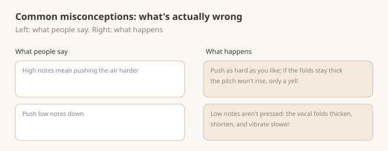
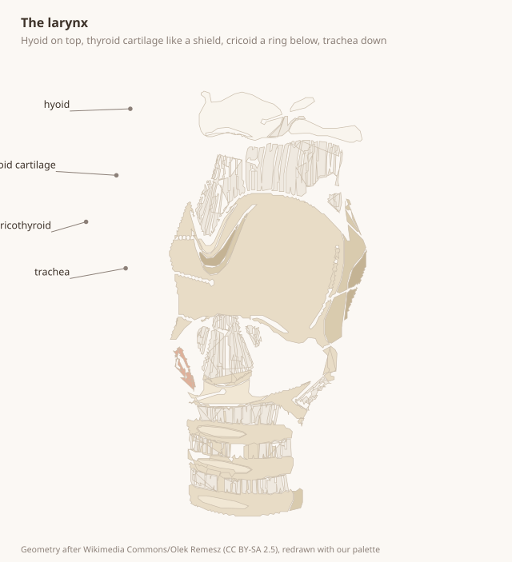
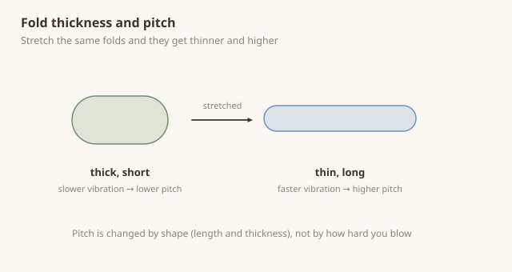
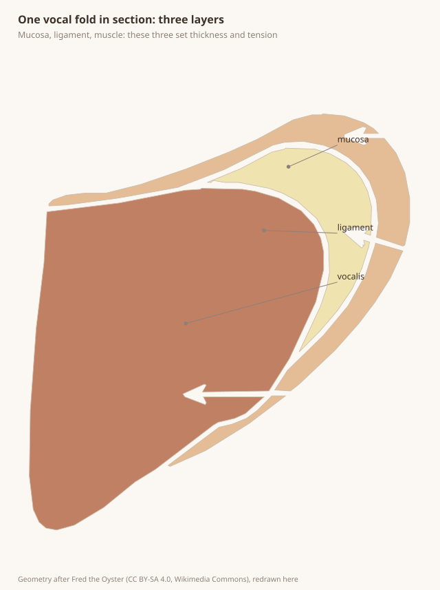
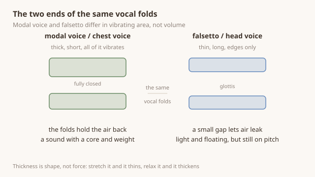
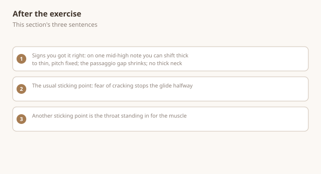

# Chapter 19: Anatomy of the Vocal Folds: How the Thyroarytenoid (TA) and Cricothyroid (CT) Work Together

## The short version

Pitch is not decided by force. It is decided by the shape two sets of muscles pull the vocal folds into.

The thyroarytenoid (TA) makes the vocal folds thicker and shorter, and the pitch goes down. The cricothyroid (CT) stretches them longer and thinner, and the pitch goes up.

Cracking or getting stuck on a high note usually means these two are pulling against each other. This chapter is about recognising both sensations, then practising until they can hand over to each other instead of fighting.

## Common misconceptions

Many people think singing high means pushing the air harder. Push the air as hard as you like: if the vocal folds are still a thick slab, the frequency simply won't rise and you get a shout instead. Pitch depends on the length, tension and mass of the vocal folds, not on air pressure.

Another misconception is that low notes have to be pressed out. A low note is not pressed out; it is the result of the vocal folds getting thicker and shorter and vibrating more slowly. Pressing the throat only narrows the channel, dulls the sound, and hurts the next day.

Others get the two muscles the wrong way round. The way to remember it is simple. The TA is inside the vocal folds; when it contracts it makes them thicker and shorter, towards thick and low. The CT sits on the outside of the vocal folds; when it contracts it pulls the thyroid cartilage forward and down, making the folds longer and thinner, towards thin and high. Get the direction backwards and every exercise in this chapter goes wrong.

## How it works

Start with where things are. The thyroid cartilage is the lump you can feel, the "Adam's apple"; the cricoid cartilage is the ring below it. The CT runs between the two, and when it contracts it pulls the thyroid cartilage down, so the vocal folds are stretched. The TA is inside the vocal folds, attached at the front to the thyroid cartilage.

The vocal folds are two bands of tissue in the middle of the larynx, with muscle inside them. The thyroarytenoid (TA) is the body of the fold. When it contracts, the folds get thicker, shorter and less tense, the vibration frequency drops, and the sound goes low and thick. Ordinary speech and calling out to someone are mostly this muscle at work.

A vocal fold is not a single rubber band. It has three layers: the outer mucosa ripples like a wave (most of what you hear as the voice is this layer moving), the ligament in the middle provides tension, and the muscle on the inside decides the thickness. That is also why "relaxed" and "supported" can be true at the same time. What you let go of is the force on the outside; what stays is the tension of the inner layer.

The cricothyroid (CT) sits on the cartilage to the side of the vocal folds. When it contracts it pulls the thyroid cartilage forward and down, the folds are stretched longer and thinner, tension rises, the vibration frequency rises, and the sound goes high and thin.

The two are not a switch, they are a ratio. The same pitch can be made from different combinations of thick and thin, so the same note can be sung thick or thin. Research comparing the chest, mixed and falsetto registers does find measurable differences in acoustic and aerodynamic parameters, but the boundaries are continuous (Lee et al., 2023). Which is exactly the point: what you are facing is not three boxes, it is one spectrum.

Going up, the ideal is that the TA steps back and the CT takes over, a smooth exchange. Untrained, the moment a high note comes the singer tenses up, the TA grips harder while the CT is pulling as well, the two fight, and the folds lock.

Locking has two outcomes. If the TA wins, you take a thick pair of folds up to the high note by force, the neck bulges, the sound is a shout, and the folds take a lot of impact. If the CT stretches to its limit and the TA suddenly can't hold, the vibration changes in an instant and the voice cracks with a click. A crack is not damaged folds, it is a failed handover. And the handover jumps because closure of the vocal folds has two stable solutions to begin with (Titze et al., 2014).

One more thing to be clear about: this is the relative involvement of the muscles, not a percentage dial. Vocal fold vibration is far more complicated than that. What you want to catch is the feel of a little thicker, a little thinner, not a number.

A last warning: pitch and volume are two different things, but the body often ties them together. The louder and the higher you sing, the more readily muscle activity in the neck and shoulders rises (Pettersen et al., 2005). So a thickening neck on a high note is not effort, it is compensation.

## An analogy

**A rubber band.** Take one rubber band. Slack, it is thick and soft, and flicked it gives a low sound; stretched, it becomes thin and tight, and flicked it gives a high sound. Vocal folds are the same: stretch them long and thin (CT) and the frequency rises; let them slacken and thicken (TA) and it falls. A rubber band doesn't turn into two rubber bands, and neither do the vocal folds.

**The baton in a relay.** In the changeover zone the runners have to be at similar speeds or the baton won't go across. If the first runner (TA) is too slow and the second (CT) has already gone, the baton hits the ground, and that is the crack. When you practise a glissando, what you are practising is that ten-metre zone.

**Driving with the handbrake on.** That is how a lot of people sing high notes: throttle (air) to the floor, handbrake (TA tension) still on. The car moves, but the engine is loud, the speed won't come up, and eventually something breaks. Let the handbrake off first, then add throttle.

## Try it now

### Exercise 1: Find the thick end first

1. Relax the jaw and pick a very low note.
2. Make a heavy "guh", like a giant talking.
3. Hand on the chest: the sound should be thick, weighted, not floaty.
4. Five times, one second each, without pressing the throat.

What you should feel: thick, but with the throat open; vibration in the chest.
If you get it wrong: if the "guh" turns into a friction noise in the throat, you pressed too low. Come up a note and find the place that is thick but loose. If the sound is still thin, the pitch is too high; go lower.

### Exercise 2: Now the thin end

1. Pucker the lips and make a very light "oo" on a rather high note.
2. Quiet, with a little air, like an owl hooting.
3. Hand on the chest: this time there is almost no vibration there.
4. Five times, two seconds each.

If you get it wrong: if it turns thick and big the moment it sounds, the TA came along. Halve the volume and aim only for light. If the sound is sharp, the throat is pinched; go back to breathing out only, then add a little sound.

### Exercise 3: Let them hand over

1. Take the thick "guh" feeling and sing "nuh" on a low note, flat and bright.
2. Without breaking the air, slide slowly upward like a siren.
3. On the way up, tell yourself "thinner, let the weight go, keep it bright".
4. At the top, slide back down and feel thick and thin change places.

What you should feel: passing a certain pitch there is a slight change of gear, but don't stop there.
If you get it wrong: if it cuts out with a click in the middle, the TA won't let go. Don't speed up to force past it; stop on the pitch where it breaks and slide back and forth with very little air until it gets used to being thin. If the whole slide stays thick and won't go up, you aren't sliding high enough.

### Exercise 4: Change thickness on one note

1. Pick a mid-to-high note you usually crack on.
2. Start on "oo", thin and light.
3. Without breaking the air or changing the pitch, slowly turn it into "nuh" and let the sound thicken.
4. Then back to "oo". Five times each way.

If you get it wrong: if the pitch drops as it thickens, you used the TA to press the note down rather than adding thickness. Fix the pitch first and change only the timbre. If it goes thin and weak, too much air is leaking; take a little less air.

## After the exercise

Signs you got it right: you can make a clear change of thickness on the same mid-to-high note without the pitch moving; the glissando has less of a step going through the passaggio; your neck doesn't thicken on high notes.

The usual sticking point is stopping halfway up the slide because you are afraid of cracking. Stop below the break and you never practise the handover. Do it the other way: stop above the break and work at it slowly with very little air.

Another is using the throat instead of the muscles. You cannot tell the TA or the CT to contract; they are reflexive. What you can do is change the pitch, change the timbre and relax the throat, and let them coordinate on their own.

Next chapter is closure: how firmly the vocal folds come together decides whether the sound leaks or squeezes.

## Further reading

- **Titze, I. R., et al. (2014).** Bi-stable vocal fold adduction: a mechanism of modal–falsetto register shifts and mixed registration. *Journal of the Acoustical Society of America.* Closure of the vocal folds has two stable states, and the passaggio is where the two states hand over. PMID 25235006.
- **Lee, Y., Oya, M., & Kaburagi, T. (2023).** Differences Among Mixed, Chest, and Falsetto Registers: A Multiparametric Study. *Journal of Voice.* Chest, mixed and falsetto can be told apart by acoustic and aerodynamic parameters, but the boundaries are continuous. PMID 33518476.
- **Pettersen, V., Bjørkøy, K., & Torp, H. (2005).** Neck and shoulder muscle activity and thorax movement in singing and speaking tasks with variation in vocal loudness and pitch. *Journal of Voice.* The louder and the higher you sing, the more readily the neck and shoulders compensate. PMID 16301107.
