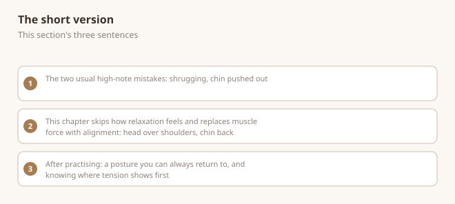
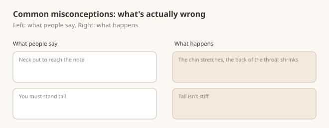
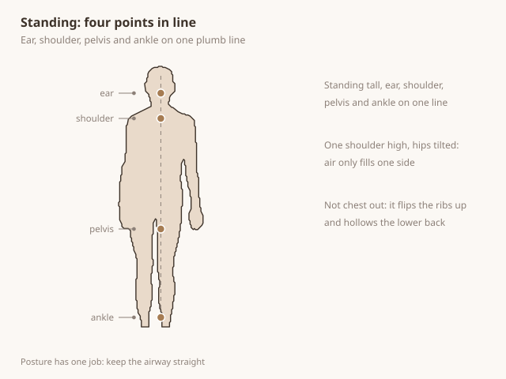
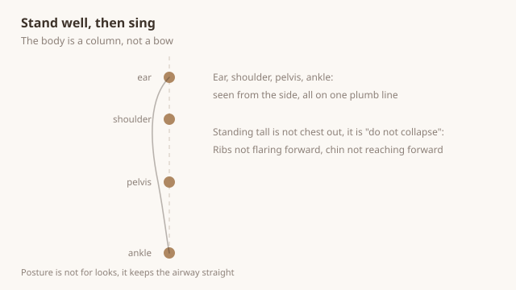
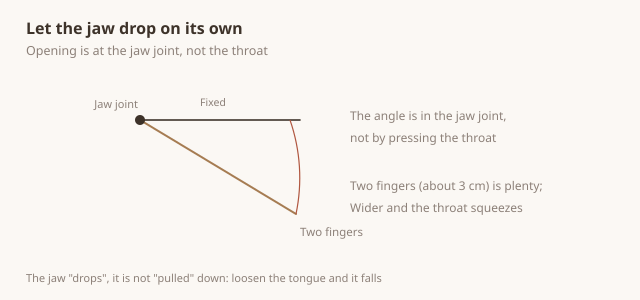
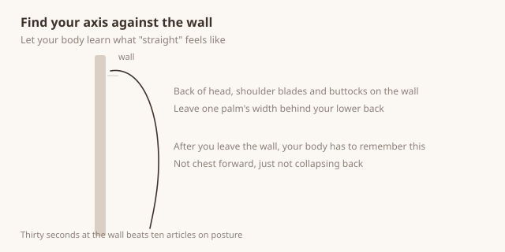
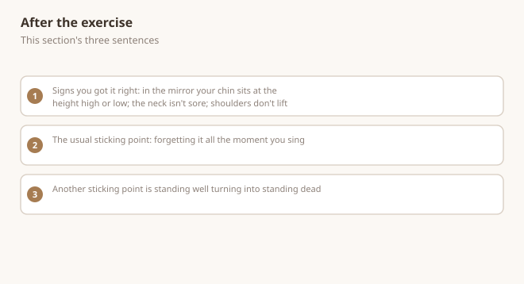

# Chapter 2: Body Awareness: Loosening the Chain of Tension in Neck, Shoulders and Jaw

## The short version

When you sing high notes, the two things you most often get wrong are shrugging the shoulders and pushing the chin out. Both compress the throat from the outside, trap the vocal folds, and make the sound flat and tight. After a while they hurt.

This chapter doesn't talk about what relaxation feels like. It talks about replacing muscle force with skeletal alignment: head directly above the shoulders, shoulders sunk, chin not pushing forward. Line it up and the effort saves itself.

After the exercise you will have a posture you can go back to at any time, and you will know where your body gives you away first when you get nervous.

## Common misconceptions

Many people think a high note means stretching the neck out to hook the note down. What actually stretches is the chin; what shortens is the space behind the throat. The larynx is pulled up, the vocal tract is compressed, and the muscles around the larynx tighten with it. The more tension there is on the outside, the harder it is for the vocal folds to adjust smoothly, and the harder it is to reach the note at all.

You have probably also heard that singing means standing up very straight. Straight is not stiff. Lock the lower back, clamp the shoulders back, and the rib cage jams, the diaphragm cannot descend, and the breath never goes deep. Be careful on the other side too: everyone's balancing strategy is different. A study measuring postural control in lyric singers found that their ways of holding steady were not the same (Peultier-Celli et al., 2022). So don't force one "standard posture" on yourself. Find the version where you can stand and still breathe.

## How it works

The body is very good at compensating. When one muscle isn't strong enough, it calls a neighbour in to help. The three most common versions in singing:

The first is shrugging. Not enough air, or in a hurry to be loud, the shoulders lift, the muscles on both sides of the neck shorten, and the area around the larynx is squeezed. The sound seems shut up inside the throat. This compensation is not imaginary; it can be measured: when volume and pitch rise, neck and shoulder muscle activity rises with them (Pettersen et al., 2005).

The second is pushing the chin forward. Many people feel subjectively that high notes are "in front", so they stretch the neck to reach them. The chin leaves the axis, the larynx is pulled up, and the channel folds over.

The third is clamping the jaw shut. To get the words clear, many people brace the chewing muscles. The jaw is the door into the mouth. With the door shut, the sound can't get into the mouth and is squeezed into the throat, dull and tight. While we are here, one common confusion: real nasality comes from the soft palate dropping and air running into the nasal cavity. It has nothing to do with a tight jaw.

All three have something in common: they interfere with the inside from the outside. The larynx adjusts itself anyway. The harder you work from outside, the less the inside can do its job.

## An analogy

**Accelerating with your toes.** The seat is too far back, so you tap the accelerator with your toes. The car moves, but your ankle aches and the pressure is unsteady. Pushing the chin out to sing high is that move: you think you are making up the distance, but the whole leg has gone crooked.

**Wheel alignment.** The steering keeps pulling to one side. The wheel isn't broken; the four wheels are out of alignment. Ear, shoulder, hip and ankle stacked up is your alignment. With it right, you don't have to keep correcting on every high note.

**A hose bent in half.** Lifting the shoulders is a hand folding the hose over. You haven't turned the water off, but it can't get through. Let go and the water goes by itself.

Where the analogies break: the body remembers habits. So "let go" isn't done in one go. You have to cover the old habit with the correct alignment, over and over, usually for weeks.

## Try it now

### Exercise 1: Shoulder reset

1. Stand tall, feet shoulder-width apart.
2. Breathe in, lift both shoulders up to your ears, hold three seconds, and feel the ache of the squeeze on both sides of the neck.
3. Breathe out and drop the shoulders in one go, letting the arms hang.
4. Repeat five times with your eyes closed.

What you should feel: each time you let go, the shoulder blades slide down and the chest gets wider. If you get it wrong: if the shoulders are still half lifted after you let go, shake out your hands ten times, roll your neck, then start again. The exhale should be longer than the inhale.

### Exercise 2: Melting the jaw

1. Put your index and middle fingers under the ears on each side of the jaw and find the muscle that bulges when you clench your teeth.
2. With the fingertips, make small circles for a minute. Don't press into pain.
3. Drop your hands. Imagine dozing off, the jaw with no strength in it, the lips slightly apart.
4. Make a "haa—" in that state, hold five seconds, three times.

What you should feel: the sound is wider than usual and nothing is caught in the throat. If you get it wrong: if the sound goes duller once the jaw drops, the root of the tongue has pulled back with it. Touch the tip of the tongue lightly behind the upper front teeth and keep the tongue forward.

### Exercise 3: Find the axis against a wall

1. Stand with your back to a wall, touching it lightly at four points: the back of the head, both shoulder blades, the buttocks and the heels.
2. Knees slightly bent, a hand's thickness between the lower back and the wall.
3. Chin slightly in, eyes level, don't look up.
4. Eyes closed, breathe slowly through the nose five times.

What you should feel: the back of the head stays on the wall and the shoulders don't slide upward. If you get it wrong: if the back of the head leaves the wall as you breathe in, you are tipping the head back; if the shoulders rub up the wall, you are shrugging again. Stop and set the four points again.

### Exercise 4: Make sound in the new posture

1. Step away from the wall and keep the head where it was, directly above the shoulders.
2. Keep the jaw slightly loose, and don't let the shoulders move on the inhale.
3. Make a "haa—" for eight seconds, three times.
4. Check as you go: is the chin forward? Are the shoulders lifted?

What you should feel: the airflow runs and the throat doesn't itch. If you get it wrong: if the posture falls apart halfway, don't force your way to the end. Stop, set it up again, then sing. Short and correct is more use than long and deformed.

## After the exercise

Signs you got it right: in the mirror your chin is at about the same height on high notes as on low ones; your neck isn't sore after singing; your shoulders don't rise on the inhale.

The usual sticking point is forgetting all of it the moment you sing. You relax in practice, then you pick up a song and it all comes back. The fix is to shorten the practice: before every song, just thirty seconds of shoulder reset and wall work, so the body starts in the right place.

Another is turning "standing well" into "standing dead". Locked knees and a braced rib cage, and the breath still doesn't go deep. Trunk strategies for breath support differ from singer to singer anyway, so leave yourself some spring rather than tying yourself up (Thorpe et al., 2001).

Next chapter takes on support. Relaxation on its own is not enough; the sound goes hollow. You need the lower belly to take over the effort so the throat can stay loose.

## Further reading

- **Pettersen, V., Bjørkøy, K., & Torp, H. (2005).** Neck and shoulder muscle activity and thorax movement in singing and speaking tasks with variation in vocal loudness and pitch. *Journal of Voice.* The louder and higher you sing, the more readily the neck and shoulder muscles join in; this is the most direct measurement behind "shrug compensation". PMID 16301107.
- **Peultier-Celli, L., Audouin, M., & Beyaert, C. (2022).** Postural Control in Lyric Singers. *Journal of Voice.* Postural control strategies in lyric singers: standing steady is not one standard posture, it is each singer finding their own way to balance. PMID 32456837.
- **Thorpe, C. W., Cala, S. J., & Chapman, J. (2001).** Patterns of breath support in projection of the singing voice. *Journal of Voice.* Different singers use different trunk strategies to get the same support, so you don't have to lock yourself into one posture. PMID 12269638.
