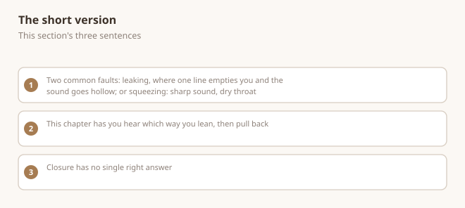
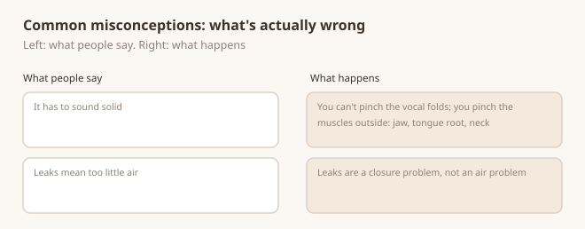
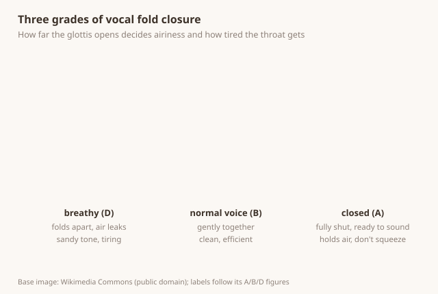
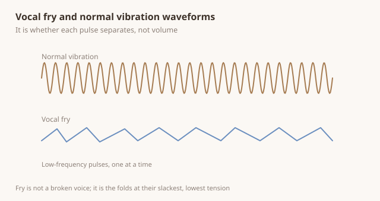
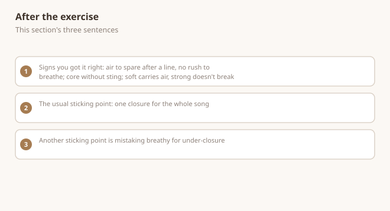

# Chapter 20: The Golden Ratio of Vocal Fold Closure: Targeted Fixes for Leakage and Cracking

## The short version

Two faults are common. One is leaking air: a line goes by and the breath is gone and the sound is weak. The other is squeezing: the sound is sharp and the throat is dry. They look like opposites, but they are two ends of the same thing: the vocal folds closing too loosely or too tightly.

This chapter wants you first to hear which side you are on, then to pull yourself back with the right exercise.

There is no single correct answer for closure. It adjusts with pitch, volume and emotion. What you practise is being able to adjust it, not fixing it in one position.

## Common misconceptions

Many people want a solid sound, so they pinch the vocal folds hard. You can't pinch the vocal folds; what you pinch is the muscle outside the larynx: the jaw, the base of the tongue, the neck. The result is a tight, flat sound, and the vocal folds themselves are no better closed.

Another misconception is that leaking air means not enough air, so take a bigger breath. Leakage is a question of how efficiently the folds close, not of how much air you have. Breathe in as much as you like: if every vibration loses half of it, the line still runs dry quickly.

Others confuse relaxed with slack. What should relax is the outside of the larynx; the closure of the folds themselves needs a moderate tension. Handle the two separately, or you will either go weaker and weaker or tighter and tighter.

## How it works

When the vocal folds vibrate, the two edges come together, the airflow pushes them apart, and they spring back, over and over. Closure means how far those two edges come together.

Too loose, and a wide gap stays in the middle: a lot of air is lost, the sound has a high proportion of breath and little core, and that is leakage. The cost is efficiency. The airflow is large, the lines you can sing are short, and over time the mucosa dries out.

Too tight, and the airflow is held back: it takes higher subglottal pressure to push the folds open, the sound turns hard and sharp, and the throat tires easily. The impact energy concentrates on the edges, and over time they fatigue. So squeezing is not "more effort, therefore better"; it is more cost for the same volume.

In between there is a band that works best: tight enough to vibrate efficiently, not so tight that it blocks the airflow. That band is not a fixed point. Higher and louder usually needs more closure; soft, breathy passages can use less. Research does show that different registers can be told apart by aerodynamic parameters, but the boundaries are continuous (Lee et al., 2023), so what you practise is sliding, not switching.

Correct closure is not slamming a door. It is coming together along with the airflow. With a steady airflow the folds find the distance at which they can vibrate; with an airflow that keeps surging, the closure goes with it. That is why you train the breath first and the closure after.

Two tools are worth knowing. Semi-occluded exercises (a straw, a lip trill, humming) add resistance behind the mouth, so the vocal folds can vibrate at lower pressure (Titze, 2006), which is especially useful if you tend to squeeze. And with straw phonation, studies have observed changes in both vocal tract and glottal function (Guzman et al., 2013), so it is not "it feels like it works"; there is measurement behind it.

## An analogy

**A pair of swing doors.** With too wide a gap the wind pours in, you are cold, and the two leaves never slap together to make a sound. Close them too tightly and you need your whole body weight to push them open, and the hinges wear out fast. The middle state is: the leaves touch, but one push opens them. Vocal fold closure is that touching.

**The washer in a tap.** An old washer drips: that is leakage, water (air) used up with nothing to show for it. Wind the tap shut as hard as you can and it stops for now, but the washer is crushed and next time it is harder to close: that is squeezing. The fix is a washer that fits, not more force.

**A handshake.** Too light and the other person thinks you don't mean it, there is nothing to hold. Too hard and it hurts. The right handshake makes contact without going white. That is the strength of contact your vocal folds use when you sing, and it adjusts to the other person (the pitch, the volume).

## Try it now

### Exercise 1: Scan where you are now

1. On the vowel "ee", sing a comfortable pitch.
2. Start very quiet and grow slowly.
3. Listen for two things: how much breath there is in the sound, and whether the throat scrapes.
4. Lots of breath and a loose sound means you tend to leak; a sharp sound and a tight throat means you tend to squeeze.

If you get it wrong: if you start pushing during the scan, what you measure is the state after pushing, not your normal state. Use a medium volume, like speech.

### Exercise 2: If you leak, train short closures

1. Make a short "uh", like the pause in the middle of a sentence.
2. Four at a time: "uh, uh, uh, uh", each one clean, with no breathiness.
3. Check the throat isn't pinching; the folds are just coming together quickly.
4. Once that is easy, put the clean onset into "ee".

What you should feel: between the four, the air is held still, not leaking the whole time.
If you get it wrong: if the "uh" turns into a friction noise in the throat, you are pushing too hard. Make it smaller and lighter. If each "uh" still leaks, you are giving too much air; steady the airflow before you work on closure.

### Exercise 3: If you squeeze, train vocal fry and the straw

1. Relax, breathe out a little, and let the vocal folds produce a low vocal fry, like a motorbike idling. Vocal fry is vibration at low tension and low pressure (Elias et al., 2016).
2. The fry doesn't have to be loud; continuous is enough.
3. Inside that loose state, add a little "oo" and feel how light the vibration is.
4. If you have a straw, phonate through it for a minute. Any pitch, the quieter the better.

If you get it wrong: if the fry won't come, the air is too strong or the throat too tight; reduce the air until it is like a sigh. If adding "oo" makes it big and tight, the old habit is back; go back to fry only.

### Exercise 4: Adjust while you sing

1. Pick a gentle line of lyric and deliberately let a little breath in: looser closure.
2. Then sing a line that needs strength: closure firmer, but without pinching the throat.
3. Alternate the two lines three times and feel the two kinds of closure inside one song.
4. Record it and listen: is the difference between the lines the difference you meant?

If you get it wrong: if the gentle line goes silent, you went past loose into nothing; that is not tenderness. If the strong line turns sharp, you went too tight; get the airflow steady again, then firm up the closure.

## After the exercise

Signs you got it right: at the end of a line there is still air to spare, and you don't have to grab another breath in a hurry; the sound has a core but isn't sharp; gentle passages can carry breath and strong ones don't crack.

The usual sticking point is one kind of closure for the whole song. Use the same closure throughout and it sounds flat, and any passage it doesn't suit either leaks or squeezes. Closure follows the line.

Another is mistaking a breathy tone for insufficient closure. A breathy tone is a deliberate effect; insufficient closure is accidental leakage. You can take the first back whenever you like; you can't take the second back. That is the difference. If you can't tell them apart, record it and listen again.

Next chapter deals with the thickness of the vocal folds: how to sing the same note thick, and how to sing it thin.

## Further reading

- **Titze, I. R. (2006).** Voice training and therapy with a semi-occluded vocal tract: rationale and scientific underpinnings. *Journal of Speech, Language, and Hearing Research, 49*(2), 448–459. With resistance added behind the mouth, the vocal folds can vibrate at lower pressure, which is especially useful when closure is too tight. PMID 16671856.
- **Guzman, M., Laukkanen, A. M., & Krupa, P. (2013).** Vocal tract and glottal function during and after vocal exercising with resonance tube and straw. *Journal of Voice.* Phonating through a straw or a resonance tube changes vocal tract and glottal function, and the change can be measured. PMID 23683806.
- **Elias, V. S., Cielo, C. A., & Jotz, G. P. (2016).** Effect of Vocal Fry on Voice and on Velopharyngeal Sphincter. *International Archives of Otorhinolaryngology.* Vocal fry is vibration at low tension and low pressure, and can be used as an exercise to loosen closure. PMID 27096021.
- **Lee, Y., Oya, M., & Kaburagi, T. (2023).** Differences Among Mixed, Chest, and Falsetto Registers: A Multiparametric Study. *Journal of Voice.* Registers can be told apart by aerodynamic and acoustic parameters, but the boundaries are continuous: closure slides. PMID 33518476.

