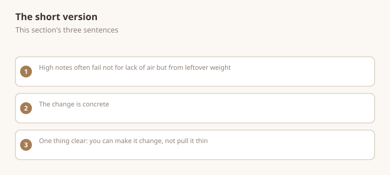
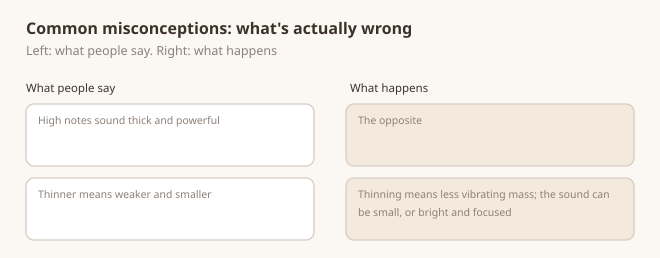
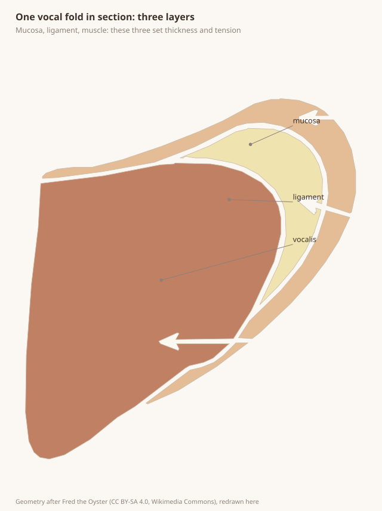
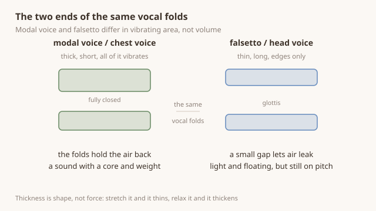
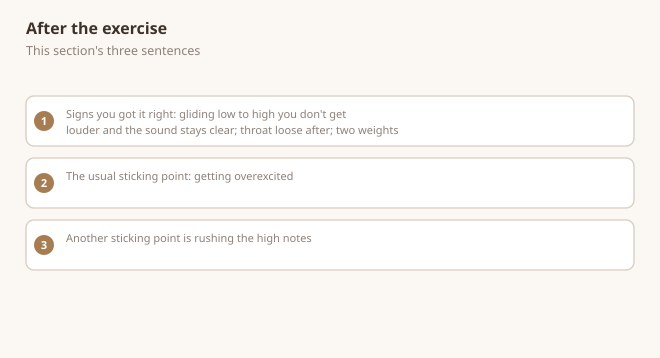

# Chapter 21: Adjusting Vocal Fold Thickness: From the Breadth of Low Notes to the Sharp Edge of High Notes

## The short version

A high note that won't come out is often not a lack of air. It is that the vocal folds are still carrying the thickness of a low note. As the pitch rises, the folds have to be stretched longer and thinner. That is what this chapter practises: as the pitch goes up, let the thickness go on purpose, instead of forcing a thick pair of folds upward.

What changes after practice is concrete. On the same high note the throat is looser and the sound more focused; sliding from low to high, the place where you get stuck gets smaller.

One thing to be clear about first: what you can control is letting it change, not pulling it thin. The muscle that actually stretches the vocal folds thin is the cricothyroid, not your willpower.

## Common misconceptions

Many people think that if a high note sounds thick and powerful, the vocal folds must be thick when you sing it. It's the opposite. Much of that thickness you hear is made by resonance and airflow. What is actually vibrating is the whole fold after it has been stretched thin, with far less vibrating mass than on a low note. Take a thick pair of folds up to a high note and you get a locked neck, a crack, or a sore throat the next day.

Another misconception is that thin means weak and small. Thin means the vibrating mass is smaller. The sound can be quiet, or it can be bright and focused. Whether it is weak depends mainly on how clean the closure is, not on thickness.

There is another confusion too: treating thick and loud as the same thing. You can sing a very thick low note at a small volume, and a very thin high note at a large one. In practice, fix the volume and change only the pitch, and you will hear more clearly how the thickness changes.

## How it works

Two sets of muscles pull against each other in the vocal folds. The thyroarytenoid (TA) makes them thick and short, and the pitch goes down. The cricothyroid (CT) stretches them long and thin, and the pitch goes up. It is not a switch, it is a continuously changing ratio.

One thing to remember: on a low note the whole fold vibrates, and on a high note the whole fold is still vibrating. What changes is that the vibrating mass gets smaller and the amplitude narrower, continuously in between. So thick and thin are not two different vocal folds; they are the two ends of one.

And the higher the note, the more stretching it needs. That is physics. If you don't let it get thinner, the only way left is to drive something already too thick to vibrate faster with more pressure. That road doesn't go far, and the price is that the muscles outside the larynx come in to help: the higher and the louder, the more obvious the compensation in the neck and shoulders (Pettersen et al., 2005). Thicken the neck and the sound goes dull.

The other direction needs care as well. Let go too quickly and the closure loosens and the sound turns into a leaking falsetto. What you actually practise is thinning and keeping the closure happening at the same time, not one or the other.

## An analogy

**A rubber band.** Unstretched it is wide and thick, and plucked it gives a low "doh"; stretch it from both ends and it thins itself and plucks crisp. Rising pitch should come with thinning. Where the analogy breaks: you stretch a rubber band with your hands, and you don't stretch the vocal folds. What stretches them is the CT, and all you decide is whether to let it take over. So the point of the exercise is not to pull hard, it is to let go and let it change.

**Wringing out a wet cloth.** A low note is like a cloth you can't wring dry: thick, heavy, full of water. As the pitch rises you wring the water out bit by bit and the cloth gets thinner and stiffer. Less mass, but a clearer shape. Back to the mechanism: what gets wrung out is the vibrating mass, not the air. A lot of people rush to top up the air the moment the sound gets thin, which is pouring the water back in.

**High up on the same string.** On a guitar, high up the neck the same string gives a higher note, and the string is the same thickness from end to end. Vocal folds are the same: you don't swap in a thin one. The same one gets stretched, and the vibrating mass shrinks with it.

## Try it now

### Exercise 1: Tell thick and thin apart first

1. On a comfortable low note make a "boh", like a sigh, with a slightly lumbering quality. Three seconds.
2. Remember the wide, loose, blurred-edge feeling in the throat.
3. Move to a mid-to-high note and make a short "nyeh", flat and focused behind the bridge of the nose. One second each, three times.
4. Compare the two. The second should have almost no chest vibration and no weight in the throat.

If you get it wrong: if the neck thickens and the throat itches on "nyeh", you are squeezing, not thinning. Stop, cut the volume in half and do it again.

### Exercise 2: Siren glissando

1. Start on the low "boh" and don't let the airflow break.
2. Slide the pitch slowly upward like a siren, taking five seconds to reach the highest note you have.
3. Halfway up, change the vowel from "boh" to "nyeh" and narrow the mouth shape.
4. Hold at the top for a second, then slide back down the same way. Five times.

What you should feel: the whole slide should get lighter, not heavier; the lower abdomen keeps sending the air out steadily.
If you get it wrong: if the sound suddenly gets heavy and won't go up, you are unwilling to let go of the thickness. Halve the volume, start again, and move the vowel change a little earlier.

### Exercise 3: Adjust thickness on one pitch

1. Get a mid-to-high note from an app or a piano.
2. Sing "nyeh" for two seconds, checking that the sound is thin, focused and not leaking.
3. Without changing the pitch, slowly open the mouth into "nah". The sound goes from a needle to a pillar.
4. Close back to "nyeh". Five times each way.

If you get it wrong: if the pitch drops, what you added was weight, not thickness. Sing "nah" smaller and put the pitch first.

### Exercise 4: Record once, treat the two faults separately

1. Record one slide from low to high.
2. Play it back and listen for places where it suddenly goes quiet or weak.
3. Going weak means the closure loosened; going tight means the thickness wasn't released. The two need separate treatment.

If you get it wrong: don't try to fix both at once with "a bit more effort". Weak needs closure practice; tight needs letting go. The directions are opposite.

## After the exercise

Signs you got it right: sliding from low to high you don't get louder and louder and the sound stays clear; after a high note the throat is loose; on one pitch you can clearly make both a thick and a thin version.

The usual sticking point is getting more and more excited as you sing. Add volume and the thickness comes back. Practising quietly on purpose is so you can hear whether the sound stays thin and focused, not because quiet sounds nice.

Another is rushing at high notes. Get the glissando smooth in the middle range and the high notes improve on their own. And one more: practising glissandos only in exercises and going back to the old habit in a song. Pick a high note you always get stuck on and lighten the two or three syllables before it.

The next step is chapter 22: the false vocal folds. A lot of stuck high notes are not because the folds aren't thin enough, but because those two protective tissues above them have come down.

## Further reading

- **Titze, I. R., et al. (2014).** Bi-stable vocal fold adduction: a mechanism of modal–falsetto register shifts and mixed registration. *Journal of the Acoustical Society of America.* Modal voice and falsetto are two closure states of the same vocal folds, not two different vocal folds. PMID 25235006.
- **Lee, Y., Oya, M., & Kaburagi, T. (2023).** Differences Among Mixed, Chest, and Falsetto Registers: A Multiparametric Study. *Journal of Voice.* The three registers can be told apart by acoustic and aerodynamic parameters, but the boundaries are continuous. PMID 33518476.
- **Pettersen, V., Bjørkøy, K., & Torp, H. (2005).** Neck and shoulder muscle activity and thorax movement in singing and speaking tasks with variation in vocal loudness and pitch. *Journal of Voice.* The higher and the louder you sing, the more obvious the compensation in the neck and shoulders. PMID 16301107.
- **Titze, I. R. (2006).** Voice training and therapy with a semi-occluded vocal tract: rationale and scientific underpinnings. *Journal of Speech, Language, and Hearing Research, 49*(2), 448–459. Why semi-occluded exercises such as lip trills and humming let the vocal folds vibrate at lower pressure. PMID 16671856.

