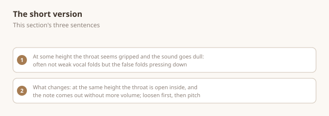
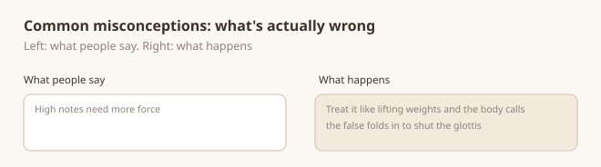
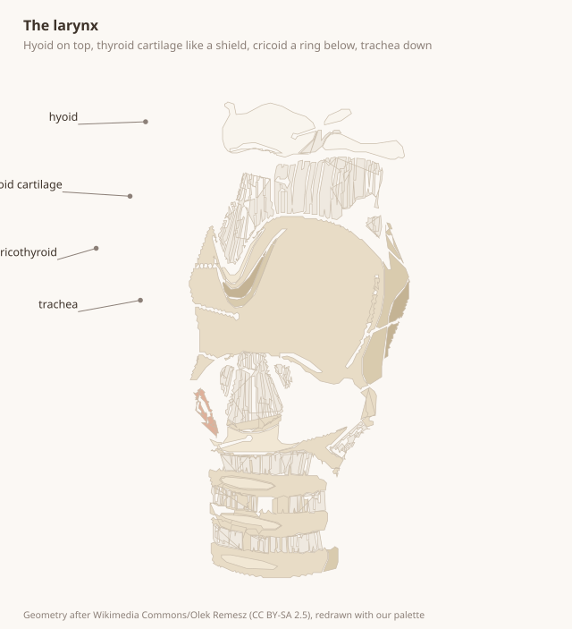
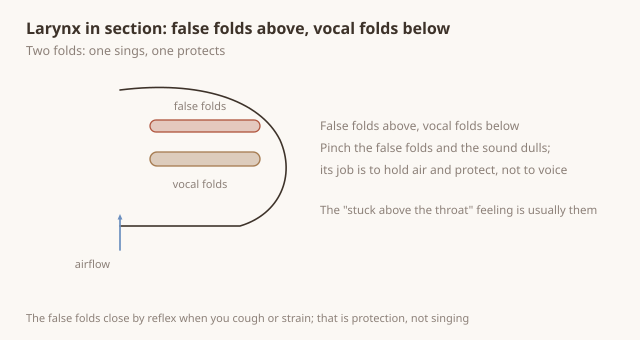
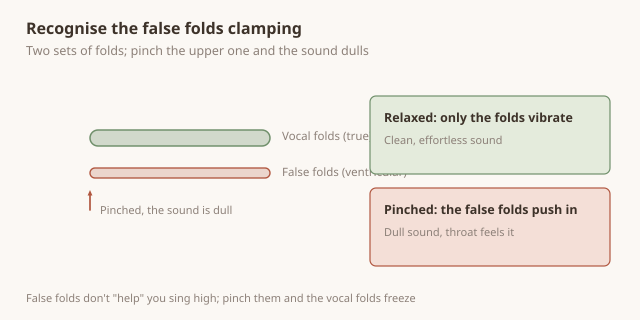
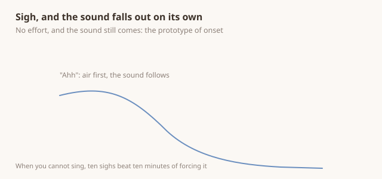
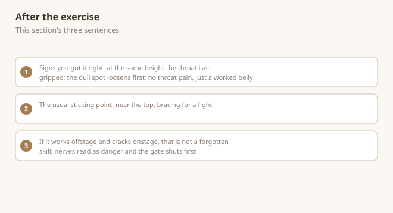

# Chapter 22: How the False Vocal Folds Work: A Defence Mechanism That Protects the True Vocal Folds and Makes Special Timbres

## The short version

Sing up to a certain height and the throat suddenly feels pinched and the sound goes muffled. The problem is often not that the vocal folds are too weak, but that the two false vocal folds above the true ones have come down. Their everyday job is protection, not sound. This chapter teaches you to recognise that clamped feeling, and then let it go.

What changes after practice: at the same height the inside of the throat is open and the sound comes out without getting louder; the places where you used to go hoarse on a high note loosen first, and pitch can be dealt with after that.

## Common misconceptions

Many people mix up the false vocal folds and falsetto. They are two different things. Falsetto is a state in which the edges of the true vocal folds vibrate. The false vocal folds are two tissues that physically exist in the larynx, sitting above the true folds, and normally they do not produce your main singing sound.

Another misconception is that high notes need more force to be steady. The more you treat it like lifting something heavy, the more the body calls the false vocal folds in to help shut the door. The result is a squashed sound, a sore throat, a crack. A real high note is looser in the larynx than a low one.

## How it works

The true vocal folds are the vibrating door in the airway. Above the door there is another pair of thick folds: the false vocal folds, called the ventricular folds in medicine. When you swallow, hold your breath or lift something heavy, they come towards the midline and close the passage tight, so nothing falls into the trachea, and they help the body trap air and build up abdominal pressure. It is a protective mechanism.

The problem is that the body generalises the effort pattern into singing, and tags both "lifting something very heavy" and "singing a very high note" as hard work. Once it feels hard, the false vocal folds come down and clamp. This over-contraction of the false vocal folds can be measured in cases of muscle tension dysphonia; it is not a feeling-based claim (Han & Morrison, 2023). Once they clamp, there is less space above the true vocal folds, the sound goes muffled and tight, and in worse cases it rasps.

That space above is not a small matter. What voice research calls the epilaryngeal tube is the short stretch of pipe just above the true vocal folds. Modelling has shown that the shape of this short tube directly changes how far high-frequency energy can be concentrated (Vampola et al., 2024). Put another way: with the same amount of air, press down the space above and the timbre falls apart.

So the direction is not to tell the false vocal folds to work, and not to train a false-fold sound. It is to convince the larynx that no defence is needed just now. Support goes to the lower abdomen and the sides of the waist; the throat is only the passage. Some scream and distortion styles deliberately bring the false vocal folds in for a rough texture, but that is a different technique and should be learnt with someone watching. It is not what this chapter practises.

One more thing: the higher and the louder you sing, the more readily the neck and shoulder muscles come in to compensate (Pettersen et al., 2005). Shrug and the false vocal folds close with you. So "drop the shoulders" is not posture advice, it is a vocal instruction.

## An analogy

**A bumper.** A bumper is not for driving, it is for when you hit something. The false vocal folds are the same: they exist for "in case", not for going forward as usual. If you hit the bumper every time you press the accelerator, the car still moves, but the fuel consumption, the noises and the undercarriage are all wrong.

**A guard at the door.** The guard's job is to stop people, not to open the door for you. The more nervous and watchful you are, the more he thinks there is something to stop. The moment you go into "ready to fight", the larynx sends out a guard and shuts the door halfway.

**Drawing a curtain in front of the microphone.** Clamp the false vocal folds and you have hung a thick cloth in front of the mic. The sound still gets out, but the high frequencies are eaten first, and it sounds muffled, distant, with no edge. Back to the mechanism: what gets eaten is the high-frequency overtones, not the total volume.

## Try it now

### Exercise 1: Get to know that clamped feeling

1. Sit on a chair and grip the underside of the seat on both sides.
2. Breathe in, pretend to lift the chair with yourself on it, and hold for three seconds.
3. Notice the locked, plugged feeling deep in the throat.
4. Let go and breathe normally. That is the state that must not appear when you sing.

If you get it wrong: if you get dizzy, stop. This exercise only lets you recognise the feeling; you don't need to strain to the limit.

### Exercise 2: Open the door

1. Imagine suddenly seeing a friend you haven't seen for years, and take a silent gasp.
2. Notice the way the depth of the throat widens and goes cool for an instant.
3. Ten times, finding that width again on every breath in.
4. Compare exercises 1 and 2. One closes, one opens.

If you get it wrong: if the shoulders rise as you breathe in, you are pulling with the upper body rather than relaxing the throat. Put a hand on your chest and leave the shoulders still.

### Exercise 3: A silent laugh

1. Close the mouth and lift the corners slightly.
2. Imagine hearing a joke in a library where you can't make a sound, and do a muffled "heh heh heh" in the throat for five seconds.
3. The airflow should be smooth, with no friction or catching noise.
4. Keep that laryngeal state and open the mouth into a light "hah".

If you get it wrong: if the muffled laugh turns into a scrape, you clamped again. Turn the volume down to almost nothing and just do the movement.

### Exercise 4: The glissando test

1. Start from a low note on a very light "oo".
2. Slide slowly upward like a siren, keeping the width from exercise 2 in the throat.
3. The higher you go, the steadier the lower abdomen and the sides of the waist must be, but don't add force in the throat.
4. Stop at the top, then slide back down. Three times.

If you get it wrong: if the sound narrows and flattens halfway up, stop on that pitch, do the silent surprise again, and start the slide from a little lower.

## After the exercise

Signs you got it right: at the same height the throat doesn't feel pinched; the places where the sound goes muffled loosen before you worry about pitch; after singing the throat doesn't hurt and only the abdomen feels as if it has done some work.

The usual sticking point is getting readier to fight the closer you get to the high note. Get ready and the door closes. Another is making relaxation into going limp all over: what relaxes is the throat, and the support should if anything be steadier. Keep the two apart.

If you sing well off stage and crack the moment you are on it, that is not technique forgotten. The nerves are read as danger and the door closes first. Dealing with that reflex is usually more use than twenty more repetitions of the high note.

The next step is vocal fry in chapter 23. It lets you feel again how the edges of the vocal folds come together, in a state where you are doing almost no work.

## Further reading

- **Han, J., & Morrison, R. (2023).** Quantification of False Vocal Fold Hyperfunction During Quiet Breathing in Muscle Tension Dysphonia. *The Laryngoscope.* The false vocal folds move towards the midline under tension and effort: an observable, measurable phenomenon, and one associated with muscle tension dysphonia. PMID 37314219.
- **Vampola, T., Horáček, J., & Laukkanen, A. M. (2024).** Three-Dimensional Finite Element Modeling of the Singer's Formant Cluster Optimization by Epilaryngeal Tube Shaping. *Journal of Voice.* The shape of the short epilaryngeal tube above the true vocal folds decides whether high-frequency energy can be concentrated. PMID 39218756.
- **Pettersen, V., Bjørkøy, K., & Torp, H. (2005).** Neck and shoulder muscle activity and thorax movement in singing and speaking tasks with variation in vocal loudness and pitch. *Journal of Voice.* The higher and the louder you sing, the more obvious the compensation in the neck and shoulders. PMID 16301107.
- **Titze, I. R., et al. (2014).** Bi-stable vocal fold adduction: a mechanism of modal–falsetto register shifts and mixed registration. *Journal of the Acoustical Society of America.* Vocal fold closure can settle in different stable states, and the passaggio is where the two hand over. PMID 25235006.
- **Titze, I. R. (2006).** Voice training and therapy with a semi-occluded vocal tract: rationale and scientific underpinnings. *Journal of Speech, Language, and Hearing Research, 49*(2), 448–459. Semi-occluded exercises let the vocal folds vibrate at lower pressure, so the larynx need not contract defensively. PMID 16671856.

