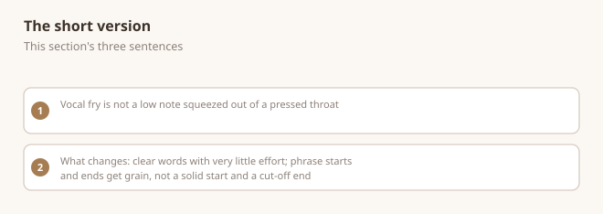
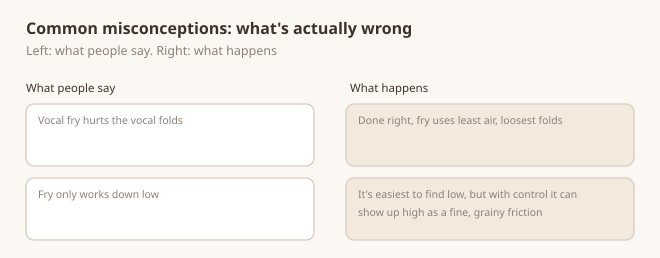
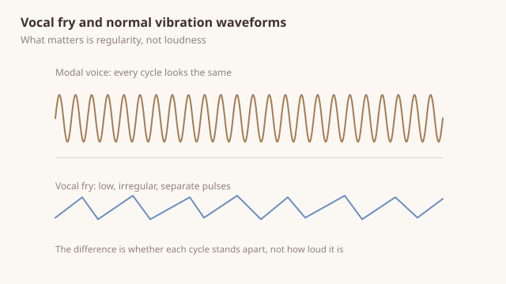
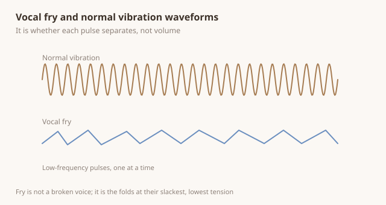
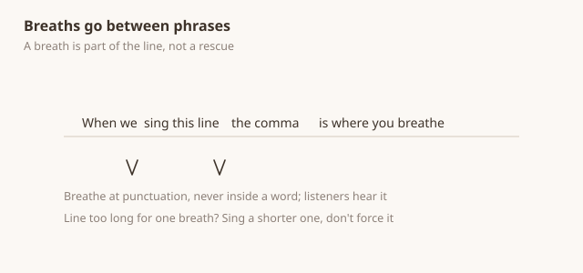
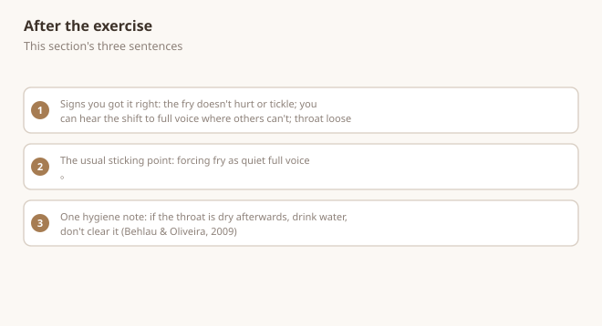

# Chapter 23: Vocal Fry: Advanced Muscle Control at Low Volume and How to Use It

## The short version

Vocal fry is not a low note squeezed out by pressing the throat. It is the state where, with very little airflow and very loose vocal folds, the folds vibrate gently one pulse at a time at a very low frequency, roughly twenty to sixty hertz. It is close to the least effortful of all the ways of making sound.

What changes after practice: you can sing clear words with very little effort, and the start and end of a phrase can have a grain to them, instead of being too solid at the first sound and cut off at the last.

## Common misconceptions

Many people think vocal fry damages the vocal folds, that it is a hoarseness forced out. In fact proper vocal fry uses the least air and the loosest folds. What hurts the throat is not the fry itself, but using too much air, or clamping the throat to make that sound.

Another misconception is that fry can only be sung very low. It is easiest to find in the low range, but with good control a fine-grained friction can appear up high as well. That is an advanced variation; get the low range clean first.

## How it works

The cycle of vocal fold vibration goes like this: the airflow pushes the folds apart, they come back together through muscle adduction and the effect of the airflow, and it repeats. Large airflow and high tension make the vibration fast. Very small airflow with loose folds stretches each closure cycle out long, so the closures separate from one another and you get vocal fry. The key is that it sits below the air pressure normal singing needs, so it takes no effort; it takes less effort.

Think of the vocal folds as two soft curtains rather than two taut strings. A string needs a certain tension to ring; a curtain only has to hang loosely with a little wind and it shivers on and off. Vocal fry is curtains shivering, not a string ringing.

Where the metaphor fails is here: a curtain doesn't adjust itself, and the vocal folds do. Give too much air and it won't turn into fry; it will turn into a leaking modal note. Clamp the throat and it will turn into a scrape. So low air and no clamping have to be true at the same time; either one on its own is not fry.

One more thing worth knowing: the grain of vocal fry comes from irregular low-frequency vibration, not from hoarseness after damage to the folds. Studies have measured its effect on the voice and on velopharyngeal closure specifically (Elias et al., 2016). In other words, it is a state, not a disease.

## An analogy

**Turning a tap almost shut.** Turn a tap almost shut and the water doesn't stop, it comes in drops. The shape of a drop is nothing like the full stream, but you didn't change the pipe; you turned the flow to minimum. Vocal fry is the folds working at that almost-shut position.

**A bus pulling away.** Let the clutch out slowly and the bus lurches forward one notch at a time; let it out suddenly and it shoots off. Lurching doesn't mean the bus is broken; it means the power is being fed just right. The grain of vocal fry is that notch-by-notch. Give the air suddenly and the bus shoots off and becomes an ordinary modal note.

**Sandpaper and glass.** The same sheet dragged over glass goes "shh", over sandpaper "shh-shh-shh". The movement is the same; the difference is how the surfaces meet. Vocal fry adds nothing; the way the folds come together has changed.

## Try it now

### Exercise 1: Find fry from a sigh

1. Sit down, drop the shoulders, let the jaw hang slightly open.
2. Make a long "ah", the way you breathe out when you are very tired. Five seconds.
3. As the air runs out, don't close the mouth; let the last of the air keep slipping through the folds.
4. The sound will break up by itself into low "uh" pulses. That is vocal fry.

If you get it wrong: if it scrapes or you want to cough, you clamped the throat or pushed the air too hard. Stop, breathe normally three times, and start again from a lighter sigh.

### Exercise 2: Feel out "too much" and "too clamped"

1. Start a steady vocal fry.
2. Deliberately push out a little more air. The pulses vanish and it becomes leaking air or a modal note. Remember that "too much".
3. Back to fry, and deliberately tense the neck. The sound gets held in and stuck. Remember that "clamped".
4. Relax again and cut the air to almost nothing. The pulses get clearer and rounder.

If you get it wrong: if nothing but a scrape comes out whatever you do, the folds are probably still too tight. Go back to the long sigh in exercise 1.

### Exercise 3: Fry into modal voice and back

1. On a low note, sing one pulse at a time: "uh, uh, uh".
2. Add a little support from the lower abdomen so the pulses gradually join up.
3. They pass over into a clean "ah"; it doesn't have to be loud.
4. Hold for two seconds, then slowly let the support go so the sound breaks back into fry. Five times.

If you get it wrong: if a step appears in the middle, you added the air too fast. Slow it down until the point of change is almost impossible to hear.

### Exercise 4: Take the other direction, breathing in

1. First do expiratory fry for two seconds.
2. Now reverse it: use an indrawn breath to make the folds produce the same low pulses.
3. The inspiratory version is usually finer and shorter, and easier to relax into.
4. Alternate three of each and feel which one opens your folds more easily.

If you get it wrong: if the throat goes dry or you want to cough as you breathe in, you are breathing in too hard. Take less, as if you had just caught a faint smell.

### Exercise 5: Put it into one line of a song

1. Pick a verse line from a ballad.
2. Sing it normally once, as a reference.
3. The second time, put a fraction of a second of vocal fry before the first word, then sing that word on from it.
4. Record and compare. The second should have a little more of the tone of a sentence not yet finished.

If you get it wrong: if you add it to every word it sounds like deliberate decoration. One place per line is enough: at the start or the end of a phrase.

## After the exercise

Signs you got it right: the fry doesn't hurt or itch; you can hear the difference between fry and modal voice yourself and other people can't easily catch the switch; after singing the throat is loose.

The usual sticking point is forcing fry out as "a modal note at low volume", and the more you practise the tighter it gets. Another is using it only when recording and never in practice, so it won't come out on stage. Two minutes a day, before you warm up properly, is the easiest way to get it.

One small point of vocal hygiene: if your throat is dry or you want to clear it after practice, drink water rather than clearing it (Behlau & Oliveira, 2009). Clearing your throat hits the vocal folds harder, and the relaxation you just practised is wasted.

The next step is the passaggio in chapter 24. Vocal fry trains loose; the passaggio trains the boundary. Put the two together and you begin to hear where you change gear.

## Further reading

- **Elias, V. S., Cielo, C. A., & Jotz, G. P. (2016).** Effect of Vocal Fry on Voice and on Velopharyngeal Sphincter. *International Archives of Otorhinolaryngology.* A measurement of vocal fry's effect on the voice and on velopharyngeal closure. PMID 27096021.
- **Paolillo, N. P., Carrozza, L., & Osio, M. (2021).** Inspiratory Vocal Fry: Anatomical and Physiological Aspects, Application in Speech Therapy, Voice Therapy and Singing Pedagogy. *Journal of Voice.* Vocal fry runs in two directions, expiratory and inspiratory, and both are used in therapy and in singing teaching. PMID 31708370.
- **Behlau, M., & Oliveira, G. (2009).** Vocal hygiene for the voice professional. *Current Opinion in Otolaryngology & Head and Neck Surgery.* Evidence-based advice on hydration, avoiding throat clearing, and voice rest. PMID 19342952.
- **Titze, I. R. (2006).** Voice training and therapy with a semi-occluded vocal tract: rationale and scientific underpinnings. *Journal of Speech, Language, and Hearing Research, 49*(2), 448–459. How airflow and resistance in the mouth change the conditions the vocal folds work under. PMID 16671856.

