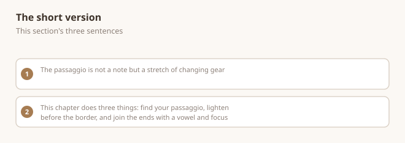
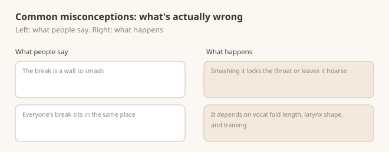
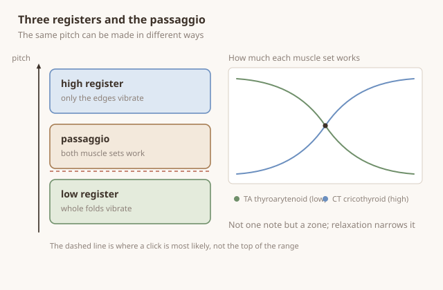
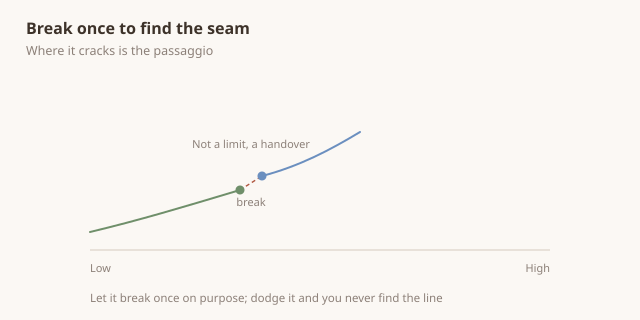
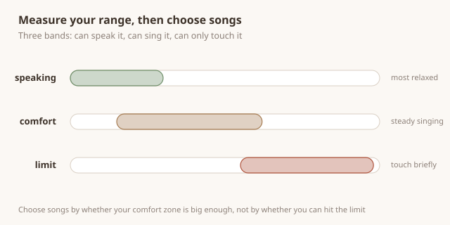
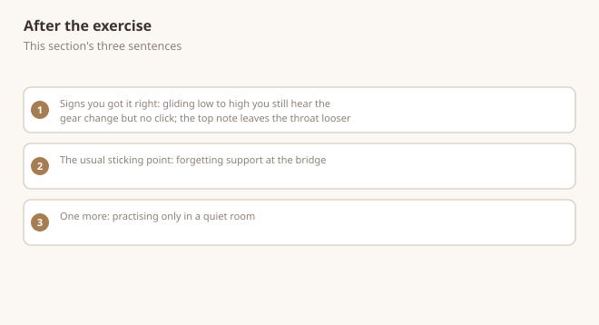

# Chapter 24: The Passaggio in Depth: Solving the Break at the Register Change

## The short version

The passaggio is not a fixed note, it is a stretch of pitches where you change gear. Singing up into it, control has to hand over from the muscle that thickens the vocal folds to the muscle that stretches them longer. Get the handover wrong and the sound snaps off with a click, or the whole stretch locks.

This chapter teaches three things: finding where your own passaggio is, taking the weight off before you reach the boundary, and joining the two ends with the vowel and a little focus.

## Common misconceptions

Many people think the passaggio is a wall to break through, and that with enough air and enough dantian you can push modal voice up over it. What you usually get is a locked throat or a hoarse voice. It is not a wall, it is a bend in a slope.

Another misconception is that where other people's passaggio is, yours is too. It depends on the length of the vocal folds, the structure of the larynx and your training background. Teaching often says men around E4 to F4 and women around A4 to C5, but that is a rough guide, not true of everyone. You have to find yours by ear.

## How it works

On low notes the thyroarytenoid (TA) thickens the vocal folds and the whole fold vibrates. On high notes the cricothyroid (CT) stretches them long and thin. In between, both are working and the ratio is changing. That is the passaggio. It is a stretch, not a note.

That it moves is worth knowing in itself. A bad night's sleep, not being warmed up, singing all evening, just getting over a cold: any of these can drop the passaggio a semitone or two. So don't memorise a fixed pitch. Find the day's position by ear.

Untrained, the TA is usually the stronger of the two and won't let go when you reach the passaggio. The folds don't get thinner, the pitch won't go up, and the brain finally has to cut across, and the sound snaps. The other way, letting go too early, loosens the closure and the sound becomes a leaking falsetto. Neither end works.

So what you practise is not more force but losing weight and keeping the closure at the same time. Narrowing the vowel is the weight loss: round the wide-open "ah" towards "uh" or "oh", and the larynx is steadier and the folds thin more easily. Focus keeps the closure: the sound gathers behind the bridge of the nose, and that hearing plus the body's feedback helps you keep a bright resonance and reduces compensation from the muscles outside the larynx; the actual closure is still controlled by the muscles inside it.

One thing can confirm the direction: the problem at the passaggio is a ratio, not strength. If practice leaves you more tired and your neck thicker, you are usually practising the wrong direction.

## An analogy

**Changing gear uphill.** In a manual car, don't change gear on a hill and the engine revs, the sound gets shrill, and eventually it stalls. The car jolts for an instant as you change gear, and that is your click. A jolt doesn't mean the car is broken, it means you are changing. What you practise is changing earlier, not jolting less.

**The last step of the stairs.** You think there is one more step, there isn't, and your foot goes through the air. The click at the passaggio is that missed step. The solution is not to jump higher, it is to see where the steps are. So the first step is always to find it, not to cover it up.

**The changeover zone in a relay.** It is not a point, it is a twenty-metre zone. The runner starts accelerating before entering it, and the baton goes across inside it. If you only chase when the baton is already falling, you will drop it. Back to the mechanism: the TA and the CT hand over across a stretch of range too, so the switch has to start two or three notes early.

## Try it now

### Exercise 1: Find your own break

1. Stand tall, breathe in.
2. On a completely unpolished "ah", slide slowly up from a comfortable low note. Five seconds.
3. Don't brace against it. Let the sound flip over somewhere with a click; let it flip.
4. Three to five times each way, and remember roughly which pitch it was.

If you get it wrong: if you push the whole way, the sound won't break, it will only get tighter. Halve the volume and allow it to break; only then can you find the real place.

### Exercise 2: Cross on a vowel

1. Start on a low "ah".
2. Two or three notes before the passaggio, round the mouth and change the vowel to "uh".
3. Carry the "uh" through the boundary; don't change at the last moment.
4. Once across, decide whether to go back to a more open vowel.

If you get it wrong: if it still breaks, you usually changed too late. Move the change earlier; better to narrow too soon than too late.

### Exercise 3: Catch it with focus

1. Make a flat "nyeh", the way a child wheedles.
2. Check the sound is gathered at the bridge of the nose and behind the teeth, with the throat doing no work.
3. On "nyeh", slide from low to high and keep that focus the whole way.
4. Once across, slowly open "nyeh" into "nah", keeping the focus.

If you get it wrong: if "nyeh" sounds like a cold in the nose, pinch the nose and test. If the sound is blocked, you are plugging the nose, not focusing.

### Exercise 4: Put it into one line

1. Pick a high note you crack on every time you sing it.
2. Find the two or three syllables before it.
3. Lighten the thickness on those syllables and move the bright point to the front of the face.
4. At the high note, round the mouth and put the support in the lower abdomen, not the throat.

If you get it wrong: if you wait until the high note to switch, it will always be too late. Switch early.

### Exercise 5: Measure it once, don't go by feel

1. With a tuner app on your phone or a piano, find the note where you break.
2. Write it down. Measure again a week later.
3. You will find it drifts; it doesn't stay on the same semitone for ever.
4. Drifting is normal. Don't chase a standard answer.

If you get it wrong: don't make someone else's passaggio your target. Range is measured, not something you claim by feel (Berger et al., 2022).

## After the exercise

Signs you got it right: sliding from low to high you can still hear a change of gear but there is no longer a click; the same high note leaves the throat looser than before.

The usual sticking point is forgetting the support while crossing. The more relaxed the throat, the steadier the lower abdomen and sides of the waist have to be, or the sound goes weak. Another is practising only glissandos and not songs: smooth in practice, cracked in the song. Pick one line that really does crack, every day; it is worth more than a hundred slides.

One more: practising only in a quiet room. The moment the backing comes in you turn the volume up by yourself and the thickness comes back. Practise with the backing on and the voice at seventy per cent.

The next step is chapter 25: mixed voice. The passaggio is the boundary; mixed voice is getting the two sides of the boundary to blend in a ratio, so it sounds seamless.

## Further reading

- **Titze, I. R., et al. (2014).** Bi-stable vocal fold adduction: a mechanism of modal–falsetto register shifts and mixed registration. *Journal of the Acoustical Society of America.* The passaggio is where two closure states hand over, not one vocal fold turning into another. PMID 25235006.
- **Lee, Y., Oya, M., & Kaburagi, T. (2023).** Differences Among Mixed, Chest, and Falsetto Registers: A Multiparametric Study. *Journal of Voice.* Chest, mixed and falsetto can be told apart by their parameters, but the boundaries are continuous. PMID 33518476.
- **Berger, T., Fuchs, M., & Dippold, S. (2022).** Standardization and Feasibility of Voice Range Profile Measurements in Epidemiological Studies. *Journal of Voice.* The range profile is an objective measurement, not something you claim by feel. PMID 32402662.
- **Mürbe, D., Pabst, F., & Hofmann, G. (2002).** Significance of auditory and kinesthetic feedback to singers' pitch control. *Journal of Voice.* Singing in tune depends on hearing and on the feeling in the body; use the two together. PMID 12002886.

