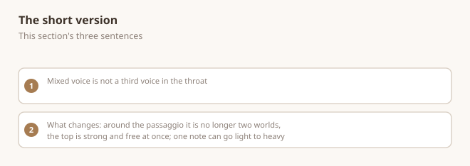
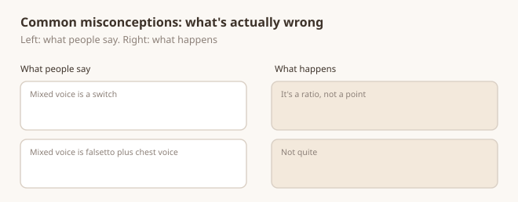
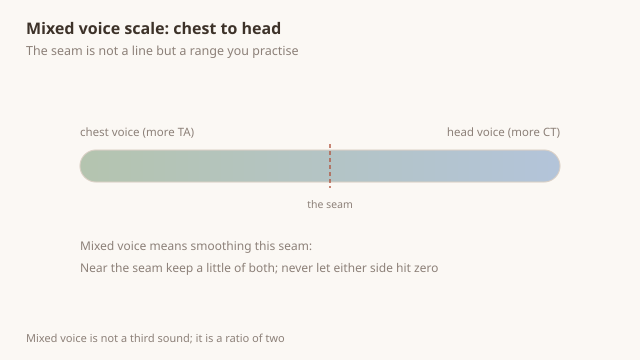
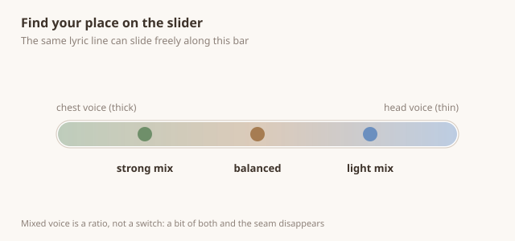
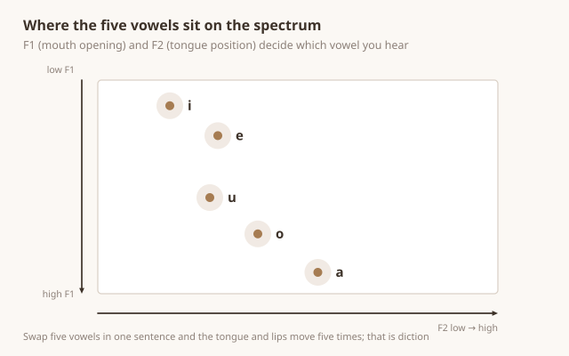
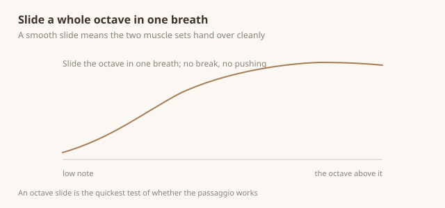
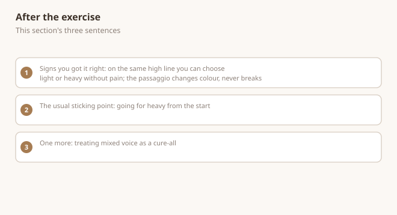
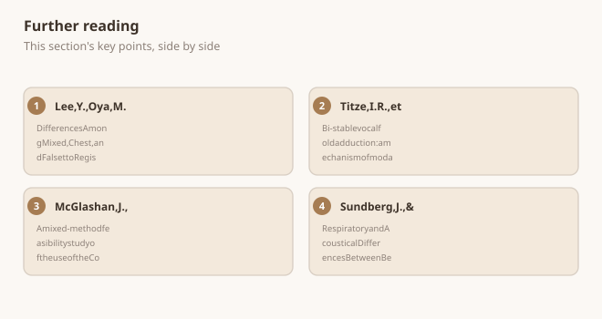

# Chapter 25: Mixed Voice: Building One Seamless Range

## The short version

Mixed voice is not a third sound hidden in the throat. It is simply the thickening muscle and the stretching muscle working at the same time in different proportions, so that the range sounds like one piece with no seam. Mixed voice leaning towards chest is solid; leaning towards head it is light; you can slide continuously between them.

What changes after practice: around the passaggio there are no longer two worlds, a high note can have power without being tight, and on one pitch you can take the sound from light to heavy and back.

## Common misconceptions

Many people think mixed voice is a particular switch, and once you find it you are set for good. It is a stretch of ratios, not a point. Which pitch you mix most easily on today depends on fatigue and on whether you are warmed up.

Another misconception is that mixed voice is falsetto plus a bit of modal voice. Not quite. Falsetto is a state with looser closure; mixed voice needs enough closure, and only the thickness may be small. Just turning the volume up on falsetto still sounds loose; forcing modal voice up locks the neck. Mixed voice sits between the two, but the closure has to be clear.

## How it works

You have only one pair of vocal folds in your throat. The thyroarytenoid makes them thick and short; the cricothyroid stretches them long and thin. Mixing means both are still active and only the balance differs. On the chest side the thyroarytenoid has more of it: the sound is thick and has more low frequency. On the head side the cricothyroid has more of it: the sound is light and has more high frequency. It is not a choice of one or the other.

Acoustic measurement really does tell chest, mixed and falsetto apart, but the boundaries are continuous (Lee et al., 2023). That sentence matters. It means there is no standard answer to "am I mixing right now". The question to ask is "which side am I leaning to".

A useful cue: the "mm" of feeling wronged, about to cry. The larynx drops slightly, the vocal tract lengthens, the cricothyroid gently stretches the folds, and the closure doesn't loosen. That is the easiest place to find mixed voice from.

One more distinction: mixed voice is not turning the volume up. It is a combination of vibrating mass and closure on the same pitch. Treat mixed voice as a louder falsetto and it sounds loose; treat it as a quieter modal voice and it sounds tight.

## An analogy

**A zip.** On a low note the zip is almost fully open and the whole fold vibrates; as the pitch goes up the zip closes and the vibrating part gets thinner. The point is slowly, not pulling halfway and suddenly switching to another zip. Where the analogy fails: a zip only goes up and down, while the thickness of the vocal folds can be affected by two muscles at once, which is how you get a state that sounds thick but has in fact already thinned.

**Two hands lifting a table.** At first both hands push equally. To move left, the left hand pushes a little more and the right a little less, but the right doesn't let go. Let go and the table tips over. Mixed voice is both hands still on, and only the ratio changing.

**Mixing a grey scale.** White plus black, with a whole stretch of grey in between. What you want is not white or black but a grey that can stop at any step. Mixed voice is the same: not choosing a side, but being able to stop where you want.

## Try it now

### Exercise 1: Find that feeling of being wronged

1. Imagine a child who can't get what they want and daren't cry, only choke up.
2. Wrinkle the brow slightly and make a long "mm", a little higher than speech.
3. Feel the sound hanging behind the bridge of the nose, with a slight stretch deep in the throat.
4. Five times, checking each time that the throat doesn't hurt.

If you get it wrong: if the "mm" turns into a growl pressed out of the throat, you went down. Take the pitch up half a tone and make it lighter.

### Exercise 2: Change to "meh"

1. Keep the feeling from the last exercise.
2. On a mid-to-high note sing "meh, meh, meh", each one short.
3. The sound should be thinner than speech but more solid than falsetto.
4. Hand on the chest: check the vibration isn't big enough for the whole chest to be ringing.

If you get it wrong: if there is no chest feeling at all and the sound leaks, the closure is too loose. Sing "meh" smaller and more focused; aim first at not being weak.

### Exercise 3: Octave slide

1. On a comfortable low note sing "meh", keeping the feeling of being wronged.
2. Don't break the air; slide upward like a siren.
3. Entering the passaggio, gather the sound at the bridge of the nose, steady the lower abdomen, and don't add force in the throat.
4. Stop at the top, then slide back down. Three times.

If you get it wrong: if it cracks halfway up, the low note usually had too much weight. Halve the volume at the start and set off again with a clearer feeling of being wronged.

### Exercise 4: Adjust the ratio on one pitch

1. Pick a pitch you usually crack on.
2. Start on a very light "oo"; that is the head-voice end.
3. Keep the pitch and slowly turn it into "meh"; the sound becomes focused, with a core.
4. Open the mouth a little more and add a touch of "ah", letting the support drop; the sound thickens.
5. Then take the whole thing back to "oo". Three times each way.

If you get it wrong: if the pitch drops as you thicken, you added weight rather than ratio. Sing the "ah" smaller and make sure the pitch doesn't move first.

## After the exercise

Signs you got it right: on the same high line you can choose to sing it light or thick without the throat hurting; in a glissando the passaggio only changes colour, it doesn't break.

The usual sticking point is wanting to sing thick from the start. Thickness is added last; it is not the starting point. Another is practising only scales and not sentences: the emotion arrives with the song and the ratio goes to pieces. Pick a line you really will sing and practise three ratios on the same pitch.

One more: treating mixed voice as a universal solution. Some songs' high notes need a little falsetto looseness; some passages need honest chest voice. Mixed voice gives you one more option; it doesn't replace the others.

The next step is chapters 26 and 27, which refine the head-leaning end and the chest-leaning end separately. First make sure you can move between the two ends; then go after either of them.

## Further reading

- **Lee, Y., Oya, M., & Kaburagi, T. (2023).** Differences Among Mixed, Chest, and Falsetto Registers: A Multiparametric Study. *Journal of Voice.* The three registers can be told apart by acoustic and aerodynamic parameters, but the boundaries are continuous. PMID 33518476.
- **Titze, I. R., et al. (2014).** Bi-stable vocal fold adduction: a mechanism of modal–falsetto register shifts and mixed registration. *Journal of the Acoustical Society of America.* Mixed voice is not a third vocal organ; it is a ratio between two closure states. PMID 25235006.
- **McGlashan, J., Aaen, M., & White, A. (2023).** A mixed-method feasibility study of the use of the Complete Vocal Technique (CVT), a pedagogic method to improve the singing voice. *Pilot and Feasibility Studies.* CVT divides singing timbre into four modes, and the difference between them is the ratio of metal to weight. PMID 37226281.
- **Sundberg, J., & Thalén, M. (2015).** Respiratory and Acoustical Differences Between Belt and Neutral Style of Singing. *Journal of Voice.* Sing the same line in different styles and the air pressure and formant strategy change with them. PMID 25819162.

