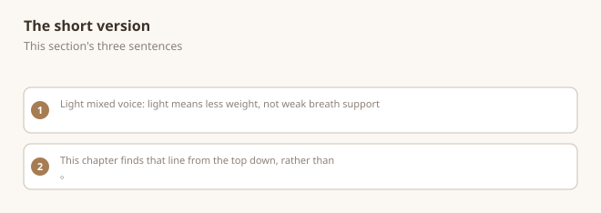
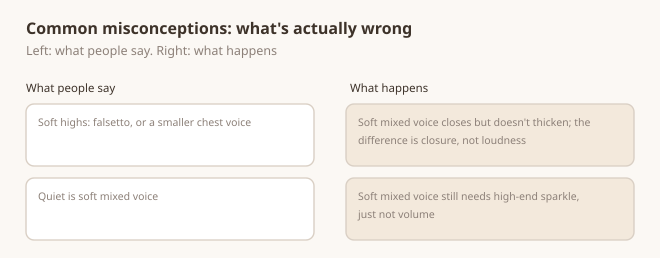
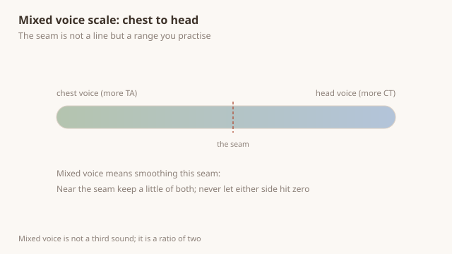
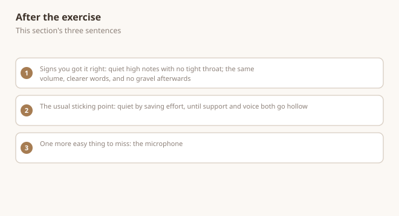

# Chapter 26: Light Mix in Practice: Handling Gentle High Notes and Weaving Colour

## The short version

The light in light mix means light in weight, not weak in support. It takes the heavy low frequencies out and leaves only a very fine edge with enough closure. It sounds like a thin line: soft, but able to pass through a backing track.

This chapter teaches you to find that line coming down from a high note, not to drag all the weight up from a low one. What changes after practice: you can sing quiet passages clearly and without pressure, and a high note doesn't need volume to have presence.

## Common misconceptions

Many people, faced with a gentle high note, switch straight to falsetto or turn the modal voice's volume down. The first is loose and gets swallowed the moment the backing arrives; the second is only quieter, and the sound is still stuck in the throat without the brightness a high note should have.

Light mix is neither. It wants closure without added thickness, and high-frequency brightness without a big volume. The difference is whether the closure is clean, not how loud you are.

## How it works

Whether a sound can be heard is a matter of volume, but it is more a matter of frequency. Low frequencies are easily eaten in a mix by the bass, the kick drum and the guitar; high-frequency overtones cut through. What light mix does is shrink the vibrating mass right down so there is more high-frequency content, and at the same time lean on good closure so the airflow doesn't leak away.

A light-source comparison: singing with force is a torch, bright but scattered; light mix is a laser pointer, a single point you can see from far away. Where the analogy fails: a laser pointer's brightness is fixed, a voice's isn't. Give more air and the sound doesn't get brighter; it turns back into a loose modal note or falsetto. So light mix needs steadier support, only this support doesn't turn into volume.

Support here means not letting the air rush out all at once. The lower abdomen squeezes the air out slowly rather than letting go. Let go and the folds don't have enough pressure to keep the closure, and the sound collapses at once.

One thing worth knowing: when the volume changes, the adjustment of the vocal tract shape is a measurable action, not just a feeling (Vurma, 2022). So singing quietly is not doing nothing; it is a different, finer set of actions.

There is also a difference in direction: finding it coming down from a high note is easier than going up from a low one. Starting low, the brain tends to carry the thickness up with it.

## An analogy

**Wool and embroidery thread.** Both are one strand: wool is warm and thick, embroidery thread fine and bright. To go through the eye of a needle you need the thread; to keep warm you need the wool. Light mix is the thread: its job is not to wrap you up, it is to get through the obstacle. Back to the mechanism: what gets finer is the vibrating mass, not the amount of air.

**A torch and a laser pointer.** In a power cut you reach for a torch, because you want to light the whole room; to point at a speaker on stage you need a laser pointer. Same press of a switch, and the difference is how concentrated the light is.

**Pouring water from a jug.** Pour slowly and the water is a thin line; tip the jug and it becomes a sheet. Keeping that line depends on controlling the angle of the jug, not on gripping it harder. The angle is your support.

## Try it now

### Exercise 1: Take the weight out first

1. Pick a very high note and sing it lightly on "oo" for two seconds.
2. There should be no feeling of weight in the throat at all.
3. Let a little air into the sound, like an owl hooting.
4. Remember that weightless feeling. Five times.

If you get it wrong: if the throat tightens the moment the high note comes, drop the pitch half a tone. A falsetto forced up by main strength won't help the rest of the exercises.

### Exercise 2: Change to "ik"

1. On the same high note, change the "oo" into a very short "ik".
2. Imagine a very small, very angry chihuahua.
3. The sound should have a slightly metallic sharpness, not a leak.
4. If it sounds loose, narrow the mouth shape and use less air.

If you get it wrong: if "ik" turns into a scrape in the throat, you clamped. Go back to "oo" and start again with less air.

### Exercise 3: Slide down from high

1. Keep the sharp "ik".
2. Slide slowly down from the high note, moving through the pentatonic scale.
3. All the way down, don't let the chest vibration come out to help.
4. At the bottom, slide back up. Three times.

If you get it wrong: if the sound suddenly gets thick and heavy on the way down, you let thickness take over. Stop on that note and slide again at a lighter volume.

### Exercise 4: Switching between fog and thread

1. Pick a mid-to-high note and give the "oo" a little more air, so it goes loose.
2. Set the lower abdomen in an instant and draw the mouth into "ee".
3. The sound goes from a patch of fog into a single line.
4. Let it go and go back to the loose "oo". Five times each way.

If you get it wrong: if the "ee" turns piercing and the throat itches, you tightened too hard. Put the support in the lower abdomen; narrow the mouth shape but don't bite.

### Exercise 5: Put it into a quiet passage

1. Pick the pre-chorus or the bridge of a slow song.
2. Sing it in light mix: every word light, but the core clear.
3. Imagine the sound floating above the piano or guitar, not buried inside it.
4. Record it and listen, and check it is quiet but understandable.

If you get it wrong: if the whole passage has no presence, it isn't that the volume is too low, it's that the closure is too loose. Add a little of the "ik" feeling back.

## After the exercise

Signs you got it right: singing a high note quietly, the throat isn't tight; at the same volume the words are clearer than before; afterwards the voice isn't hoarse.

The usual sticking point is that the quieter it gets the more you want to save effort, so you let the support go too and the sound turns weak. Another is treating light mix as the default timbre for a whole song: it suits quiet, delicate passages, and the chorus still has to be thick where it should be thick.

One more thing that is easy to overlook: the microphone. The detail in light mix comes from the broadband noise of the breathy component, the high frequencies of the consonants and the brightness of the overtones, and back away from the mic and it all scatters. When recording, try three distances first and find the one where the words are clear and it doesn't pop.

The next step is chapter 27, working up the other end: a high note with power that doesn't lock the neck. First make sure you can move between light and heavy; only then do the two ends mean anything.

## Further reading

- **Lee, Y., Oya, M., & Kaburagi, T. (2023).** Differences Among Mixed, Chest, and Falsetto Registers: A Multiparametric Study. *Journal of Voice.* Mixed voice and falsetto can be told apart by their parameters, and one of the keys is the ratio of closure to airflow. PMID 33518476.
- **Sundberg, J., & Thalén, M. (2015).** Respiratory and Acoustical Differences Between Belt and Neutral Style of Singing. *Journal of Voice.* Light and heavy are two different strategies of air pressure and formant tuning, not just a difference in volume. PMID 25819162.
- **Vurma, A. (2022).** Amplitude Effects of Vocal Tract Resonance Adjustments When Singing Louder. *Journal of Voice.* When the volume changes, the vocal tract's resonance adjustments are a measurable action. PMID 32624371.
- **McGlashan, J., Aaen, M., & White, A. (2023).** A mixed-method feasibility study of the use of the Complete Vocal Technique (CVT), a pedagogic method to improve the singing voice. *Pilot and Feasibility Studies.* CVT's neutral mode is exactly the light kind, with closure still clear. PMID 37226281.

