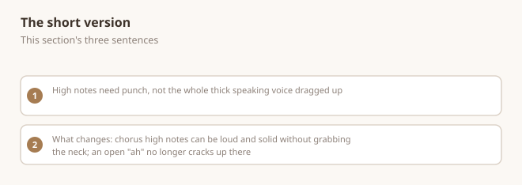
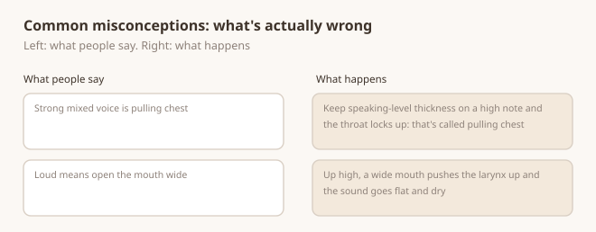
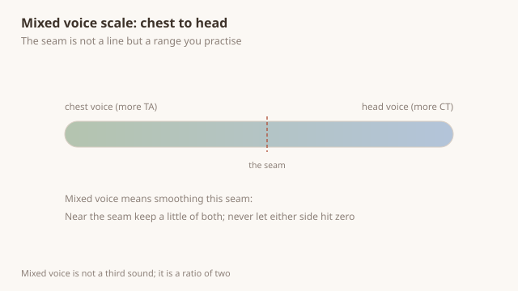
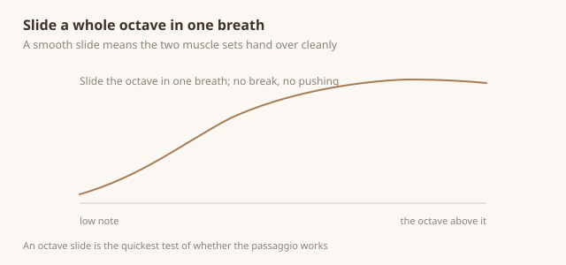
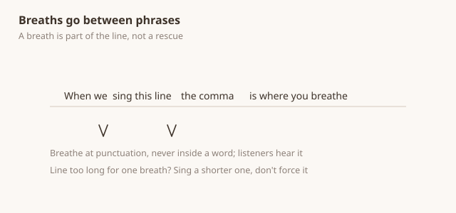
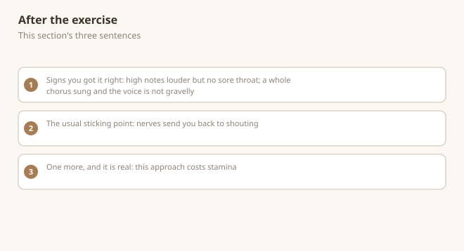

# Chapter 27: Strong Mix in Practice: High Notes with Punch and Weight

## The short version

A high note with punch does not come from dragging the whole thick speaking voice up with it. Strong mix rests on two things: the vocal folds get thinner but close tightly, and the pharynx focuses the sound and adds high frequency, so it sounds thick. The throat itself is the light part.

What changes after practice: the high notes in a chorus come out loud and solid without locking the neck, and a wide-open syllable like "ah" no longer cracks the moment you take it up high.

## Common misconceptions

Many people think strong mix means forcing modal voice up. Keep the thickness of speech on a high note and the throat is bound to lock; the English teaching world calls it pulling chest. The harder you push, the less it goes up.

Another misconception is that loud means opening the mouth as wide as you can. Up high, opening too wide actually makes the larynx ride up, and the sound goes flat and dry. The higher the note, the more the vowel usually has to narrow, so the formant keeps up with the overtones.

## How it works

Strong mix is still mixed voice. The cricothyroid is working, and the vocal folds have in fact already thinned. So where does the thickness come from? Partly from focus in the pharynx, which adds a stretch of bright, penetrating high frequency. Partly from the lower abdomen and the sides of the waist supplying very steady air pressure, so the thinned folds vibrate solidly.

A hi-fi analogy: the same small speaker sounds thin with no horn; add a horn that flares outward and the sound radiates more easily, so it becomes loud and aggressive. What makes the sound bigger is the shape, not the throat.

One word needs care here: twang. It narrows the pharynx above the larynx with the pharyngeal constrictors and the aryepiglottic muscles, which makes the sound brighter and more focused. It is not some secret technique. It sounds flat and piercing, and sounding bad while you practise is normal, but the throat should not hurt.

Keep "bright" and "tight" apart. Bright comes from shape and high frequency; tight comes from force. On the same pitch you can sing bright without tight, or tight without bright. The test comes afterwards: bright and relaxed leaves the throat merely used; tight leaves it sore, hoarse, and lower the next morning. That feedback is more reliable than how it felt at the time.

One thing the research states plainly: singing high notes thick and powerful is not a single parameter. Sound pressure, air pressure and formant strategy all change together (Sundberg & Thalén, 2015; Lebowitz & Baken, 2011). So "sing louder" is not one volume knob you turn.

## An analogy

**A horn.** The same small speaker driver in a box with no horn sounds muffled and scattered; add the horn and the sound gathers in one direction and seems much bigger. Where the analogy breaks: a horn is a passive shape, while the pharynx is a shape muscles make. You cannot "push the sound into the horn"; you can only narrow the horn and let the sound change itself.

**Pinching a hose.** Squash the end of a hose halfway and the jet travels further. The amount of water has not changed; the shape of the outlet has. Narrowing the pharynx is that squeeze: a smaller outlet, a faster jet.

**Accelerator and steering wheel.** Punch is not gripping the wheel harder, it is pressing the accelerator steadily. Grip the wheel to death and the car only drifts; lock the throat and the sound only tightens.

## Try it now

### Exercise 1: Find that layer of brightness first

1. Pinch your nose, so that in a moment you can check the sound is not leaking out through the nostrils.
2. Make a harsh "nyeh", the way a duck sounds or a child mocks someone.
3. Feel the vibration sitting against the hard palate and behind the teeth, with the throat doing no work.
4. Let go of the nose. The sound should be just as bright.

If you get it wrong: if the sound disappears when you pinch your nose, what you made was nasal, not focused. Open the mouth a little and let the sound come out of the mouth.

### Exercise 2: Put the brightness back into a vowel

1. Make the "nyeh" on a mid-high note.
2. Keep the feeling of it against the back of the teeth, and slowly open the mouth into "beh".
3. Open a little more, into "yeh".
4. The whole way through, do not let that bright point drop back into the throat.

If you get it wrong: if "yeh" goes dull the moment you open, the mouth opened too fast and too wide. Go back to "nyeh" and open a little at a time.

### Exercise 3: The squat glide

1. Knees slightly bent, hands on your hips, feeling the sides of the waist.
2. Breathe in and let the sides of the waist expand.
3. On "beh", slide up from a low note.
4. The higher the note, the more the lower abdomen and the sides of the waist push outward and press down. The throat must not join in.

If you get it wrong: if the high note suddenly thins or cracks, the support usually let go at the last moment. It is not that you were not loud enough. Breathe in again and keep the support to the end.

### Exercise 4: How to sing "ah" up high

1. First open the mouth wide on purpose and shout "ah"; listen to that dry, tight sound and keep it as a reference.
2. Start again, gathering the two corners of the lips, as if the mouth shape sat between "oh" and "uh".
3. Sing "ah" with that gathered shape, with the same support.
4. Record it and listen. It feels to you like "oh"; it still sounds like "ah".

If you get it wrong: if the gathered shape turns it into a different word nobody can make out, you gathered too much. Put the mouth shape back halfway.

### Exercise 5: Train stamina, not that one note

1. Pick a chorus of eight bars without a break.
2. Mark every breathing point on the score first, rests included.
3. Sing the whole stretch at seventy per cent of your volume and do not stop in the middle.
4. If you finish with a feeling in the abdomen and nothing in the throat, you did it right.

If you get it wrong: if the third line starts to go hoarse, the support is being shared out badly; it is not a lack of strength. Move the breathing points earlier.

## After the exercise

Signs you got it right: the high notes are louder but the throat does not hurt; after a whole chorus the voice has not gone hoarse. The effort you spent was in the abdomen, not the neck.

The usual sticking point is going back to dragging the throat the moment you get nervous. Keep the volume at seventy per cent while you practise and put your attention on support and mouth shape rather than on whether it is loud enough. Another is practising the high note for a minute at a time: stamina is a separate thing, and the body has to get used to holding support for the length of a chorus.

One more is plain practical: this way of singing costs energy. Do not practise punch when the throat is already tired; that only makes you use the wrong muscles. When you order a practice session, put strong mix in the first half, while the voice is still fresh.

Next is Chapter 28, which pulls the focus in the pharynx out and trains it on its own. It is a large part of why strong mix can sound thick.

## Further reading

- **Sundberg, J., & Thalén, M. (2015).** Respiratory and Acoustical Differences Between Belt and Neutral Style of Singing. *Journal of Voice.* A thick, powerful high note differs from neutral singing in both air pressure and formant strategy. PMID 25819162.
- **Lebowitz, A., & Baken, R. J. (2011).** Correlates of the belt voice: a broader examination. *Journal of Voice.* Belt is not one parameter but a combination of several features. PMID 20236798.
- **McGlashan, J., Aaen, M., & White, A. (2023).** A mixed-method feasibility study of the use of the Complete Vocal Technique (CVT), a pedagogic method to improve the singing voice. *Pilot and Feasibility Studies.* CVT divides the powerful high note into two modes, overdrive and belting, differing in metal and in range. PMID 37226281.
- **Pettersen, V., Bjørkøy, K., & Torp, H. (2005).** Neck and shoulder muscle activity and thorax movement in singing and speaking tasks with variation in vocal loudness and pitch. *Journal of Voice.* The louder and the higher you sing, the more obvious the compensating activity in neck and shoulders; punch should not be grown in the neck. PMID 16301107.

