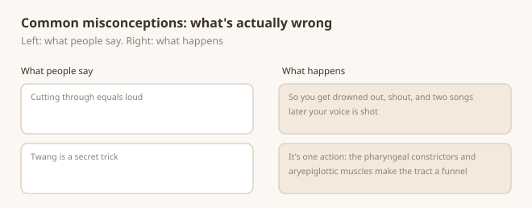
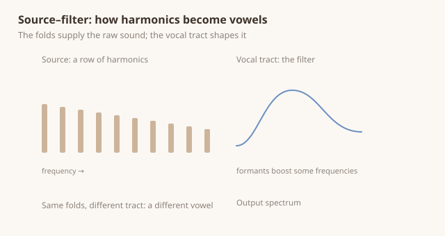
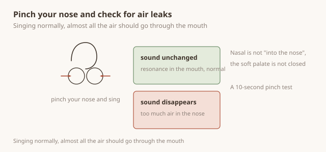
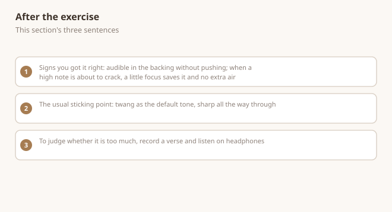

# Chapter 28: The Secret of Pharyngeal Resonance: Giving the Voice Penetration and Edge

## The short version

Getting buried in a band is usually not a lack of volume; it is overlapping frequency. The bass and kick drum own the low end, and the guitar and keyboard carry plenty of energy in the middle. Squeeze in with a thick sound and you simply get eaten. To cut through, the voice has to carry a bright, focused band of high frequency. The place that does this is the pharynx, and the method is to narrow it.

What changes after practice: at the same volume, your voice can be heard inside the backing track; when a high note is about to crack you no longer need more air, only a little focus added back.

## Common misconceptions

Many people take penetration to mean loud. So the moment they get buried they start dragging the throat, and two songs later the voice is hoarse. What gets a voice through is frequency, not volume.

Another misconception is that twang is some mysterious secret trick. It is one action: the pharyngeal constrictors and the aryepiglottic muscles narrow the pharynx above the larynx, so the vocal tract becomes a small funnel. Once it narrows, the formants shift, the low mids are held back, the high overtones are boosted, and the sound turns bright and focused. We all use this action when we imitate a duck or a child mocking someone.

## How it works

The pharynx sits above the true vocal folds and behind the root of the tongue. Relaxed, it is a wide tube: warm and round, with blurred edges. Narrowed, the epiglottis tips backward, the section above becomes a small funnel, the impedance of the vocal tract changes, the formants move up, and the upper overtones line up with a formant and get reinforced. That is twang.

Why does brightness help? The ear is especially sensitive around two to three thousand hertz. In a mix that band often keeps a relatively narrow gap, and if your voice has some energy there it is easy to pick out even at modest volume. Voice research calls this high-frequency cluster the singer's formant. It is a group of overtones reinforced by the shape of the vocal tract, sitting around 2.8 to 3.2 kHz (Lee et al., 2008), not an extra organ grown inside the throat.

And the shape of that short tube above really does change how tightly this high-frequency energy gathers, in computer models at least (Vampola et al., 2024). In other words, "narrow the top" is not mysticism; it is a physical action, and a doable one.

The limit of the funnel analogy lies here: a funnel is a passive shape, while the pharynx is made by muscles contracting. So you cannot "push the sound into the funnel"; you can only narrow the funnel and let the sound change itself. Narrow too much and it pierces; too little and nothing happens. There is a usable range in between.

One more thing worth knowing: narrowing the pharynx brightens the sound, but it does not let you sing higher. Pitch is decided by the length and tension of the vocal folds; the pharynx only changes the timbre. Many people run the two together, so when a note won't come they start narrowing, the sound turns piercing, and the pitch has not moved.

## An analogy

**A finger on the hose.** Squash the end of a hose a little and the water shoots further and straighter. The amount of water has not changed; the outlet has. Narrowing the pharynx is that squeeze: a smaller outlet, concentrated energy.

**A horn.** The same small speaker with a horn attached becomes loud and directional. A horn is not an amplifier; it only lets the sound radiate out more easily. The pharynx does the same job.

**A focusing hood on a torch.** The bulb does not get brighter, but with a hood on it the beam reaches further. The catch is that the hood must not be too narrow: too narrow and all the light lands on one spot, and you cannot see the road.

## Try it now

### Exercise 1: Find that brightness first

1. Imitate a little witch laughing: "heh, heh, heh", short and sharp.
2. Imitate a duck: "quack", or the "nyeh" of a child mocking someone.
3. Feel the vibration against the hard palate and behind the teeth, with no pain in the throat.
4. All of these sound ugly. That is normal.

If you get it wrong: if your throat tickles or you want to cough while doing it, you are squeezing the throat, not the pharynx above it. Halve the volume and make the sound smaller.

### Exercise 2: The nose-pinch check

1. Make the witch's "heh heh heh".
2. Pinch your nose.
3. If the sound barely changes, it is coming out of the mouth and the placement is right.
4. If the sound is blocked or obviously duller, what you just made was nasal.

If you get it wrong: the nose-pinch test is a check, not an exercise. Do not sing while pinching your nose; it teaches the wrong kind of effort.

### Exercise 3: Dilute the brightness

1. Make the harsh "nyeh" on a mid-high note.
2. Keep that narrowed feeling above the throat, and slowly open the mouth into "nah".
3. The sound goes from cartoon character to a solid rock timbre.
4. Open further into "ah" and let it round out, but keep a focused core.

If you get it wrong: if the bright point vanishes completely each time you open, you are holding it up with the mouth shape rather than the pharynx. Go back to "nyeh" and open a little at a time.

### Exercise 4: Quiet has to be clear too

1. Use a very small volume, as if talking into someone's ear.
2. First make a breathy "ha" and hear how loose it is.
3. Add a little pharyngeal focus and switch to "hee" or "hey".
4. Compare the two. The second is just as quiet, and the words are much clearer.

If you get it wrong: if adding focus to the quiet sound makes it louder, you turned focus into force. Focus is a shape, not a volume.

### Exercise 5: Test it inside a backing track

1. Play a backing track and sing at your usual volume; record once as a reference.
2. Add a little focus the second time, deliberately keeping the volume the same.
3. Play both back and listen to which take has clearer diction inside the track.
4. Remember that amount. That is the setting you want on stage.

If you get it wrong: if the two takes sound about the same, the backing track may be too loud. Turn the track down until it sits below your voice.

## After the exercise

Signs you got it right: inside the backing track your voice is audible without pushing; when a high note is about to crack, a little focus rescues it without extra air; the throat does not hurt afterwards, it only feels used.

The usual sticking point is treating twang as the default timbre for a whole song, piercing from beginning to end. It is a knob: less in the verse, more in the chorus. Another is practising only the ugly sounds and never the dilution, so you do not dare use it on stage.

To judge whether you have gone too far, record a stretch of the song and listen on headphones. If the high end stabs your ears, or the diction turns mushy, you narrowed too much. The ideal spot is this: clearly audible inside the track, but when you take the headphones off and talk to someone face to face, they do not feel you are shouting at them.

Next is Chapter 29: the soft palate. Together with the pharynx it gives you most of the pop timbres there are.

## Further reading

- **Lee, S. H., Kwon, H. J., & Choi, H. J. (2008).** The singer's formant and speaker's ring resonance: a long-term average spectrum analysis. *Clinical and Experimental Otorhinolaryngology.* The singer's formant (a cluster of energy around 2.8–3.2 kHz) can be measured. PMID 19434279.
- **Vampola, T., Horáček, J., & Laukkanen, A. M. (2024).** Three-Dimensional Finite Element Modeling of the Singer's Formant Cluster Optimization by Epilaryngeal Tube Shaping. *Journal of Voice.* A small epilaryngeal cavity (a narrowed pharynx) concentrates high-frequency energy. PMID 39218756.
- **Vurma, A. (2022).** Amplitude Effects of Vocal Tract Resonance Adjustments When Singing Louder. *Journal of Voice.* Adjusting vocal tract resonance is a measurable action, not just a feeling. PMID 32624371.
- **Guzman, M., Laukkanen, A. M., & Krupa, P. (2013).** Vocal tract and glottal function during and after vocal exercising with resonance tube and straw. *Journal of Voice.* With a tube adding resistance in the mouth, vocal tract and glottal function both change, the same kind of impedance adjustment as narrowing the pharynx. PMID 23683806.

