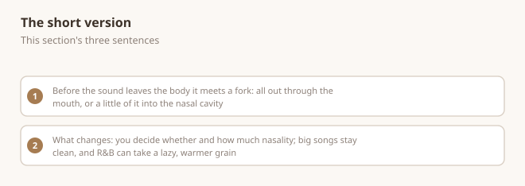
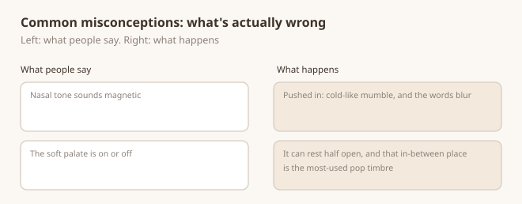
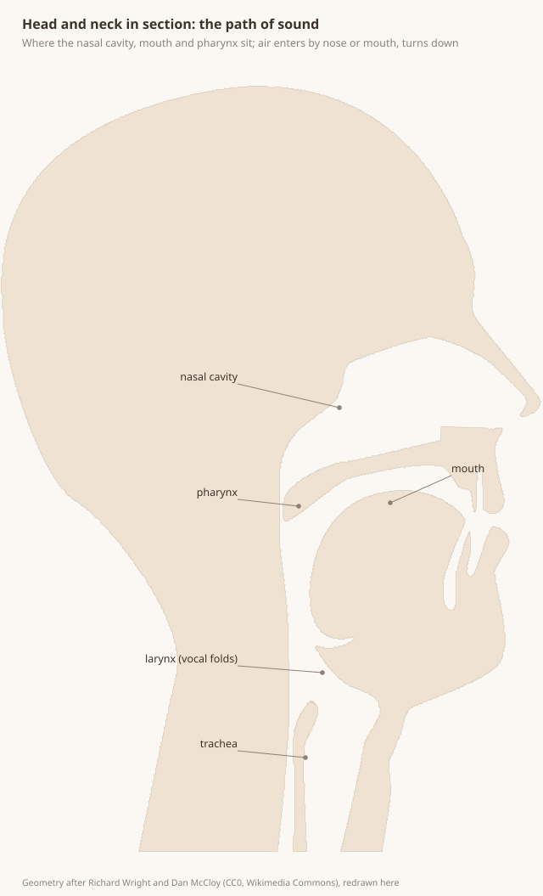
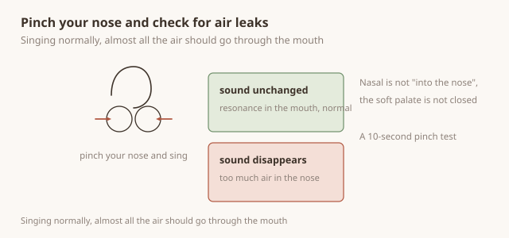
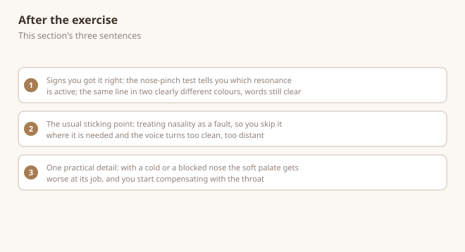
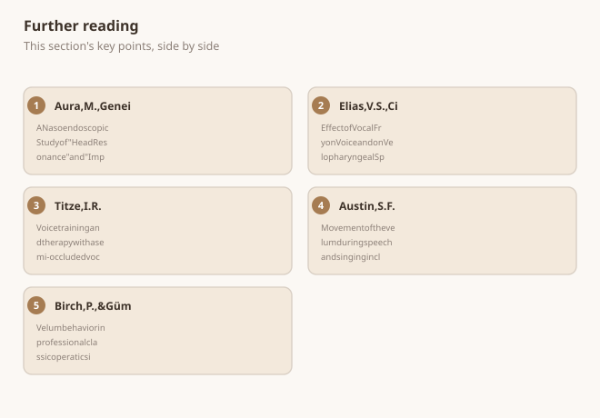

# Chapter 29: Raising and Lowering the Soft Palate: Setting the Balance of Nasal and Oral Resonance

## The short version

Before the sound leaves the body it meets one last fork: out through the mouth, or partly through the nose. What controls the fork is the soft palate. Lift it and almost all the sound goes out of the mouth, clean and full; lower it a little and the sound gains a sticky, warm layer of nasality.

What changes after practice: you decide whether you want nasality and how much; a big ballad sounds clean, and an R&B song can take a little lazy, velvety colour.

## Common misconceptions

Many people think a "velvety nasal" tone means stuffing air up the nostrils. Stuffed in, it only becomes the dull sound of a cold, and the words mush. In a nasal tone that sounds good, most of the sound still leaves through the mouth; only a small part is shared with the nasal cavity so the two resonate together.

Another misconception is that the soft palate only has two settings, open and shut. It can actually stop half-open, and that position is the one pop singing uses most.

## How it works

Run your tongue along the roof of your mouth. The hard part at the front is the hard palate; further back it turns soft and boneless, and that is the soft palate, with the uvula hanging off its end. When you swallow it lifts automatically to shut the nasal cavity so food does not go up your nose. Singing means turning it from automatic into controllable. In trained singers the soft palate really does move differently in speech and in singing; the difference can be observed (Austin, 1997).

Lift the soft palate and the nasal passage closes and the sound travels through the mouth. That sound is clear and strong, and it suits high notes and passages that need punch. Lower the soft palate and the sound enters the nasal cavity and turns dull and flat. Fully lowered is actually not pleasant, but it is a useful landmark that confirms where the nasal cavity is.

What is genuinely useful is the middle: the soft palate lowered only a little, most of the sound still leaving the mouth and the nasal cavity taking a small share. Pinch your nose and the sound does not vanish, but the timbre goes duller, which proves both sides are working. You do not need to memorise proportions; judge them by ear and with the nose-pinch test.

The mechanism is useful for more than timbre. Endoscopic studies of "head resonance" and imposto in classical singing found that the change lies mainly in the shape of the vocal tract and in adjustments of the pharynx and soft palate, not in sound actually reaching the skull (Aura et al., 2022). Low-tension vibration such as vocal fry has also been measured for its effect on velopharyngeal closure (Elias et al., 2016). The same piece of tissue, used differently.

One warning: the nose-pinch test is only a checking tool. Do not sing while pinching your nose, and do not equate "sound passing through the nose" with "nasal". How nasal it sounds is judged at the listener's end, not by what you hear inside your own skull. Hearing yourself, you always get less low end than everyone else.

## An analogy

**A level crossing.** Barrier down, the cars can only use the road; barrier up, the other line opens too. The soft palate is that barrier, not the engine. It does not make sound, it only decides which route the sound takes.

**The gap in a window screen.** Open a small gap and a little wind comes in; the room is not ventilated, but the smell changes. A half-open soft palate is like that: neither fully open nor fully shut, just a gap.

**Faders on a mixing desk.** One fader for the lead vocal, one for the room reverb. The soft palate is the reverb fader: push it up for more space, push it all the way and everything smears. What you want is not an extreme, it is the right amount.

## Try it now

### Exercise 1: Feel it move

1. Mouth closed, breathe in deeply through the nose. The soft palate is down.
2. Open the mouth and breathe in deeply through the mouth instead. On the breath the soft palate barely moves; it just rests in a neutral, relaxed position.
3. Keep the mouth open and make a long "ah". The soft palate lifts when you phonate, closing the nasal passage.
4. Alternate nose in, mouth out, mouth in, nose out, and every so often add an "ah", noticing a muscle deep in the mouth going up and down.

If you get it wrong: if you cannot feel it at all, don't hurry. Put your attention on whether the nose is open while you phonate: open means the soft palate is down, blocked means it is up.

### Exercise 2: Find both ends with consonants

1. Make an exaggerated "k", the back of the tongue pressed against the soft palate. This is the raised end.
2. Make "ng", like the end of the English word sing. This is the lowered end.
3. Alternate ten times and feel the difference.
4. Remember both positions; everything between them is your adjustable range.

If you get it wrong: if the throat tightens on "ng", you are pressing with the throat, not lowering the soft palate. Open the mouth slightly and let the jaw loose.

### Exercise 3: The nose-pinch test

1. Sing a round "ah", the way a yawn begins.
2. On the held note, pinch your nose and release it several times.
3. The goal is for the sound barely to change. That means the soft palate is closing well.
4. Now hold a long "ng" and pinch your nose; the sound should be blocked.

If you get it wrong: if the "ah" goes dull when you pinch the nose, you are leaking nasality. Lift the soft palate a little more, or check whether the back of the tongue is pulling back and pressing on it.

### Exercise 4: Slide from nasal to oral

1. Start with a fully nasal "ng".
2. Without breaking the air, lower the back of the tongue until it becomes "ah".
3. On the "ah", deliberately do not lift the soft palate all the way; stop half-open.
4. Listen for whether that "ah" is a little flat, a little lazy. That is the nasal colour pop singing uses.

If you get it wrong: if "ah" turns into a full classical ring, you lifted too much; if it mumbles so nobody can make out the word, you lowered too much. Adjust back and forth and find the middle.

### Exercise 5: One line of a song, two colours

1. Pick one line of lyrics.
2. First time, sing it with the soft palate lifted: clean sound, clear words.
3. Second time, half-lower it: a little more of that sticky nasal quality.
4. Record both and compare. Neither is wrong; one simply fits better.

If you get it wrong: if the second take sounds like a cold, start with "lower it less". Half-open and fully open are only a whisker apart.

## After the exercise

Signs you got it right: you can use the nose-pinch test to tell which resonance you are in; on one line of a song you can produce two clearly different colours, and the words stay intelligible in both.

The usual sticking point is treating nasality as a bad thing, so you never dare add it where it belongs and the voice ends up too clean, too distant. Another is leaving the soft palate down all the time, so every song smears. It is a palette, not a default.

One practical detail: with a cold or a blocked nose, control of the soft palate gets worse and you unconsciously make up for it with the throat. Do not force timbre work then; put vocal rest into the schedule first.

Next is Chapter 30: the head cavity. Together with the soft palate and the pharynx it makes up the brightness of the high range.

## Further reading

- **Aura, M., Geneid, A., & Bjørkøy, K. (2022).** A Nasoendoscopic Study of "Head Resonance" and "Imposto" in Classical Singing. *Journal of Voice.* What is called head resonance is in fact a change in vocal tract shape, not sound reaching the skull. PMID 32513553.
- **Elias, V. S., Cielo, C. A., & Jotz, G. P. (2016).** Effect of Vocal Fry on Voice and on Velopharyngeal Sphincter. *International Archives of Otorhinolaryngology.* Measuring the effect of vocal fry on velopharyngeal closure. PMID 27096021.
- **Titze, I. R. (2006).** Voice training and therapy with a semi-occluded vocal tract: rationale and scientific underpinnings. *Journal of Speech, Language, and Hearing Research, 49*(2), 448–459. Why semi-occluded exercises such as humming make it easier to feel vibration in the face. PMID 16671856.
- **Austin, S. F. (1997).** Movement of the velum during speech and singing in classically trained singers. *Journal of Voice.* Trained singers move the velum in different patterns when speaking and when singing; there is observational support for "making it controllable". PMID 9181545.
- **Birch, P., & Gümoes, B. (2002).** Velum behavior in professional classic operatic singing. *Journal of Voice.* In professional opera singers the position of the velum and the amount of nasality change with pitch and vowel. PMID 12002888.

