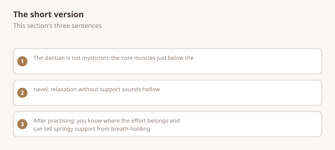
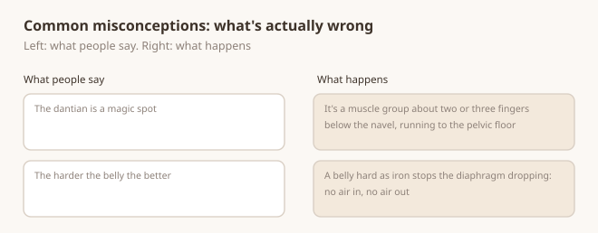
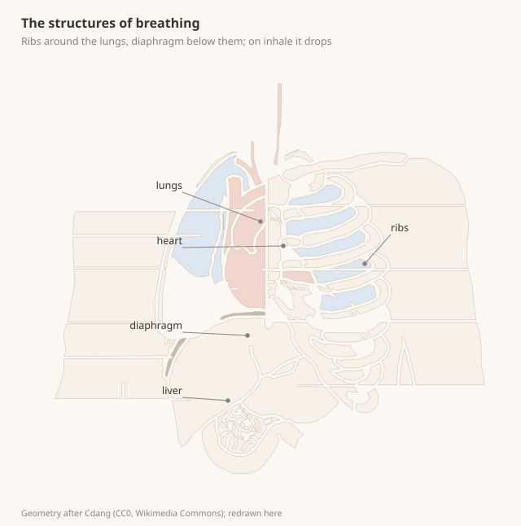
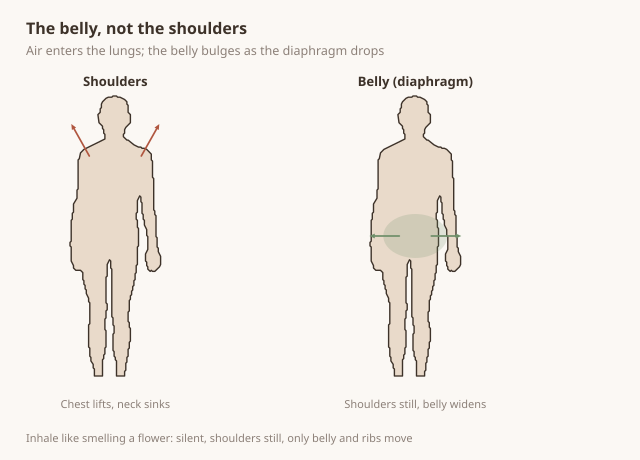
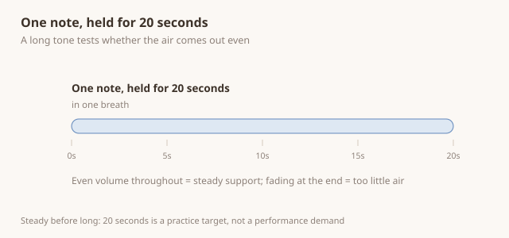
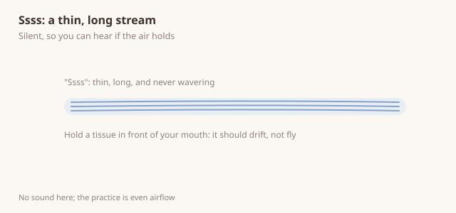
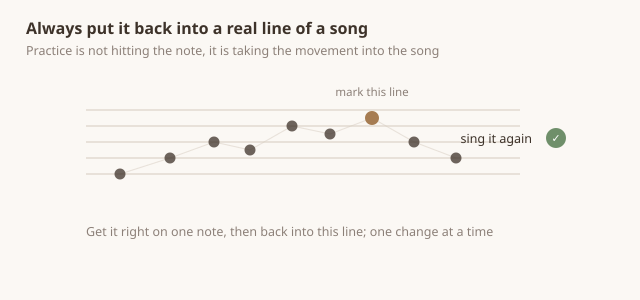
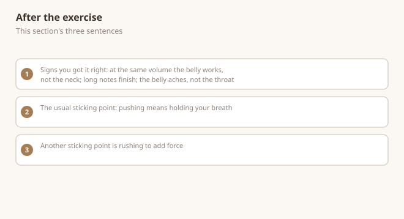

# Chapter 3: Core Support: Finding Your Dantian (Muscle Memory, Where the Effort Goes, and Daily Training)

## The short version

The dantian is not mysticism. It is the band of core muscle just below the navel, joining the lower belly to the pelvic floor. It has exactly one job: to control how fast the air comes out. When it is steady, the throat doesn't have to compensate.

Relaxation with no breath support gives a hollow sound. This chapter joins the two: upper body loose, lower belly working a little.

After the exercise you will know where the effort is supposed to come from, and you will be able to tell springy support from holding your breath.

## Common misconceptions

Many people think the dantian is a mysterious point, and that once you find it your singing improves by itself. It is a group of muscles, roughly two or three fingers below the navel, running down to the pelvic floor. It doesn't wake up on its own. You have to call it up with practice.

Another misconception is that when you need effort, the harder your belly is the better. A belly hard as an iron plate stops the diaphragm descending: the air won't go in and won't go out. Support is a continuous, adjustable pressure, not something you lock.

## How it works

On the inhale the diaphragm contracts and drops, air enters the lungs, and the lower belly is pushed outward. On the exhale the diaphragm relaxes and rises. Singing needs a slower exhale, so the lower belly and the abdominal muscles draw in gently and resist the diaphragm springing back too quickly, and the air comes out evenly. The pelvic floor relaxes on the inhale and joins in on the exhale and in support; it and the deep abdominal muscles are one action system (Emerich Gordon & Reed, 2020).

That is the dantian's job: control the speed of the air, not make the volume. Volume and pitch are decided by the vibration of the vocal folds; the lower belly only delivers the air they need, steadily. So singing loud is not pushing the belly harder. It is closure and airflow working together.

There is also an order to remember: steady airflow first, steady sound second. Add throat effort on top of the airflow and you are stepping on the accelerator and pulling the handbrake at the same time.

One last thing: support is not a standard action. A study measuring the changes in singers' trunks as they projected sound found the strategies differ quite a bit; some rely on the lower belly, some on the sides and the ribs (Thorpe et al., 2001). What you are training is steady delivery, not a copy of someone else's belly.

## An analogy

**Squeezing a water balloon.** Press steadily from the bottom and the water flows well. Pinch at the outlet and it sprays and stutters. The throat is the outlet. Where the analogy breaks: a balloon empties and stays empty, but you can top your air up mid-phrase, so you never have to squeeze it dry in one go.

**Pumping up a bicycle tyre.** The pump stroke is short and steady, one after another, not one long shove. That is what the short "ss" trains: one stroke, one inward bounce of the lower belly.

**A tyre.** Press it and there is resistance, but it hasn't turned to stone. That is how support should feel: springy, adjustable, not braced.

## Try it now

### Exercise 1: Find the spot with a cough

1. Stand tall, hands on your waist with the fingers turned inward, four fingers below the navel.
2. Relax the upper body and give two small, muffled coughs.
3. Notice the moment you cough: the muscle under the four fingers pushes outward and firms up.
4. Cough three more times and remember the spot.

What you should feel: a brief push outward in the lower belly. If you get it wrong: if you only feel the shoulders moving, make the cough smaller, more like clearing your throat, and let the body find the muscle by itself.

### Exercise 2: Blow out a distant candle

1. Hand on the lower belly, imagine a candle two metres in front of you.
2. Breathe in, purse your lips and make a "hoo—", sending the air a long way.
3. Draw the lower belly in and keep feeding the air. Don't spend it all in one go.
4. Three times, five seconds each.

What you should feel: the lower belly drawing in steadily and slowly. If you get it wrong: if the shoulders lift as you blow, or the belly snaps all the way in at once, you are pushing from the chest. Slow down. The contraction should be gradual, not used up in one bite.

### Exercise 3: The short "ss"

1. Breathe in through the nose and let the lower belly swell slightly.
2. Teeth lightly together, make a short "ss, ss, ss, ss", four at a time.
3. Each "ss" bounces the lower belly inward once.
4. Three rounds.

What you should feel: the lower belly like a pump, one bounce at a time, and the shoulders still. If you get it wrong: if the belly doesn't move at all and only the throat is hissing, turn the volume down, rest a hand on the lower belly so you can feel the bounce, and start again.

### Exercise 4: The long "ss"

1. Breathe in and make a steady "sss—".
2. Hold it for ten to fifteen seconds, with the volume and the thickness of the air unchanged.
3. Let the lower belly draw in slowly. Don't use it all up at once.
4. Three times.

What you should feel: the whole airstream is one straight line and doesn't suddenly get thin at the end. If you get it wrong: if it shakes in the second half, the air is uneven. Slow the exhale, or come down to eight seconds first. Steady matters more than long.

### Exercise 5: Join it to sound

1. With the lower belly supporting, make short "ha, ha, ha" sounds, like laughter.
2. Then one long "haa—", held up by the lower belly.
3. Check that the throat is loose.
4. Three of each.

What you should feel: the belly is working and the throat is not involved. If you get it wrong: if the "ha" scrapes out of the throat, go back to the "ss" in exercise 3, confirm you have the spot, then add sound.

## After the exercise

Signs you got it right: at the same volume, it is the belly doing the work, not the neck; you can carry a long note to the end without topping up; after singing your lower belly is a little sore and your throat is not.

The usual sticking point is holding your breath the moment you push. Hold it and the sound tightens and your face reddens. The test is simple: during the exercise, can you talk and feed air at the same time? If you can't, you are holding.

Another is rushing to add force. What support trains is steadiness, not intensity. Five minutes a day of short and long "ss" is more effective than one hard session now and then. If you finish dry and wanting to clear your throat, drink some water and rest the voice. Don't press the discomfort down by clearing it (Behlau & Oliveira, 2009).

Next chapter turns this steady airflow into a line you can control: no blasting, no breaking off, and it can swell and settle with the phrase.

## Further reading

- **Emerich Gordon, K., & Reed, O. (2020).** The Role of the Pelvic Floor in Respiration: A Multidisciplinary Literature Review. *Journal of Voice.* The role of the pelvic floor and the deep abdominal muscles in breathing, which is roughly where the "dantian" sits anatomically. PMID 30447797.
- **Thorpe, C. W., Cala, S. J., & Chapman, J. (2001).** Patterns of breath support in projection of the singing voice. *Journal of Voice.* Support is not a single action; different singers use different trunk strategies to reach the same result, so you don't have to memorise one way of using the belly. PMID 12269638.
- **Behlau, M., & Oliveira, G. (2009).** Vocal hygiene for the voice professional. *Current Opinion in Otolaryngology & Head and Neck Surgery.* Evidence-based advice on drinking water, avoiding throat clearing and scheduling voice rest, the everyday care that sits alongside support training. PMID 19342952.
