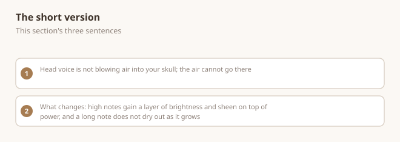
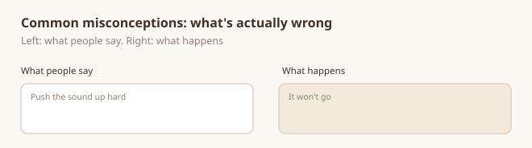
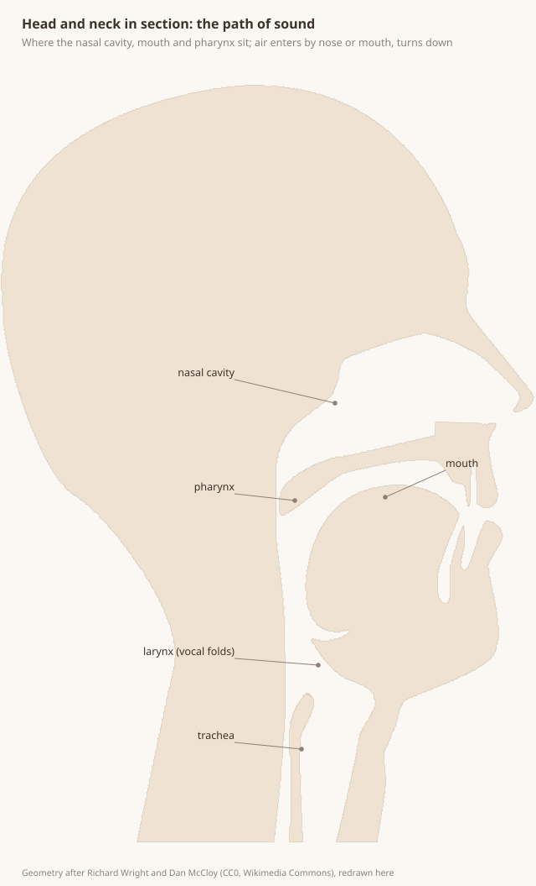
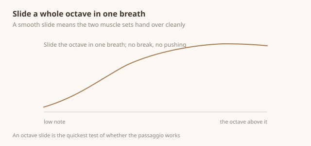
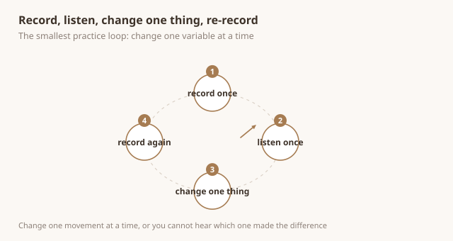
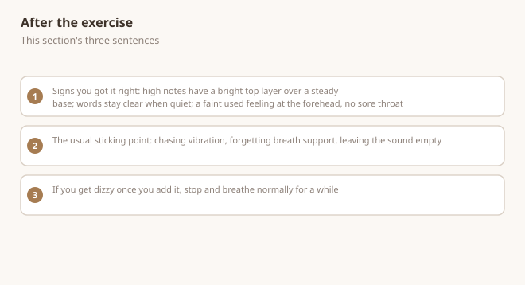

# Chapter 30: The High-Frequency End of Head Resonance: Airy, Bright, Focused Overtones

## The short version

"Head resonance" is not blowing air into your head; the air cannot get in. What you feel buzzing at the point between the eyebrows or at the bridge of the nose is a sound rich in high overtones making the bones and soft tissue of the face vibrate with it, which in turn makes the sound feel as if it sits high. This chapter has you find that vibration first, then lay it on top of a solid high note.

What changes after practice: the high note has a layer of brightness and gloss on top of its strength, and a long note does not turn dry the moment it gets big.

## Common misconceptions

Many people treat head voice and head resonance as the same thing. Head voice describes the state of the vocal folds: the cricothyroid leads, and the folds are stretched longer and thinner. Head resonance describes the sensation of the sound vibrating up high. The two usually arrive together, but they are not the same event.

Another misconception is that you have to force the sound upward. It will not go. The skull is not a hollow box like the body of an instrument and it does not amplify anything. Push upward and all you do is tighten the throat, which makes the sound come out less than before.

## How it works

The vocal folds produce a very weak sound, and as it passes through the spaces and shapes of the vocal tract some frequencies get amplified. The head area does contain a few small cavities, the nasal cavity and the sinuses, but the sinuses resonate low; they are not the main structure that amplifies high frequency. The brightness you feel is mostly high overtones carrying the facial tissue along with them. It is a passive resonance: you do not sing at it, you simply have enough overtones, good closure, and a jaw and neck that are not in the way, and the vibration shows up by itself.

Endoscopic research has looked at "head resonance" in classical singing, and the conclusion is that the change lies mainly in the shape of the vocal tract, not in sound actually running into some chamber (Aura et al., 2022). That matches another measured phenomenon: trained singers carry a cluster of concentrated energy up high, usually called the singer's formant, sitting around 2.8 to 3.2 kHz (Lee et al., 2008).

A tuning fork analogy: strike a fork and press its base against a table, and the whole table rings. Nobody blew air at the table; it was set vibrating. The voice works the same way: what is really vibrating is the column of air and the tissue, and the skull is only one part of what carries the vibration along.

This analogy fails at the most important point: a table only receives passively, while a human vocal tract changes shape with the vowel, the soft palate and the position of the larynx, actively deciding which frequencies are amplified. So the practice is not to find a way to shake the skull; it is to adjust the shape of the vocal tract so the high overtones are amplified.

One clarification while we are here: part of the "it's up in my head" feeling comes from the sensory nerves of the body, not purely from acoustics. So do not make "the more numb the better" your standard; that only makes you lift the chin and tighten the neck to manufacture the sensation. The standard should be whether the sound got brighter and the words got clearer.

## An analogy

**A tuning fork and a table.** The fork itself is quiet; pressed against the tabletop, the whole table rings. The tabletop is not a speaker, it only spreads the vibration. The tissue of your face is that table.

**The body of a violin.** The sound the strings make on their own is pitifully thin; it only becomes the volume we hear because the body vibrates with them. But the body is made of wood and has a particular shape, while the shape of the vocal tract also decides what gets amplified, except that you can adjust it.

**Speaker placement.** The same pair of speakers in a corner and in the middle of a room sound completely different. The speakers did not change; the space did. Adjusting your vowels and soft palate is moving that pair of speakers.

## Try it now

### Exercise 1: Use humming to find the placement

1. Close the lips, leave a little space between the teeth, do not bite down.
2. Hum a long "mmm" on a mid-high note for three seconds.
3. Leave some space inside the mouth, as if holding half a mouthful of water.
4. Put your attention on the bridge of the nose and the point between the eyebrows, and look for that tingling vibration.

If you get it wrong: if you cannot find it at all, move the pitch up a little first. Too low and the vibration gathers in the chest instead.

### Exercise 2: Let the vibration climb

1. Keep the "mmm" going and slide slowly upward like a siren.
2. Imagine the vibration moving from the lips and the tip of the nose up to the point between the eyebrows.
3. Give support from the lower abdomen, but do not push the throat upward.
4. Stop at the highest point, then slide back down. Three times.

If you get it wrong: if the throat tightens as you go up, you are pushing rather than letting go. Halve the volume and slide on less air.

### Exercise 3: Opened mouth, no drop

1. Find the vibration at the point between the eyebrows on a mid-high note.
2. Hold it for two seconds, then slowly push the lips forward into "oo".
3. The moment the mouth opens, notice whether the vibration falls back into the throat or the chest.
4. Narrow a little more into "ee" and the sound turns brighter and more focused.

If you get it wrong: if "ee" catches in the throat as soon as you sing it, the tongue is working too hard. Flatten the tongue and make the mouth shape smaller.

### Exercise 4: Lay it on a high note

1. Pick the high note in the chorus of a ballad.
2. Sing it in strong mix first: solid, but possibly a little dry.
3. Before you sing, make a silent surprised face, so the soft palate lifts and the throat opens.
4. Sing it again on the same support, adjusting the shape of the vocal tract to add high overtones and keeping your attention on that bright feeling between the eyebrows.

If you get it wrong: if the sound turns hollow once you add the top, you let the support go. Keep the support in the lower abdomen; up top you only opened one more space.

### Exercise 5: Record and compare

1. Record the same line twice: once without, once with.
2. Listen on headphones and ask only one question: which take has clearer words.
3. Do not ask which one is "more resonant"; that feeling is unreliable.
4. Choose the clearer take and remember its mouth shape.

If you get it wrong: if the two are nearly the same, this line probably did not need it. Not every line does.

## After the exercise

Signs you got it right: the high note has a two-layer feel, bright on top and steady underneath; singing quietly, the words are still clear; afterwards your forehead or the bridge of your nose feels slightly used, but the throat does not hurt.

The usual sticking point is chasing the vibration and forgetting the support, which leaves the sound hollow. Another is adding it to every song; add too much and the voice drifts and the diction blurs. It is a layer of gloss, not the body of the sound.

If you start to feel dizzy once you add it, stop and breathe normally. Dizziness is not resonance opening up; it is usually breath-holding or over-breathing. There is no need to make yourself short of oxygen for this kind of work.

Next is Chapter 31, which puts the four proportions — chest, pharynx, nasal cavity and head — side by side and matches them to the style. You will find that one line of lyrics can be sung in completely different colours.

## Further reading

- **Aura, M., Geneid, A., & Bjørkøy, K. (2022).** A Nasoendoscopic Study of "Head Resonance" and "Imposto" in Classical Singing. *Journal of Voice.* What is called head resonance is in fact a change in vocal tract shape, not sound reaching the skull. PMID 32513553.
- **Lee, S. H., Kwon, H. J., & Choi, H. J. (2008).** The singer's formant and speaker's ring resonance: a long-term average spectrum analysis. *Clinical and Experimental Otorhinolaryngology.* The singer's formant (a cluster of energy around 2.8–3.2 kHz) can be measured. PMID 19434279.
- **Vampola, T., Horáček, J., & Laukkanen, A. M. (2024).** Three-Dimensional Finite Element Modeling of the Singer's Formant Cluster Optimization by Epilaryngeal Tube Shaping. *Journal of Voice.* The shape of the pharynx and the epilaryngeal cavity changes how tightly high-frequency energy gathers. PMID 39218756.
- **Titze, I. R. (2006).** Voice training and therapy with a semi-occluded vocal tract: rationale and scientific underpinnings. *Journal of Speech, Language, and Hearing Research, 49*(2), 448–459. Why humming and straw phonation make the vibration easier to feel. PMID 16671856.

