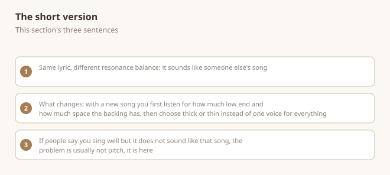
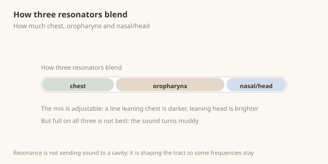
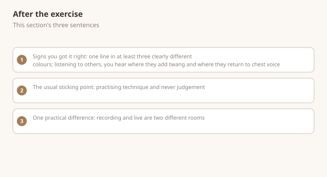

# Chapter 31: The Timbre Console: Setting the Resonance Balance for Major-Key Colour and Different Styles

## The short version

Sing the same line of lyrics with a different resonance balance and it sounds like someone else's song. Timbre is not your true face; it is a parameter you can set. This chapter treats chest, pharynx, nasal cavity and head as four knobs, and turns them where the arrangement asks.

What changes after practice: handed a new song, you first listen for how much low end there is and how big the space in the backing track is, and only then decide whether the voice should be thick or thin, instead of singing every song in the same sound.

If people often tell you "that was good, but it didn't sound much like this song", the problem is usually not your pitch. It is here.

## Common misconceptions

Many people work up one timbre they are happy with and then use it on everything. The quiet ballads come out sounding pressured, and on a busy, fast arrangement the voice smears into the track. That is not a lack of skill; it is having no idea of fit.

Another misconception is that the resonance balance has a correct answer. It does not. On the same rock song, one singer sounds clean and transparent and another sounds thick and solid, and both work, depending on how many instruments there are, how much space the mix leaves, and where you are standing as you sing. The numbers are a way of remembering, not a prescription.

One more thing to clear up: "major-key colour" here means atmosphere, not a musical mode. Major keys often sound bright and open, but a minor-key song can be sung warm and bright too. What decides the sound is not the key signature, it is the arrangement.

## How it works

The "colour" of a sound is not an abstract feeling, it is a spectrum: which frequencies are amplified and which are held back. What decides that is the shape of the vocal tract — how high the larynx sits, whether the soft palate is up or down, whether the pharynx is narrowed or released, whether the lips are round or spread. On the same pitch, change the shape and the spectrum changes its face (Vurma, 2022).

The four knobs lean toward different frequency regions:

- **Chest:** low end and thickness. The sound turns warm and close, like talking right against the microphone.
- **Pharynx:** focus and edge in the high mids. Narrowed, the energy around two to three thousand hertz gathers, and that is the band that lets a voice cut through a backing track (Lee et al., 2008).
- **Nasal cavity:** the soft palate drops slightly and adds a nasal resonance around two or three hundred hertz, which sounds sticky with a hint of sharp brightness.
- **Head:** the gloss up high. Note that this is not sound getting into the skull; it is the shape of the vocal tract making high overtones more obvious (Aura et al., 2022).

The direction of the adjustment is one sentence: add what it doesn't have, stay away from what it already has too much of. If the backing track is full of low end, adding chest only crams it further; if the track is clean with plenty of space, a voice that is too dry will sound lonely.

Order matters too: decide first how clear the diction should be, then the brightness, and only last the thickness. Once the diction blurs, no amount of later adjustment rescues it; brightness and thickness can be layered onto the same diction. Turn one knob at a time, so you can hear which one made the difference.

## An analogy

**Seasoning.** When the soup is already salty you don't add salt, you add a little acid or aroma. The low end of the backing track is the salt in that soup. It is already full and you add chest anyway, and the whole thing turns to mush; it is light and you add a little thickness, and the voice is immediately there. Back to the mechanism: you are adjusting a spectrum, and the spectrum is shared — you and the backing track are competing for the same stretch of frequency.

**Where the microphone points.** On the same guitar, a microphone near the bridge gives a bright, sharp sound; near the neck it gives a thick, warm one. The guitar has not changed and neither have the strings; what changed is which part of the vibration is captured. Your larynx height, your soft palate and the width of your pharynx are that microphone position: the sound is still yours, the emphasised frequencies are not. Where it breaks down: the microphone is not changed by the sound, while your vocal tract is, because it is both the instrument and the speaker.

**How coarse you grind the beans.** From the same beans, a coarse grind and a long steep give you body and sweetness; a fine grind and a fast pour give you brightness and aroma. The beans have not changed; which components get extracted has. The shape of your vocal tract is the grind: at the same pitch, different frequencies are amplified and the taste is different. Where it breaks down: coffee lets you choose the grind once, while your vocal tract can change it in the middle of a sentence.

## Try it now

### Exercise 1: Listen first, then decide

1. Pick three songs with a wide spread of style: a quiet ballad, a rock song with a busy arrangement, and an R&B track.
2. Listen only to the verse of each, on headphones, and listen specifically to the bass and drums. Ask two things: how much low end is there? Is there space?
3. Write two answers on paper: does this want thick or thin? Bright or dark?
4. Do not sing yet.

If you get it wrong: if you wrote the same answer for all three, you were listening to the melody, not the arrangement. Turn the overall volume down and pay attention only to the bass.

### Exercise 2: Three recipes, one line of lyrics

Take the same line of lyrics on the same pitch and do it three times:

1. **The close version:** more chest, soft palate lifted so the sound is clean, the onset a very soft breath. The aim is to sound like talking, not like singing.
2. **The cutting version:** take half the chest away, narrow the pharynx, focus the sound onto the bridge of the nose and the hard palate, and keep the words clean. A short onset, with the lower abdomen giving air quickly.
3. **The sticky version:** jaw relaxed, soft palate a little lower, vowels not too carefully articulated, the bright vowels swallowed slightly toward the back, and a touch of vocal fry at the end of the phrase.

Sing each one twice and record the second take.

What you should feel: the close version buzzes in the chest and leaves the throat loose; the cutting version has a slight tautness behind the bridge of the nose but no pain in the throat; the sticky version sounds as if it is closer to the microphone.

If you get it wrong: if the cutting version is piercing and the throat tickles, the pharynx is narrowed too far; halve the amount of focus. If the sticky version mumbles so nobody can make out the words, the soft palate is too far down; make the words clear first, then add the nasality.

### Exercise 3: Change one variable at a time

1. Record three versions of the same line on the same pitch.
2. Listen without looking at the order; play them shuffled. Ask: which one suits this song best, and why?
3. Write the reason down, for example "the track is busy, so it needs to sit forward".

If you get it wrong: if all three sound much the same, the knobs did not really turn. Sing each one in its most exaggerated form first, to make sure you can hear the difference, then pull back to a reasonable amount.

## After the exercise

Signs you got it right: on one sentence you can produce at least three clearly different colours; listening to other people's songs, you start to hear which section they added pharynx to and which section they took back to chest.

The usual sticking point is practising technique and never practising judgement. Technique is the material; judgement is the production. Another is imitating a particular singer too soon: imitating is fine to start with, but you have to hear why they sing that way — which layer of the arrangement they are cutting through, or whether they want the words to sound closer. Stick a timbre on like a sticker and it won't fit the next song.

One practical difference: the studio and a live show are two different environments. In the studio you can fix things track by track; live you get one chance, and the monitors lie to you. Practise the three recipes at home until you can switch without thinking, so that on stage you have room to spare.

Next is Chapter 32: twang. It is exactly the knob behind this chapter's "cutting version", and pulled out and trained on its own it becomes steadier and cheaper in effort.

## Further reading

- **Aura, M., Geneid, A., & Bjørkøy, K. (2022).** A Nasoendoscopic Study of "Head Resonance" and "Imposto" in Classical Singing. *Journal of Voice.* The endoscope shows that "head resonance" and imposto in classical singing are changes of vocal tract shape, not sound running into the skull. PMID 32513553.
- **Lee, S. H., Kwon, H. J., & Choi, H. J. (2008).** The singer's formant and speaker's ring resonance: a long-term average spectrum analysis. *Clinical and Experimental Otorhinolaryngology.* The singer's formant, a cluster of energy around 2.8–3.2 kHz, can be measured with a long-term average spectrum. PMID 19434279.
- **Vurma, A. (2022).** Amplitude Effects of Vocal Tract Resonance Adjustments When Singing Louder. *Journal of Voice.* When the volume changes, adjusting vocal tract resonance is a measurable action, not just a feeling of brightness. PMID 32624371.
- **Sundberg, J., & Thalén, M. (2015).** Respiratory and Acoustical Differences Between Belt and Neutral Style of Singing. *Journal of Voice.* On the same phrase, belt and neutral singing differ in air pressure, sound pressure and formant strategy; timbre is a whole set of parameters, not one switch. PMID 25819162.

