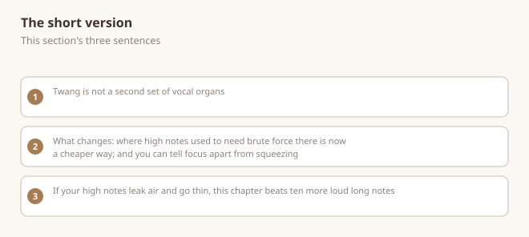
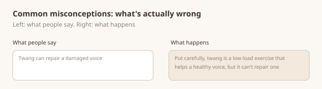
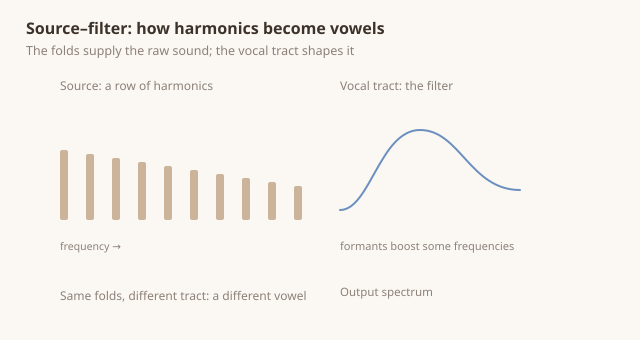
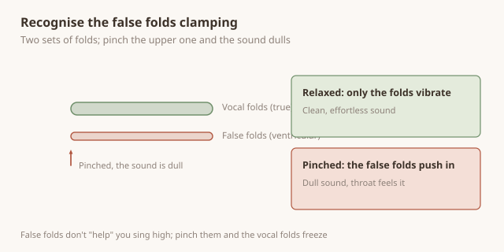
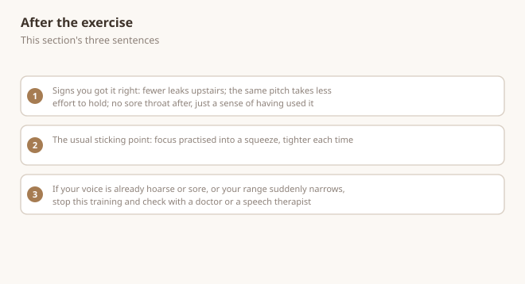

# Chapter 32: A First Look at Twang: An Advanced Training Method for Stronger Vocal Fold Phonation

## The short version

Twang is not a second set of vocal organs. Its core is one action: narrow the pharynx above the larynx so the sound turns flat and focused. It is a practice tool, not the sound you take on stage.

What changes after practice: places where a high note used to need sheer force can be done in a cheaper way, and you can tell focus apart from squeezing.

If your high notes leak air and come out hollow, this chapter will do more for you than ten more loud long tones.

## Common misconceptions

Many people try twang for the first time and think, "how could a sound this ugly ever be singing". Sounding ugly while you practise is normal. It is like holding a horse stance: you never take it on stage, but it makes you steady once you are there. When you actually sing, you dilute that focus into the vowel; you do not quack through a whole song.

Another misconception is that twang can repair damaged vocal folds. Put conservatively: narrowing the pharynx so the sound focuses is a phonation exercise with a lower load, and it helps healthy vocal folds. But if you have been hoarse for more than two weeks, if singing hurts, or if your range has suddenly narrowed, that is not a problem with your practice method; it is time to see an ENT specialist or a speech therapist. Practice cannot replace a diagnosis.

One more confusion to unpack: taking focus for squeeze. Focus is a shape narrowing; squeeze is more force. The first leaves the throat loose afterwards, the second leaves it scratchy.

## How it works

There is only one core action: the pharyngeal constrictors and the aryepiglottic muscles narrow the pharynx above the larynx, and the vocal tract becomes a small funnel. As the sound passes through, the low mids are held back and the high frequency around two to three thousand hertz is emphasised, so it sounds flat, bright and focused (Vampola et al., 2024). That also explains how a professional singer's voice cuts through an orchestra: not louder, but with more concentrated energy in that band.

Why does it help closure? When the sound is required to be focused and not to leak, the edges of the vocal folds sit closer together, and that closure does not have to be bought by adding thickness. What you get is thin and bright, but not heavy. That is exactly the half a high note needs.

There is another layer: a narrow vocal tract is itself a resistance. With resistance behind the mouth, the vocal folds can vibrate at lower pressure (Titze, 2006). Measured with resonance tubes and straws, a narrow tube really does change how the glottis works (Guzman et al., 2013). So the feeling after twang practice that "the voice suddenly became easier" is not an illusion; the load really did drop.

The boundary needs stating too: this exercise does not teach you to "sing with the false vocal folds". The false folds are there to protect, not to phonate. What you want is for them to move aside and not press down, and then to do the closure with the edges of the true folds. The flat sound comes from the shape of the vocal tract, not from the false folds ringing.

One last risk: narrowing the pharynx easily brings the neck in as well. The louder and the higher you sing, the more obvious the compensation in neck and shoulders (Pettersen et al., 2005). So keep the practice volume small, small enough that you do not need to borrow force from the neck.

## An analogy

**Pinching a hose.** A garden hose has a fixed bore; squash the outlet with your fingers and the water shoots further and tighter, but you have not added a booster pump, the pump is the same one as before. Narrowing the pharynx is squashing the outlet: the vocal folds have not got stronger, the energy has been gathered. Where it breaks down: you can hold a hose squeezed all day, while a narrowed pharynx starts to ache, so practise in short bursts and let go at the end.

**Switching a torch to spot.** On the same bulb, the flood setting lights up a whole wall and the spot setting lights only a small patch, but that patch is bright. You did not change the bulb, and when you sing you want that patch, not the whole wall.

**Holding a horse stance.** Nobody goes on stage in a horse stance, but everyone who trains martial arts holds one. What it trains is being steady in an awkward position. Twang is the horse stance of the voice: you never use the posture itself, but it demands that you not leak air and not squeeze inside a narrow shape.

## Try it now

### Exercise 1: First confirm that focus is not squeeze

1. Breathe in, then close the door of the throat as if you were holding your breath.
2. Without letting go, squeeze a short "nyeh" straight out of that spot.
3. The sound should be flat, bright and stuck behind the bridge of the nose.
4. Pinch your nose and try again; the sound should not suddenly turn dull.

What you should feel: a slight tautness behind the bridge of the nose, with no pain in the throat itself. If you get it wrong: a scratchy throat, a cough, a husky sound — that is squeezing, not focus. Stop and do two minutes of lip trill (Chapter 11) to let the throat loosen again.

### Exercise 2: A short "nyeh"

1. Fire off short, bouncing "nyeh, nyeh, nyeh", the way you shoo a cat.
2. Make each one shorter than the last.
3. Check each one for a hiss of leaking air.
4. Do ten, rest thirty seconds, do ten more. No more than three sets in total.

What you should feel: the sound is like small pebbles thrown onto hard ground. If you get it wrong: getting tighter and tighter is fatigue, not progress. Stopping at five is better than forcing ten.

### Exercise 3: Slide across the passaggio

1. Start on "nyeh" at a low-to-mid note.
2. Slide upward like a siren, keeping it flat and focused the whole way.
3. Near the passaggio, steady the lower abdomen and add nothing to the throat.
4. Stop on the high note, then slide back down. Three times.

If you get it wrong: if the sound suddenly thickens and turns heavy halfway up, "nyeh" has fallen back into a vowel; make the mouth shape smaller. If the air runs out at the top, the support went; narrow the interval and slide only a fifth.

### Exercise 4: Dilute the focus back into a vowel

1. Choose a mid-high note you tend to sing hollow.
2. Sing "nyeh" on it for two seconds and remember that focused core.
3. At the same pitch, slowly open the mouth into "nah" or "ah".
4. Keep that little bit of focus in the throat as you open, like a fine needle left inside something soft.

What you should feel: the sound widens from thin, but the line down the middle does not break. If you get it wrong: if it scatters the moment you open, the whole focus dropped. Halve the mouth shape and start again, or practise only as far as "nah" and do not jump straight to "ah".

Spend at least half of every practice session on this one, or you will build a set of skills you cannot use when you sing.

## After the exercise

Signs you got it right: the high notes leak less; on the same pitch you can hold it with less effort; afterwards the throat does not hurt, it only feels used.

The usual sticking point is training focus into squeeze and getting tighter and tighter. The test is simple: afterwards, do you keep wanting to clear your throat? If you do, you did it wrong. The second is practising only the ugly version and never the dilution, so the exercise feels great and the singing gets nothing.

If your voice is already hoarse or painful, or your range has suddenly narrowed, stop this kind of training for now and see a doctor or a speech therapist. Practice is for healthy vocal folds.

Next, go back and look at Chapters 25 to 27. The closure twang trains is exactly the "light but not hollow" half of mixed voice.

## Further reading

- **Vampola, T., Horáček, J., & Laukkanen, A. M. (2024).** Three-Dimensional Finite Element Modeling of the Singer's Formant Cluster Optimization by Epilaryngeal Tube Shaping. *Journal of Voice.* A small epilaryngeal cavity concentrates the singer's formant cluster; the shape of the pharynx changes the high-frequency output directly. PMID 39218756.
- **Titze, I. R. (2006).** Voice training and therapy with a semi-occluded vocal tract: rationale and scientific underpinnings. *Journal of Speech, Language, and Hearing Research, 49*(2), 448–459. A narrowed vocal tract and its resistance directly affect the pressure the vocal folds need in order to vibrate. PMID 16671856.
- **Guzman, M., Laukkanen, A. M., & Krupa, P. (2013).** Vocal tract and glottal function during and after vocal exercising with resonance tube and straw. *Journal of Voice.* Phonating through resonance tubes and straws changes vocal tract and glottal function, and the change after the exercise has been measured too. PMID 23683806.
- **Pettersen, V., Bjørkøy, K., & Torp, H. (2005).** Neck and shoulder muscle activity and thorax movement in singing and speaking tasks with variation in vocal loudness and pitch. *Journal of Voice.* The louder and the higher you sing, the more readily the neck and shoulder muscles compensate; that is also the first signal that focus has turned into squeeze. PMID 16301107.

